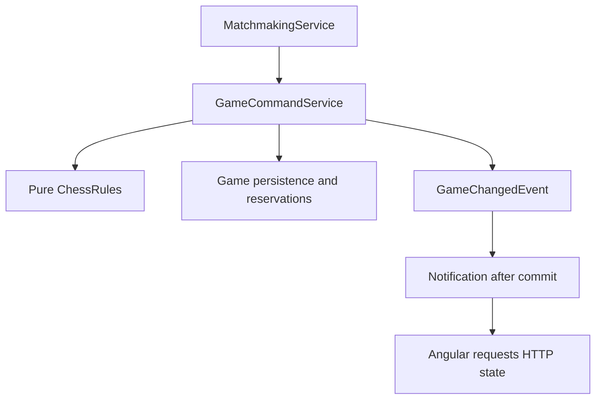

# Architecture

This document describes the Day 28 gameplay baseline plus Day 29 setup/readability changes, inspected on 6 November 2026 against actual user chess-web-app-day29-mid.zip. See [load testing](load-testing.md) for measurements and their limits. See [review](day28-ui-review.md) and [handoff](day28-handoff.md). No assistant application execution. Previous main-document text is preserved in [history](history/main-documents-through-day27.md). Session/WebSocket and tab companions retain their detailed Day 27 behavior.

## Application structure

One Spring Boot application, organized by feature with conventional controller/service/DTO/entity/repository layers. Keep `Player` terminology. This is a modular monolith, not DDD or a collection of microservices. Cross-feature operations use services or application events rather than another feature’s repositories.

| Feature | Responsibility |
| --- | --- |
| auth | Registration, local credentials and login orchestration |
| player | Player creation/lookup, self-profile, username updates, statistics and Elo completion reaction |
| security | HTTP session security, password encoding, CSRF and cookie settings |
| matchmaking | Persistent queue, eligibility and transactional pairing |
| game | Game creation/read/move commands, reservations, lifecycle, immutable rules and game events |
| notification | WebSocket configuration/security, private outbound notifications and session access tracking |
| common | Shared timestamps and validation/error infrastructure |

Controllers translate transport input. Services own authorization, use-case orchestration and transactions. Repositories stay within their feature. Concrete services and explicit record mappings remain sufficient; mapper frameworks and additional service interfaces are unnecessary without a concrete need.

## Authentication and profile

Transactional registration creates a Player through PlayerService and stores encoded credentials in auth. Scalar Player IDs avoid cross-feature entity coupling. PostgreSQL uniqueness constraints remain authoritative when availability checks race.

Login validates credentials, changes an existing session ID and resets CSRF, then explicitly saves a SecurityContext with a canonical Player-ID String principal. Spring Session JDBC stores it in PostgreSQL. Login returns PlayerResponse; JWT classes/starter/settings are removed. V14 creates framework session tables. Cookie settings are explicitly bound by SessionCookieConfig; TimeConfig now owns Clock.

The browser manages an HttpOnly session cookie; Angular stores only profile/revision and restores them at startup through csrf then players/me. Built-in XSRF handling supplies headers for relative API writes. Protected 401 clears a matching captured revision; 403 does not invalidate authentication. Login/register failure retains passwords. Profile edits keep stable Player identity. Broadcast hints trigger receiver clear/navigation/restore, as detailed in the tab companion. Exact, case-sensitive credential matching remains.

## Persistence and transactions

PostgreSQL is durable storage. Applied Flyway migrations are immutable; future schema changes use new migrations. Hibernate validates rather than generates the schema; Open EntityManager in View is disabled.

| Migration | Responsibility |
| --- | --- |
| V1 | Players |
| V2 | Local credentials |
| V3 | Matchmaking queue and ordering index |
| V4 | Games, participants, FEN and optimistic version |
| V5 | Active-player reservations and initial backfill |
| V6 | Completion fields and lifecycle consistency constraints |
| V7 | History baseline/completeness/count and ordered move records |
| V8 | Nullable SAN for pre-SAN records; new application records require SAN |
| V9 | Completion constraint permits resignation with a winner |
| V10 | Pending participant offer on active games; completion permits draw agreement |
| V11 | Player statistics and per-game processing/exclusion markers |
| V12 | Nullable game clocks; active/frozen/untimed shape constraint |
| V13 | TIMEOUT with a winning outcome |
| V14 | Spring Session JDBC session and attribute tables |
| V15 | Nullable immutable starting usernames/ratings for both participants |

BaseEntity timestamps use JPA callbacks. SQL defaults support non-JPA insertion; direct SQL updates do not automatically advance `updated_at`. Identity sequences need not rewind after rollback.

Queue operations acquire the same PostgreSQL transaction-level advisory lock. This serializes cooperating operations on the single queue, including status reads. Repeated join preserves enqueue time through an upsert. Pairing selects the oldest eligible entries, assigns colors, invokes GameCommandService and removes both queue entries in one transaction.

GameCommandService flushes game creation before inserting JDBC reservations that reference it. JPA and JdbcTemplate share the datasource and transaction. The reservation table’s Player primary key enforces one active game across either color. Incomplete reservation or release counts fail the transaction. Leaving the waiting queue does not cancel an established game.

## Pure chess rules

`game.rules` contains no Spring, JPA, HTTP or notification concerns. Immutable Piece/Square/Move records, Board and ChessPosition represent placement and metadata. Board currently uses map storage and identity equality; tests compare board contents or FEN rather than assuming value equality for Board.

| ChessRules operation | Responsibility |
| --- | --- |
| initialPosition() | Standard starting position |
| legalMoves(position) | Complete immutable set for the side to move |
| applyMove(position, move) | Exact legal-set membership, then shared application |
| evaluate(position) | NORMAL, CHECK, CHECKMATE or STALEMATE |

GameRulesConfig constructs the six pseudo-legal strategies, dispatcher, shared applier, attack detector, legal filter and evaluator. Sliding pieces share ray traversal. Attack detection includes pinned attackers; generated moves exclude king captures. Legal filtering checks the moving king on the resulting board. Castling additionally checks the original and transit positions.

FenParser validates structural representation, not historical reachability. FenSerializer is separate. Promotion choices are explicit; there is no automatic queen. En passant and castling use the shared immutable application pipeline. Rights are historical metadata and are never restored by returning a piece or promoting a rook.

The facade does not own authorization, persistence, version checks or transactions. FEN alone cannot establish repetition history. See the [movement pipeline companion](movement-pipeline-architecture.md).

## Game commands and lifecycle

Both participants may read a game, including after completion. Commands derive the acting Player from the authenticated session principal, never from request-supplied identity.

For a well-formed move command, GameCommandService checks existence, membership, lifecycle, expected version, clock expiry, turn and legal membership. It applies and evaluates the move through ChessRules before mutating the managed game. SAN is formatted from the original position, accepted move, complete legal set and resulting assessment before managed state changes. The recorded sequence advances on the versioned Game row. Flush advances the optimistic version and detects competing writes before history insertion. A losing optimistic update becomes STALE_GAME_VERSION.

Checkmate sets the mover’s winning result; stalemate sets DRAW. Position, recorded count, move record including SAN, result/reason/time and deletion of both reservations commit or roll back together. The move and any completion share a Clock-derived timestamp truncated to microseconds. History is explicitly flushed before reservation release and event publication. Flush is not commit. Version is a concurrency token, not a separately defined move number.

## Internal events and real-time delivery

GameCommandService publishes immutable GameChangedEvent values after creation/reservation success or after game/history flush and any reservation release succeed. They carry game/participant IDs, version and GAME_CREATED/GAME_UPDATED. The game feature imports no WebSocket transport.

GameNotificationListener runs AFTER_COMMIT and sends a small PlayerUpdate to both participant user destinations. During matchmaking it waits for the outer pairing transaction, including queue removal. A rollback produces no notification. Terminal moves use GAME_UPDATED; HTTP GET supplies the result.

Sending is best-effort. Each recipient attempt catches runtime send failures so the other recipient is still attempted and a committed command is not reported as a delivery failure. There is no outbox, durable replay, acknowledgement guarantee or external broker. No database writes occur in the listener.

## WebSocket security

HTTP upgrade requires session authentication and the configured Origin. SessionHandshakeInterceptor copies the existing session ID, Player name and raw CSRF cookie. CONNECT requires one matching X-XSRF-TOKEN native header and inherited authenticated identity; WebSocketSessionAccess rechecks the stored session before registering the socket binding. The expected CSRF attribute and native credential headers are removed after acceptance.

Only the exact private subscription is allowed; raw broker paths, other-Player paths, wildcards and SEND are rejected. Inbound operations and outgoing application MESSAGEs check the exact bound HTTP session, stored SecurityContext and Player identity. Outbound checks happen before enqueue and handler; protocol/heartbeat output bypasses that application-message filter. Disconnect removes bindings idempotently.

JDBC session reads do not extend activity. Each outgoing application message can incur two session reads. There is no proactive physical socket closure on session invalidation, no JDBC destruction-event dependency and no recall of transmitted messages. The local simple broker/map remain single-instance. See [authentication diagram](session-authentication-flow.md#websocket-authentication-in-detail).

## Angular orchestration

App instantiates RealtimeService and SessionSyncService independently of route navigation after startup restoration. It recreates private subscriptions after reconnecting, ignores stale-session callbacks, validates incoming update shape and exposes signals/observables. STOMP errors mark live delivery unavailable; HTTP still determines session validity.

Home embeds MatchmakingPanel. It reads status on entry, notifications, connections and periodic recovery; pending reads coalesce during requests. Home auto-resumes an existing game. Finished-game review offers Return to current game instead of redirecting on initial discovery, while a started/observed waiting search follows the resulting match. Find another match joins immediately. Commands reconcile through GET and are not automatically repeated.

Game owns authoritative snapshots, promotion, commands and recovery. Route switchMap cancels old-route reads; exhaustMap permits one GET at a time. Notifications received during GET/POST coalesce into a pending read. A safety GET may be cancelled before a move POST starts. Unchanged versions preserve snapshot identity and promotion; older responses cannot replace newer state. Known-newer notifications block proposals until reconciliation. There is no automatic command retry.

ChessBoard owns rendering/orientation/selection and emits coordinates. Its selection-reset effect observes FEN, orientation and enabled inputs. It clears selection before emitting, so cancelling promotion leaves no stale source. Home, Game and ChessBoard use separate HTML/CSS files.

## Configuration and deployment boundary

`app.websocket` binds to WebSocketProperties with constructor validation. Endpoint registration, subscription authorization and sending consume this shared object; the HTTP endpoint is protected by the general authenticated-request rule. Destination paths are derived from prefixes plus updates-path. The configured heartbeat range is 1–300 seconds. A lazily injected broker scheduler enables heartbeats.

Angular’s REALTIME_CONFIG contains matching routing addresses and its own timing settings. Backend YAML is not automatically published to the browser. Development proxying includes WebSocket upgrades. Configuration/secrets remain user-managed.

The simple broker and session registry are in-process. Current delivery assumes a single application instance. Multi-instance notification routing requires a separate design, even though database concurrency guards continue to protect shared state.

## Deferred scope

The PGN download UI, pre-SAN backfill, clock extensions, extra rule-based draws, acceptance, abandonment/disconnect completion, rating extensions remain separate choices; session continuity is implemented in Day 27. Replay and backend PGN export are implemented. Promotion chooser legality gating is intentionally deferred. Custom board polish/library integration is optional. Closing a page does not finish a game. See [roadmap](roadmap.md) and the two flow companions for details.

## Persisted history and SAN

Game owns immutable historyStartFen/historyComplete metadata and a mutable recordedMoveCount. V7 copies existing currentFen into the baseline and marks all existing games incomplete, conservatively including games whose earlier moves are unknown. New games set their supplied initial FEN as the baseline and historyComplete=true. This means history since creation, not game completion. Counts begin at zero and sequence numbers begin at one relative to that baseline; neither is defined as the JPA version or FEN fullmove number.

GameMove uses scalar game/Player IDs and stores source/destination, optional promotion, resulting FEN, playedAt and SAN. No application update operations are exposed. The database unique constraint on (game_id, sequence_number) protects ordering uniqueness and supplies its index. Membership, legal chess behavior and count/row consistency remain application responsibilities rather than cross-row database checks.

getHistory authorizes membership before reading records through the captured recordedMoveCount. Later committed entries are excluded by the query bound. Consistency relies on atomic append-only writes and stable history metadata; this is not a general-purpose repeatable-read transaction or a concurrent-reader integration test claim. No history write belongs in an after-commit listener.

SanFormatter is pure Java. It consumes the original position, accepted move, complete legal set and resulting assessment. It produces English SAN with captures, O-O/O-O-O, = promotion, legal-source disambiguation and +/# suffixes. It does not replace the legality facade. V8 preserves null SAN for pre-SAN entries; no backfill is supplied.

Angular reads the board, then history, within the same coordinated read operation. Matching versions accept history; older history is ignored; newer history queues board synchronization. An older accepted list may remain visible while catching up, but a newer list is not shown ahead of the board. History failures have separate feedback and do not independently disable moves. Accepted POSTs explicitly queue reconciliation so the sender's list catches up even when its notification is already obsolete. See [history flow](move-history-flow.md).

## Day 22 explicit lifecycle commands

GameCommandService owns resign, offerDraw, acceptDraw, declineDraw and withdrawDraw. Public methods own transactions. loadActiveGameForCommand performs existence, participant, active lifecycle and expected-version checks in that order. requireDrawOfferActor checks offer presence and sender/recipient roles. These application commands do not evaluate pure chess rules.

persistLifecycleChange flushes the optimistic game update, releases exactly two reservations if finished, publishes GAME_UPDATED and maps GameResponse. It does not commit. An enclosing failure restores completion, pending offer and reservations and suppresses AFTER_COMMIT delivery. A concurrent move or lifecycle command may win; another write based on the same loaded version must fail. Private helpers do not create transaction boundaries.

Game.drawOfferedByPlayerId stores one nullable participant ID. Entity guards and ck_games_draw_offer prevent nonparticipant or finished-game offers. finish validates outcome before clearing negotiation; updatePosition clears an offer only after validating its input. Service-rejected moves never mutate the entity. V10 allows DRAW only for STALEMATE/DRAW_AGREEMENT and winning results only for CHECKMATE/RESIGNATION. Applied migrations remain immutable.

Lifecycle-only mutations leave FEN, baseline and recorded count unchanged and insert no GameMove. Version therefore advances independently of move count. GameResponse includes pending offer ownership; GameMoveResult is unchanged. History is a move log, not an audit of negotiations.

Angular executeGameCommand coordinates all POST types through one submission lock and shared recovery. General command permission is independent of turn; move permission adds turn checks. Promotion must be resolved before lifecycle actions. Inline confirmation is required for resignation/acceptance. Known-newer snapshots clear confirmations even when FEN did not change. Accepted lifecycle responses trigger board/history reconciliation because captured history versions advance too. See [lifecycle flow](game-lifecycle-flow.md).

## Day 23 verification boundaries

WebSocketPropertiesTest uses an isolated binding context. WebSocketIntegrationTest starts the real server on a random port and uses actual STOMP clients, real HTTP login/session cookies and CSRF, simple broker, listener and database transactions. A private probe establishes subscription readiness before application assertions. Resignation delivery waits for outer commit, reaches both participants and excludes an independently ready outsider. Rollback preserves active state and reservations and produces no update during the bounded observation windows.

GameMigrationIntegrationTest applies the real migrations to uniquely named PostgreSQL schemas. It tests V6-to-V10 legacy metadata and V7/V8/V9/V10 history/resignation continuity. It does not run JPA services against intermediate schemas or prove every deployment upgrade path. The current source filename is GameMigrationIntegrationTest.java; no naming cleanup remains.

These tests do not introduce delivery guarantees, heartbeat/reconnection socket coverage or a frontend coordinator suite. The user reports passing tests; no assistant execution is claimed. See [review](day23-reliability-review.md).

## Day 24 replay and export

GameExportService owns the participant-protected PGN read transaction. It loads the game, authorizes before exposing export availability, captures GameResponse and recordedMoveCount, then reads immutable move rows through that count. Player usernames come through PlayerService, never another feature's repository. Names are current at export time, not historical snapshots; they are not guaranteed to reflect one simultaneous cross-Player read.

PgnFormatter lives in game.export, outside the pure rules engine. It consumes captured DTOs and the existing FenParser. It requires matching game IDs/versions, complete history, an exact row count, contiguous sequences and nonblank SAN. It formats persisted SAN without replaying or revalidating chess moves. Baseline side/fullmove number determines numbering; lifecycle versions do not. Current result and captured move boundary remain consistent under existing atomic append-only writes, without asserting general repeatable-read isolation or an explicitly tested concurrent-export schedule.

The controller emits UTF-8 bytes, application/x-chess-pgn, an attachment filename based on game ID and Cache-Control: no-store. Authentication and access use session security and feature errors; unsupported history returns 409 PGN_EXPORT_UNAVAILABLE. No export button or Blob client method is included in Angular by user decision.

Game.replayIndex is a local display cursor: null follows game.currentFen; zero selects historyStartFen; a positive value selects a move's resultingFen. replayHistory checks game identity, version not ahead, row count and sequence continuity. An older accepted list remains usable during reconciliation. displayedFen drives both board and FEN details, while live status/offer/result remain sourced from game(). Numeric replay selection disables the shared command permission, including at the last recorded entry. Only Latest resumes live following; Next does not automatically do so.

Replay navigation clears pending promotion/confirmation, is blocked during POST, preserves its cursor across live updates and resets on route initialization or history-clearing 403/404 responses. ChessBoard's existing FEN/enabled effect clears selection. No new board component, rules engine, migration or frontend test suite was introduced. See [replay/export flow](replay-pgn-flow.md).

## Day 25 Player statistics and transaction ownership

PlayerStatistics is a separate player-owned entity keyed by scalar playerId, with a database foreign key, rating, wins/draws/losses and optimistic version. gamesPlayed is derived. PlayerService.createPlayer is transactional and flushes the Player before saving statistics; AuthService registration provides the enclosing credentials transaction. V11 initializes existing Players at 1200 with zero counts. It marks already FINISHED games excluded (statistics_applied=false); existing active games remain eligible.

GameCommandService publishes GameFinishedEvent after a terminal move's history flush or a lifecycle game flush and after exact reservation release. The player.event.PlayerStatisticsGameFinishedEventListener is a regular synchronous @EventListener. It maps the game result and calls PlayerStatisticsService.recordFinishedGame with MANDATORY propagation. No @Async/custom asynchronous multicaster is introduced. Rating failure propagates and rolls back the game, history, reservations, marker and both statistics. A later outer failure rolls them back too. GameChangedEvent is published afterward; notification delivery remains AFTER_COMMIT and best-effort.

PlayerStatisticsRepository owns both the JPA entity operations and native insertFinishedGameClaim, wrapped by default boolean claimFinishedGame. ON CONFLICT DO NOTHING uses the game primary key to reject repeated/excluded processing. Successful claims are transactional, not durable work queues. The service then locks statistics by ascending Player ID with PESSIMISTIC_WRITE, maps back to colors, calculates from both old ratings, updates and flushes. The event is a trusted internal contract; the consumer does not reload/verify game membership/result through another feature's repository.

EloCalculator is pure Java in player.rating: initial 1200, K=32, scale 400, actual scores 1/0.5/0. One Math.round adjustment is applied oppositely to conserve the pair's total. There is no floor, provisional policy, time-control separation, backfill or rating audit ledger. Overflow checks fail rather than wrap. The /players/me/statistics read uses ordinary findById, checks account existence and maps a DTO. No rating-write lock is needed for display. The statistics profile contract is unchanged; Day 27 independently replaces transport authentication with sessions.

Home embeds PlayerStatistics with separate TS/HTML/CSS. Initial/manual/live-hint/reconnect triggers switch to a fresh GET, guarded by captured session revision/Player ID. Inner tap updates signals; inner catchError returns EMPTY so later triggers remain active. Inner finalize handles completion/error/cancellation; downstream takeUntilDestroyed tears down active GETs. No polling, focus retry or new frontend test suite is added for this card. See [statistics flow](player-statistics-flow.md).

## Day 26 clocks and timeout extension

Game clock state and TIMEOUT are implemented. New games start White at configured 10m/no increment before commit/opening; old games remain untimed. Expired commands return GAME_CLOCK_EXPIRED; a separate scanAndExpireGames worker calls transactional expireGame, rechecks current state and completes at the stored deadline. Version conflicts arbitrate competing writes. Timeout uses existing reservation release, GameFinishedEvent synchronous statistics and AFTER_COMMIT best-effort hints. Rating failure rolls back frozen clocks and completion together. Timeout adds no move row; draw offers never pause clocks.

Both response DTOs append projected clock with calculatedAt; read timestamps are not persisted completion events. Timeout currently always awards opponent win; the possible-mate draw exception is deferred. Disconnect/logout does not itself complete a game, but a timed game continues and can later expire. This scheduled worker does not make statistics asynchronous or introduce an outbox.

See [clock flow and pseudocode](game-clocks-flow.md) for timing, configuration, transaction boundaries and remaining limits.

## Session integration and tab coordination

Spring Boot supplies the session filter/repository through its JDBC session starter. The schema has no cross-feature Player entity relation; authentication uses a scalar identity in serialized SecurityContext. Session persistence uses its own framework transactions and is not part of a game completion transaction. Production cleanup runs every minute; fixture tests disable it. Cookie age and inactivity expiry are distinct. CSRF reset clears the browser cookie, not a server-side revocation list.

SessionSyncService consumes only hints and rechecks the backend. It resets revision/profile before navigation, guards against a newer local operation, then restores with another revision and opens Home on success. It does not replay commands or lock all tab mutations. See the detailed [tab flow](tab-synchronization-flow.md).

## Day 28 read services and presentation boundaries

GameQueryService owns getGame, getHistory, getLegalMoves, getPlayedGames and findActiveGameId. GameCommandService owns creation, moves, negotiations, resignation and timeout mutation. GameExportService retains export. Read transactions use REQUIRED propagation and join an outer matchmaking transaction; this service split does not introduce a separate database or transaction mechanism.

GameQueryService maps all legal commands for the side to move to versioned hints, including promotion choices and en-passant capture flags. Angular caches one accepted hint set per game version/authentication/route scope, retries only the read on request and filters selected origins locally. Hints do not authorize commands or prevent timeout races. Explicit illegal-move rejection briefly distinguishes source and destination; other failures retain their existing recovery behavior.

New games capture both Players' usernames/ratings through PlayerService and store immutable V15 fields before saving. Legacy rows keep an entirely null snapshot. Completion changes current statistics without rewriting match-start display values. This is distinct from PGN's existing current-name policy.

The self-only finished-games controller supplies the authenticated subject to GameQueryService. Slice pagination filters in SQL and maps saved scalar fields without per-opponent reads. Future public history needs its own authorization policy, including access to individual game details.

GameClocks projects the Game-declared ChessBoard between shared clockRow templates. MoveHistoryReplay owns notation display and emits replay events; Game retains cursor, permissions, commands and reconciliation. Game actions and confirmations remain local markup; activity is feedback/future chat. See the component ownership diagram in the Day 28 review. The current source applies the closing cleanup: Game.moveTokens is removed and initialization streams use named setup methods. Legal-hint setup remains called synchronously from the constructor. The external gameActions fragment receives current explicitly through NgTemplateOutletContext; it does not create another state owner. The companion guide retains its earlier proposal wording.

## Day 29 load-testing boundary

The loadtest profile selects port 8081, a separate chess_loadtest database and non-Secure cookies for local HTTP; ordinary credentials, schema migration and session/clock settings are inherited. TypeScript k6 scripts live outside Angular in load-tests/, with their own package/lockfile, strict noEmit compiler configuration and npm entry points. Type checking is separate from k6 execution. No application API or notification transport change is introduced by this workload.

Smoke covers the real registration/login/CSRF/profile/statistics/logout flow. The statistics baseline registers distinct Players/sessions in sequential setup, then uses constant concurrent VUs with sequential reads and one-second think time per VU. Custom metrics exclude setup, warm-up and teardown. These reads do not exercise rules or full gameplay. Source/result provenance and limits are in [load testing](load-testing.md).

ChessBackendApplication excludes UserDetailsServiceAutoConfiguration, removing the unused generated in-memory user. AuthService/LoginService still perform the custom authentication and explicit context persistence; SecurityFilterChain, session cookies, CSRF and socket checks remain configured. No replacement authentication architecture is introduced.
