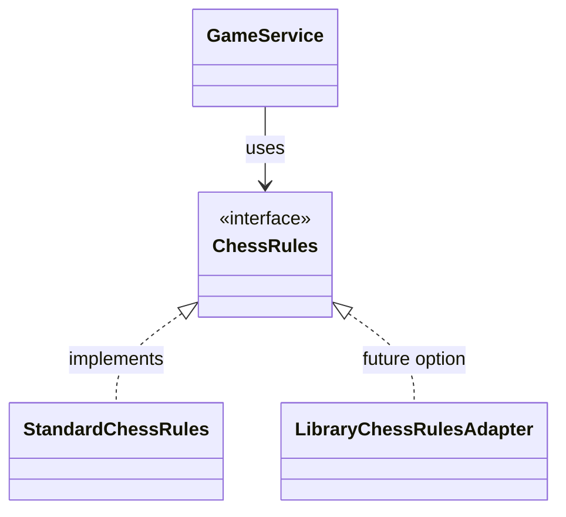

# Architecture

Updated through the Day 5 guided implementation session on 23 October 2026. Reviewed source baseline: completed Day 4 in `chess-web-app-day5-start.zip`. Day 5 changes below describe the supplied implementation and session progress; a fresh source archive has not been reviewed. See `development-progress.md` for verification provenance and `roadmap.md` for scheduling.

## Style and ownership

A single Spring Boot application, organized as a modular monolith with feature packages and conventional controller/service/DTO/entity/repository layers. Not DDD; no microservices or multi-project Gradle modules are required. Keep the domain term `Player`.

| Package | Ownership | State |
| --- | --- | --- |
| `auth` | Registration, local credentials, login | Implemented |
| `player` | Identity and profile data | Creation, lookup, current profile read and username updates |
| `security` | HTTP authentication, password encoding, JWT machinery | Implemented |
| `common` | Shared timestamps and request validation error handling | Implemented |
| `matchmaking` | Persistent queue, eligibility, and transactional pairing | Implemented |
| `game` | Initial state, active-player reservations, and participant-protected retrieval | Implemented |
| `notification` | Authorized outbound updates | Planned |

Controllers handle transport and delegate. Services coordinate use cases and transaction boundaries. Repositories remain within their owning feature. Cross-feature calls use service operations and DTOs. Concrete services are sufficient; interfaces and mapper frameworks are introduced only when needed.

Auth consumes `PlayerResponse` from `PlayerService`; it does not import player entities or repositories. `PlayerResponse` is also the `/players/me` HTTP contract. `RegisterResponse` deliberately retains the API field `playerId`, while `PlayerResponse` uses `id`.

## Registration and persistence

`AuthController` validates a registration request. Transactional `AuthService.register()` creates a player through `PlayerService`, encodes the password, saves credentials, and returns a registration DTO. All database writes must succeed or roll back together. The current order creates the player before encoding; rollback tests intentionally fail that later step.

PostgreSQL is durable storage. Flyway V1 creates players; V2 creates local credentials. Hibernate uses `ddl-auto: validate`, and Open EntityManager in View is disabled. Applied migrations remain immutable; schema changes use new migrations.

`AuthCredential.playerId` is a scalar foreign key rather than a JPA relationship. Its uniqueness permits one local credential per player. The foreign key has no deletion cascade. Future account deletion and external login methods need explicit designs.

`BaseEntity` contains creation/update `Instant` timestamps managed by JPA callbacks. SQL defaults initialize timestamps for non-JPA inserts, but direct SQL updates do not automatically advance `updated_at`.

Username/email availability checks improve feedback. PostgreSQL constraints remain authoritative under concurrency. `PlayerExceptionHandler` translates the named username/email constraints to 409 and rethrows unknown integrity failures. It is global advice because player failures can originate from auth controllers; its schema knowledge remains owned by player.

Identity lookup currently compares exact stored values. No canonicalization or case-insensitive identity policy is implemented. Any future normalization change must coordinate registration, lookup, existing rows, and unique constraints.

## Credential verification and login

`LoginController` validates input and delegates to `LoginService`. That service calls read-only transactional `AuthService.authenticate()`, then signs an access token after credential verification returns.

Authentication loads a player through the player service, retrieves local credentials, and calls `PasswordEncoder.matches`. Unknown accounts and missing local credentials use a dummy hash generated once at bean initialization. This reduces a timing difference but does not guarantee identical response timings.

Invalid credentials share one message and auth-owned error code. Login returns `accessToken`, `tokenType`, and `expiresIn` in seconds, with `Cache-Control: no-store`. The implemented login response does not contain the player profile.

Password encoding uses `DelegatingPasswordEncoder`, bcrypt by default. Registration enforces minimum length; registration and login enforce BCrypt's 72-byte UTF-8 maximum. No password trimming or normalization is performed. DTO validation is triggered at the HTTP boundary; calling services directly does not automatically validate DTO annotations.

## JWT issuance and request authentication

`JwtTokenService` uses `JwtEncoder`, an injected clock, issuer, and TTL. JWTs use HS256 with at least 32 decoded key bytes. Claims are `sub` (player ID), `iss`, `iat`, and `exp`. Tokens carry no profile fields.

`JwtConfig` provides encoder/decoder beans and requires a configured key. The decoder trusts HS256 and validates issuer, required expiration, expiration and optional not-before validity with 60 seconds of skew, and a subject parseable as a positive Java Long. Timestamp validation and issuance use the injected clock.

`SecurityConfig` permits POST registration/login, protects other requests, uses stateless sessions, and delegates bearer processing to Spring Security's resource server support. No custom JWT filter is needed. CSRF is disabled for the current bearer-header API design; revisit this if cookie-based authentication is introduced.

`GET /api/v1/players/me` belongs to `PlayerController` because it returns a current database-backed profile. It extracts the validated subject and returns `PlayerResponse`, or 401 if the player no longer exists. The controller currently uses `Objects.requireNonNull` as an assertion of decoder validation; controller-only tests must supply a valid principal.

Deleting a player does not cryptographically revoke its JWT. `/players/me` detects deletion through its lookup; future endpoints must apply their own resource and account checks. Refresh tokens, revocation, logout endpoints, account-status checks, rate limiting, and key rotation machinery are not implemented.

## Current-player username updates

`PATCH /api/v1/players/me` belongs to `PlayerController`. It validates `UpdatePlayerRequest` and derives player identity from the JWT subject. The body contains only the username; no client-supplied player ID chooses the update target. Email/password changes are outside this use case.

Transactional `PlayerService.updateUsername()` returns `Optional<PlayerResponse>`. A missing player returns empty; the controller translates that result into 401 using `ResponseStatusException`, consistently with the current profile-read endpoint. HTTP concerns remain at the controller boundary.

Submitting the current username returns without mutation. Otherwise, the service checks username availability, calls `Player.changeUsername()` on the managed entity and flushes through the repository. JPA dirty checking writes the update; an additional `save()` is unnecessary. The inherited `@PreUpdate` callback updates `updatedAt` for a changed entity. Flushing executes SQL without committing.

The availability check improves feedback but cannot guarantee uniqueness under concurrency. PostgreSQL's existing `uk_players_username` constraint remains authoritative, and `PlayerExceptionHandler` maps its violation to `USERNAME_ALREADY_EXISTS`. Concurrent edits to the same player's username currently use last-write-wins behavior; `Player` has no optimistic-lock version. The `Game` version field does not protect player edits.

Username validation remains nonblank and 3–30 Java UTF-16 string units, matching registration. There is no trimming, case normalization or special-character restriction. Existing IDs, credentials, game references and JWT subjects remain unchanged. No migration is introduced.

`ProfileEditor` is a standalone component under `player/components/profile-editor`, embedded in authenticated Home. `PlayerApiService` handles PATCH transport; the component coordinates form feedback and updates `AuthSessionStore` from the returned profile. It ignores successful responses if the token or current player has changed. Destruction cancels its subscription. Server validation remains authoritative, errors preserve input, and successful saves reset the form to the returned username. The welcome message observes the same store through `AuthService`.

The Day 5 integration-test increment covers persistence, same-username no-op behavior, duplicate rejection, validation, JWT-derived ownership, missing authentication, deleted-player access and reuse of the existing JWT after renaming. Transactional HTTP tests flush/clear before persistence assertions and roll back fixtures; they do not establish real HTTP commit behavior or reproduce a concurrent rename race.

## Error ownership

- `ApiExceptionHandler`: shared MVC handling and field-validation Problem Details.
- `PlayerExceptionHandler`: player duplicates and known database constraints.
- `AuthExceptionHandler`: invalid local credentials.
- `MatchmakingExceptionHandler`: unavailable authenticated players.
- `GameExceptionHandler`: active-game conflicts, missing games, and participant access denial.
- Spring Security filter chain: missing/invalid bearer credentials.

Feature-owned error constants avoid a global catalog of every feature's codes. Field errors omit rejected values to avoid exposing passwords. Filter-chain errors do not currently share the MVC Problem Detail format. HTTP status consistency is implemented; a universal error-body contract is not. [api-contracts.md](api-contracts.md) lists the expected status/code combinations by action, including failures without a guaranteed application code.

## Tests and transaction semantics

Mockito tests cover registration, authentication, and duplicate prechecks. Standalone MockMvc covers request validation and selected exception mapping. PostgreSQL tests exercise persisted registration, actual unique constraints, and service rollback. Full-context MockMvc tests exercise registration/login/profile access and actual JWT decoding.

JWT tests include missing/malformed token, valid token with a real player, altered signature, expiration, wrong issuer, missing/invalid subject including numeric overflow, missing expiration, and deleted-player lookup.

Transactional tests normally roll back fixtures. Synchronous MockMvc shares the test thread; a real HTTP server would not share that transaction. The rollback-specific integration test has no enclosing test transaction and uses a mocked encoder to fail after player creation. It proves rollback at that failure point, not every possible persistence failure.

Expected PostgreSQL constraint failures can appear in test logs. Do not continue querying within a failed transaction. Identity sequences need not rewind after rollback. Existing data from earlier committed tests is not removed by adding transactional annotations.

## Frontend authentication

Angular 21 uses standalone components, reactive forms, signals, lazy routes, and Angular Material. `AuthApiService` handles auth HTTP calls; `PlayerApiService` handles profile HTTP calls. `AuthService` orchestrates login; `AuthSessionStore` owns in-memory token/player state. The interceptor injects the store rather than `AuthService`, avoiding an HTTP/service dependency cycle.

The login sequence is token issuance → store token → GET `/api/v1/players/me` → store player. `isAuthenticated` requires both token and player. Failure clears the state. The `authGuard` redirects unauthenticated users from `/home` to `/login`; server authentication remains the enforcement boundary.

The interceptor attaches tokens only to relative `/api/` URLs and excludes public login/register. On a protected-request 401, it clears state only if the current token matches the request's token. An established player session is redirected with `sessionExpired=true`; an initial profile failure stays on the login form. External requests and 403 responses bypass session invalidation.

Token/player state is not persisted, so reload requires another login. There is no expiry timer or token refresh; an idle page may retain displayed state until a protected request receives 401. Client logout clears memory; the JWT itself remains valid until expiry. Cancellation of the login subscription after token issuance can leave a token without a player; authentication still evaluates false. Revisit cleanup if this causes a concrete navigation problem.

Both forms prevent duplicate submissions, show progress/errors, and retain passwords after failure. Successful login clears its password; successful registration resets the form and redirects to login. Registration displays backend duplicate/field-validation errors. Material theming is configured in `material-theme.scss`; home uses Material cards, buttons, and progress indicators for queue controls and matched-game discovery.

The five focused HTTP/store tests cover bearer attachment, external URL exclusion, protected 401 clearing/redirect, profile-load failure cleanup, and logout. They do not test forms, the guard, successful login completion, public-auth token exclusion with an existing token, stale-token responses, or password retention. These are coverage limits, not requests for a broad frontend suite. There is no generated `app.spec.ts` in this checkpoint; the five authentication tests are the current frontend suite.

## Configuration

Shared configuration lives in `application.yaml`; test overrides use `application-test.yml`. Both are YAML. An ignored `application-local.yml`, if used, requires the `local` profile. Shared database defaults permit optional environment overrides. Secret configuration is user-managed and outside this increment.

Flyway migration-name validation is enabled only in the test profile; enabling it in shared configuration is an optional small follow-up.

## Matchmaking queue

The matchmaking feature owns persistent queue membership through conventional
controller/service/DTO/entity/repository layers.

Controllers derive player identity from the validated JWT subject. Clients
cannot select another player through a request body or parameter.
MatchmakingService checks player existence through PlayerService.

Flyway V3 creates matchmaking_queue. A unique player_id constraint enforces
one entry per player. An index on enqueued_at and id supports deterministic
oldest-entry selection.

Joining uses a PostgreSQL upsert that preserves the existing entry ID and
enqueue timestamp. The conflict update locks the existing row until the
service transaction completes. Repeated joins perform an update without
changing business data.

Leaving uses a bulk JPQL delete. Repeated leave succeeds when no entry exists.
This operation bypasses JPA removal callbacks and remove cascades; the current
queue entity requires neither.

## Game creation and transactional pairing

Flyway V4 creates games with two distinct players, an initial FEN,
IN_PROGRESS status, timestamps, and an optimistic-lock version.

V5 creates active_game_players. Its player_id primary key prevents a player
from occupying multiple active games across either color assignment.
The game feature owns reservation writes.

GameService creates the game through JPA, flushes it, and reserves both
players through JdbcTemplate. Both use the same datasource and participate
in the same Spring-managed transaction. Flushing executes pending SQL;
it does not commit. A reservation conflict rolls back the game and any
partial reservation.

Matchmaking operations acquire the same transaction-level PostgreSQL
advisory lock before accessing queue state. This serializes operations
on the single queue across cooperating application instances.
The lock is released when the surrounding transaction finishes.

Pairing selects the oldest entries by enqueued_at and id, checks active-game
eligibility, randomly assigns colors, creates the game, and removes both
queue entries. These writes commit or roll back together.

The reservation constraint independently protects against another
game-creation caller that does not acquire the queue advisory lock.

Queue status is NOT_QUEUED, WAITING, or MATCHED. MATCHED includes gameId.
Repeated joins return an existing active game. Leaving removes queue
membership and does not cancel an established game.

GET /api/v1/games/{gameId} derives the requesting player from the validated
JWT subject. GameService permits either participant to read the game,
returns 404 for a missing game, and rejects nonparticipants with 403.
The response contains player IDs rather than opponent profile details.

## Planned chess rules boundary

Status: planned for Day 6; not yet implemented.

GameService depends on ChessRules. Our implementation owns chess
behavior without depending on Spring, JPA or HTTP. A future library
can be integrated through an adapter implementing the same interface.

The library adapter is a documented extension point, not a class
we need to implement now. Interface methods will be defined as
the first rules use cases are established.

## Planned application growth

Spring application events may decouple appropriate internal reactions, but are not durable messaging. WebSocket/STOMP remains a candidate for later real-time delivery, not an implemented dependency. It will need authenticated connections and authorized subscriptions/commands. Redis and Kafka are outside the initial infrastructure. Spectators, tournaments, chat, engine analysis, and distributed scaling remain out of initial scope.

## Current gameplay boundary

`GameStatus` currently contains only `IN_PROGRESS`. The stored FEN is the initial position; no service applies moves. `@Version` is present for future concurrent game updates, but move-command conflict handling is not implemented. There is no terminal status, result, lifecycle endpoint, or reservation-release operation.

The Angular frontend has no game API service, game route, or chessboard. It discovers `gameId` through manual queue-status refresh. Spring application events and WebSocket/STOMP delivery remain planned; no notification feature is implemented.

Queue operations acquire the queue advisory lock before queue access, including read-only status requests. This is a deliberate small-system serialization tradeoff. The lock is cooperative; database constraints remain necessary for game-creation callers outside matchmaking.
