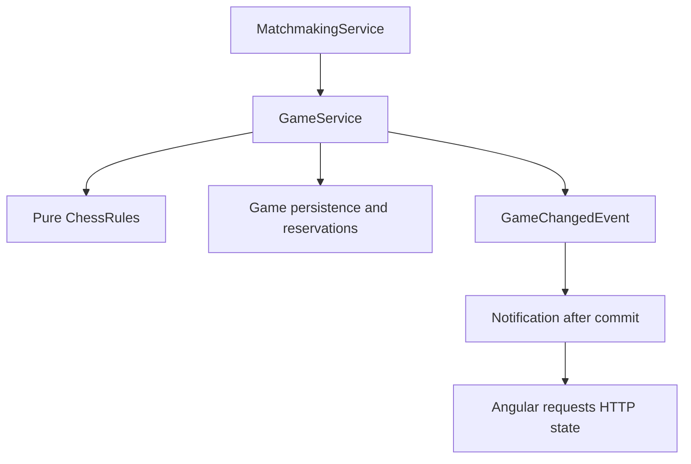

# Architecture

This document describes the current Day 21 system, source-reviewed on 30 October 2026 against `chess-web-app-day21-end.zip`. Earlier checkpoint narratives are preserved in [history](history/main-documents-through-day20.md). Verification evidence and scope limits are recorded in the [Day 21 review](day21-history-review.md).

## Application structure

One Spring Boot application, organized by feature with conventional controller/service/DTO/entity/repository layers. Keep `Player` terminology. This is a modular monolith, not DDD or a collection of microservices. Cross-feature operations use services or application events rather than another feature’s repositories.

| Feature | Responsibility |
| --- | --- |
| auth | Registration, local credentials and login orchestration |
| player | Player creation/lookup, self-profile and username updates |
| security | HTTP security, password encoding, JWT signing/validation |
| matchmaking | Persistent queue, eligibility and transactional pairing |
| game | Game creation/read/move commands, reservations, lifecycle, immutable rules and game events |
| notification | WebSocket configuration/security, private outbound notifications and session access tracking |
| common | Shared timestamps and validation/error infrastructure |

Controllers translate transport input. Services own authorization, use-case orchestration and transactions. Repositories stay within their feature. Concrete services and explicit record mappings remain sufficient; mapper frameworks and additional service interfaces are unnecessary without a concrete need.

## Authentication and profile

Transactional registration creates a Player through PlayerService and stores encoded credentials in auth. Scalar Player IDs avoid cross-feature entity coupling. PostgreSQL uniqueness constraints remain authoritative when availability checks race.

Login validates credentials, issues HS256 JWTs and then Angular loads `/players/me`. JWT subject contains the Player ID. The shared JwtDecoder validates signature, issuer, timestamps, a required expiry and positive Long subject. HTTP timestamp validation has its existing 60-second tolerance; WebSocket checks additionally enforce the stated expiry strictly.

The frontend stores token/Player in memory. Its interceptor attaches bearer tokens only to relative protected `/api/` requests. A protected 401 clears the matching session; stale responses cannot clear a different current token. A 403 does not invalidate the session. Login/register failure retains passwords. Username PATCH updates the current session profile without changing JWT identity. Exact, case-sensitive identity matching remains the implemented policy.

## Persistence and transactions

PostgreSQL is durable storage. Applied Flyway migrations are immutable; future schema changes use new migrations. Hibernate validates rather than generates the schema; Open EntityManager in View is disabled.

| Migration | Responsibility |
| --- | --- |
| V1 | Players |
| V2 | Local credentials |
| V3 | Matchmaking queue and ordering index |
| V4 | Games, participants, FEN and optimistic version |
| V5 | Active-player reservations and initial backfill |
| V6 | Completion fields and lifecycle consistency constraints |
| V7 | History baseline/completeness/count and ordered move records |
| V8 | Nullable SAN for pre-SAN records; new application records require SAN |

BaseEntity timestamps use JPA callbacks. SQL defaults support non-JPA insertion; direct SQL updates do not automatically advance `updated_at`. Identity sequences need not rewind after rollback.

Queue operations acquire the same PostgreSQL transaction-level advisory lock. This serializes cooperating operations on the single queue, including status reads. Repeated join preserves enqueue time through an upsert. Pairing selects the oldest eligible entries, assigns colors, invokes GameService and removes both queue entries in one transaction.

GameService flushes game creation before inserting JDBC reservations that reference it. JPA and JdbcTemplate share the datasource and transaction. The reservation table’s Player primary key enforces one active game across either color. Incomplete reservation or release counts fail the transaction. Leaving the waiting queue does not cancel an established game.

## Pure chess rules

`game.rules` contains no Spring, JPA, HTTP or notification concerns. Immutable Piece/Square/Move records, Board and ChessPosition represent placement and metadata. Board currently uses map storage and identity equality; tests compare board contents or FEN rather than assuming value equality for Board.

| ChessRules operation | Responsibility |
| --- | --- |
| initialPosition() | Standard starting position |
| legalMoves(position) | Complete immutable set for the side to move |
| applyMove(position, move) | Exact legal-set membership, then shared application |
| evaluate(position) | NORMAL, CHECK, CHECKMATE or STALEMATE |

GameRulesConfig constructs the six pseudo-legal strategies, dispatcher, shared applier, attack detector, legal filter and evaluator. Sliding pieces share ray traversal. Attack detection includes pinned attackers; generated moves exclude king captures. Legal filtering checks the moving king on the resulting board. Castling additionally checks the original and transit positions.

FenParser validates structural representation, not historical reachability. FenSerializer is separate. Promotion choices are explicit; there is no automatic queen. En passant and castling use the shared immutable application pipeline. Rights are historical metadata and are never restored by returning a piece or promoting a rook.

The facade does not own authorization, persistence, version checks or transactions. FEN alone cannot establish repetition history. See the [movement pipeline companion](movement-pipeline-architecture.md).

## Game commands and lifecycle

Both participants may read a game, including after completion. Commands derive the acting Player from the JWT, never from request-supplied identity.

For a well-formed move command, GameService checks existence, membership, lifecycle, expected version, turn and legal membership. It applies and evaluates the move through ChessRules before mutating the managed game. SAN is formatted from the original position, accepted move, complete legal set and resulting assessment before managed state changes. The recorded sequence advances on the versioned Game row. Flush advances the optimistic version and detects competing writes before history insertion. A losing optimistic update becomes STALE_GAME_VERSION.

Checkmate sets the mover’s winning result; stalemate sets DRAW. Position, recorded count, move record including SAN, result/reason/time and deletion of both reservations commit or roll back together. The move and any completion share a Clock-derived timestamp truncated to microseconds. History is explicitly flushed before reservation release and event publication. Flush is not commit. Version is a concurrency token, not a separately defined move number.

## Internal events and real-time delivery

GameService publishes immutable GameChangedEvent values after creation/reservation success or after game/history flush and any reservation release succeed. They carry game/participant IDs, version and GAME_CREATED/GAME_UPDATED. The game feature imports no WebSocket transport.

GameNotificationListener runs AFTER_COMMIT and sends a small PlayerUpdate to both participant user destinations. During matchmaking it waits for the outer pairing transaction, including queue removal. A rollback produces no notification. Terminal moves use GAME_UPDATED; HTTP GET supplies the result.

Sending is best-effort. Each recipient attempt catches runtime send failures so the other recipient is still attempted and a committed command is not reported as a delivery failure. There is no outbox, durable replay, acknowledgement guarantee or external broker. No database writes occur in the listener.

## WebSocket security

The configured HTTP GET endpoint permits the upgrade. STOMP CONNECT must supply exactly one bearer Authorization header and pass the existing decoder plus strict expiry. The interceptor assigns a canonical Player-ID principal and removes the native header entry; the authenticated principal still retains the JWT.

Only the exact configured private subscription is allowed. Direct broker paths, another user’s path, wildcards and client SEND commands are rejected. User routing is not itself authorization; the inbound interceptor enforces this policy. Backend event recipients come from stored participants.

WebSocketSessionAccess stores expiry by session ID. Outbound application messages require an unexpired registered session both before enqueueing and immediately before outbound handling. Disconnect removes the entry idempotently. This filters delivery, not proactive socket closure at the expiry instant; an already transmitted message cannot be recalled.

The frontend deactivates on logout, session replacement and local expiry. Browser timers are best-effort, so backend checks remain authoritative. Token decoding in the browser schedules cleanup; it does not validate signatures.

## Angular orchestration

App instantiates one RealtimeService independently of route navigation. It recreates private subscriptions after reconnecting, ignores stale-session callbacks, validates incoming update shape and exposes signals/observables. STOMP errors mark live delivery unavailable; HTTP still determines session validity.

Home reads queue state on entry, notifications and connection events. One pending read is drained after any current queue command/read. Periodic checks run for unknown, WAITING and MATCHED state; NOT_QUEUED is idle. Pairing reveals an Open game link rather than forcing navigation.

Game owns authoritative snapshots, promotion, commands and recovery. Route switchMap cancels old-route reads; exhaustMap permits one GET at a time. Notifications received during GET/POST coalesce into a pending read. A safety GET may be cancelled before a move POST starts. Unchanged versions preserve snapshot identity and promotion; older responses cannot replace newer state. Known-newer notifications block proposals until reconciliation. There is no automatic command retry.

ChessBoard owns rendering/orientation/selection and emits coordinates. Its selection-reset effect observes FEN, orientation and enabled inputs. It clears selection before emitting, so cancelling promotion leaves no stale source. Home, Game and ChessBoard use separate HTML/CSS files.

## Configuration and deployment boundary

`app.websocket` binds to WebSocketProperties with constructor validation. Endpoint registration, HTTP permission, subscription authorization and sending consume this shared object. Destination paths are derived from prefixes plus updates-path. The configured heartbeat range is 1–300 seconds. A lazily injected broker scheduler enables heartbeats.

Angular’s REALTIME_CONFIG contains matching routing addresses and its own timing settings. Backend YAML is not automatically published to the browser. Development proxying includes WebSocket upgrades. Configuration/secrets remain user-managed.

The simple broker and session registry are in-process. Current delivery assumes a single application instance. Multi-instance notification routing requires a separate design, even though database concurrency guards continue to protect shared state.

## Deferred scope

Replay controls/PGN export, clocks, extra draws, resignation/agreement, acceptance, abandonment/disconnect completion, ratings and statistics remain separate milestones. Custom board polish/library integration is optional. Closing a page does not finish a game. See [roadmap](roadmap.md) and the two flow companions for details.

## Persisted history and SAN

Game owns immutable historyStartFen/historyComplete metadata and a mutable recordedMoveCount. V7 copies existing currentFen into the baseline and marks all existing games incomplete, conservatively including games whose earlier moves are unknown. New games set their supplied initial FEN as the baseline and historyComplete=true. This means history since creation, not game completion. Counts begin at zero and sequence numbers begin at one relative to that baseline; neither is defined as the JPA version or FEN fullmove number.

GameMove uses scalar game/Player IDs and stores source/destination, optional promotion, resulting FEN, playedAt and SAN. No application update operations are exposed. The database unique constraint on (game_id, sequence_number) protects ordering uniqueness and supplies its index. Membership, legal chess behavior and count/row consistency remain application responsibilities rather than cross-row database checks.

getHistory authorizes membership before reading records through the captured recordedMoveCount. Later committed entries are excluded by the query bound. Consistency relies on atomic append-only writes and stable history metadata; this is not a general-purpose repeatable-read transaction or a concurrent-reader integration test claim. No history write belongs in an after-commit listener.

SanFormatter is pure Java. It consumes the original position, accepted move, complete legal set and resulting assessment. It produces English SAN with captures, O-O/O-O-O, = promotion, legal-source disambiguation and +/# suffixes. It does not replace the legality facade. V8 preserves null SAN for pre-SAN entries; no backfill is supplied.

Angular reads the board, then history, within the same coordinated read operation. Matching versions accept history; older history is ignored; newer history queues board synchronization. An older accepted list may remain visible while catching up, but a newer list is not shown ahead of the board. History failures have separate feedback and do not independently disable moves. Accepted POSTs explicitly queue reconciliation so the sender's list catches up even when its notification is already obsolete. See [history flow](move-history-flow.md).
