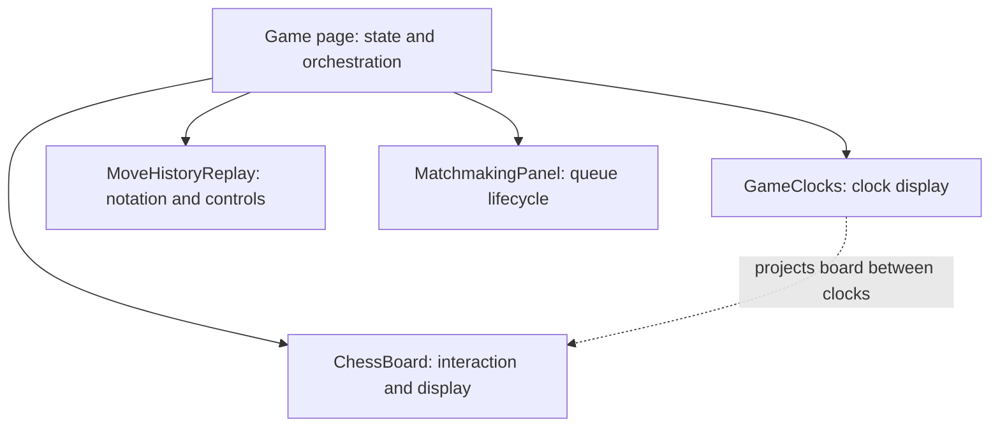

# Day 28 — UI, game discovery and readability review

## Source and evidence

Reviewed on 5 November 2026 against the actual user `chess-web-app-day28-end.zip`. This review inspects the supplied implementation; it does not substitute a generated implementation archive. No byte comparison with a preceding archive was performed in this closing review, so no added/changed path totals are asserted.

The user reports everything green. No assistant tests, builds, migrations, database calls or browser checks were performed. Findings below concern inspected source, not comprehensive runtime acceptance or a security/concurrency audit. The optional closing readability edits in the companion guide are **proposed, not applied** to the uploaded source.

## Delivered scope

| Area | Inspected implementation |
| --- | --- |
| Shell and palette | Shared home/logo, Games played and logout; reserved sidebar; warm amber default with blue/green alternatives in code |
| Workspace | Board dominates the left; opponent/self clocks surround it; profile, state, replay, actions, activity and connection information on the right |
| Participant identity | V15 records both starting usernames and ratings; new game details are immutable snapshots; legacy details remain null |
| Clocks | Inactive display is dimmed; active row has a diagonal shimmer and reduced-motion treatment; backend remains authoritative |
| Promotion | Icon choices begin on the destination square and extend inward; focus trap, cancellation and Escape handling |
| Move feedback | Versioned server legal hints; local source filtering and deduplicated promotion destinations; rejected source/destination feedback for explicit illegal-move rejection |
| Matchmaking | Shared panel starts search immediately; follows searches into matches; Home resumes an existing game, while finished-game review offers a return link |
| Discovery | Authenticated self-only finished-games list, bounded pagination, stable timestamp/ID ordering and links to the existing game route |
| Backend services | GameCommandService owns mutations; GameQueryService owns ordinary reads; GameExportService retains PGN responsibilities |
| Components | GameClocks, ChessBoard, MatchmakingPanel and MoveHistoryReplay have separate TS/HTML/CSS; Game retains orchestration |
| Action cues | Incoming offer responses and resign/accept confirmations are in Game actions; activity contains feedback and a future-chat placeholder |

Starting snapshots are read through PlayerService before saving a new game. These ordinary reads do not assert that both Players' values were captured at one simultaneous database instant. Displayed starting Elo does not change when completion changes current Player statistics. Existing PGN export still resolves current names; V15 has not changed its naming policy.

## Component ownership and projection

The solid arrows describe declaration/configuration by Game. The dotted arrow describes the rendered content slot: Game declares ChessBoard and supplies its bindings; GameClocks places that projected content between its rows using ng-content. Projection does not transfer game orchestration to GameClocks.

## Query and transaction boundaries

GameQueryService uses readOnly transactions with default REQUIRED propagation. Calls through its Spring proxy join an existing compatible transaction, including a matchmaking write transaction. The inner annotation does not create a separately committed read window or turn an outer write transaction read-only. Private helper calls do not introduce transactions. Splitting these services is responsibility separation within the same conventional architecture.

The finished-games query filters membership and FINISHED before pagination and orders by finishedAt descending, then ID descending. Slice reads an extra row to determine hasNext and avoids a count query. Mapping uses game scalar IDs and saved snapshots rather than per-opponent profile reads. This inspected listing path does not contain an N+1 opponent lookup. That statement does not certify every use case or prove an efficient execution plan at production scale. Offset pages can shift when new completions arrive.

PlayedGameResponse is relative to a subject Player. The current controller always obtains that subject from the authenticated principal. Future other-Player history needs an explicit visibility policy and endpoint authorization; changing a DTO does not grant access. Reviewing another Player's listed game would also require a separate game-read policy, because current game/history/PGN endpoints remain participant-only.

## Readability assessment

The supplied game.html has 262 lines, game.ts has 1,192, and MoveHistoryReplay has 89 HTML/68 TS lines. GameClocks already uses a shared clockRow template. ChessBoard HTML has 63 lines; Home HTML has 55. These sizes do not justify blanket template extraction.

The unused Game.moveTokens computed remains after its presentation logic moved to MoveHistoryReplay. Remove that leftover. Its current lazy computed is not a demonstrated rendering/performance defect, but duplicate ownership makes future edits confusing. Name the legal-hint setup and five initialization subscriptions without changing their operators, order or guards. A larger state-service extraction remains outside this milestone.

See [closing cleanup](day28-readability-cleanup.md) for exact mechanical changes, a scoped optional game-actions template and pros/cons. None of those proposed changes is assumed applied in this review.

## Selected deep-read tests

| Test | What to understand |
| --- | --- |
| GameCreationIntegrationTest.participantSnapshotsSurviveProfileChangesAndCompletion | Saved match identity/rating versus mutable profile/statistics |
| GameReadIntegrationTest.legalMoveHintsExcludeMovesThatExposeTheKing | Hints originate in the pure legal generator, not client movement rules |
| GameReadIntegrationTest.enPassantHintIsMarkedAsCaptureDespiteEmptyDestination | Capture semantics differ from destination occupancy |
| GameReadIntegrationTest.promotionHintsRetainAllFourChoices | Four distinct legal commands can share one highlighted destination |
| GameReadIntegrationTest.playedGamesIncludesBothColorsAndExcludesActiveAndUnrelatedGames | Subject perspective and database filtering |
| GameReadIntegrationTest.playedGamesPaginatesWithIdTieBreaker | Deterministic ordering under equal timestamps |
| PlayedGamesQueryEfficiencyIntegrationTest.listingQueryCountDoesNotGrowWithTheNumberOfGames | Flush/clear fixture setup, then measure only the listing; one statement for small/full pages |
| matchmaking-panel.spec.ts: earlier authentication revision | Ignore a delayed join response after local identity changes |

The four matchmaking tests mock the coordinator and override its template; they are not real-router, rendered-template or browser acceptance tests. The SQL-count test uses a shared SessionFactory counter and controlled fixtures; concurrent factory activity can affect it. Run it alone when analyzing its logs. Its flush/clear is before measurement, not evidence that production code clears its persistence context. It counts Hibernate prepared statements, not all JDBC/session/security activity or elapsed performance, and does not run EXPLAIN. The optional logging profile is application-sql.yml.

No isolated V14-to-V15 migration-upgrade fixture, full legal-hint/frontend race suite, rendered promotion/replay acceptance or actual browser BroadcastChannel check is established by this review. Existing Day 27 session/socket limits remain in their companions.

## Deferred scope and closing status

The implemented Day 28 scope is ready to close based on inspected source and the user's green report. Apply the optional cleanup only if desired; it does not start another feature milestone. Documentation was behind the implementation and is synchronized by this replacement package.

Chat and rematch remain future work. Find another match is implemented and does not imply a rematch invitation protocol. Public Player history, PGN download UI, extra draws, full timeout mating-possibility adjudication, match acceptance/abandonment, replay enhancements and stronger distributed/session coordination remain separate decisions. Promotion shape can still open the chooser before a king-safety rejection, intentionally deferred even though hints now exist. Inactive clock dimming is visual; there is no game pause feature.

The earlier intermittent action-click report has no established runtime cause or fix. Confirmations are now visibly grouped with actions, but that layout change does not establish a fix for every missed click. Distinguish confirmation/no POST from a rejected POST and its status/code. Commands are never silently retried.
