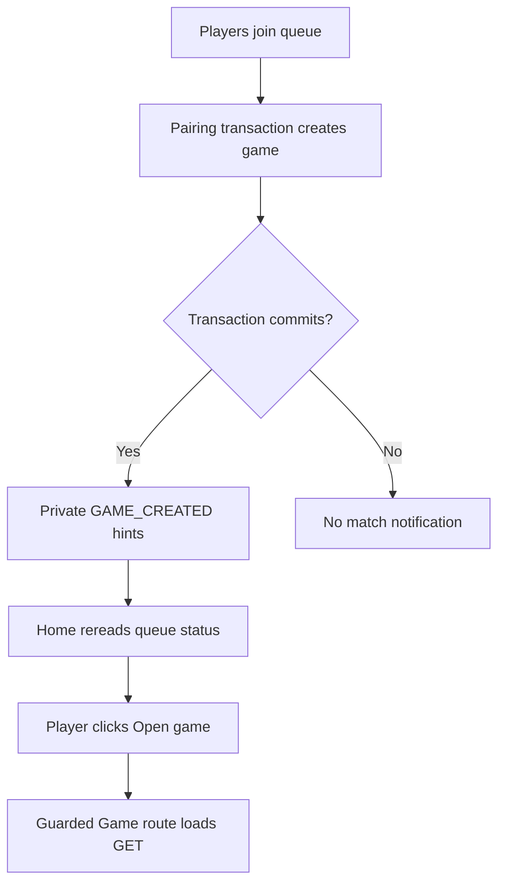
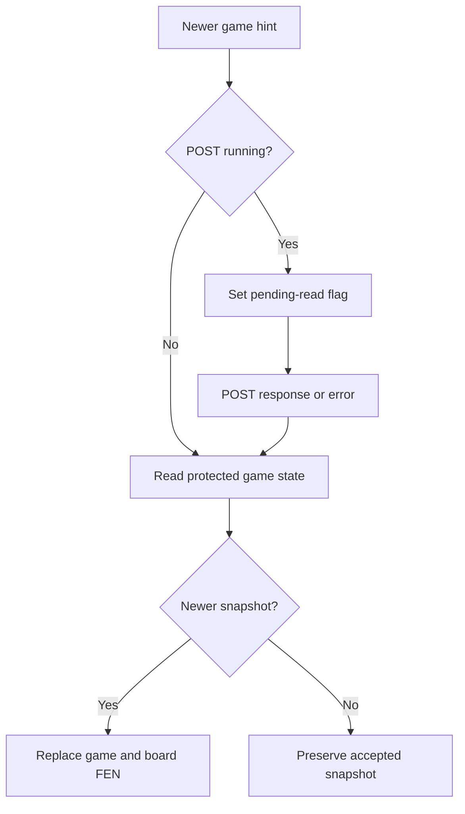

# Frontend gameplay flow

This companion describes Day 24 gameplay source reviewed against actual user `chess-web-app-day24-end.zip` on 31 October 2026. Day 24 adds replay display state and command gating; existing HTTP/live reconciliation remains in place. The Angular PGN download UI is deferred. Review is not an assistant build/runtime acceptance result.

## Ownership

| Owner | Responsibility |
| --- | --- |
| GameService | Participant/turn/version/lifecycle checks, rules, persistence and completion |
| RealtimeService | Application-wide socket lifecycle, subscription and validated change hints |
| Home | Queue commands/status reads and explicit Open game navigation |
| Game | Authoritative snapshots, replay cursor/displayed FEN, requests, promotion and reconciliation |
| ChessBoard | FEN projection, orientation, selection and move proposals |
| GameApiService | Game/history GET and move/lifecycle POST transport |
| AuthSessionStore/interceptor | In-memory identity/token and protected HTTP handling |

Home, Game and ChessBoard each use separate HTML/CSS files. Templates are connected through templateUrl/styleUrl; separation changes file organization, not data flow.

## From pairing to an open board

Matchmaking creates the game before the route opens. Home updates automatically, but routing remains an explicit Player action. The game route never creates the game. The route guard checks local authentication; the backend separately enforces JWT and participant access.

## Signals and coordination

| Angular API | Use here |
| --- | --- |
| signal | Writable state such as game, submitting and pendingPromotion |
| computed | Derived interaction permission and board projections |
| input | Parent-supplied FEN, orientation and enabled state |
| output | ChessBoard moveProposed event |
| effect | Selection reset; connection lifecycle side effect |
| untracked | Avoid accidental signal dependencies during transport setup |

Signals are local reactive state; they do not observe database changes. WebSocket notifications and HTTP responses supply new information. Computed values track the signals actually read and derive cached values. Angular updates templates consuming changed signals without a manual board redraw.

Game.canSubmitMove requires a loaded active game, authenticated participant, no initial loading/submission/refresh requirement and displayed side-to-move matching that Player. Frontend permission improves interaction; the backend independently checks actual state.

## Board inputs and selection

Game passes displayedFen, Player orientation and interaction permission to ChessBoard. displayedFen follows currentFen in live mode or projects a stored replay position. The FEN display parser projects placement/side to move; it does not duplicate legal-move evaluation. Display orientation changes ordering, not algebraic coordinates. a1 remains dark.

The selection-reset effect deliberately reads fen(), orientation() and enabled(), then clears selectedSquare. It does not read selectedSquare and therefore does not subscribe to selection changes. An effect is a lifecycle-managed reactive side effect, not polling or a synchronous callback inside every signal.set().

Selecting an own piece stores its square. Selecting another own piece replaces it; clicking the source again clears it. A destination proposal clears selectedSquare **before** emitting. Game inspects promotion shape, then either requests an explicit choice or submits. Cancelling promotion sends no POST and leaves no stale selected source. The backend owns legality for ordinary and special moves.

## Read stream and route lifecycle

Game.route.paramMap uses outer switchMap to cancel the old route’s read stream. New route setup clears old game/promotion/messages and resets activeGameId/latestNotifiedVersion/pending-read state. A validated route starts its first GET immediately.

Within a route, refreshRequests uses exhaustMap so only one coordinated board-then-history read runs at a time. Additional required work is recorded in readPending instead of being silently lost. The coordinator uses a microtask to coalesce triggers and checks destruction, authentication, current route, reading and submitting before starting another read.

readSnapshot retains an existing board. loading represents a read with no snapshot; reading separately coordinates background work. A newer version replaces game and clears promotion. The same version preserves object identity, FEN and promotion. An older snapshot cannot replace newer accepted state. Successful reads clear obsolete move feedback unless the observed version is still below a known notification.

catchError sits inside the read operation so future triggers remain active. Game-state read failures set needsRefresh and an error; history failures have separate feedback. A 403/404 additionally removes the snapshot. finalize clears read flags and schedules pending work. takeUntilDestroyed tears down page streams; takeUntil(cancelReads), placed after the history switchMap, permits cancellation of either GET stage before POST.

## Read triggers

| Trigger | Behavior |
| --- | --- |
| Initial valid route | Immediate GET |
| Relevant hint above displayed version | Track highest hinted version, clear promotion, block proposals and queue GET |
| Hint at/below displayed version | Ignore |
| Successful initial/reconnection | Queue blocking synchronization |
| Window focus/visible return | Queue blocking synchronization |
| Manual refresh | Queue blocking synchronization, guarded against submission/initial loading |
| 30-second timer | Nonblocking safety read only while page visible with a loaded active game or loaded board/history-refresh-required state |

An initial GET failure without a loaded snapshot is not retried by that timer. It can recover through manual refresh, connection/focus events or relevant hints. Blocking synchronization can clear selection/promotion even when the resulting version is unchanged; only an unchanged **nonblocking safety read** preserves those interactions.

CONNECTED is a transport state after the client sends SUBSCRIBE. The simple broker does not acknowledge subscription registration. Reconciliation covers missed messages; it is not a strict delivery or timing guarantee.

## POST and notification ordering

Before POST, an enabled board can coexist only with a nonblocking safety read. Game cancels that GET, remembers a pending read, then submits using the current version. Notifications during POST queue a read; they never replace the in-flight command. POST finalize clears submitting and drains pending work.

A successful POST preserves participant metadata from GET and replaces accepted FEN/version/status/completion fields. Its snapshot-identity check ignores callbacks for a replaced route snapshot. Same-version reads preserve that identity. A notification received before the POST response may cause one harmless reconciliation GET afterward. If received after the accepted version is displayed, it is ignored.

## Failure and completion

| Situation | Behavior |
| --- | --- |
| Illegal move / invalid request | Feedback, no optimistic board update |
| Stale version / wrong turn / already finished | Queue GET, never retry POST |
| Uncertain transport/server outcome | Block proposals and queue GET; command may already have committed |
| Protected HTTP 401 | Existing session-aware interceptor clears/redirects |
| Game-state read failure | Preserve blocked state; 403/404 removes snapshot |
| FINISHED snapshot/result | Show persisted outcome and disable moves |

Checkmate/stalemate release reservations in the backend transaction. Both Players learn completion through accepted POST or notification-triggered GET/recovery. Returning Home rereads status; another match is permitted after release. Closing the page or losing connectivity has no completion effect.

## File map and references

Game coordination is in frontend/src/app/game/pages/game/game.ts; board display in game/components/chess-board; transport in game/services/game-api.service.ts. Notification connection/config/models live under frontend/src/app/notification. Home’s current queue signal is queueStatusResponse and both pages expose realtimeService to their templates.

See [real-time delivery and security](realtime-updates-flow.md), [contracts](api-contracts.md), [review](day21-history-review.md), [Angular signals](https://angular.dev/guide/signals) and [StompJS lifecycle](https://stomp-js.github.io/guide/stompjs/using-stompjs-v5.html).

## Day 21 history extension

readSnapshot accepts the game snapshot in tap, then switchMap invokes readHistorySnapshot. reading/loading finalize after the complete read chain. History errors return null inside the history branch; they do not flow into the board-error handler. The history version must match the displayed board version. A newer response updates the known-newer version and queues blocking synchronization; an older one is ignored. A stale accepted list can remain visible while the page catches up.

Successful POST queues a nonblocking read after submission finalizes even when its own notification was ignored. historyNeedsRefresh extends visible-page safety recovery to finished games with missing/failed/outdated history. Matching history and an error-free finished board stop periodic work. No command is replayed. The coordinate and SAN columns remain side by side. See [history flow](move-history-flow.md).

## Day 22 shared command and confirmation flow

canSubmitGameCommand requires an authenticated active participant, no replay selection, no initial loading/submission and no blocking refresh. canSubmitMove adds the side-to-move check and absence of lifecycle confirmation. canSubmitLifecycleAction ignores turn but requires promotion to be resolved. History-only failures do not independently block either command type.

executeGameCommand receives a captured GameResponse, an Observable factory and a response mapper. It cancels an allowed safety read, clears local dialogs, sets submitting and invokes the command through defer. Both move and lifecycle paths use this lock and finalize handler. Snapshot identity protects against callbacks after route replacement. Lifecycle success accepts GameResponse directly; move success preserves participant metadata and explicitly sets drawOfferedByPlayerId to null.

Resign and accept-draw first open an inline confirmation. The confirmation disables board proposals and hides other lifecycle buttons. Confirm rechecks current permission. Route changes, blocking synchronization and accepted newer snapshots dismiss it; unchanged nonblocking reads preserve it. Promotion must be chosen/cancelled before lifecycle actions.

All accepted commands queue board/history reconciliation. Conflicts, missing/changed offers and uncertain failures block commands and request GET without retrying POST. Finished snapshots show resignation or agreement alongside existing outcome labels and remove lifecycle controls. Game.moveMessage remains the general action-feedback signal. See [lifecycle flow](game-lifecycle-flow.md).

## Day 23 verification note

The frontend is unchanged. Actual backend STOMP clients now exercise selected private delivery/security paths, but these tests do not exercise Angular signals, browser timers, reconnect recovery or command/read coordination. No new frontend tests or assistant browser checks were performed. See [review](day23-reliability-review.md).

## Day 24 recorded-position replay

replayIndex=null means live following. Zero means the recorded baseline; n means the FEN after recorded entry n. Numeric selections stay read-only even when n is the final available entry. Start, Previous, Next and entry buttons select numeric positions; Latest alone returns to live following. Previous from live uses available history length minus one, so an outdated available list is not a promise to step back exactly one move from the current live board. Empty history still supports the baseline.

replayHistory requires matching game ID, history version not ahead of the live game, count equal to list length and contiguous sequences starting at one. It permits a previously accepted older list while reconciliation continues. Legacy incomplete history and null SAN still allow replay because saved positions, not notation reconstruction, drive display. displayedFen is null for an unavailable selected position rather than silently switching to live.

canSubmitGameCommand includes !isReplaying, which blocks both move and lifecycle submission. canNavigateReplay blocks cursor navigation during POST. Entering replay cancels pending promotion/action confirmation and clears move feedback. Existing board input effects clear selectedSquare on FEN/enabled changes. Live game/offer/result continue updating independently and are labeled as live status.

Route initialization resets the cursor; board/history 403/404 branches that clear history also reset it. New accepted game/history versions do not reset it. A missing newer history response can retain the old selection with catching-up feedback. Latest returns to the currently accepted authoritative board; existing needsRefresh/turn/status/confirmation guards still apply before commands.

The user reports replay working except that the route-switch scenario was not manually verified. No new frontend tests, assistant browser checks or frontend builds were run. Next-to-live-at-the-end behavior was discussed only and remains unimplemented. See [flow and manual checks](replay-pgn-flow.md).

## Deferred improvement: promotion chooser before legality validation

The frontend opens promotion selection when a proposed pawn move reaches the last rank. This detects promotion shape, not legal-move membership. The chooser may therefore appear for a proposal that fails to resolve check or exposes the moving king. The user observed this premature chooser and intentionally deferred fixing it for later personal implementation.

After piece selection, the existing backend must reject a move outside the legal set, preserving position, version and history. A chooser appearing is a UI limitation; accepting a self-check move would be a separate rules defect. This review does not claim a new runtime reproduction or dedicated promotion-chooser test.

A future extension can expose version-associated legal moves from the existing rules engine and open the chooser only for a matching legal promotion candidate. The work is moderate API/frontend integration; keeping legal data aligned with the current version matters more than adding another promotion-rank check. Backend legality/version validation remains authoritative. No legal-move endpoint or client chess engine is added now.

Future checks: a promotion that fails king safety never opens the chooser; a legal promotion still offers explicit piece selection; stale legal data cannot authorize a command; rejected moves preserve position/version/history. Cancelling a chooser continues to send no POST.
