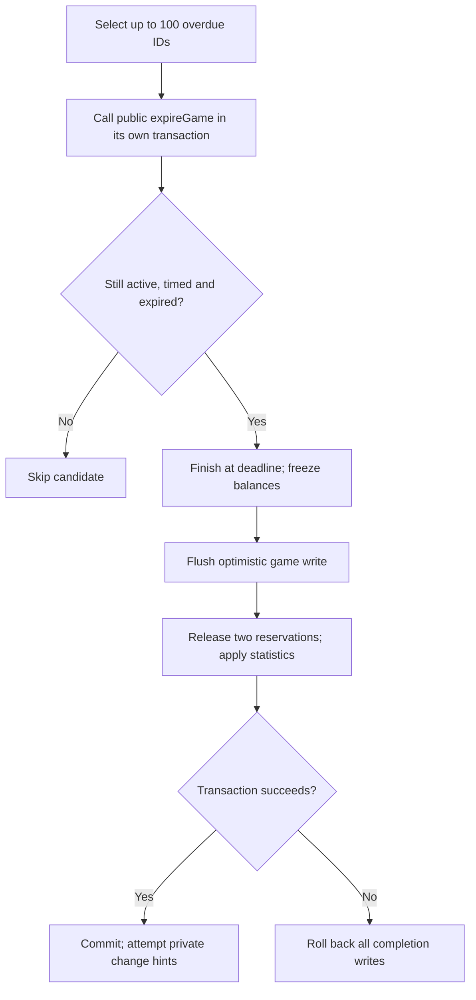

# Game clocks and timeout flow

Day 27 update, source-reviewed on 4 November 2026 against actual user chess-web-app-day27-end(1).zip. Session/CSRF authentication supersedes earlier bearer/token statements. See [review](day27-sessions-review.md), [authentication and WebSocket diagrams](session-authentication-flow.md) and [tab synchronization](tab-synchronization-flow.md). No assistant application execution; older Day-labelled sections describe their historical checkpoint.


Source-reviewed on 3 November 2026 against actual user chess-web-app-day26-end.zip. See [review](day26-clocks-review.md) for evidence and limitations. No assistant application execution is claimed.

## Ownership and storage

| Owner | Responsibility |
| --- | --- |
| GameClockState / GameClockCalculator | Immutable running snapshot and pure arithmetic, outside game.rules |
| Game | Persist balances/turn metadata, transition and freeze before completion |
| GameClockProperties | Required initial time and whole-millisecond range validation |
| GameService | Command guards, server time, versioned completion and transaction |
| GameRepository | Deadline-ordered bounded candidate selection |
| GameTimeoutScanner.scanAndExpireGames | Fixed-delay selection, per-game service calls and failure isolation |
| GameClockResponse | Read projection at calculatedAt, no persistence mutation |
| Game / GameClocks Angular components | Accept snapshots / estimate remaining time for display |

V12 adds nullable white_remaining_millis, black_remaining_millis, clock_running_color and clock_turn_started_at. All null means untimed. Active timed games require nonnegative balances, valid running color and timestamp. Finished timed games keep balances and clear both running fields. V13 adds TIMEOUT with a winning result. Existing active/finished games are not retrofitted with clocks.

Balances are stored at a turn boundary. For the running Player, remaining(t)=max(0, storedRemaining-elapsedMillis). The stopped Player retains storedRemaining. Exact zero expires. New games start White at initialization. No increment or pause exists.

## Transaction and scanner



The scanner has no surrounding transaction. Each proxy call owns a completion transaction. Runtime failures from one service call are logged and processing continues. Candidate selection failures are outside that per-game catch. Next scans rediscover eligible rows; there is no durable retry queue or strict completion-latency guarantee.

For moves, existence, membership, active state and expected version precede expiry. Early expiry is checked before rules, then captureCommandTimeAndCheckExpiry supplies acceptance time before mutation. Clock transitions and history use that timestamp. Finished-game response mapping uses clock.instant directly and never calls the active-clock guard. Existing timeouts can still show IN_PROGRESS/zero until the scanner commits. Rejected expired commands do not themselves release reservations.

Timeout and a pre-expiry move can race from the same version; one update wins. Timeout uses stored runningColor, freezes at deadline and awards the opponent a win. There is no possible-mating-sequence exception in this version. Ratings and claim are synchronous in the same transaction; notification sends occur only after commit.

## Response versus persistence

```json
{
  "clock": {
    "whiteRemainingMillis": 25000,
    "blackRemainingMillis": 600000,
    "runningColor": "WHITE",
    "calculatedAt": "2026-11-03T08:00:05Z"
  }
}
```

Illustrative nested fields on both GameResponse and GameMoveResult. Untimed games return clock=null. Finished clocks have runningColor=null and frozen balances. calculatedAt changes per response even when frozen balances and game version do not. It describes calculation time, not completion time. Never weaken persisted finishedAt equality to accommodate response metadata.

| Server read | Version | White remaining |
| --- | ---: | ---: |
| First | 7 | 30 seconds |
| Five seconds later with no move | 7 | 25 seconds |

Version identifies persisted game changes, not elapsed time. Thus same-version responses update clockSnapshot while game() retains its existing object identity. Older response versions are ignored for clock replacement. Lifecycle POSTs accept their full clock; move POSTs explicitly map result.clock.

## Frontend pseudocode

The actual companion also exists at frontend/src/app/game/components/game-clocks/pseudocode.txt.

```text
WHEN a game response arrives:
    if its version is older than the accepted game version:
        ignore its clock data
    otherwise:
        accept its clock snapshot even if the version is unchanged
        keep board identity unchanged if the version did not advance

WHEN the clock component receives an accepted snapshot:
    remember each Player's server-calculated remaining time
    remember which Player's clock is running
    record local receipt time using performance.now()

EVERY display tick:
    calculate elapsed time since receiving the snapshot
    for each Player:
        if their clock is running:
            displayed remaining time =
                server-calculated remaining time - elapsed time
        otherwise:
            displayed remaining time = server-calculated remaining time
        clamp displayed remaining time to zero
        round positive fractional seconds upward; format minutes:seconds
    if the running Player's displayed time is zero:
        show waiting for the server result
        do not declare a winner or finish the game locally

WHEN a fresh snapshot arrives:
    replace remembered remaining times and reset the receipt-time anchor

WHEN the server reports completion:
    neither clock is running; show frozen remaining times

WHEN the component is destroyed:
    unsubscribe from the display timer
```

The interval fires every 100ms but elapsed time comes from performance.now, not the number of callbacks. calculatedAt is carried but not compared to Date.now or used to estimate response age. Network delivery adds display lag; periodic reanchoring can cause a correction. Browser suspension can affect the estimate; existing reconnect/focus/visible-page safety reads recover current server state. The timer still exists for the mounted component when clocks are frozen, but does not subtract from either balance.

Clocks show live game time during replay, not historical time. Existing Latest return remains explicit. A local zero does not independently change canSubmitGameCommand; backend expiry rejects invalid timing. Initial read failure without a game snapshot still relies on manual/focus/connection/hint recovery under the existing coordinator.

## Configuration and known follow-up

Production uses 10m, enabled=true and fixed delay 1s. Batch size is 100. Day 27 source now sets shared test timeout-scan-enabled=false and disables session cleanup. Production scanning remains true. No configuration is changed by this documentation package.

No deadline index, backoff, permanent-failure quarantine, scheduler lease, time-control selector or latency compensation exists. Large batches or repeated failures can delay later games. Persisted timestamp recovery after restart is supported by the design, not demonstrated by a restart test. Clock start precedes creation commit and opening the board. Disconnect/logout/replay never pause it.

## Deep reading and manual acceptance

Read ratingFailureRollsBackTimeoutAndAllowsSuccessfulRetry for atomicity, moveAndTimeoutCannotBothCommitFromTheSameVersion for optimistic contention, projectsBalancesWithoutChangingStoredState for response projection and clockResponsesSwitchAfterMoveAndFreezeAfterResignation for transport semantics.

Suggested manual scenarios, not assistant-executed results: both Players see the running side; a move switches it; draw negotiation does not pause it; replay leaves live clocks running; terminal completion freezes both; old games show untimed; missed timeout hints recover through normal reads. Dedicated real-socket timeout delivery, scheduler-trigger and process-restart checks remain unestablished.
