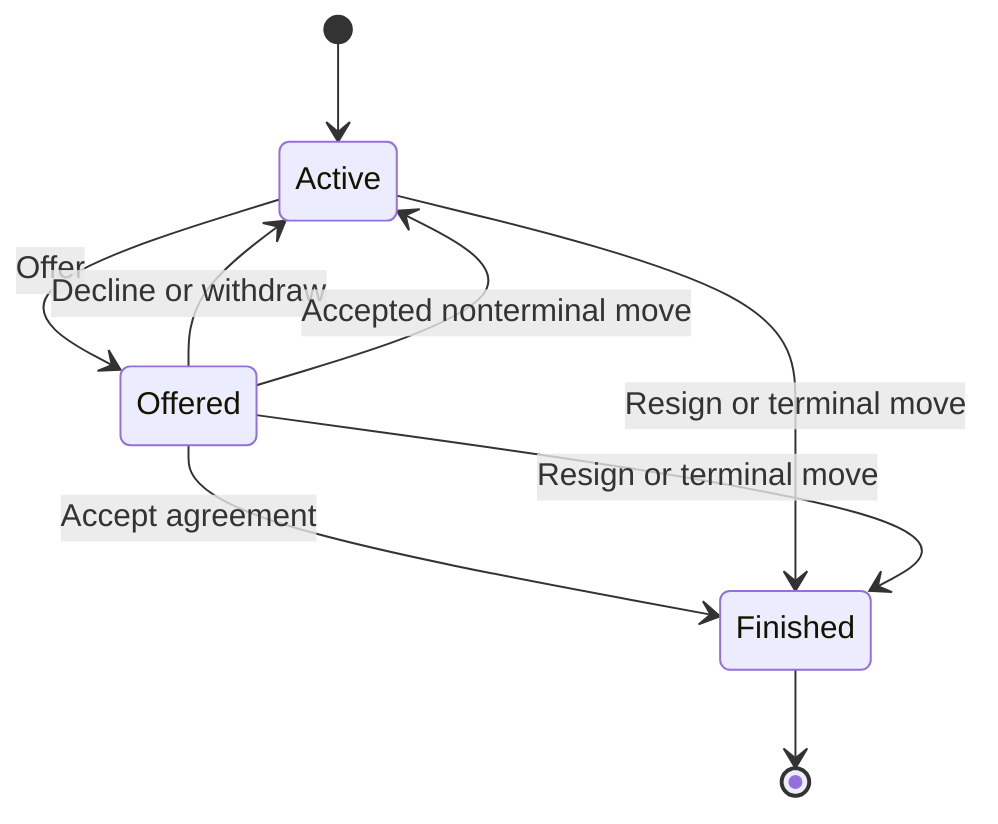
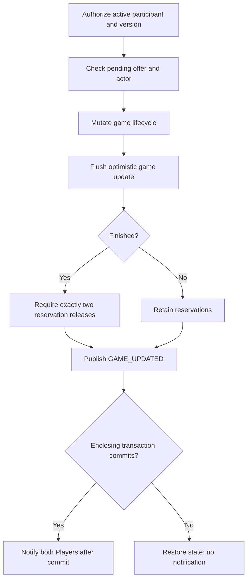
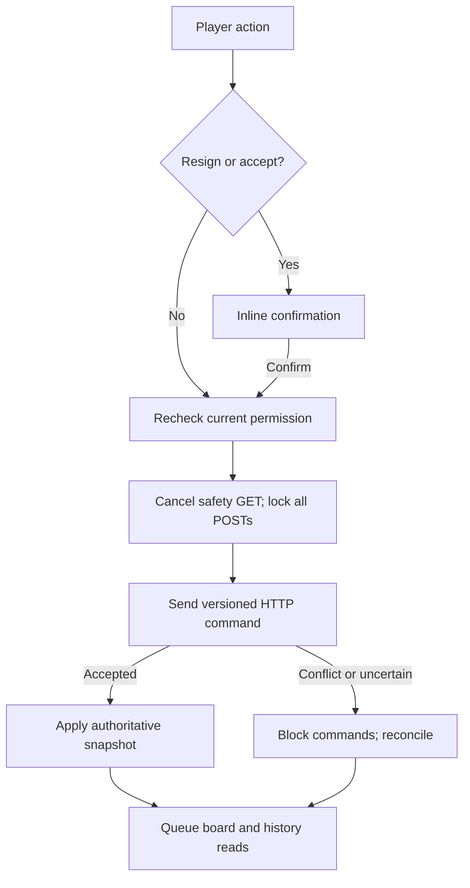

# Explicit game lifecycle flow

Source-reviewed on 31 October 2026 against user chess-web-app-day23-end.zip. Day 23 adds tests; lifecycle production behavior is unchanged. No assistant tests, builds, migrations or browser checks were run.

## Ownership and policy

GameService owns application authorization, transactions and outcomes. Game guards local state transitions. The pure Java rules engine is unchanged. The notification feature consumes immutable game events after commit; Angular sends HTTP commands and rereads authoritative snapshots.

| Action | Actor | Result | Reservations |
| --- | --- | --- | --- |
| Resign | Either participant, any turn | Opponent wins; RESIGNATION | Release both |
| Offer | Either participant, no pending offer | Store sender; remain active | Retain both |
| Accept | Recipient of pending offer | DRAW; DRAW_AGREEMENT | Release both |
| Decline | Recipient | Clear offer; remain active | Retain both |
| Withdraw | Sender | Clear offer; remain active | Retain both |
| Accepted move | Side to move | Clear pending offer; apply rules | Release only if terminal |

Play continues during negotiation. Any accepted move clears an offer; a rejected move preserves it. Every finish clears it. There is no offer timeout, durable offer history, cooldown or minimum move rule. This is an application policy, not a tournament-procedure implementation. Disconnect/logout/page close has no completion effect.

## Transaction order

loadActiveGameForCommand checks missing game, membership, active status and expected version. Offer-specific presence/role checks follow. persistLifecycleChange flushes before release and publishes an immutable event. Public methods own the transaction; private helpers add no transaction boundaries. Resignation needs no offer check. Clock timestamps use microsecond precision.

V9 permits RESIGNATION with a winner. V10 adds nullable draw_offered_by_player_id, restricted to an active game's participants, and permits DRAW_AGREEMENT only with DRAW. finish validates all arguments/result combinations before changing completion or clearing the offer.

## Versions and competing commands

Every successful offer, decline, withdrawal, acceptance or resignation changes a mapped field, so JPA advances the optimistic version. Rejected commands leave durable state unchanged. Lifecycle-only updates do not change FEN/count or insert move records.

If acceptance and a move both load version 1, either may win. An acceptance winner yields a finished draw and released reservations, with no new move row. A move winner clears the offer, records one move and retains reservations unless terminal. The losing update fails at flush and rolls back. A stale request first loaded after completion can instead receive GAME_ALREADY_FINISHED because lifecycle precedes the expected-version check. Commands are never automatically replayed.

## Browser command coordinator

canSubmitGameCommand is turn-independent. canSubmitMove adds turn and no lifecycle confirmation. canSubmitLifecycleAction requires no pending promotion. Both paths enter executeGameCommand and share submitting. Commands wait for a successful board synchronization when a newer state is known. History-only failures do not block otherwise valid commands.

Resignation/acceptance confirmation is reset by route change, blocking synchronization or an accepted newer snapshot; unchanged nonblocking reads preserve it. Confirm rechecks permission. All command callbacks are ignored if their captured snapshot was replaced. Uncertain POST outcomes trigger GET and never an automatic POST retry.

GameResponse includes nullable drawOfferedByPlayerId. Lifecycle responses replace the snapshot directly. Move responses retain participant data and explicitly clear the offer. History must still be refreshed to the new game version even when its list is unchanged. Notification payloads remain small hints.

## Verification boundaries

Source includes controlled move-versus-resignation and move-versus-acceptance race fixtures, completion/release rollback and HTTP workflow coverage. No assistant execution is claimed. The two endpoint-wide draw HTTP authentication/precondition tests are now present and inspected. Day 23 adds real socket resignation commit/rollback and participant-isolation tests plus selected database-upgrade constraints. New Angular coordinator tests remain absent. See [review](day23-reliability-review.md).
