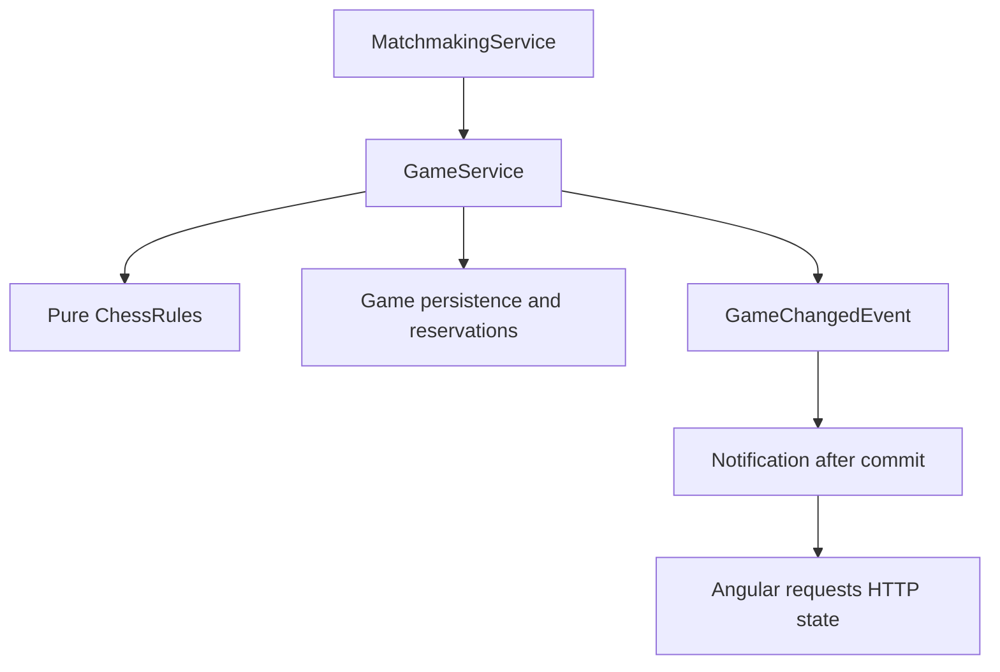
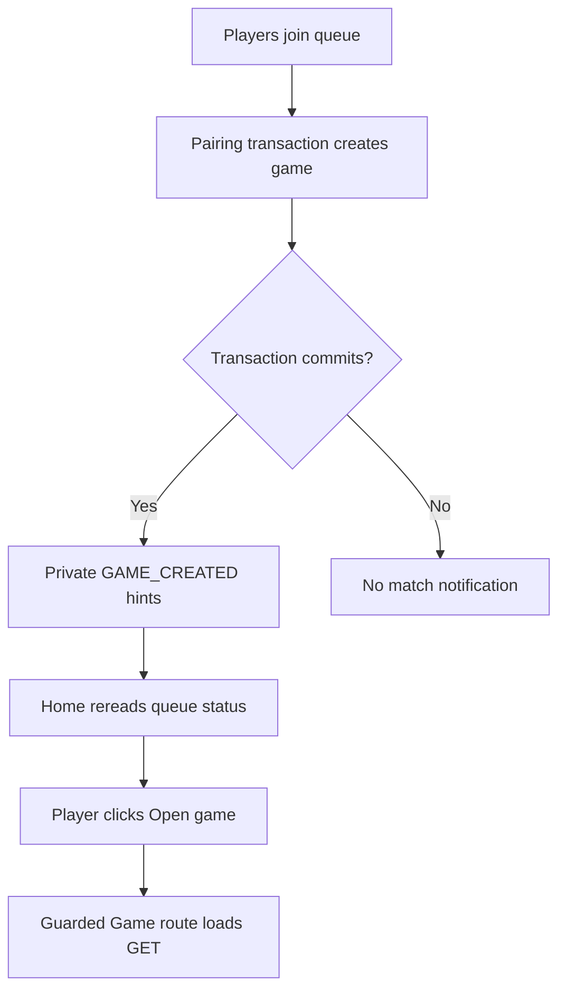
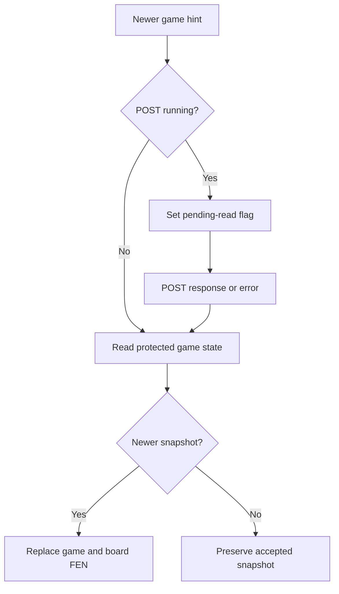
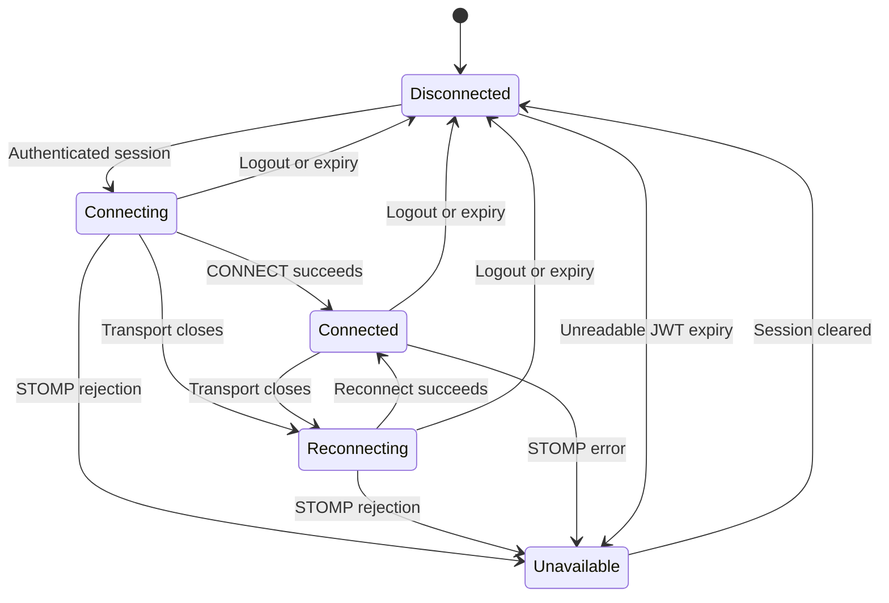
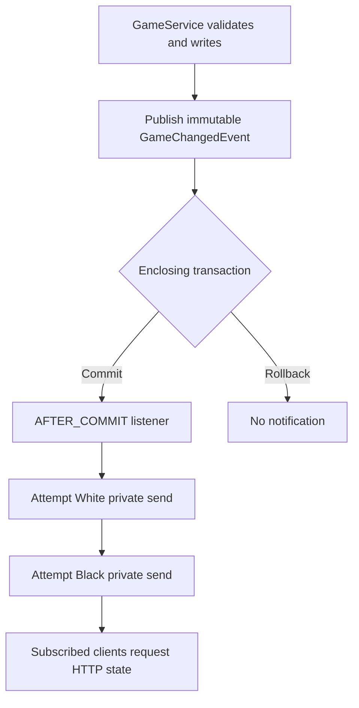
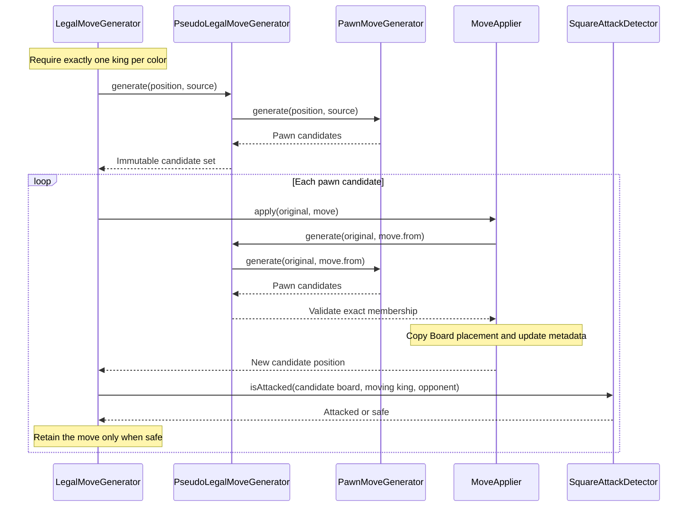

# Main documents through Day 20

Historical snapshot before the Day 21 documentation synchronization. Current behavior is described in the main documents.


---

## README.md

# Chess Web App

A backend-focused chess portfolio project built as a modular monolith with conventional feature layers. It implements its own pure Java rules engine and a minimal Angular interface.

## Current checkpoint

Day 20 adds authenticated WebSocket/STOMP notifications for matchmaking and gameplay, after-commit delivery, session-expiry checks, reconnect recovery and periodic HTTP reconciliation. Source-reviewed on 30 October 2026 against the actual `chess-web-app-day20-end.zip`.

The user reports that the implementation looks good. Tests are treated as green under the standing working agreement unless failures are reported. No tests, builds, migrations or browser checks were run by the assistant. Source review does not establish independent runtime acceptance. See [review and coverage](../day20-realtime-review.md).

## Capabilities

- Registration/login, BCrypt password handling, JWT authentication and self-profile GET/username PATCH.
- Persistent matchmaking with atomic pairing, oldest-first eligibility and one active-game reservation per Player.
- Immutable chess rules: all pieces, king safety, explicit promotion, en passant, standard castling and normal/check/checkmate/stalemate assessment.
- Participant-protected game GET and versioned HTTP move commands with optimistic concurrency protection.
- Atomic checkmate/stalemate completion, persisted results and release of both active reservations.
- Custom Player-oriented board, explicit promotion/cancellation and server-accepted FEN display.
- Private live notifications, automatic queue/game reads, deferred reconciliation during commands, heartbeats and reconnect recovery.

**Pairing does not automatically navigate to the board.** Home updates to show the matched game; the Player clicks **Open game**. This is the intended Day 20 behavior.

## Stack

Java 21, Spring Boot 4.1.1, Gradle wrapper 9.8.1, PostgreSQL, JPA, Flyway, Spring Security/JWT, Lombok and YAML. Angular 21, Angular Material, signals, RxJS and `@stomp/stompjs` (declared `^7.5.0`).

## Run locally

Keep database and JWT configuration user-managed in `backend/src/main/resources/application.yaml`. Flyway migrations V1–V6 provide the schema; Hibernate validates it.

From `backend/`:

```bash
./gradlew bootRun
```

From `frontend/`, using compatible Node tooling and the declared npm 11.6.2:

```bash
npm ci
npm start
```

Open http://localhost:4200. The development proxy forwards `/api/**`, including WebSocket upgrades, to port 8080. Restart the dev server after proxy changes.

Backend WebSocket routing is configured under `app.websocket`; matching frontend addresses and timing are in `frontend/src/app/notification/config/realtime.config.ts`. See [configuration and protocol](../api-contracts.md#real-time-updates).

## Verification

Suggested commands, not assistant-executed results:

```bash
# From backend/, no database needed for these focused tests:
./gradlew test --tests 'com.chessapp.notification.*' --tests 'com.chessapp.game.service.GameMoveServiceTest'

# With the configured PostgreSQL test database:
SPRING_PROFILES_ACTIVE=test ./gradlew test
```

From `frontend/`:

```bash
npm test -- --watch=false
npm run build
```

Backend reports are generated under `backend/build/reports/tests/test/`. Frontend tests remain the existing focused authentication suite. The [Day 20 review](../day20-realtime-review.md) distinguishes source-confirmed coverage from missing tests and suggested manual scenarios.

## Current limits

Notifications are live hints, not durable move history or guaranteed delivery. HTTP reads recover current state; commands are never automatically replayed. Sessions are in memory, so browser reload requires login again.

There are no clocks, history/replay interface, resignation/agreed draws, repetition/move-count/dead-position draws, acceptance stage or abandonment policy. Closing the page, disconnecting or logging out does not finish a game or release its reservations. Spectators, chat, AI, external brokers and distributed deployment remain outside current scope. The custom board has no legal-move highlighting, drag-and-drop or persistent check indicator.

## Documentation

- [Architecture](../architecture.md): current ownership and boundaries.
- [API and real-time contracts](../api-contracts.md).
- [Frontend gameplay flow](../frontend-gameplay-flow.md): Angular and board coordination.
- [Real-time flow](../realtime-updates-flow.md): diagrams for security, commit timing and recovery.
- [Development progress](../development-progress.md), [roadmap](../roadmap.md) and [frontend setup](../../frontend/README.md).
- [Movement pipeline](../movement-pipeline-architecture.md): pure rules companion.
- [Day 20 source review](../day20-realtime-review.md) and [next-session handoff](../day20-handoff.md).
- [Historical main-document checkpoints](main-documents-through-day19.md). Existing Day documents retain their historical scope.


---

## frontend/README.md

# Chess Frontend

Angular 21 standalone frontend with Angular Material, signals, RxJS, in-memory authentication and a custom board. Current Day 20 source was reviewed on 30 October 2026. No assistant build/test/browser run is claimed; see [review](../day20-realtime-review.md).

## Run

From frontend/, use compatible Node tooling and the declared npm 11.6.2:

```bash
npm ci
npm start
```

Open http://localhost:4200. The start script enables proxy.conf.json, forwarding `/api/**` and WebSocket upgrades to port 8080. Restart the dev server after proxy changes. If a generated lazy chunk returns 404 after dependency/rebuild changes, restart, wait for successful compilation and hard-refresh. If needed, stop the server and use `npx ng cache clean`, then restart. This was the reported Day 20 development issue, subsequently reported resolved; it is not a game-rule failure.

## Authentication and navigation

Login stores the token, fetches `/players/me` and establishes authentication when both token and Player exist. Sessions are in memory; browser reload requires login again. Protected 401 handling compares the request token with the current session before clearing it. Failed forms preserve passwords.

Home supports profile editing and persistent matchmaking. It reads queue state on entry, private updates and successful connections. A single pending read is drained after a current command/read. Unknown/WAITING/MATCHED status has 30-second recovery checks; NOT_QUEUED is idle. Home’s signal is named queueStatusResponse in this checkpoint.

**A match reveals Open game; it does not automatically navigate.** The Player clicks the link to open the guarded game route. Home now has separate home.ts, home.html and home.css files.

## Gameplay

Game owns GET snapshots, versioned POST commands, promotion and recovery. ChessBoard receives FEN/orientation/enabled and emits proposed coordinates. Game/board templates and CSS remain separate. The board does not validate chess legality or perform optimistic piece moves.

Select an own piece and destination; select another own piece to change source or click the selected square to cancel. Promotion requires an explicit choice; cancel sends no request and leaves no stale source. Castling proposes the king’s source/destination. En passant proposes the capturing pawn’s source/destination.

Relevant newer notifications request GET. A pending read waits during POST; safety reads can be cancelled before submission. Same-version reads preserve snapshot identity/promotion, and older reads cannot overwrite a newer snapshot. Read failures block proposals; stale/uncertain command outcomes reconcile through GET without replay.

Games also reconcile after reconnect/focus and periodically while visible with a loaded active snapshot. The board stays visible during background reads. GET does not expose positionStatus, so there is no persistent check indicator. Terminal results disable moves; returning Home reads queue state and released Players can join again.

## Real-time connection

App instantiates RealtimeService once. It observes token/authentication, recreates subscriptions on reconnect, validates update payloads and ignores callbacks from replaced sessions. Heartbeats detect transport failures. Local expiry/logout deactivates the connection; expiry also navigates to login. STOMP rejection marks live delivery UNAVAILABLE while HTTP/manual recovery remains available.

@stomp/stompjs is declared as ^7.5.0. REALTIME_CONFIG supplies matching backend addresses plus reconnect/heartbeat/recovery timing. Backend YAML is not read by Angular.

## Verification and limits

Optional user-run commands:

```bash
npm test -- --watch=false
npm run build
```

The existing five auth-flow.spec.ts tests are unchanged. There is no new notification/game coordinator suite in the ZIP. Suggested two-session scenarios are in the [review](../day20-realtime-review.md).

No move list/replay, clocks, drag-and-drop or legal-move highlighting. Disconnecting never decides game completion or releases reservations. No durable notification replay, auto board navigation or persisted login session is supplied.

See [gameplay coordination](../frontend-gameplay-flow.md), [real-time diagrams](../realtime-updates-flow.md), [contracts](../api-contracts.md), [architecture](../architecture.md) and [roadmap](../roadmap.md).


---

## docs/architecture.md

# Architecture

This document describes the current Day 20 system, source-reviewed on 30 October 2026 against `chess-web-app-day20-end.zip`. Earlier checkpoint narratives are preserved in [history](main-documents-through-day19.md). Verification evidence and scope limits are recorded in the [Day 20 review](../day20-realtime-review.md).

## Application structure

One Spring Boot application, organized by feature with conventional controller/service/DTO/entity/repository layers. Keep `Player` terminology. This is a modular monolith, not DDD or a collection of microservices. Cross-feature operations use services or application events rather than another feature’s repositories.

| Feature | Responsibility |
| --- | --- |
| auth | Registration, local credentials and login orchestration |
| player | Player creation/lookup, self-profile and username updates |
| security | HTTP security, password encoding, JWT signing/validation |
| matchmaking | Persistent queue, eligibility and transactional pairing |
| game | Game creation/read/move commands, reservations, lifecycle, immutable rules and game events |
| notification | WebSocket configuration/security, private outbound notifications and session access tracking |
| common | Shared timestamps and validation/error infrastructure |

Controllers translate transport input. Services own authorization, use-case orchestration and transactions. Repositories stay within their feature. Concrete services and explicit record mappings remain sufficient; mapper frameworks and additional service interfaces are unnecessary without a concrete need.



## Authentication and profile

Transactional registration creates a Player through PlayerService and stores encoded credentials in auth. Scalar Player IDs avoid cross-feature entity coupling. PostgreSQL uniqueness constraints remain authoritative when availability checks race.

Login validates credentials, issues HS256 JWTs and then Angular loads `/players/me`. JWT subject contains the Player ID. The shared JwtDecoder validates signature, issuer, timestamps, a required expiry and positive Long subject. HTTP timestamp validation has its existing 60-second tolerance; WebSocket checks additionally enforce the stated expiry strictly.

The frontend stores token/Player in memory. Its interceptor attaches bearer tokens only to relative protected `/api/` requests. A protected 401 clears the matching session; stale responses cannot clear a different current token. A 403 does not invalidate the session. Login/register failure retains passwords. Username PATCH updates the current session profile without changing JWT identity. Exact, case-sensitive identity matching remains the implemented policy.

## Persistence and transactions

PostgreSQL is durable storage. Applied Flyway migrations are immutable; future schema changes use new migrations. Hibernate validates rather than generates the schema; Open EntityManager in View is disabled.

| Migration | Responsibility |
| --- | --- |
| V1 | Players |
| V2 | Local credentials |
| V3 | Matchmaking queue and ordering index |
| V4 | Games, participants, FEN and optimistic version |
| V5 | Active-player reservations and initial backfill |
| V6 | Completion fields and lifecycle consistency constraints |

BaseEntity timestamps use JPA callbacks. SQL defaults support non-JPA insertion; direct SQL updates do not automatically advance `updated_at`. Identity sequences need not rewind after rollback.

Queue operations acquire the same PostgreSQL transaction-level advisory lock. This serializes cooperating operations on the single queue, including status reads. Repeated join preserves enqueue time through an upsert. Pairing selects the oldest eligible entries, assigns colors, invokes GameService and removes both queue entries in one transaction.

GameService flushes game creation before inserting JDBC reservations that reference it. JPA and JdbcTemplate share the datasource and transaction. The reservation table’s Player primary key enforces one active game across either color. Incomplete reservation or release counts fail the transaction. Leaving the waiting queue does not cancel an established game.

## Pure chess rules

`game.rules` contains no Spring, JPA, HTTP or notification concerns. Immutable Piece/Square/Move records, Board and ChessPosition represent placement and metadata. Board currently uses map storage and identity equality; tests compare board contents or FEN rather than assuming value equality for Board.

| ChessRules operation | Responsibility |
| --- | --- |
| initialPosition() | Standard starting position |
| legalMoves(position) | Complete immutable set for the side to move |
| applyMove(position, move) | Exact legal-set membership, then shared application |
| evaluate(position) | NORMAL, CHECK, CHECKMATE or STALEMATE |

GameRulesConfig constructs the six pseudo-legal strategies, dispatcher, shared applier, attack detector, legal filter and evaluator. Sliding pieces share ray traversal. Attack detection includes pinned attackers; generated moves exclude king captures. Legal filtering checks the moving king on the resulting board. Castling additionally checks the original and transit positions.

FenParser validates structural representation, not historical reachability. FenSerializer is separate. Promotion choices are explicit; there is no automatic queen. En passant and castling use the shared immutable application pipeline. Rights are historical metadata and are never restored by returning a piece or promoting a rook.

The facade does not own authorization, persistence, version checks or transactions. FEN alone cannot establish repetition history. See the [movement pipeline companion](../movement-pipeline-architecture.md).

## Game commands and lifecycle

Both participants may read a game, including after completion. Commands derive the acting Player from the JWT, never from request-supplied identity.

For a well-formed move command, GameService checks existence, membership, lifecycle, expected version, turn and legal membership. It applies and evaluates the move through ChessRules before mutating the managed game. Flush advances the optimistic version and detects competing writes. A losing optimistic update becomes STALE_GAME_VERSION.

Checkmate sets the mover’s winning result; stalemate sets DRAW. Completion FEN, result/reason/time and deletion of both reservations commit or roll back together. Flush is not commit. Version is a concurrency token, not a separately defined move number.

## Internal events and real-time delivery

GameService publishes immutable GameChangedEvent values after creation/reservation success or after move flush/release success. They carry game/participant IDs, version and GAME_CREATED/GAME_UPDATED. The game feature imports no WebSocket transport.

GameNotificationListener runs AFTER_COMMIT and sends a small PlayerUpdate to both participant user destinations. During matchmaking it waits for the outer pairing transaction, including queue removal. A rollback produces no notification. Terminal moves use GAME_UPDATED; HTTP GET supplies the result.

Sending is best-effort. Each recipient attempt catches runtime send failures so the other recipient is still attempted and a committed command is not reported as a delivery failure. There is no outbox, durable replay, acknowledgement guarantee or external broker. No database writes occur in the listener.

## WebSocket security

The configured HTTP GET endpoint permits the upgrade. STOMP CONNECT must supply exactly one bearer Authorization header and pass the existing decoder plus strict expiry. The interceptor assigns a canonical Player-ID principal and removes the native header entry; the authenticated principal still retains the JWT.

Only the exact configured private subscription is allowed. Direct broker paths, another user’s path, wildcards and client SEND commands are rejected. User routing is not itself authorization; the inbound interceptor enforces this policy. Backend event recipients come from stored participants.

WebSocketSessionAccess stores expiry by session ID. Outbound application messages require an unexpired registered session both before enqueueing and immediately before outbound handling. Disconnect removes the entry idempotently. This filters delivery, not proactive socket closure at the expiry instant; an already transmitted message cannot be recalled.

The frontend deactivates on logout, session replacement and local expiry. Browser timers are best-effort, so backend checks remain authoritative. Token decoding in the browser schedules cleanup; it does not validate signatures.

## Angular orchestration

App instantiates one RealtimeService independently of route navigation. It recreates private subscriptions after reconnecting, ignores stale-session callbacks, validates incoming update shape and exposes signals/observables. STOMP errors mark live delivery unavailable; HTTP still determines session validity.

Home reads queue state on entry, notifications and connection events. One pending read is drained after any current queue command/read. Periodic checks run for unknown, WAITING and MATCHED state; NOT_QUEUED is idle. Pairing reveals an Open game link rather than forcing navigation.

Game owns authoritative snapshots, promotion, commands and recovery. Route switchMap cancels old-route reads; exhaustMap permits one GET at a time. Notifications received during GET/POST coalesce into a pending read. A safety GET may be cancelled before a move POST starts. Unchanged versions preserve snapshot identity and promotion; older responses cannot replace newer state. Known-newer notifications block proposals until reconciliation. There is no automatic command retry.

ChessBoard owns rendering/orientation/selection and emits coordinates. Its selection-reset effect observes FEN, orientation and enabled inputs. It clears selection before emitting, so cancelling promotion leaves no stale source. Home, Game and ChessBoard use separate HTML/CSS files.

## Configuration and deployment boundary

`app.websocket` binds to WebSocketProperties with constructor validation. Endpoint registration, HTTP permission, subscription authorization and sending consume this shared object. Destination paths are derived from prefixes plus updates-path. The configured heartbeat range is 1–300 seconds. A lazily injected broker scheduler enables heartbeats.

Angular’s REALTIME_CONFIG contains matching routing addresses and its own timing settings. Backend YAML is not automatically published to the browser. Development proxying includes WebSocket upgrades. Configuration/secrets remain user-managed.

The simple broker and session registry are in-process. Current delivery assumes a single application instance. Multi-instance notification routing requires a separate design, even though database concurrency guards continue to protect shared state.

## Deferred scope

History/replay, clocks, extra draws, resignation/agreement, acceptance, abandonment/disconnect completion, ratings and statistics remain separate milestones. Custom board polish/library integration is optional. Closing a page does not finish a game. See [roadmap](../roadmap.md) and the two flow companions for details.


---

## docs/api-contracts.md

# API Contracts

Current Day 20 contracts, source-reviewed on 30 October 2026 against `chess-web-app-day20-end.zip`. Tests follow the standing user agreement; the assistant ran no tests/builds or independent runtime acceptance checks. Earlier checkpoint narratives are preserved in [history](main-documents-through-day19.md).

## Shared conventions

- Protected endpoints require `Authorization: Bearer <token>`.
- Protected self-service actions derive player identity from the validated JWT subject; clients do not choose the acting player ID.
- MVC validation returns Problem Detail with `code: VALIDATION_FAILED` and an `errors` array containing `field` and `message`. Rejected password values are omitted.
- Duplicate-identity and feature-owned exceptions return Problem Detail with their application code.
- Missing/invalid bearer credentials use Spring Security handling; no application code or uniform MVC error body is guaranteed.
- Deleted-player failures from profile GET/PATCH use `ResponseStatusException` with 401; no application code is guaranteed. Matchmaking has its own `AUTHENTICATED_PLAYER_UNAVAILABLE` code.
- Malformed JSON, incompatible field types, path conversion failures and unexpected server errors may have different bodies. Clients need a generic fallback.
- The frontend handles protected 401 session cleanup centrally; action-specific UI handles known codes. A 403 does not invalidate the session.

## Endpoint index

| Method | Route | Authentication | Successful response |
| --- | --- | --- | --- |
| POST | `/api/v1/auth/register` | Public | 201; `playerId`, `username`, `email` |
| POST | `/api/v1/auth/login` | Public | 200; `accessToken`, `tokenType`, `expiresIn` |
| GET | `/api/v1/players/me` | Bearer JWT | 200; `id`, `username`, `email` |
| PATCH | `/api/v1/players/me` | Bearer JWT | 200; updated `id`, `username`, `email` |
| POST | `/api/v1/matchmaking/queue` | Bearer JWT | 200; queue status |
| GET | `/api/v1/matchmaking/queue/me` | Bearer JWT | 200; queue status |
| DELETE | `/api/v1/matchmaking/queue/me` | Bearer JWT | 204; no body |
| GET | `/api/v1/games/{gameId}` | Participant bearer JWT | 200; game state |
| POST | `/api/v1/games/{gameId}/moves` | Participant Bearer JWT | 200; GameMoveResult |

There is no public game-creation endpoint: pairing invokes creation internally. Participant-authenticated POST /api/v1/games/{gameId}/moves delegates to GameService. Pure rules exceptions are not themselves the HTTP contract; game-owned application exceptions map gameplay rejections.

## Register — POST `/api/v1/auth/register`

Request fields: `username`, `email`, `password`.

Username: nonblank, 3–30 Java UTF-16 string units. Email: nonblank, valid email format, at most 255 units. Password: nonblank, at least 8 units and at most 72 UTF-8 bytes. No trimming or normalization is applied. Success returns the registered identity without credentials or a token.

| Failure | Status | Application code |
| --- | --- | --- |
| Invalid fields | 400 | `VALIDATION_FAILED` |
| Username taken | 409 | `USERNAME_ALREADY_EXISTS` |
| Email registered | 409 | `EMAIL_ALREADY_EXISTS` |

## Login — POST `/api/v1/auth/login`

Request fields: `email`, `password`. Email matching is exact. Login validates nonblank fields, email format/maximum length and the BCrypt byte maximum; it does not impose registration's minimum password length.

Success returns `accessToken`, `tokenType: Bearer` and `expiresIn` in seconds, with `Cache-Control: no-store`. The frontend then loads the self-profile. Unknown accounts and incorrect/missing local credentials receive the same invalid-credentials response.

| Failure | Status | Application code |
| --- | --- | --- |
| Invalid fields | 400 | `VALIDATION_FAILED` |
| Invalid credentials | 401 | `INVALID_CREDENTIALS` |

## Read self-profile — GET `/api/v1/players/me`

No request body. Success returns the current database-backed `PlayerResponse` (`id`, `username`, `email`).

| Failure | Status | Application code |
| --- | --- | --- |
| Missing, invalid or expired token | 401 | Not guaranteed |
| Authenticated player no longer exists | 401 | Not guaranteed |

## Update username — PATCH `/api/v1/players/me`

Request:

```json
{
  "username": "new_username"
}
```

Success: 200 with the existing `PlayerResponse` shape:

```json
{
  "id": 1,
  "username": "new_username",
  "email": "player@example.com"
}
```

### Rules

- Only the authenticated player's username changes. Email and ID are unchanged.
- Username must be nonblank and 3–30 Java UTF-16 string units long. Some supplementary Unicode characters occupy two units.
- Matching is exact and case-sensitive. Spaces and special characters are allowed; whitespace-only values are rejected. No trimming or normalization is performed.
- Submitting the current username succeeds without changing the entity or its update timestamp.
- Availability prechecks provide feedback; the existing PostgreSQL unique constraint protects against conflicting writes under concurrency.
- Existing JWTs remain valid because their subject contains the stable player ID.
- Concurrent edits to the same player's username use last-write-wins behavior.
- Missing/null username is invalid. This endpoint is a username-specific update, not a general JSON Patch or JSON Merge Patch implementation. Additional fields are outside its supported contract.

| Failure | Status | Application code |
| --- | --- | --- |
| Invalid username | 400 | `VALIDATION_FAILED` |
| Username taken | 409 | `USERNAME_ALREADY_EXISTS` |
| Missing, invalid or expired token | 401 | Not guaranteed |
| Authenticated player no longer exists | 401 | Not guaranteed |

A representative validation response is:

```json
{
  "type": "about:blank",
  "title": "Request validation failed",
  "status": 400,
  "detail": "One or more request fields are invalid",
  "instance": "/api/v1/players/me",
  "code": "VALIDATION_FAILED",
  "errors": [
    { "field": "username", "message": "must not be blank" }
  ]
}
```

Validation messages and the number of entries depend on the input and validator. Clients should use `field` and `code` rather than match literal messages.

## Queue join/status/leave

POST `/api/v1/matchmaking/queue` joins and attempts pairing. GET `/api/v1/matchmaking/queue/me` reads status. DELETE `/api/v1/matchmaking/queue/me` removes waiting membership and returns 204, including repeated leave requests.

Queue responses contain `status`, `enqueuedAt` and `gameId`. `WAITING` has an enqueue timestamp; `MATCHED` has a game ID. Inapplicable fields are null under the current DTO. Status is `NOT_QUEUED`, `WAITING` or `MATCHED`.

Repeated joins preserve the original waiting timestamp or return the existing active game. Leaving does not cancel an established game. Logout does not leave the queue. Pairing is triggered on join. Day 20 notifications request queue reads automatically; manual refresh remains available. Home offers Open game after discovering MATCHED and does not automatically navigate.

| Action | Failure | Status | Application code |
| --- | --- | --- | --- |
| Join, status, leave | Missing, invalid or expired token | 401 | Not guaranteed |
| Join, status, leave | Authenticated player no longer exists | 401 | `AUTHENTICATED_PLAYER_UNAVAILABLE` |
| Join during pairing | Reservation conflict with another game-creation caller | 409 | `PLAYER_ALREADY_IN_GAME` |

An ordinary repeated join by an already matched player returns 200 `MATCHED`; it is not a conflict. The reservation-conflict case describes a competing creation race and rolls back the pairing transaction.

## Read game — GET `/api/v1/games/{gameId}`

No request body. Success returns id, whitePlayerId, blackPlayerId, status, currentFen, createdAt, version, result, terminationReason and finishedAt through GameResponse.from(game). Either participant can read; opponent profile/email is not returned. New games start in IN_PROGRESS at the initial FEN. Accepted commands advance FEN/version and may produce FINISHED. Completion fields are null during active play. GET does not reevaluate the position and has no positionStatus.

| Failure | Status | Application code |
| --- | --- | --- |
| Missing, invalid or expired token | 401 | Not guaranteed |
| Game does not exist | 404 | `GAME_NOT_FOUND` |
| Authenticated requester is not a participant | 403 | `GAME_ACCESS_DENIED` |

## Submit move — POST `/api/v1/games/{gameId}/moves`

Authenticated Player identity comes from the validated JWT subject.

```json
{
  "expectedVersion": 0,
  "from": "e2",
  "to": "e4",
  "promotion": null
}
```

expectedVersion is required and nonnegative. Coordinates are required lowercase algebraic squares from a1 through h8 and must differ. Promotion is omitted/null or exactly QUEEN, ROOK, BISHOP or KNIGHT; board-dependent validity remains in the rules pipeline. No automatic queen choice is supplied.

Success returns 200 with gameId, currentFen, version, positionStatus, status, result, terminationReason and finishedAt. positionStatus assesses the side to move and is NORMAL, CHECK, CHECKMATE or STALEMATE. Lifecycle is IN_PROGRESS/FINISHED; results are WHITE_WIN/BLACK_WIN/DRAW; implemented termination reasons are CHECKMATE/STALEMATE.

| Failure | Status | Application code |
| --- | --- | --- |
| Invalid request fields | 400 | VALIDATION_FAILED |
| Missing/invalid bearer credentials | 401 | Not guaranteed |
| Nonparticipant | 403 | GAME_ACCESS_DENIED |
| Missing game | 404 | GAME_NOT_FOUND |
| Finished game | 409 | GAME_ALREADY_FINISHED |
| Stale observed/concurrent version | 409 | STALE_GAME_VERSION |
| Wrong turn | 409 | NOT_PLAYERS_TURN |
| Well-formed illegal proposal | 422 | ILLEGAL_GAME_MOVE |

Request validation precedes service lookup. Well-formed command precedence is missing game, membership, lifecycle, version, turn and exact legal membership. Malformed JSON/incompatible types return 400 without promising VALIDATION_FAILED. Unexpected rules/stored-state failures are not broadly reclassified as client illegality.

Clients use the accepted response version for the next command. Reload stale state without automatically replaying a move. An uncertain network failure may follow a commit, so read before proposing another move.

The Angular page preserves GET-only participant metadata when applying a POST response. Both participants can read a finished game. Terminal release permits another queue join. Day 20 GAME_UPDATED notifications request a fresh GET for the opponent as well. No history-listing endpoint is implemented.

## Real-time updates

WebSocket messages are server-to-client change hints. Existing REST routes and error precedence are unchanged by Day 20; move commands remain HTTP POST.

### Addresses and configuration

Values below are those in the reviewed source, not mandatory deployment URLs.

| Setting | Reviewed value |
| --- | --- |
| app.websocket.endpoint | /api/v1/ws |
| app.websocket.allowed-origin | http://localhost:4200 |
| app.websocket.application-prefix | /app |
| app.websocket.user-prefix | /user |
| app.websocket.broker-prefix | /queue |
| app.websocket.updates-path | /updates |
| app.websocket.time-to-first-message | 10s |
| app.websocket.heartbeat-interval | 10s |
| Derived backend user-send destination | /queue/updates |
| Derived client subscription destination | /user/queue/updates |

WebSocketProperties validates literal slash-prefixed paths with no wildcards/trailing slash; HTTP(S) origin without path/query/fragment; nonoverlapping routing prefixes; first-message timeout 1ms–2147483647ms; heartbeat interval 1–300 seconds. An invalid constructor-bound configuration prevents startup. Validation does not validate all deployment/browser/proxy combinations.

The endpoint’s HTTP GET upgrade is permitted, with the configured origin restriction. STOMP CONNECT requires exactly one native header:

```text
Authorization: Bearer <JWT>
```

The existing decoder verifies the JWT. An additional strict expiry check applies. The canonical principal name is the decimal Player ID. No token is placed in the URL. Removal of the native Authorization header does not erase the JWT retained by the authentication principal.

### Client operations

| Operation | Policy |
| --- | --- |
| CONNECT / STOMP | Authenticate with bearer JWT |
| SUBSCRIBE | Authenticated and unexpired; exact configured private destination only |
| UNSUBSCRIBE | Authenticated and unexpired |
| Heartbeat | Authenticated and unexpired |
| DISCONNECT | Allowed for cleanup, including framework-generated cleanup |
| SEND and other client commands | Rejected |

No game-topic, spectator or client-publication contract is supplied. Raw broker paths, another user’s destination and wildcard subscriptions are forbidden. STOMP failures are not REST Problem Detail responses; clients must not assume MVC error codes on the socket.

### Server update

```json
{
  "type": "GAME_UPDATED",
  "gameId": 10,
  "version": 3
}
```

Type is GAME_CREATED or GAME_UPDATED. GameService events provide both stored participant IDs; the notification listener sends the hint to each Player after commit. GAME_UPDATED includes terminal moves. Each Player’s subscribed sessions may receive the notification; the payload has no FEN, move, result or opponent profile.

Angular validates recognized type, positive safe-integer gameId and nonnegative safe-integer version. Unknown/malformed payloads are ignored. The version is an observed game concurrency version, not a separate move-history index.

### Delivery and recovery

- A rolled-back transaction sends no successful-change notification. During pairing, delivery waits for the outer transaction, including queue removal.
- The simple broker is in-process and does not provide persistent replay, subscription receipts or a delivery acknowledgement guarantee. A successful enqueue is not proof of browser receipt.
- CONNECTED means the connection succeeded and the client sent SUBSCRIBE, not that subscription registration has been acknowledged.
- Stale/duplicate hints at or below the displayed game version are ignored. Out-of-order higher hints cause a fresh HTTP read; a read cannot replace a newer snapshot with an older one.
- Home rereads on connection/update events, with 30-second checks for unknown/WAITING/MATCHED state. It does not force board navigation.
- Game rereads on relevant newer hints, connections and focus/visibility return. Visible loaded active games, or loaded games still requiring refresh, receive 30-second safety reads. Initial failed reads without a snapshot rely on manual refresh, connection/focus events or a new hint; the periodic filter requires a snapshot.
- Reconciliation waits during POST. A safety GET can be cancelled before POST. Commands are never replayed. Failed reads block proposals pending a successful read.

Server outbound application messages require a registered unexpired session at enqueue and handler checks. Disconnect removes access. Backend filtering does not proactively close the physical socket at the exact expiry instant; already transmitted messages cannot be recalled.

Frontend local expiry clears the in-memory session, deactivates the client and navigates to login. Transport close/error enables reconnect attempts. STOMP rejection stops automatic reconnect for that session and marks live updates unavailable; it does not by itself clear a still-current HTTP session.

### Frontend timing

REALTIME_CONFIG currently declares reconnect delay 5000ms, connection timeout 10000ms, heartbeat interval 10000ms and reconciliation interval 30000ms. Its endpoint/subscription must match backend configuration; YAML is not automatically exposed to Angular. Development `/api/**` proxying includes WebSocket upgrades.

## Keeping contracts synchronized

When changing an endpoint, update its owning DTO/service/controller, corresponding integration assertions, this action's contract and the checkpoint progress together. Keep feature error constants in their owning package. Tests verify documented behavior; this document does not establish that a test run passed.


---

## docs/development-progress.md

# Development Progress

## Current checkpoint — Day 20

Source-reviewed on 30 October 2026 against the actual user archive `chess-web-app-day20-end.zip`, compared with the attached Day 19 continuation baseline. The reviewed source includes the two Day 19 guard/message fixes. No blocking defect was found in the inspected Day 20 changes.

The user reports that the implementation looks good. Tests follow the standing agreement that failures will be reported. No assistant tests, builds, migrations or browser checks were run. There is no independent frontend build or comprehensive manual acceptance claim.

## Delivered in Day 20

- WebSocket starter, endpoint upgrade permission and WebSocket-enabled Angular proxy.
- YAML-backed WebSocketProperties, derived destinations, path/origin/duration validation and heartbeat scheduler.
- CONNECT authentication through the existing JwtDecoder; exact private-subscription authorization; rejected client publishing.
- Session expiry registry, idempotent disconnect cleanup and outbound expiry checks before enqueueing/handling.
- GameChangedEvent publication from GameService and private PlayerUpdate delivery after the enclosing transaction commits.
- RealtimeService connection lifecycle, stale-session guards, token-expiry cleanup, reconnect subscription recreation and payload validation.
- Automatic Home reads with one pending status read, explicit Open game navigation and extracted HTML/CSS.
- Game version filtering, one-at-a-time reads, deferred reconciliation during POST, cancellation of safety GET before POST, focus/reconnect recovery and visible-page periodic checks.

## Working sessions

| Session | Delivered scope |
| --- | --- |
| Days 1–3 | Project setup, authentication/profile foundation, Angular authentication and persistent queue foundation |
| Day 4 | Initial game persistence, active-player reservations, transactional pairing, matched-game discovery and participant-protected retrieval |
| Day 5 | Authenticated username PATCH, backend tests and Angular profile editor |
| Day 6 | Immutable representation, separate FEN parser/serializer and initial-position rules boundary |
| Day 7 | Move/board relocation, knight movement, candidate application, all-piece attack detection, king-safety filtering and test rendering |
| Day 8 | Strategy dispatch, rook movement, shared pipeline and corner-rook castling-right updates |
| Day 9 | Shared sliding traversal, bishop/queen strategies, centralized movement fixtures and pipeline tests |
| Day 10 | Ordinary king candidates, resulting-square king safety, irreversible king castling-right removal and associated tests |
| Day 11 | Guided ordinary pawn generation, pawn metadata application, registration, dispatcher coverage and king-safety tests; final source reviewed; user reports green tests |
| Day 12 | Explicit promotion choices, quiet/capture generation, immutable replacement, shared king safety/metadata and renderer/test updates; source reviewed; user reports green tests |
| Day 13 | En passant generation, immutable off-destination capture, defensive metadata handling, expiry and king-safety tests; source reviewed; user reports green tests |
| Day 14 | Standard castling for both colors/sides, immutable two-piece application, staged king safety and boundary tests; final source reviewed; green tests reported through king-safety increment |
| Day 15 | Complete legal-move enumeration, shared filtering, current-side position assessment, cross-package test fixtures and both-color special-move/check-escape regressions; source reviewed; user reports all tests green |
| Day 16 | Legality-enforcing rules facade, production wiring, facade special-move/assessment regressions and closing tests; source reviewed; historical passing evidence described above |
| Day 17 | GameService move commands, exact legal application, version protection, checkmate/stalemate results, atomic reservation release, V6 and entity/unit/PostgreSQL test sources; source-reviewed, green status per standing user instruction |
| Day 18 | JWT-derived HTTP move submission, validated requests, version/result-bearing reads, game-owned error contracts and HTTP integration coverage |
| Day 19 | Custom Angular gameplay: guarded navigation, board display, explicit promotion, versioned moves, manual refresh, recovery, completion feedback, separate component HTML/CSS and lifecycle guide; source-reviewed; guard/message follow-ups included in the Day 20 baseline |
| Day 20 | Authenticated private WebSocket/STOMP updates, typed YAML routing, after-commit game events, expiry filtering, heartbeat/reconnect handling, automatic Home/Game reconciliation and separate Home HTML/CSS |


## Source-confirmed test coverage

| Source | Inspected coverage |
| --- | --- |
| StompSecurityInterceptorTest | Valid CONNECT/principal/header removal, missing/invalid credentials, allowed private subscription, blocked alternative destinations, anonymous subscription, client SEND and expired subscription |
| StompOutboundSecurityInterceptorTest | Unexpired session, unknown/missing session, expiry while queued and repeated disconnect cleanup; disconnect fixture uses Message<byte[]> |
| GameMoveIntegrationTest | Existing game command/persistence/concurrency tests plus created-game notifications to both Players, delayed delivery until outer commit and suppressed delivery on rollback |
| GameMoveServiceTest | Existing rejection/order/rules-failure tests with the added event-publisher mock |
| Existing Angular auth-flow.spec.ts | Existing five focused authentication tests; unchanged |

The proposed WebSocketPropertiesTest is **not present** in this archive. There is no independent configuration-binding test, full STOMP socket delivery test or new frontend notification/coordinator test in this checkpoint. Code inspection and existing integration contexts do not replace those tests. These are coverage limits, not evidence that a failure occurred.

## Suggested verification

From backend/, focused checks without a database:

```bash
./gradlew test --tests 'com.chessapp.notification.*' --tests 'com.chessapp.game.service.GameMoveServiceTest'
```

With the configured PostgreSQL test database:

```bash
SPRING_PROFILES_ACTIVE=test ./gradlew test
```

From frontend/:

```bash
npm test -- --watch=false
npm run build
```

Suggested manual scenarios are in the [Day 20 review](../day20-realtime-review.md). Commands are supplied for the user; they were not run by the assistant.

## Current limits and working agreement

One queue and one in-process message broker; no durable notifications/history. HTTP commands remain authoritative and are not replayed. Sessions remain in memory. Disconnect/logout does not release reservations or determine a game outcome. Auto-navigation is not implemented by design. Additional game/rating policies remain in the [roadmap](../roadmap.md).

Continue with inline, explainable increments. The user implements production changes. Do not silently apply generated implementation archives. Documentation replacement packages are welcome. Keep feature service boundaries, pure Java rules, Player naming, useful comments, minimal frontend tests and separate component HTML/CSS. Preserve user-managed configuration. Treat tests as green unless failures are reported; do not execute tests/builds without an explicit request.

Historical checkpoint evidence is preserved in [the archive](main-documents-through-day19.md) and the existing Day documents.


---

## docs/roadmap.md

# Roadmap

## Current position

Working Days 1–20 identify actual sessions, not a rewritten version of the original 30-working-day estimate. The [progress document](../development-progress.md) lists delivered sessions. Day 20 implements authenticated real-time hints plus HTTP state recovery for matchmaking and gameplay.

The custom board is the MVP choice. Home automatically discovers pairing and offers Open game; automatic navigation is not a missing requirement.

## Next milestone selection

Start a new major milestone in a new chat after closing the Day 20 review/documentation commit. Recheck the latest source before implementation. Do not silently combine unrelated features.

Persisted move history is a reasonable next candidate: record accepted moves atomically, provide ordered participant-protected reads and later add a minimal move list. Existing games cannot recover earlier moves from their current FEN. History continuity/backfill policy must be explicit. Replay controls and SAN/PGN notation are separate scope choices.

A focused verification/reliability milestone is another candidate if desired: configuration-binding tests, actual STOMP security/delivery tests and selected frontend coordination tests. No broad frontend suite is required by the current agreement.

## Remaining capabilities

| Capability | Separate decisions needed |
| --- | --- |
| Move history | Stored fields, ordering, legacy games, read contract and minimal display |
| Replay/notation | Replay controls, SAN/PGN format and export |
| Clocks | Time controls, authoritative timing and timeout results |
| Extra outcomes | Repetition, move-count and dead-position draws; resignation/agreement |
| Disconnect policy | Grace periods, abandonment rules, reconnect behavior and reservation release |
| Match lifecycle | Acceptance stage, cancellation, queue expiry and rating filters |
| Player profile growth | Statistics, ELO and event-driven updates; account email/password actions |
| Delivery reliability | Whether durable outbox/replay or multi-instance routing is actually needed |
| Board polish | Optional styling, accessibility/interaction improvements or a justified library adapter |

These are candidates rather than promises to implement every item in the MVP. Redis/Kafka, spectators, tournaments, chat, engine analysis, AI and distributed scaling remain outside current scope.

## Engineering constraints

Preserve the modular monolith and conventional feature layers. Cross-feature calls use services/events; repositories stay owned by their feature. Pure rules remain free of transport/persistence dependencies. Keep Player terminology, versioned HTTP moves, atomic reservation/lifecycle updates, YAML configuration and separate component templates/styles.

Notifications are best-effort invalidation hints, not a command or durable move log. Closing a page does not finish the game. Browser session persistence/refresh tokens are separate decisions. Map-versus-array board evaluation remains deferred until a demonstrated benefit justifies it while preserving Board API.

## Historical plan

The original estimate and earlier milestone proposals are preserved in [historical main-document checkpoints](main-documents-through-day19.md) and existing Day documents. Historical pending features must not override the implemented Day 20 state.


---

## docs/frontend-gameplay-flow.md

# Frontend gameplay flow

This companion describes the actual Day 20 source reviewed on 30 October 2026. It supersedes the manual-refresh-only Day 19 flow preserved in [history](main-documents-through-day19.md). Source review is not an independent build or runtime acceptance result.

## Ownership

| Owner | Responsibility |
| --- | --- |
| GameService | Participant/turn/version/lifecycle checks, rules, persistence and completion |
| RealtimeService | Application-wide socket lifecycle, subscription and validated change hints |
| Home | Queue commands/status reads and explicit Open game navigation |
| Game | Authoritative snapshots, requests, promotion and reconciliation |
| ChessBoard | FEN projection, orientation, selection and move proposals |
| GameApiService | GET/POST transport |
| AuthSessionStore/interceptor | In-memory identity/token and protected HTTP handling |

Home, Game and ChessBoard each use separate HTML/CSS files. Templates are connected through templateUrl/styleUrl; separation changes file organization, not data flow.

## From pairing to an open board



Matchmaking creates the game before the route opens. Home updates automatically, but routing remains an explicit Player action. The game route never creates the game. The route guard checks local authentication; the backend separately enforces JWT and participant access.

## Signals and coordination

| Angular API | Use here |
| --- | --- |
| signal | Writable state such as game, submitting and pendingPromotion |
| computed | Derived interaction permission and board projections |
| input | Parent-supplied FEN, orientation and enabled state |
| output | ChessBoard moveProposed event |
| effect | Selection reset; connection lifecycle side effect |
| untracked | Avoid accidental signal dependencies during transport setup |

Signals are local reactive state; they do not observe database changes. WebSocket notifications and HTTP responses supply new information. Computed values track the signals actually read and derive cached values. Angular updates templates consuming changed signals without a manual board redraw.

Game.canSubmitMove requires a loaded active game, authenticated participant, no initial loading/submission/refresh requirement and displayed side-to-move matching that Player. Frontend permission improves interaction; the backend independently checks actual state.

## Board inputs and selection

Game passes currentFen, Player orientation and interaction permission to ChessBoard. The FEN display parser projects placement/side to move; it does not duplicate legal-move evaluation. Display orientation changes ordering, not algebraic coordinates. a1 remains dark.

The selection-reset effect deliberately reads fen(), orientation() and enabled(), then clears selectedSquare. It does not read selectedSquare and therefore does not subscribe to selection changes. An effect is a lifecycle-managed reactive side effect, not polling or a synchronous callback inside every signal.set().

Selecting an own piece stores its square. Selecting another own piece replaces it; clicking the source again clears it. A destination proposal clears selectedSquare **before** emitting. Game inspects promotion shape, then either requests an explicit choice or submits. Cancelling promotion sends no POST and leaves no stale selected source. The backend owns legality for ordinary and special moves.

## Read stream and route lifecycle

Game.route.paramMap uses outer switchMap to cancel the old route’s read stream. New route setup clears old game/promotion/messages and resets activeGameId/latestNotifiedVersion/pending-read state. A validated route starts its first GET immediately.

Within a route, refreshRequests uses exhaustMap so only one GET runs at a time. Additional required work is recorded in readPending instead of being silently lost. The coordinator uses a microtask to coalesce triggers and checks destruction, authentication, current route, reading and submitting before starting another read.

readSnapshot retains an existing board. loading represents a read with no snapshot; reading separately coordinates background work. A newer version replaces game and clears promotion. The same version preserves object identity, FEN and promotion. An older snapshot cannot replace newer accepted state. Successful reads clear obsolete move feedback unless the observed version is still below a known notification.

catchError sits inside the read operation so future triggers remain active. Failures set needsRefresh and an error. A 403/404 additionally removes the snapshot. finalize clears read flags and schedules pending work. takeUntilDestroyed tears down page streams; takeUntil(cancelReads) permits cancellation of a safety GET before POST.

## Read triggers

| Trigger | Behavior |
| --- | --- |
| Initial valid route | Immediate GET |
| Relevant hint above displayed version | Track highest hinted version, clear promotion, block proposals and queue GET |
| Hint at/below displayed version | Ignore |
| Successful initial/reconnection | Queue blocking synchronization |
| Window focus/visible return | Queue blocking synchronization |
| Manual refresh | Queue blocking synchronization, guarded against submission/initial loading |
| 30-second timer | Nonblocking safety read only while page visible with a loaded active game or loaded refresh-required state |

An initial GET failure without a loaded snapshot is not retried by that timer. It can recover through manual refresh, connection/focus events or relevant hints. Blocking synchronization can clear selection/promotion even when the resulting version is unchanged; only an unchanged **nonblocking safety read** preserves those interactions.

CONNECTED is a transport state after the client sends SUBSCRIBE. The simple broker does not acknowledge subscription registration. Reconciliation covers missed messages; it is not a strict delivery or timing guarantee.

## POST and notification ordering



Before POST, an enabled board can coexist only with a nonblocking safety read. Game cancels that GET, remembers a pending read, then submits using the current version. Notifications during POST queue a read; they never replace the in-flight command. POST finalize clears submitting and drains pending work.

A successful POST preserves participant metadata from GET and replaces accepted FEN/version/status/completion fields. Its snapshot-identity check ignores callbacks for a replaced route snapshot. Same-version reads preserve that identity. A notification received before the POST response may cause one harmless reconciliation GET afterward. If received after the accepted version is displayed, it is ignored.

## Failure and completion

| Situation | Behavior |
| --- | --- |
| Illegal move / invalid request | Feedback, no optimistic board update |
| Stale version / wrong turn / already finished | Queue GET, never retry POST |
| Uncertain transport/server outcome | Block proposals and queue GET; command may already have committed |
| Protected HTTP 401 | Existing session-aware interceptor clears/redirects |
| Read failure | Preserve blocked state; 403/404 removes snapshot |
| FINISHED snapshot/result | Show persisted outcome and disable moves |

Checkmate/stalemate release reservations in the backend transaction. Both Players learn completion through accepted POST or notification-triggered GET/recovery. Returning Home rereads status; another match is permitted after release. Closing the page or losing connectivity has no completion effect.

## File map and references

Game coordination is in frontend/src/app/game/pages/game/game.ts; board display in game/components/chess-board; transport in game/services/game-api.service.ts. Notification connection/config/models live under frontend/src/app/notification. Home’s current queue signal is queueStatusResponse and both pages expose realtimeService to their templates.

See [real-time delivery and security](../realtime-updates-flow.md), [contracts](../api-contracts.md), [review](../day20-realtime-review.md), [Angular signals](https://angular.dev/guide/signals) and [StompJS lifecycle](https://stomp-js.github.io/guide/stompjs/using-stompjs-v5.html).


---

## docs/realtime-updates-flow.md

# Real-time updates flow

Day 20 source companion, reviewed on 30 October 2026 against `chess-web-app-day20-end.zip`. This explains implemented behavior, not a planned transport. No assistant application test/build/browser run is claimed.

## Connection and subscription

App injects one root RealtimeService. Its effect reads token and isAuthenticated. When login has loaded both token and Player, it creates a client. Effect cleanup marks that client stopped, clears the expiry timer and deactivates it. Navigation between Home/Game does not intentionally create a new connection.



New credentials cause cleanup and a new lifecycle. Invalid/unreadable expiry marks the socket unavailable but leaves HTTP session validity to HTTP. STOMP rejection stops retry for the current socket lifecycle; transport failure normally permits retries. callbacks check captured token/current session/stopped to ignore old clients. No bearer frames are deliberately logged by the client debug callback.

The endpoint uses the page’s origin and ws/wss scheme. During development, the Angular proxy forwards upgrades. The browser supplies its bearer header inside CONNECT, not an arbitrary HTTP upgrade header or token query parameter.

## Authentication and private routing

The HTTP upgrade is permitted. Origin restriction and first-message timeout apply. CONNECT then uses the existing JwtDecoder and strict token expiry. The interceptor sets a canonical Player-ID principal and registers session expiry.

| Routing stage | Example |
| --- | --- |
| Upgrade endpoint | /api/v1/ws |
| Client subscribes | /user/queue/updates |
| Sender selects Player | convertAndSendToUser("42", "/queue/updates", update) |
| Broker destination | Session-specific internal /queue/... destination |

The same subscription string does not mean all Players share updates. Spring resolves it using user/session identity. A user can have multiple subscribed sessions. The inbound interceptor still explicitly authenticates and restricts the destination: user routing alone is not authorization.

Only the exact derived private subscription is accepted. Direct broker paths, user-ID-addressed paths, wildcard subscriptions and client SEND are rejected. The /app prefix separates hypothetical application handlers from broker routing; no WebSocket command handler is implemented.

Native Authorization removal changes the existing message’s mutable accessor. The interceptor returns the same message object, so assertSame can pass while a separate header-removal assertion also passes. The principal retains the JWT; native-header removal is not token erasure.

## Committed changes and notifications



createGame publishes after both reservations are verified. submitMove publishes after its flush and any completion reservation release. These events carry IDs, version and type, not managed entities. Game depends on ApplicationEventPublisher, not messaging transport.

Pairing calls createGame inside MatchmakingService’s transaction. The listener therefore waits for the outer transaction, including both queue deletions. A failure after GameService returns can still roll back and suppress delivery. Flush alone does not permit notification.

PlayerUpdate contains only type, gameId and version. GAME_CREATED leads Home to reread status. GAME_UPDATED covers ordinary and terminal moves; Game reads the current participant-protected snapshot. Terminal result fields are not duplicated into the notification contract.

The listener attempts each participant separately and logs runtime enqueue failures. It performs no database writes or fresh entity loads. It does not turn a failed send into a failed committed HTTP command.

## Expiry and cleanup

WebSocketSessionAccess holds session ID to expiry in a ConcurrentHashMap. Inbound operations check the authenticated JWT expiry. Outbound application messages check registered/unexpired access before sending to the outbound channel and again immediately before executor handling, covering time spent queued.

Disconnect removes the registry entry idempotently. Unknown/missing session IDs cannot receive application messages. Protocol establishment, heartbeat and cleanup messages are not filtered as application MESSAGE payloads by the outbound interceptor.

These checks do not schedule server-side physical closure at the exact expiry instant and cannot recall a transmitted message. The browser separately schedules local expiry, clears the current session, deactivates and navigates to login. Browser timers can be delayed; backend expiry remains authoritative. The existing HTTP decoder’s timestamp tolerance is unchanged.

## Heartbeats and delivery guarantees

The configured backend heartbeat is 10 seconds, validated between 1 and 300 seconds. A lazily injected messageBrokerTaskScheduler avoids a configuration cycle. StompJS requests incoming/outgoing 10-second heartbeats and discards an unresponsive transport so reconnect can proceed. Intervals are negotiated and browser scheduling is not an exact clock.

The in-memory simple broker has no persistent replay, subscription receipts or guaranteed browser acknowledgement. CONNECTED means a successful connection followed by a sent subscription request. A commit during the small registration window can be missed. A process failure between commit and notification can also lose the hint. This checkpoint does not introduce an outbox or exactly-once semantics.

## Recovery reads

| Consumer | Immediate reads | Periodic recovery |
| --- | --- | --- |
| Home | Entry, private updates and successful connections | Every 30 seconds for unknown/WAITING/MATCHED, not idle NOT_QUEUED |
| Game | Entry, relevant newer hints, connection/reconnect, focus/visible return and manual refresh | Every 30 seconds while visible with loaded active or refresh-required state |

Home coalesces events received during a queue command/read into one pending read. It updates MATCHED feedback but intentionally leaves Open game as an explicit action.

Game coalesces required reads during GET/POST. Safety reads retain the board and same-version object. A Player may start a POST during a safety read; the GET is cancelled first and a read is queued afterward. Known-newer hints block proposals until reconciled. Delayed hints and older snapshots cannot roll back accepted state. There is never an automatic POST retry.

If an initial Game read fails without a snapshot, the timer does not retry it. Manual refresh, focus/connection events or a relevant hint can retry. The recovery intervals improve eventual state discovery; they do not guarantee a strict 30-second bound during network failure or browser throttling.

## Configuration lookup

Backend settings live in application.yaml under app.websocket and bind to WebSocketProperties. Prefixes and updates-path derive both sending and allowed-subscription destinations. Endpoint registration and HTTP security use the same endpoint property. Frontend REALTIME_CONFIG separately supplies matching addresses and client timing. Do not assume editing YAML changes a compiled browser address.

The origin property is a single allowed HTTP(S) origin. Routing prefixes cannot overlap; literal-path validation rejects wildcards and trailing slashes. These are configuration checks, not proof of deployment correctness. User-managed JWT/database configuration is outside this documentation package.

## Tests and scope

Inspected tests cover inbound authorization, outbound expiry/cleanup and real PostgreSQL transaction notification timing with a mocked messaging template. Actual end-to-end socket routing, heartbeat negotiation, subscription readiness and Angular coordination are not independently automated in this ZIP. See [review](../day20-realtime-review.md).

No clocks, history, acceptance or disconnect outcome is added. This is a single-instance live notification path. Future durable/multi-instance requirements need their own design rather than assuming the simple broker scales transparently.

## References

- [Spring token authentication](https://docs.spring.io/spring-framework/reference/web/websocket/stomp/authentication-token-based.html)
- [Spring user destinations](https://docs.spring.io/spring-framework/reference/web/websocket/stomp/user-destination.html)
- [Transaction-bound events](https://docs.spring.io/spring-framework/reference/data-access/transaction/event.html)
- [Simple broker and heartbeat scheduler](https://docs.spring.io/spring-framework/reference/web/websocket/stomp/handle-simple-broker.html)
- [Simple broker limitations](https://docs.spring.io/spring-framework/reference/web/websocket/stomp/handle-broker-relay.html)
- [StompJS lifecycle](https://stomp-js.github.io/guide/stompjs/using-stompjs-v5.html)


---

## docs/movement-pipeline-architecture.md

# Movement pipeline architecture — Day 17

## Day 18 current checkpoint — HTTP gameplay

Authenticated POST /api/v1/games/{gameId}/moves now delegates to the existing
GameService command using JWT-derived Player identity. SubmitMoveRequest
validates request shape before conversion into Move. Specific gameplay
rejections have game-owned HTTP status/code mappings.

GameResponse.from(game) maps participant-protected reads, now including
version, result, terminationReason and finishedAt. Successful move commands
return the existing GameMoveResult.

The HTTP tests cover committed commands, POST/GET agreement, authentication,
validation, failure precedence, special moves and terminal results/release.
Tests are treated as green under the user's standing instruction; no
independent tests/builds or final Day 18 archive review are claimed.

No migration, runtime configuration, rules implementation or frontend
implementation changes are included. History, frontend gameplay, real-time
delivery, clocks and disconnect policy remain pending.

See [Day 18 HTTP gameplay](../day18-http-gameplay.md) for the contract and coverage.
Earlier checkpoint sections describe historical boundaries.

## Day 17 current checkpoint — source-reviewed, 28 October 2026

Reviewed the actual user implementation in `chess-web-app-day17-end(1).zip` against `chess-web-app-day16-end.zip`. No blocking defect was found in the reviewed Day 17 production/test changes. Tests are treated as green under the user's standing instruction to report failures; this is user-provided verification context, not an independent run or a detailed per-command log. No tests, builds or migrations were run by the assistant, and no separate frontend build result is claimed.

`GameService.submitMove(gameId, requestingPlayerId, expectedVersion, move)` now coordinates participant/turn checks, exact legal application, resulting-position assessment, current-FEN persistence, stale/concurrent-command rejection and atomic checkmate/stalemate completion with reservation release. `GameMoveResult.from(game, assessment)` owns mechanical result mapping; `Game.finish()` calls its extracted switch-based `validateResult()`. There is no separate production GameMoveService.

V6 adds completion fields and consistency constraints. GameStatus is IN_PROGRESS/FINISHED, with separate result, termination reason and finish time. The unchanged game GET response fields can now carry an advanced FEN and FINISHED status; version/result/reason/time remain absent from that HTTP response. No HTTP move route, move history, frontend gameplay or disconnect policy is added. See the [reviewed implementation and verification commands](../day17-gameplay-service.md).

Day 16 and earlier milestone sections below retain historical behavior/evidence. Their initial-only and pending-gameplay descriptions do not override this checkpoint. The earlier closing-test passing-status uncertainty is retained as historical provenance; current test status follows the user's later standing instruction.

### Historical Day 16 review provenance

Reviewed on 28 October 2026 against `chess-web-app-day16-end.zip`. Source inspection confirms the legality-enforcing facade, complete production strategy registration, facade regression tests and both [closing checks](../day16-closing-checks.md). No blocking defect was found in the reviewed Day 16 changes. The user reports all tests green through increments 1–2. Both later closing tests are present, but no subsequent explicit passing report was supplied for them. No tests or builds were run independently; no detailed test log or separate frontend build result was supplied.

The Day 16 section describes the inspected implementation and supersedes earlier initial-position-only boundary and test-only-construction statements. Historical sections retain the behavior and evidence available at those checkpoints.

## Day 16 application entry point — historical

`ChessRules` exposes `initialPosition()`, `legalMoves(position)`, `applyMove(position, move)` and `evaluate(position)`. Lookup returns the complete immutable legal set. Application requires exact membership in that set, including the promotion choice, before delegating to `MoveApplier`. Assessment returns `PositionStatus` for the side to move. The existing pipeline remains shared; no per-piece application services or duplicate movement algorithms are introduced.

`GameService` still calls only `initialPosition()` and serializes it for creation. Games remain at their initial FEN in `IN_PROGRESS`. Move submission, persistence/history, gameplay concurrency, terminal lifecycle and active-reservation release remain pending. No endpoint, DTO, migration or frontend implementation changes in Day 16. Authorization, transactions, persistence and concurrency remain service responsibilities.

The original walkthrough below explains the lower-level pipeline inspected in Day 15. Day 16 adds a facade around it:

1. A caller supplies the original ChessPosition and a proposed Move to ChessRules.applyMove().
2. StandardChessRules asks LegalMoveGenerator for the complete legal set. Candidate application and attack filtering still run as described below.
3. Exact set membership checks source, destination and optional promotion choice. A missing choice is not replaced with queen.
4. Only an accepted proposal is delegated to MoveApplier for the returned position. Both successful and rejected operations preserve the input.

StandardChessRules.legalMoves() delegates complete enumeration, and evaluate() delegates current-side assessment. Application does not automatically evaluate its result or persist it. Current application services still use initialPosition() only.

GameRulesConfig assembles the six-strategy dispatcher, shared applier/detector, legal generator and evaluator behind the facade. MovementTestFixtures remains public test-only infrastructure, reused for facade tests as well as movement/evaluation tests. Internal classes remain usable directly for focused unit tests; future gameplay callers must enter through the legality-enforcing boundary.

The accepted proposal is applied again after legal enumeration. This preserves the applier's direct-caller validation contract. The facade adds no alternative movement or metadata algorithm.

This companion to `docs/architecture.md` describes the implementation inspected in `chess-web-app-day15-end.zip` on 27 October 2026. The user reports all tests green after final Day 15 regressions. No tests or builds were run independently for this review.

## The central idea

Generate movement candidates for one piece, construct each resulting position, and retain candidates that satisfy king safety. Standard castling also needs safety checks before the final position is constructed.

The pawn exercises the broadest range of movement cases: ordinary advances, starting-rank double advances, diagonal captures, promotion and en passant. Castling adds a different kind of complexity to the king.

These stages are in-process Java calls inside `game.rules`. They are not HTTP requests, separate services, database transactions or events. The wider application remains a modular monolith with conventional feature layers.

## Ownership

| Component | Responsibility | Result |
| --- | --- | --- |
| `FenParser` | Convert structural FEN into immutable board and metadata | `ChessPosition` |
| `LegalMoveGenerator` | Generate from one source or across every moving-side piece; validate kings and enforce shared king/castling safety | Immutable `Set<Move>` |
| `PositionEvaluator` | Combine complete legal replies with current moving-king attack state | `PositionStatus` |
| `PseudoLegalMoveGenerator` | Select the registered strategy for the source piece type | Strategy-generated `Set<Move>` |
| `PawnMoveGenerator` | Enumerate pawn movement using geometry, occupancy, side to move and special-move metadata | Pseudo-legal candidates |
| `MoveApplier` | Validate exact candidate membership and construct the resulting placement and metadata | New `ChessPosition` |
| `Board` | Copy placement while relocating, replacing or removing pieces | New `Board` |
| `SquareAttackDetector` | Determine whether a specified color attacks a specified square on a supplied board | `boolean` |
| `FenSerializer` | Convert a position to FEN for representation or assertions | FEN string |

Pseudo-legal means the piece's movement and placement conditions are satisfied; it does not establish own-king safety. Legal filtering adds that safety and castling's path restrictions.

## Actual call structure

`LegalMoveGenerator` is the coordinator. The following diagram shows its calls for a pawn source; it is not a chain of independently running components.



Application regenerates candidates even though the caller has just generated them. This is how the current `MoveApplier` protects direct callers: it does not assume every supplied `Move` came from the generator. Any future optimization should preserve that contract.

Every candidate is applied to the same original position. Trying candidate B does not start from the result of candidate A. Set iteration order is unspecified.

## Walkthrough: White captures en passant

Starting FEN:

```text
7k/8/8/3pP3/8/8/8/K7 w - d6 0 20
```

| State | Value |
| --- | --- |
| White king | a1 |
| Black king | h8 |
| White pawn under consideration | e5 |
| Black pawn available for capture | d5 |
| Side to move | White |
| En passant target | d6 |
| Halfmove clock / fullmove number | 0 / 20 |

The target is the passed-over square and possible landing square. It is not the captured pawn's square. The metadata describes a preceding d7–d5 advance, but the parser and local movement checks do not reconstruct history.

### 1. Request legal moves for e5

In the existing movement test package, construction and invocation can look like this:

```java
var position = new FenParser().parse(
        "7k/8/8/3pP3/8/8/8/K7 w - d6 0 20"
);
var dispatcher = MovementTestFixtures.pseudoLegalGenerator();
var legalGenerator = MovementTestFixtures.legalGenerator(dispatcher);

var moves = legalGenerator.generate(
        position, Square.fromAlgebraic("e5")
);
```

`MovementTestFixtures` is a public test-only helper with public factories so movement and evaluation tests can share construction; it is not a production service or Spring bean. Tests construct the movement components directly; Day 16 production construction is described above.

`LegalMoveGenerator` checks that both colors have exactly one king before generating candidates. This prevents incomplete or ambiguous king placement from being accepted for legal filtering; it does not prove full position legality or reachability.

### 2. Dispatch by piece type

`PseudoLegalMoveGenerator` reads e5. It contains a White pawn and White is to move, so the dispatcher selects the `PAWN` strategy from its immutable registry.

Empty sources and opposing sources return no candidates. An unregistered own-piece type throws explicitly. Duplicate strategy registrations fail during construction. With the standard fixture, all six types are registered.

This is the Strategy pattern: the dispatcher selects a piece-specific algorithm through `PiecePseudoLegalMoveGenerator`.

### 3. Generate pawn candidates

For White, the internal rank direction is +1.

| Possibility | Check | Decision |
| --- | --- | --- |
| e5 → e6 | e6 is empty | Include |
| e5 → e7 | e5 is not the starting rank | Omit |
| e5 → d6 | Correct source rank, forward diagonal, matching target, empty destination, opposing pawn on d5 | Include en passant |
| e5 → f6 | Empty diagonal without a matching opportunity | Omit |

The candidate set is `{e5→e6, e5→d6}`. Generation has not yet checked White's king.

En passant checks require both metadata and local placement. A stale target with no adjacent opposing pawn contributes no capture candidate. An occupied diagonal is handled using ordinary capture rules, even if inconsistent target metadata names it.

### 4. Apply e5 → d6

`MoveApplier` first regenerates candidates and checks `contains(move)`. `Move` is a record, so membership includes from, to and the promotion choice.

After membership succeeds, the applier observes a pawn moving diagonally into an empty destination. Among supported candidates, that identifies en passant.

Placement changes are:

1. `board.movePiece(e5, d6)` creates a new board with the White pawn relocated.
2. `removePiece(d5)` creates another new board without the captured pawn.

The captured square combines the destination file with the source rank: `(d, 5)`. `Board` owns placement and does not revalidate chess rules.

| Metadata | Result |
| --- | --- |
| Side to move | Black |
| Halfmove clock | 0, because a pawn moved |
| Fullmove number | 20, because White moved |
| En passant target | Cleared |
| Castling rights | Unchanged |

The constructed position serializes as:

```text
7k/8/3P4/8/8/8/8/K7 b - - 0 20
```

The original FEN remains unchanged. This is what the tests mean by preserving the original position.

### 5. Filter using the moving side's king

Although application has switched the turn to Black, `LegalMoveGenerator` checks White's king: White just moved. It finds a1 on the resulting board and asks whether Black attacks it.

No Black piece attacks a1 in this example, so e5→d6 is retained. The ordinary e5→e6 candidate also survives. The returned legal set contains both moves; it does not contain resulting positions or select a move to play.

## Why application does not establish legality

Consider the existing regression fixture:

```text
7k/8/8/r4pPK/8/8/8/8 w - f6 0 20
```

Black has a rook on a5 and a pawn on f5. White has a pawn on g5 and king on h5. The f5 and g5 pawns currently block the rook's rank.

The candidate g5→f6 satisfies en passant conditions. Application relocates the White pawn and removes f5, producing:

```text
7k/8/5P2/r6K/8/8/8/8 b - - 0 20
```

Now both blocking squares are empty. The rook on a5 attacks White's king on h5.

| Stage | g5 → f6 |
| --- | --- |
| Pawn candidate generation | Included |
| Pseudo-legal application | A result can be constructed |
| Attack detection on the resulting board | White king is attacked |
| Legal filtering | Rejected |

The ordinary g5→g6 move remains legal because the Black pawn on f5 still blocks the rook. This shows why en passant safety must examine the board after both pawn squares have been vacated.

## How promotion uses the same pipeline

Starting FEN:

```text
7k/4P3/8/8/8/8/8/K7 w - - 0 20
```

The White pawn on e7 can advance to e8, but it must promote. The strategy generates four distinct moves: e7→e8=QUEEN, =ROOK, =BISHOP and =KNIGHT.

`Move` validates the allowed replacement type. The strategy establishes when a replacement is required. Membership rejects a missing choice or an inappropriate choice on an ordinary move; there is no automatic queen default.

The applier retains the original pawn for metadata handling and supplies a new same-color replacement piece to `Board.movePiece(from, to, destinationPiece)`. The legal generator then checks the moving side's king on each resulting board, just as for other moves. A promoted rook never adds castling rights.

## What differs for castling

Ordinary king safety on the completed board cannot establish whether the king started in check or passed through check.

| Stage | Responsible component | Occupancy used |
| --- | --- | --- |
| Rights, home king, same-color corner rook and clear intervening path | `KingMoveGenerator` | Original board |
| Starting square safe | `LegalMoveGenerator` | Original board |
| Transit square safe | `LegalMoveGenerator` | King on transit square, source vacated, rook unmoved |
| Both pieces relocated and metadata updated | `MoveApplier` | Newly constructed board |
| Destination safe | Shared final-board check | Completed castling board |

`isCastlingMove()` identifies the candidate. Only those candidates call `isCastlingPathSafe()`. Non-castling moves proceed to shared application and final-board filtering.

Pinned attackers still count in attack detection. The queenside b-file must be empty, but it is not a king transit square. An attacked rook does not itself forbid castling.

## Position-wide enumeration and assessment

`generate(position)` validates one king per color, scans all 64 squares and combines `generateForSource(position, from)` results for moving-side pieces. The source-specific public overload uses the same private body. Every trial starts from the original position; the input is never advanced during enumeration. Both public results are immutable sets.

`PositionEvaluator.evaluate(position)` obtains the complete reply set before assessing the current board. It locates the validated moving king and asks SquareAttackDetector whether the opponent attacks that square. Available replies mean NORMAL or CHECK; no replies mean STALEMATE or CHECKMATE, depending on current check. Generation failures propagate rather than becoming an empty reply set.

Example: `7k/8/8/8/8/8/PP3N2/K6r w - - 0 20` has White in check from h1. The king on a1 cannot move, but Nf2-d1 blocks and Nf2-h1 captures. These are exactly the two legal replies, so the assessment is CHECK. A king-only or knight-only subset cannot generally establish a terminal position.

NORMAL means safe with at least one legal reply within the implemented assessment. It does not rule out repetition, move-count draws or dead positions. PositionStatus is separate from persisted GameStatus.

## Current boundaries

- Both single-source and position-wide generation are available. Only the complete reply set combined with current check establishes checkmate or stalemate; other draw rules remain outside assessment.
- ChessRules retains initial position, legal lookup/application and assessment. GameService now coordinates persisted move application, separate resulting-position evaluation, completion and reservation release. There is no HTTP move-submission endpoint.
- GameService owns authorization, transactions, persistence and concurrency. It prechecks exact legal membership for a distinct application rejection, still applies through ChessRules.applyMove(), then evaluates the result. Direct MoveApplier.apply() remains insufficient.
- `FenParser` validates structure, not historical reachability. FEN alone cannot establish repetition.
- `Board` has identity equality. Compare square contents or canonical FEN for content assertions.
- The lower-level walkthrough preserves inspected Day 15/16 rules behavior, unchanged in Day 17. The current service integration is described above and in day17-gameplay-service.md; this documentation update changes no production or test source.

