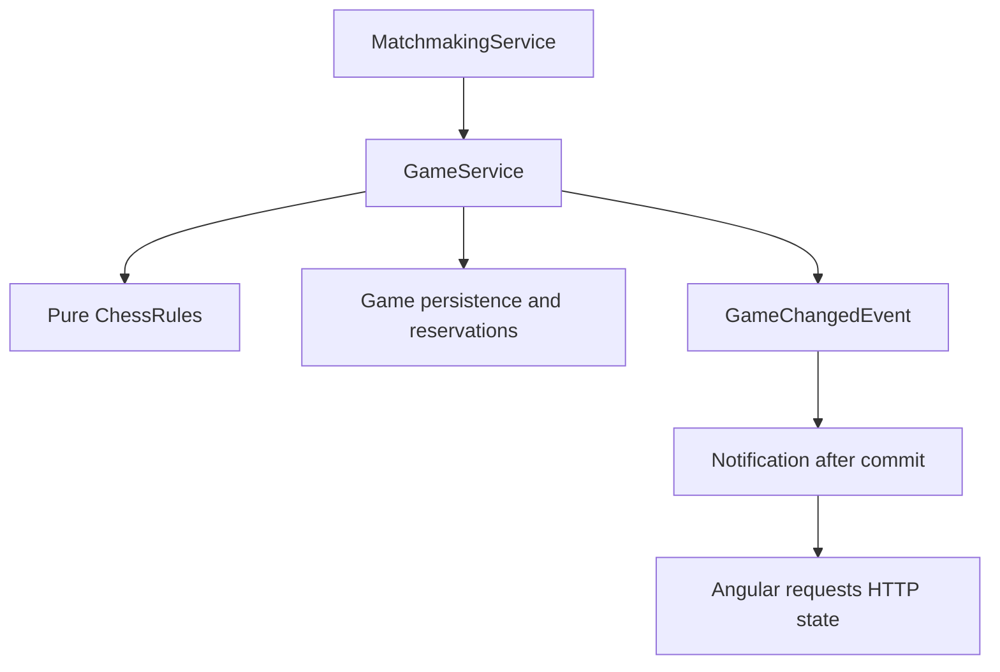
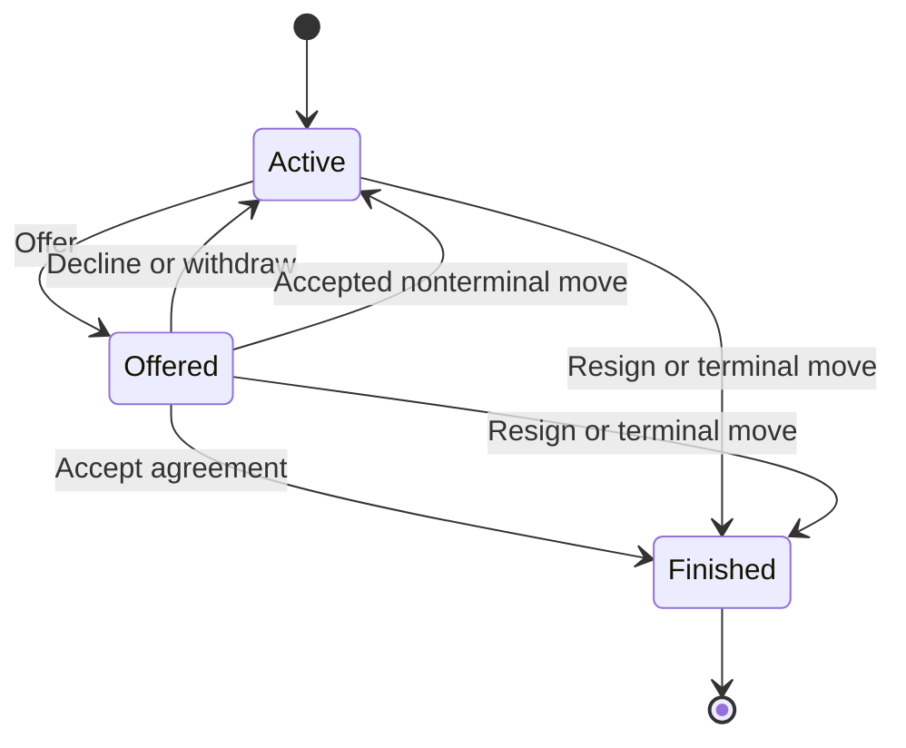
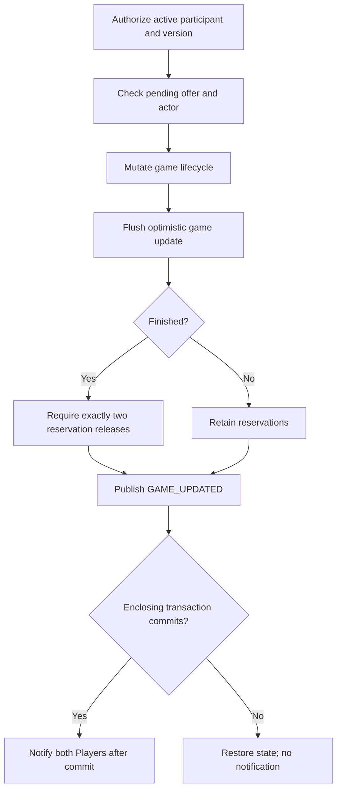
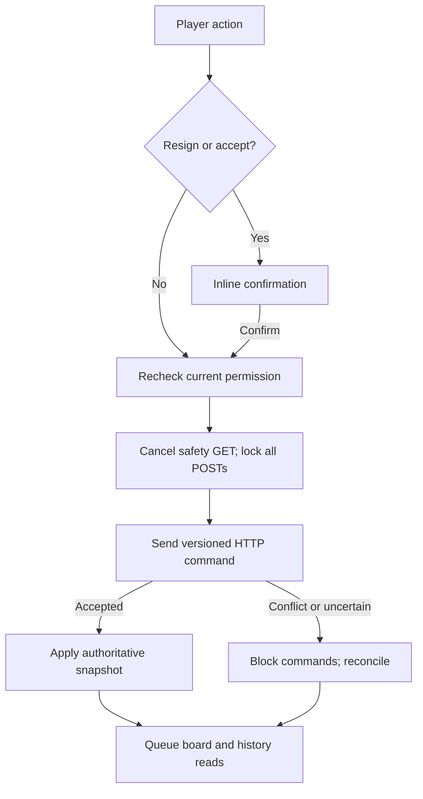
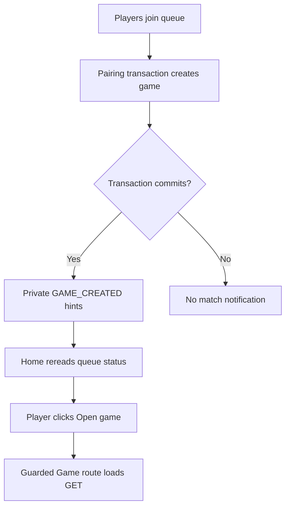
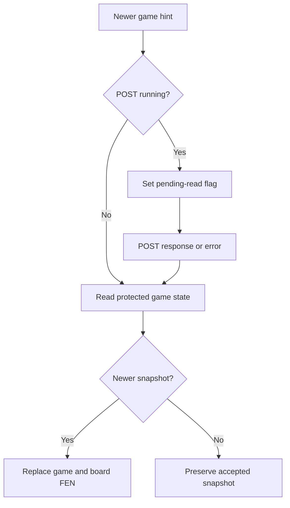
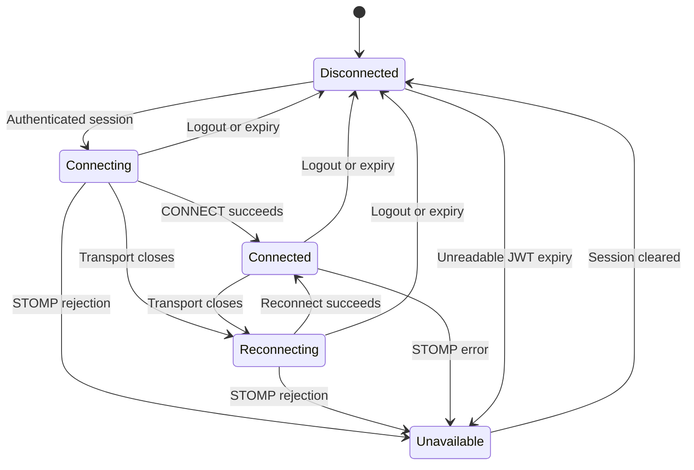
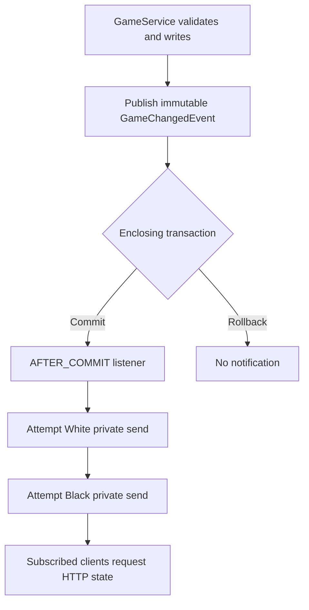
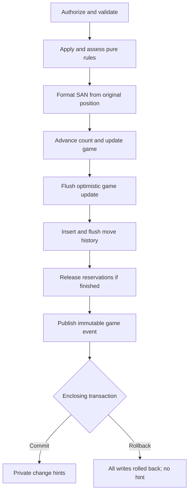
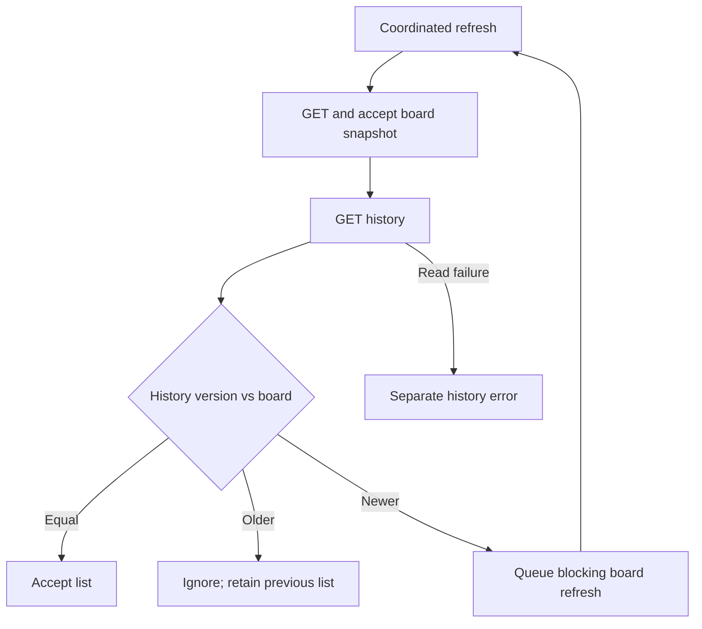

# Main documentation through Day 22

Exact uploaded main-document text before the Day 23 replacements. Missing-coverage statements below describe the historical checkpoint, not current Day 23 coverage.

---

## Archived file: README.md

# Chess Web App

A backend-focused chess portfolio project built as a modular monolith with conventional feature layers. It implements its own pure Java rules engine and a minimal Angular interface.

## Current checkpoint

Day 22 adds versioned resignation and draw-offer commands, atomic agreed completion and Angular lifecycle controls. Source-reviewed on 31 October 2026 against the actual user `chess-web-app-day22-end.zip`, compared with the attached Day 21 checkpoint. Day 21 history/SAN and Day 20 real-time recovery remain in place.

The user reports all tests green, including the two HTTP tests added after the upload. The assistant ran no tests, builds, migrations or browser checks. See [Day 22 review and coverage](docs/day22-lifecycle-review.md).

## Capabilities

- Registration/login, BCrypt password handling, JWT authentication and self-profile GET/username PATCH.
- Persistent matchmaking with atomic pairing, oldest-first eligibility and one active-game reservation per Player.
- Immutable chess rules: all pieces, king safety, explicit promotion, en passant, standard castling and normal/check/checkmate/stalemate assessment.
- Participant-protected game GET and versioned HTTP move commands with optimistic concurrency protection.
- Atomic checkmate/stalemate, resignation and agreed-draw completion, persisted outcomes and release of both active reservations.
- One pending draw offer, opponent accept/decline and sender withdrawal; any accepted move clears the offer.
- Custom Player-oriented board, explicit promotion/cancellation and server-accepted FEN display.
- Ordered persisted moves with coordinates, promotion, resulting FEN, timestamps and SAN; explicit legacy-game baselines.
- Private live notifications, automatic queue/game reads, deferred reconciliation during commands, heartbeats and reconnect recovery.

**Pairing does not automatically navigate to the board.** Home updates to show the matched game; the Player clicks **Open game**. This is the intended Day 20 behavior.

## Stack

Java 21, Spring Boot 4.1.1, Gradle wrapper 9.8.1, PostgreSQL, JPA, Flyway, Spring Security/JWT, Lombok and YAML. Angular 21, Angular Material, signals, RxJS and `@stomp/stompjs` (declared `^7.5.0`).

## Run locally

Keep database and JWT configuration user-managed in `backend/src/main/resources/application.yaml`. Flyway migrations V1–V10 provide the schema; Hibernate validates it.

From `backend/`:

```bash
./gradlew bootRun
```

From `frontend/`, using compatible Node tooling and the declared npm 11.6.2:

```bash
npm ci
npm start
```

Open http://localhost:4200. The development proxy forwards `/api/**`, including WebSocket upgrades, to port 8080. Restart the dev server after proxy changes.

Backend WebSocket routing is configured under `app.websocket`; matching frontend addresses and timing are in `frontend/src/app/notification/config/realtime.config.ts`. See [configuration and protocol](docs/api-contracts.md#real-time-updates).

## Verification

Suggested commands, not assistant-executed results:

```bash
# From backend/, no database needed for these focused tests:
./gradlew test --tests 'com.chessapp.notification.*' --tests 'com.chessapp.game.service.GameMoveServiceTest' --tests 'com.chessapp.game.rules.notation.SanFormatterTest'

# With the configured PostgreSQL test database:
SPRING_PROFILES_ACTIVE=test ./gradlew test
```

From `frontend/`:

```bash
npm test -- --watch=false
npm run build
```

Backend reports are generated under `backend/build/reports/tests/test/`. Frontend tests remain the existing focused authentication suite. The [Day 22 review](docs/day22-lifecycle-review.md) distinguishes source-confirmed coverage from missing tests and suggested manual scenarios.

## Current limits

Notifications are best-effort live hints. Accepted moves are separately persisted in the database; notification delivery is not guaranteed. HTTP reads recover current state; commands are never automatically replayed. Sessions are in memory, so browser reload requires login again.

Existing games record forward from their migration-time FEN; earlier moves cannot be reconstructed. Entries recorded before SAN support retain null SAN, displayed as “—” beside their coordinates. There are no replay controls, PGN export, clocks, repetition/move-count/dead-position draws, acceptance stage or abandonment policy. Closing the page, disconnecting or logging out does not finish a game or release its reservations. Spectators, chat, AI, external brokers and distributed deployment remain outside current scope. The custom board has no legal-move highlighting, drag-and-drop or persistent check indicator.

## Documentation

- [Architecture](docs/architecture.md): current ownership and boundaries.
- [API and real-time contracts](docs/api-contracts.md).
- [Frontend gameplay flow](docs/frontend-gameplay-flow.md): Angular and board coordination.
- [Real-time flow](docs/realtime-updates-flow.md): diagrams for security, commit timing and recovery.
- [Development progress](docs/development-progress.md), [roadmap](docs/roadmap.md) and [frontend setup](frontend/README.md).
- [Movement pipeline](docs/movement-pipeline-architecture.md): pure rules companion.
- [Move history and SAN flow](docs/move-history-flow.md).
- [Lifecycle flow](docs/game-lifecycle-flow.md), [Day 22 source review](docs/day22-lifecycle-review.md) and [next-session handoff](docs/day22-handoff.md).
- [Day 21 source review](docs/day21-history-review.md) retains historical checkpoint evidence.
- [Historical main-document checkpoints](docs/history/main-documents-through-day21.md). Existing Day documents retain their historical scope.

## Lifecycle policy

Either participant may resign or offer a draw regardless of turn. Only the recipient can accept/decline; only the sender can withdraw. Play continues during an offer, and any accepted move clears it. Resignation awards the opponent a win. Offers, responses and resignation advance the concurrency version without adding move-history rows. Angular confirms resignation/draw acceptance and shares one POST lock with moves. See [contracts](docs/api-contracts.md#explicit-lifecycle-commands).


---

## Archived file: frontend/README.md

# Chess Frontend

Angular 21 standalone frontend with Angular Material, signals, RxJS, in-memory authentication and a custom board. Current Day 22 source was reviewed on 31 October 2026. No assistant build/test/browser run is claimed; see [review](../docs/day22-lifecycle-review.md).

## Run

From frontend/, use compatible Node tooling and the declared npm 11.6.2:

```bash
npm ci
npm start
```

Open http://localhost:4200. The start script enables proxy.conf.json, forwarding `/api/**` and WebSocket upgrades to port 8080. Restart the dev server after proxy changes. If a generated lazy chunk returns 404 after dependency/rebuild changes, restart, wait for successful compilation and hard-refresh. If needed, stop the server and use `npx ng cache clean`, then restart. This was the reported Day 20 development issue, subsequently reported resolved; it is not a game-rule failure.

## Authentication and navigation

Login stores the token, fetches `/players/me` and establishes authentication when both token and Player exist. Sessions are in memory; browser reload requires login again. Protected 401 handling compares the request token with the current session before clearing it. Failed forms preserve passwords.

Home supports profile editing and persistent matchmaking. It reads queue state on entry, private updates and successful connections. A single pending read is drained after a current command/read. Unknown/WAITING/MATCHED status has 30-second recovery checks; NOT_QUEUED is idle. Home’s signal is named queueStatusResponse in this checkpoint.

**A match reveals Open game; it does not automatically navigate.** The Player clicks the link to open the guarded game route. Home now has separate home.ts, home.html and home.css files.

## Gameplay

Game owns GET snapshots, versioned POST commands, promotion and recovery. ChessBoard receives FEN/orientation/enabled and emits proposed coordinates. Game/board templates and CSS remain separate. The board does not validate chess legality or perform optimistic piece moves.

Select an own piece and destination; select another own piece to change source or click the selected square to cancel. Promotion requires an explicit choice; cancel sends no request and leaves no stale source. Castling proposes the king’s source/destination. En passant proposes the capturing pawn’s source/destination.

Relevant newer notifications request GET. A pending read waits during POST; safety reads can be cancelled before submission. Same-version reads preserve snapshot identity/promotion, and older reads cannot overwrite a newer snapshot. Game-state read failures block proposals; stale/uncertain command outcomes reconcile through GET without replay.

Games also reconcile after reconnect/focus and periodically while visible with a loaded active snapshot. The board stays visible during background reads. GET does not expose positionStatus, so there is no persistent check indicator. Terminal results disable all game commands; returning Home reads queue state and released Players can join again.

## Real-time connection

App instantiates RealtimeService once. It observes token/authentication, recreates subscriptions on reconnect, validates update payloads and ignores callbacks from replaced sessions. Heartbeats detect transport failures. Local expiry/logout deactivates the connection; expiry also navigates to login. STOMP rejection marks live delivery UNAVAILABLE while HTTP/manual recovery remains available.

@stomp/stompjs is declared as ^7.5.0. REALTIME_CONFIG supplies matching backend addresses plus reconnect/heartbeat/recovery timing. Backend YAML is not read by Angular.

## Verification and limits

Optional user-run commands:

```bash
npm test -- --watch=false
npm run build
```

The existing five auth-flow.spec.ts tests are unchanged. There is no new notification/game coordinator suite in the ZIP. Suggested two-session scenarios are in the [review](../docs/day22-lifecycle-review.md).

The move list has separate coordinate and SAN columns. Pre-SAN entries show “—” for SAN. There are no replay controls, PGN export, clocks, drag-and-drop or legal-move highlighting. Disconnecting never decides game completion or releases reservations. No durable notification replay, auto board navigation or persisted login session is supplied.

See [gameplay coordination](../docs/frontend-gameplay-flow.md), [real-time diagrams](../docs/realtime-updates-flow.md), [contracts](../docs/api-contracts.md), [architecture](../docs/architecture.md) and [roadmap](../docs/roadmap.md).

## Move history coordination

After accepting game GET, Game reads GET /games/{gameId}/moves. History with the displayed version is accepted; older history is ignored; newer history queues blocking board synchronization. The previous list remains visible with catching-up feedback when outdated. History errors are separate from board errors and do not alone block proposals.

The reading flag spans both GETs. cancelReads is downstream of switchMap, so a permitted POST cancels either stage. Route cancellation also tears down both. Successful POST explicitly queues nonblocking reconciliation. Visible loaded finished games continue safety checks while history is missing, outdated or failed; they stop when board/history are synchronized. Initial game GET failures without a snapshot still require manual/focus/connection/hint recovery.

The table shows Entry, Player, Move and SAN. Entry is a recorded individual-move sequence relative to the baseline. Legacy incomplete history has an explanatory notice. SAN is generated in the backend; Angular does not duplicate chess legality or notation rules. See [history flow](../docs/move-history-flow.md).

## Day 22 lifecycle controls

GameApiService maps typed actions to resignation and draw-offer POST routes. GameResponse adds nullable drawOfferedByPlayerId and termination reasons RESIGNATION/DRAW_AGREEMENT. Move responses remain unchanged; their accepted mapping explicitly clears the pending offer.

canSubmitGameCommand checks active participant/session and synchronization/submission state. canSubmitMove additionally checks turn and absence of lifecycle confirmation. canSubmitLifecycleAction ignores turn but requires promotion to be resolved. An offer does not pause play.

Resignation and draw acceptance use inline confirmation; decline, withdrawal and offer send directly. A newer snapshot, route change or blocking synchronization clears confirmation. Unchanged nonblocking reads preserve it. Any accepted move clears the offer; the pending offer is discovered through ordinary game GET.

executeGameCommand shares the existing submitting flag across moves and lifecycle commands. It cancels either GET stage before POST, ignores callbacks for replaced snapshots, applies the accepted response and queues board/history reconciliation. Conflicts and uncertain responses request fresh state without replay. The retained moveMessage signal now carries general action feedback.

No new frontend tests are included. The lifecycle companion and Day 22 review record suggested two-session checks and the actual coverage limits.


---

## Archived file: docs/architecture.md

# Architecture

This document describes the current Day 22 system, source-reviewed on 31 October 2026 against `chess-web-app-day22-end.zip`. Earlier checkpoint narratives are preserved in [history](history/main-documents-through-day21.md). Verification evidence and scope limits are recorded in the [Day 22 review](day22-lifecycle-review.md).

## Application structure

One Spring Boot application, organized by feature with conventional controller/service/DTO/entity/repository layers. Keep `Player` terminology. This is a modular monolith, not DDD or a collection of microservices. Cross-feature operations use services or application events rather than another feature’s repositories.

| Feature | Responsibility |
| --- | --- |
| auth | Registration, local credentials and login orchestration |
| player | Player creation/lookup, self-profile and username updates |
| security | HTTP security, password encoding, JWT signing/validation |
| matchmaking | Persistent queue, eligibility and transactional pairing |
| game | Game creation/read/move commands, reservations, lifecycle, immutable rules and game events |
| notification | WebSocket configuration/security, private outbound notifications and session access tracking |
| common | Shared timestamps and validation/error infrastructure |

Controllers translate transport input. Services own authorization, use-case orchestration and transactions. Repositories stay within their feature. Concrete services and explicit record mappings remain sufficient; mapper frameworks and additional service interfaces are unnecessary without a concrete need.



## Authentication and profile

Transactional registration creates a Player through PlayerService and stores encoded credentials in auth. Scalar Player IDs avoid cross-feature entity coupling. PostgreSQL uniqueness constraints remain authoritative when availability checks race.

Login validates credentials, issues HS256 JWTs and then Angular loads `/players/me`. JWT subject contains the Player ID. The shared JwtDecoder validates signature, issuer, timestamps, a required expiry and positive Long subject. HTTP timestamp validation has its existing 60-second tolerance; WebSocket checks additionally enforce the stated expiry strictly.

The frontend stores token/Player in memory. Its interceptor attaches bearer tokens only to relative protected `/api/` requests. A protected 401 clears the matching session; stale responses cannot clear a different current token. A 403 does not invalidate the session. Login/register failure retains passwords. Username PATCH updates the current session profile without changing JWT identity. Exact, case-sensitive identity matching remains the implemented policy.

## Persistence and transactions

PostgreSQL is durable storage. Applied Flyway migrations are immutable; future schema changes use new migrations. Hibernate validates rather than generates the schema; Open EntityManager in View is disabled.

| Migration | Responsibility |
| --- | --- |
| V1 | Players |
| V2 | Local credentials |
| V3 | Matchmaking queue and ordering index |
| V4 | Games, participants, FEN and optimistic version |
| V5 | Active-player reservations and initial backfill |
| V6 | Completion fields and lifecycle consistency constraints |
| V7 | History baseline/completeness/count and ordered move records |
| V8 | Nullable SAN for pre-SAN records; new application records require SAN |
| V9 | Completion constraint permits resignation with a winner |
| V10 | Pending participant offer on active games; completion permits draw agreement |

BaseEntity timestamps use JPA callbacks. SQL defaults support non-JPA insertion; direct SQL updates do not automatically advance `updated_at`. Identity sequences need not rewind after rollback.

Queue operations acquire the same PostgreSQL transaction-level advisory lock. This serializes cooperating operations on the single queue, including status reads. Repeated join preserves enqueue time through an upsert. Pairing selects the oldest eligible entries, assigns colors, invokes GameService and removes both queue entries in one transaction.

GameService flushes game creation before inserting JDBC reservations that reference it. JPA and JdbcTemplate share the datasource and transaction. The reservation table’s Player primary key enforces one active game across either color. Incomplete reservation or release counts fail the transaction. Leaving the waiting queue does not cancel an established game.

## Pure chess rules

`game.rules` contains no Spring, JPA, HTTP or notification concerns. Immutable Piece/Square/Move records, Board and ChessPosition represent placement and metadata. Board currently uses map storage and identity equality; tests compare board contents or FEN rather than assuming value equality for Board.

| ChessRules operation | Responsibility |
| --- | --- |
| initialPosition() | Standard starting position |
| legalMoves(position) | Complete immutable set for the side to move |
| applyMove(position, move) | Exact legal-set membership, then shared application |
| evaluate(position) | NORMAL, CHECK, CHECKMATE or STALEMATE |

GameRulesConfig constructs the six pseudo-legal strategies, dispatcher, shared applier, attack detector, legal filter and evaluator. Sliding pieces share ray traversal. Attack detection includes pinned attackers; generated moves exclude king captures. Legal filtering checks the moving king on the resulting board. Castling additionally checks the original and transit positions.

FenParser validates structural representation, not historical reachability. FenSerializer is separate. Promotion choices are explicit; there is no automatic queen. En passant and castling use the shared immutable application pipeline. Rights are historical metadata and are never restored by returning a piece or promoting a rook.

The facade does not own authorization, persistence, version checks or transactions. FEN alone cannot establish repetition history. See the [movement pipeline companion](movement-pipeline-architecture.md).

## Game commands and lifecycle

Both participants may read a game, including after completion. Commands derive the acting Player from the JWT, never from request-supplied identity.

For a well-formed move command, GameService checks existence, membership, lifecycle, expected version, turn and legal membership. It applies and evaluates the move through ChessRules before mutating the managed game. SAN is formatted from the original position, accepted move, complete legal set and resulting assessment before managed state changes. The recorded sequence advances on the versioned Game row. Flush advances the optimistic version and detects competing writes before history insertion. A losing optimistic update becomes STALE_GAME_VERSION.

Checkmate sets the mover’s winning result; stalemate sets DRAW. Position, recorded count, move record including SAN, result/reason/time and deletion of both reservations commit or roll back together. The move and any completion share a Clock-derived timestamp truncated to microseconds. History is explicitly flushed before reservation release and event publication. Flush is not commit. Version is a concurrency token, not a separately defined move number.

## Internal events and real-time delivery

GameService publishes immutable GameChangedEvent values after creation/reservation success or after game/history flush and any reservation release succeed. They carry game/participant IDs, version and GAME_CREATED/GAME_UPDATED. The game feature imports no WebSocket transport.

GameNotificationListener runs AFTER_COMMIT and sends a small PlayerUpdate to both participant user destinations. During matchmaking it waits for the outer pairing transaction, including queue removal. A rollback produces no notification. Terminal moves use GAME_UPDATED; HTTP GET supplies the result.

Sending is best-effort. Each recipient attempt catches runtime send failures so the other recipient is still attempted and a committed command is not reported as a delivery failure. There is no outbox, durable replay, acknowledgement guarantee or external broker. No database writes occur in the listener.

## WebSocket security

The configured HTTP GET endpoint permits the upgrade. STOMP CONNECT must supply exactly one bearer Authorization header and pass the existing decoder plus strict expiry. The interceptor assigns a canonical Player-ID principal and removes the native header entry; the authenticated principal still retains the JWT.

Only the exact configured private subscription is allowed. Direct broker paths, another user’s path, wildcards and client SEND commands are rejected. User routing is not itself authorization; the inbound interceptor enforces this policy. Backend event recipients come from stored participants.

WebSocketSessionAccess stores expiry by session ID. Outbound application messages require an unexpired registered session both before enqueueing and immediately before outbound handling. Disconnect removes the entry idempotently. This filters delivery, not proactive socket closure at the expiry instant; an already transmitted message cannot be recalled.

The frontend deactivates on logout, session replacement and local expiry. Browser timers are best-effort, so backend checks remain authoritative. Token decoding in the browser schedules cleanup; it does not validate signatures.

## Angular orchestration

App instantiates one RealtimeService independently of route navigation. It recreates private subscriptions after reconnecting, ignores stale-session callbacks, validates incoming update shape and exposes signals/observables. STOMP errors mark live delivery unavailable; HTTP still determines session validity.

Home reads queue state on entry, notifications and connection events. One pending read is drained after any current queue command/read. Periodic checks run for unknown, WAITING and MATCHED state; NOT_QUEUED is idle. Pairing reveals an Open game link rather than forcing navigation.

Game owns authoritative snapshots, promotion, commands and recovery. Route switchMap cancels old-route reads; exhaustMap permits one GET at a time. Notifications received during GET/POST coalesce into a pending read. A safety GET may be cancelled before a move POST starts. Unchanged versions preserve snapshot identity and promotion; older responses cannot replace newer state. Known-newer notifications block proposals until reconciliation. There is no automatic command retry.

ChessBoard owns rendering/orientation/selection and emits coordinates. Its selection-reset effect observes FEN, orientation and enabled inputs. It clears selection before emitting, so cancelling promotion leaves no stale source. Home, Game and ChessBoard use separate HTML/CSS files.

## Configuration and deployment boundary

`app.websocket` binds to WebSocketProperties with constructor validation. Endpoint registration, HTTP permission, subscription authorization and sending consume this shared object. Destination paths are derived from prefixes plus updates-path. The configured heartbeat range is 1–300 seconds. A lazily injected broker scheduler enables heartbeats.

Angular’s REALTIME_CONFIG contains matching routing addresses and its own timing settings. Backend YAML is not automatically published to the browser. Development proxying includes WebSocket upgrades. Configuration/secrets remain user-managed.

The simple broker and session registry are in-process. Current delivery assumes a single application instance. Multi-instance notification routing requires a separate design, even though database concurrency guards continue to protect shared state.

## Deferred scope

Replay controls/PGN export, clocks, extra rule-based draws, acceptance, abandonment/disconnect completion, ratings and statistics remain separate milestones. Custom board polish/library integration is optional. Closing a page does not finish a game. See [roadmap](roadmap.md) and the two flow companions for details.

## Persisted history and SAN

Game owns immutable historyStartFen/historyComplete metadata and a mutable recordedMoveCount. V7 copies existing currentFen into the baseline and marks all existing games incomplete, conservatively including games whose earlier moves are unknown. New games set their supplied initial FEN as the baseline and historyComplete=true. This means history since creation, not game completion. Counts begin at zero and sequence numbers begin at one relative to that baseline; neither is defined as the JPA version or FEN fullmove number.

GameMove uses scalar game/Player IDs and stores source/destination, optional promotion, resulting FEN, playedAt and SAN. No application update operations are exposed. The database unique constraint on (game_id, sequence_number) protects ordering uniqueness and supplies its index. Membership, legal chess behavior and count/row consistency remain application responsibilities rather than cross-row database checks.

getHistory authorizes membership before reading records through the captured recordedMoveCount. Later committed entries are excluded by the query bound. Consistency relies on atomic append-only writes and stable history metadata; this is not a general-purpose repeatable-read transaction or a concurrent-reader integration test claim. No history write belongs in an after-commit listener.

SanFormatter is pure Java. It consumes the original position, accepted move, complete legal set and resulting assessment. It produces English SAN with captures, O-O/O-O-O, = promotion, legal-source disambiguation and +/# suffixes. It does not replace the legality facade. V8 preserves null SAN for pre-SAN entries; no backfill is supplied.

Angular reads the board, then history, within the same coordinated read operation. Matching versions accept history; older history is ignored; newer history queues board synchronization. An older accepted list may remain visible while catching up, but a newer list is not shown ahead of the board. History failures have separate feedback and do not independently disable moves. Accepted POSTs explicitly queue reconciliation so the sender's list catches up even when its notification is already obsolete. See [history flow](move-history-flow.md).

## Day 22 explicit lifecycle commands

GameService owns resign, offerDraw, acceptDraw, declineDraw and withdrawDraw. Public methods own transactions. loadActiveGameForCommand performs existence, participant, active lifecycle and expected-version checks in that order. requireDrawOfferActor checks offer presence and sender/recipient roles. These application commands do not evaluate pure chess rules.

persistLifecycleChange flushes the optimistic game update, releases exactly two reservations if finished, publishes GAME_UPDATED and maps GameResponse. It does not commit. An enclosing failure restores completion, pending offer and reservations and suppresses AFTER_COMMIT delivery. A concurrent move or lifecycle command may win; another write based on the same loaded version must fail. Private helpers do not create transaction boundaries.

Game.drawOfferedByPlayerId stores one nullable participant ID. Entity guards and ck_games_draw_offer prevent nonparticipant or finished-game offers. finish validates outcome before clearing negotiation; updatePosition clears an offer only after validating its input. Service-rejected moves never mutate the entity. V10 allows DRAW only for STALEMATE/DRAW_AGREEMENT and winning results only for CHECKMATE/RESIGNATION. Applied migrations remain immutable.

Lifecycle-only mutations leave FEN, baseline and recorded count unchanged and insert no GameMove. Version therefore advances independently of move count. GameResponse includes pending offer ownership; GameMoveResult is unchanged. History is a move log, not an audit of negotiations.

Angular executeGameCommand coordinates all POST types through one submission lock and shared recovery. General command permission is independent of turn; move permission adds turn checks. Promotion must be resolved before lifecycle actions. Inline confirmation is required for resignation/acceptance. Known-newer snapshots clear confirmations even when FEN did not change. Accepted lifecycle responses trigger board/history reconciliation because captured history versions advance too. See [lifecycle flow](game-lifecycle-flow.md).


---

## Archived file: docs/development-progress.md

# Development Progress

## Current checkpoint — Day 22

Source-reviewed on 31 October 2026 against the actual user chess-web-app-day22-end.zip, compared with chess-web-app-day21-end(1).zip including documentation replacements. No blocking defect was found in inspected changes. The user reports all tests green, including the subsequently added HTTP tests. No assistant tests, builds, migrations or browser checks were run.

Delivered: V9 resignation, V10 pending offers/agreed draws, JWT-derived versioned lifecycle endpoints, shared lifecycle guards/flush/release/event helpers, pending offer in GameResponse, offer reset on accepted moves/completion, shared Angular POST coordination, inline terminal-action confirmation and all four outcome labels.

Inspected tests cover resignation for either color, history preservation, error precedence, rollback/release failures, after-commit resignation delivery, move-versus-resignation and move-versus-acceptance races, draw accept/decline/withdraw persistence, role errors, offer clearing/preservation and HTTP workflow/error mapping. The race helper preloads the same version in both transactions.

The uploaded snapshot lacks drawCommandsRequireAuthentication and drawCommandsValidateVersionAndPreserveFailurePrecedence. The user subsequently reports adding both tests and running all tests green. Those post-upload test implementations were not included in the inspected ZIP; retain this distinction at the next source review. No new frontend coordinator tests, real socket suite, WebSocketPropertiesTest or actual prior-database upgrade fixture is present. See [Day 22 review](day22-lifecycle-review.md) and [lifecycle flow](game-lifecycle-flow.md).


## Previous checkpoint — Day 21

Reviewed on 30 October 2026 against the actual user chess-web-app-day21-end.zip and compared with the attached Day 20 baseline including documentation replacements. No blocking defect was found in inspected changes. User reports all looks good; tests are treated as green under the standing agreement unless failures are reported. No assistant tests, builds, migrations or browser checks were run.

Delivered: V7 history metadata/table; V8 SAN compatibility; accepted-move recording in the existing transaction; bounded participant-protected GET history; pure Java SAN; extracted GameService persistence/lifecycle helpers; board-then-history refresh with version matching and history-specific errors; separate coordinate and SAN columns, including null-SAN “—”.

Inspected additions cover entity metadata/count guards, persisted ordinary/special/terminal moves, rejection/rollback preservation, one history row for concurrent winners, simulated legacy continuity, bounded queries, history HTTP access and ordering, SAN capture response mapping, null-SAN compatibility and formatter fixtures including pinned alternatives. The bounded-query test is sequential, not a forced concurrent read test. Legacy tests simulate post-migration state; an actual old-database upgrade test is absent. There is no new frontend coordinator suite.

See [Day 21 review](day21-history-review.md) and [history flow](move-history-flow.md).

## Previous checkpoint — Day 20

Source-reviewed on 30 October 2026 against the actual user archive `chess-web-app-day20-end.zip`, compared with the attached Day 19 continuation baseline. The reviewed source includes the two Day 19 guard/message fixes. No blocking defect was found in the inspected Day 20 changes.

The user reports that the implementation looks good. Tests follow the standing agreement that failures will be reported. No assistant tests, builds, migrations or browser checks were run. There is no independent frontend build or comprehensive manual acceptance claim.

## Delivered in Day 20

- WebSocket starter, endpoint upgrade permission and WebSocket-enabled Angular proxy.
- YAML-backed WebSocketProperties, derived destinations, path/origin/duration validation and heartbeat scheduler.
- CONNECT authentication through the existing JwtDecoder; exact private-subscription authorization; rejected client publishing.
- Session expiry registry, idempotent disconnect cleanup and outbound expiry checks before enqueueing/handling.
- GameChangedEvent publication from GameService and private PlayerUpdate delivery after the enclosing transaction commits.
- RealtimeService connection lifecycle, stale-session guards, token-expiry cleanup, reconnect subscription recreation and payload validation.
- Automatic Home reads with one pending status read, explicit Open game navigation and extracted HTML/CSS.
- Game version filtering, one-at-a-time reads, deferred reconciliation during POST, cancellation of safety GET before POST, focus/reconnect recovery and visible-page periodic checks.

## Working sessions

| Session | Delivered scope |
| --- | --- |
| Days 1–3 | Project setup, authentication/profile foundation, Angular authentication and persistent queue foundation |
| Day 4 | Initial game persistence, active-player reservations, transactional pairing, matched-game discovery and participant-protected retrieval |
| Day 5 | Authenticated username PATCH, backend tests and Angular profile editor |
| Day 6 | Immutable representation, separate FEN parser/serializer and initial-position rules boundary |
| Day 7 | Move/board relocation, knight movement, candidate application, all-piece attack detection, king-safety filtering and test rendering |
| Day 8 | Strategy dispatch, rook movement, shared pipeline and corner-rook castling-right updates |
| Day 9 | Shared sliding traversal, bishop/queen strategies, centralized movement fixtures and pipeline tests |
| Day 10 | Ordinary king candidates, resulting-square king safety, irreversible king castling-right removal and associated tests |
| Day 11 | Guided ordinary pawn generation, pawn metadata application, registration, dispatcher coverage and king-safety tests; final source reviewed; user reports green tests |
| Day 12 | Explicit promotion choices, quiet/capture generation, immutable replacement, shared king safety/metadata and renderer/test updates; source reviewed; user reports green tests |
| Day 13 | En passant generation, immutable off-destination capture, defensive metadata handling, expiry and king-safety tests; source reviewed; user reports green tests |
| Day 14 | Standard castling for both colors/sides, immutable two-piece application, staged king safety and boundary tests; final source reviewed; green tests reported through king-safety increment |
| Day 15 | Complete legal-move enumeration, shared filtering, current-side position assessment, cross-package test fixtures and both-color special-move/check-escape regressions; source reviewed; user reports all tests green |
| Day 16 | Legality-enforcing rules facade, production wiring, facade special-move/assessment regressions and closing tests; source reviewed; historical passing evidence described above |
| Day 17 | GameService move commands, exact legal application, version protection, checkmate/stalemate results, atomic reservation release, V6 and entity/unit/PostgreSQL test sources; source-reviewed, green status per standing user instruction |
| Day 18 | JWT-derived HTTP move submission, validated requests, version/result-bearing reads, game-owned error contracts and HTTP integration coverage |
| Day 19 | Custom Angular gameplay: guarded navigation, board display, explicit promotion, versioned moves, manual refresh, recovery, completion feedback, separate component HTML/CSS and lifecycle guide; source-reviewed; guard/message follow-ups included in the Day 20 baseline |
| Day 20 | Authenticated private WebSocket/STOMP updates, typed YAML routing, after-commit game events, expiry filtering, heartbeat/reconnect handling, automatic Home/Game reconciliation and separate Home HTML/CSS |
| Day 21 | Atomic persisted history, legacy baselines, bounded protected reads, SAN and synchronized coordinate/SAN move list |
| Day 22 | Versioned resignation/draw negotiation, atomic completion/release, shared Angular commands and inline confirmation |


## Source-confirmed test coverage

| Source | Inspected coverage |
| --- | --- |
| StompSecurityInterceptorTest | Valid CONNECT/principal/header removal, missing/invalid credentials, allowed private subscription, blocked alternative destinations, anonymous subscription, client SEND and expired subscription |
| StompOutboundSecurityInterceptorTest | Unexpired session, unknown/missing session, expiry while queued and repeated disconnect cleanup; disconnect fixture uses Message<byte[]> |
| GameMoveIntegrationTest | Existing game command/persistence/concurrency tests plus created-game notifications to both Players, delayed delivery until outer commit and suppressed delivery on rollback |
| GameMoveServiceTest | Existing rejection/order/rules-failure tests with the added event-publisher mock |
| Existing Angular auth-flow.spec.ts | Existing five focused authentication tests; unchanged |

The proposed WebSocketPropertiesTest is **not present** in this archive. There is no independent configuration-binding test, full STOMP socket delivery test or new frontend notification/coordinator test in this checkpoint. Code inspection and existing integration contexts do not replace those tests. These are coverage limits, not evidence that a failure occurred.

## Suggested verification

From backend/, focused checks without a database:

```bash
./gradlew test --tests 'com.chessapp.notification.*' --tests 'com.chessapp.game.service.GameMoveServiceTest'
```

With the configured PostgreSQL test database:

```bash
SPRING_PROFILES_ACTIVE=test ./gradlew test
```

From frontend/:

```bash
npm test -- --watch=false
npm run build
```

Suggested manual scenarios are in the [Day 20 review](day20-realtime-review.md). Commands are supplied for the user; they were not run by the assistant.

## Current limits and working agreement

One queue and one in-process message broker; notifications are not durable. Move history is separately persisted from Day 21. HTTP commands remain authoritative and are not replayed. Sessions remain in memory. Disconnect/logout does not release reservations or determine a game outcome. Auto-navigation is not implemented by design. Additional game/rating policies remain in the [roadmap](roadmap.md).

Continue with inline, explainable increments. The user implements production changes. Do not silently apply generated implementation archives. Documentation replacement packages are welcome. Keep feature service boundaries, pure Java rules, Player naming, useful comments, minimal frontend tests and separate component HTML/CSS. Preserve user-managed configuration. Treat tests as green unless failures are reported; do not execute tests/builds without an explicit request.

Historical checkpoint evidence is preserved in [the archive](history/main-documents-through-day19.md) and the existing Day documents.

## Current scope after Day 22

Resignation and agreed draws are implemented. Replay/export, clocks, extra rule-based draws, ratings and abandonment remain separate decisions. No next feature has been selected. The historical Day 20/21 sections above retain their checkpoint-specific evidence.


---

## Archived file: docs/roadmap.md

# Roadmap

## Current position

Working Days 1–22 identify actual sessions, not a rewritten version of the original 30-working-day estimate. The [progress document](development-progress.md) lists delivered sessions. Day 20 implements authenticated real-time hints plus HTTP recovery. Day 21 adds persisted history, SAN and the synchronized move list. Day 22 adds explicit resignation and draw negotiation with atomic completion and shared Angular command coordination.

The custom board is the MVP choice. Home automatically discovers pairing and offers Open game; automatic navigation is not a missing requirement.

## Next milestone selection

Day 22 is complete in inspected source. Review and commit documentation, then select the next milestone in a new chat. No next feature is implicitly authorized.

A focused backend reliability milestone is a reasonable candidate: consider configuration binding, real socket security/delivery or an actual old-database upgrade fixture. The user reports the two previously missing draw HTTP precondition tests added and all tests green; inspect them with the next source checkpoint. Replay controls/PGN export or Player statistics/ratings are separate feature choices. Minimal frontend testing remains the user's preference.

## Remaining capabilities

| Capability | Separate decisions needed |
| --- | --- |
| History extensions | Optional pre-SAN backfill, pagination and retention if needed; missing pre-V7 moves remain unavailable |
| Replay/export | Replay controls and PGN generation/export; SAN is already implemented |
| Clocks | Time controls, authoritative timing and timeout results |
| Extra outcomes | Repetition, move-count and dead-position draws |
| Disconnect policy | Grace periods, abandonment rules, reconnect behavior and reservation release |
| Match lifecycle | Acceptance stage, cancellation, queue expiry and rating filters |
| Player profile growth | Statistics, ELO and event-driven updates; account email/password actions |
| Delivery reliability | Whether durable outbox/replay or multi-instance routing is actually needed |
| Board polish | Optional styling, accessibility/interaction improvements or a justified library adapter |

These are candidates rather than promises to implement every item in the MVP. Redis/Kafka, spectators, tournaments, chat, engine analysis, AI and distributed scaling remain outside current scope.

## Engineering constraints

Preserve the modular monolith and conventional feature layers. Cross-feature calls use services/events; repositories stay owned by their feature. Pure rules remain free of transport/persistence dependencies. Keep Player terminology, versioned HTTP moves, atomic reservation/lifecycle updates, YAML configuration and separate component templates/styles.

Notifications are best-effort invalidation hints, not a command or durable move log. Closing a page does not finish the game. Browser session persistence/refresh tokens are separate decisions. Map-versus-array board evaluation remains deferred until a demonstrated benefit justifies it while preserving Board API.

## Historical plan

The original estimate and earlier milestone proposals are preserved in [historical main-document checkpoints](history/main-documents-through-day19.md) and existing Day documents. Historical pending features must not override the implemented Day 22 state.


---

## Archived file: docs/api-contracts.md

# API Contracts

Current Day 22 contracts, source-reviewed on 31 October 2026 against `chess-web-app-day22-end.zip`. Tests follow the standing user agreement; the assistant ran no tests/builds or independent runtime acceptance checks. Earlier checkpoint narratives are preserved in [history](history/main-documents-through-day21.md).

## Shared conventions

- Protected endpoints require `Authorization: Bearer <token>`.
- Protected self-service actions derive player identity from the validated JWT subject; clients do not choose the acting player ID.
- MVC validation returns Problem Detail with `code: VALIDATION_FAILED` and an `errors` array containing `field` and `message`. Rejected password values are omitted.
- Duplicate-identity and feature-owned exceptions return Problem Detail with their application code.
- Missing/invalid bearer credentials use Spring Security handling; no application code or uniform MVC error body is guaranteed.
- Deleted-player failures from profile GET/PATCH use `ResponseStatusException` with 401; no application code is guaranteed. Matchmaking has its own `AUTHENTICATED_PLAYER_UNAVAILABLE` code.
- Malformed JSON, incompatible field types, path conversion failures and unexpected server errors may have different bodies. Clients need a generic fallback.
- The frontend handles protected 401 session cleanup centrally; action-specific UI handles known codes. A 403 does not invalidate the session.

## Endpoint index

| Method | Route | Authentication | Successful response |
| --- | --- | --- | --- |
| POST | `/api/v1/auth/register` | Public | 201; `playerId`, `username`, `email` |
| POST | `/api/v1/auth/login` | Public | 200; `accessToken`, `tokenType`, `expiresIn` |
| GET | `/api/v1/players/me` | Bearer JWT | 200; `id`, `username`, `email` |
| PATCH | `/api/v1/players/me` | Bearer JWT | 200; updated `id`, `username`, `email` |
| POST | `/api/v1/matchmaking/queue` | Bearer JWT | 200; queue status |
| GET | `/api/v1/matchmaking/queue/me` | Bearer JWT | 200; queue status |
| DELETE | `/api/v1/matchmaking/queue/me` | Bearer JWT | 204; no body |
| GET | `/api/v1/games/{gameId}` | Participant bearer JWT | 200; game state |
| POST | `/api/v1/games/{gameId}/moves` | Participant Bearer JWT | 200; GameMoveResult |
| GET | `/api/v1/games/{gameId}/moves` | Participant bearer JWT | 200; GameHistoryResponse |
| POST | `/api/v1/games/{gameId}/resignation` | Participant bearer JWT | 200; GameResponse |
| POST | `/api/v1/games/{gameId}/draw-offer` | Participant bearer JWT | 200; GameResponse |
| POST | `/api/v1/games/{gameId}/draw-offer/accept` | Participant bearer JWT | 200; GameResponse |
| POST | `/api/v1/games/{gameId}/draw-offer/decline` | Participant bearer JWT | 200; GameResponse |
| POST | `/api/v1/games/{gameId}/draw-offer/withdraw` | Participant bearer JWT | 200; GameResponse |

There is no public game-creation endpoint: pairing invokes creation internally. Participant-authenticated POST /api/v1/games/{gameId}/moves delegates to GameService. Pure rules exceptions are not themselves the HTTP contract; game-owned application exceptions map gameplay rejections.

## Register — POST `/api/v1/auth/register`

Request fields: `username`, `email`, `password`.

Username: nonblank, 3–30 Java UTF-16 string units. Email: nonblank, valid email format, at most 255 units. Password: nonblank, at least 8 units and at most 72 UTF-8 bytes. No trimming or normalization is applied. Success returns the registered identity without credentials or a token.

| Failure | Status | Application code |
| --- | --- | --- |
| Invalid fields | 400 | `VALIDATION_FAILED` |
| Username taken | 409 | `USERNAME_ALREADY_EXISTS` |
| Email registered | 409 | `EMAIL_ALREADY_EXISTS` |

## Login — POST `/api/v1/auth/login`

Request fields: `email`, `password`. Email matching is exact. Login validates nonblank fields, email format/maximum length and the BCrypt byte maximum; it does not impose registration's minimum password length.

Success returns `accessToken`, `tokenType: Bearer` and `expiresIn` in seconds, with `Cache-Control: no-store`. The frontend then loads the self-profile. Unknown accounts and incorrect/missing local credentials receive the same invalid-credentials response.

| Failure | Status | Application code |
| --- | --- | --- |
| Invalid fields | 400 | `VALIDATION_FAILED` |
| Invalid credentials | 401 | `INVALID_CREDENTIALS` |

## Read self-profile — GET `/api/v1/players/me`

No request body. Success returns the current database-backed `PlayerResponse` (`id`, `username`, `email`).

| Failure | Status | Application code |
| --- | --- | --- |
| Missing, invalid or expired token | 401 | Not guaranteed |
| Authenticated player no longer exists | 401 | Not guaranteed |

## Update username — PATCH `/api/v1/players/me`

Request:

```json
{
  "username": "new_username"
}
```

Success: 200 with the existing `PlayerResponse` shape:

```json
{
  "id": 1,
  "username": "new_username",
  "email": "player@example.com"
}
```

### Rules

- Only the authenticated player's username changes. Email and ID are unchanged.
- Username must be nonblank and 3–30 Java UTF-16 string units long. Some supplementary Unicode characters occupy two units.
- Matching is exact and case-sensitive. Spaces and special characters are allowed; whitespace-only values are rejected. No trimming or normalization is performed.
- Submitting the current username succeeds without changing the entity or its update timestamp.
- Availability prechecks provide feedback; the existing PostgreSQL unique constraint protects against conflicting writes under concurrency.
- Existing JWTs remain valid because their subject contains the stable player ID.
- Concurrent edits to the same player's username use last-write-wins behavior.
- Missing/null username is invalid. This endpoint is a username-specific update, not a general JSON Patch or JSON Merge Patch implementation. Additional fields are outside its supported contract.

| Failure | Status | Application code |
| --- | --- | --- |
| Invalid username | 400 | `VALIDATION_FAILED` |
| Username taken | 409 | `USERNAME_ALREADY_EXISTS` |
| Missing, invalid or expired token | 401 | Not guaranteed |
| Authenticated player no longer exists | 401 | Not guaranteed |

A representative validation response is:

```json
{
  "type": "about:blank",
  "title": "Request validation failed",
  "status": 400,
  "detail": "One or more request fields are invalid",
  "instance": "/api/v1/players/me",
  "code": "VALIDATION_FAILED",
  "errors": [
    { "field": "username", "message": "must not be blank" }
  ]
}
```

Validation messages and the number of entries depend on the input and validator. Clients should use `field` and `code` rather than match literal messages.

## Queue join/status/leave

POST `/api/v1/matchmaking/queue` joins and attempts pairing. GET `/api/v1/matchmaking/queue/me` reads status. DELETE `/api/v1/matchmaking/queue/me` removes waiting membership and returns 204, including repeated leave requests.

Queue responses contain `status`, `enqueuedAt` and `gameId`. `WAITING` has an enqueue timestamp; `MATCHED` has a game ID. Inapplicable fields are null under the current DTO. Status is `NOT_QUEUED`, `WAITING` or `MATCHED`.

Repeated joins preserve the original waiting timestamp or return the existing active game. Leaving does not cancel an established game. Logout does not leave the queue. Pairing is triggered on join. Day 20 notifications request queue reads automatically; manual refresh remains available. Home offers Open game after discovering MATCHED and does not automatically navigate.

| Action | Failure | Status | Application code |
| --- | --- | --- | --- |
| Join, status, leave | Missing, invalid or expired token | 401 | Not guaranteed |
| Join, status, leave | Authenticated player no longer exists | 401 | `AUTHENTICATED_PLAYER_UNAVAILABLE` |
| Join during pairing | Reservation conflict with another game-creation caller | 409 | `PLAYER_ALREADY_IN_GAME` |

An ordinary repeated join by an already matched player returns 200 `MATCHED`; it is not a conflict. The reservation-conflict case describes a competing creation race and rolls back the pairing transaction.

## Read game — GET `/api/v1/games/{gameId}`

No request body. Success returns id, whitePlayerId, blackPlayerId, status, currentFen, createdAt, version, result, terminationReason, finishedAt and nullable drawOfferedByPlayerId through GameResponse.from(game). Either participant can read; opponent profile/email is not returned. New games start in IN_PROGRESS at the initial FEN. Accepted commands advance FEN/version and may produce FINISHED. Completion fields are null during active play. GET does not reevaluate the position and has no positionStatus.

| Failure | Status | Application code |
| --- | --- | --- |
| Missing, invalid or expired token | 401 | Not guaranteed |
| Game does not exist | 404 | `GAME_NOT_FOUND` |
| Authenticated requester is not a participant | 403 | `GAME_ACCESS_DENIED` |

## Submit move — POST `/api/v1/games/{gameId}/moves`

Authenticated Player identity comes from the validated JWT subject.

```json
{
  "expectedVersion": 0,
  "from": "e2",
  "to": "e4",
  "promotion": null
}
```

expectedVersion is required and nonnegative. Coordinates are required lowercase algebraic squares from a1 through h8 and must differ. Promotion is omitted/null or exactly QUEEN, ROOK, BISHOP or KNIGHT; board-dependent validity remains in the rules pipeline. No automatic queen choice is supplied.

Success returns 200 with gameId, currentFen, version, positionStatus, status, result, terminationReason and finishedAt. positionStatus assesses the side to move and is NORMAL, CHECK, CHECKMATE or STALEMATE. Lifecycle is IN_PROGRESS/FINISHED; results are WHITE_WIN/BLACK_WIN/DRAW; supported termination reasons are CHECKMATE/STALEMATE/RESIGNATION/DRAW_AGREEMENT. Move-driven completion uses CHECKMATE/STALEMATE; explicit lifecycle commands produce the other two.

| Failure | Status | Application code |
| --- | --- | --- |
| Invalid request fields | 400 | VALIDATION_FAILED |
| Missing/invalid bearer credentials | 401 | Not guaranteed |
| Nonparticipant | 403 | GAME_ACCESS_DENIED |
| Missing game | 404 | GAME_NOT_FOUND |
| Finished game | 409 | GAME_ALREADY_FINISHED |
| Stale observed/concurrent version | 409 | STALE_GAME_VERSION |
| Wrong turn | 409 | NOT_PLAYERS_TURN |
| Well-formed illegal proposal | 422 | ILLEGAL_GAME_MOVE |

Request validation precedes service lookup. Well-formed command precedence is missing game, membership, lifecycle, version, turn and exact legal membership. Malformed JSON/incompatible types return 400 without promising VALIDATION_FAILED. Unexpected rules/stored-state failures are not broadly reclassified as client illegality.

Clients use the accepted response version for the next command. Reload stale state without automatically replaying a move. An uncertain network failure may follow a commit, so read before proposing another move.

The Angular page preserves GET-only participant metadata when applying a POST response. Both participants can read a finished game. Terminal release permits another queue join. Day 20 GAME_UPDATED notifications request a fresh GET for the opponent as well. The separate history GET exposes persisted moves including SAN.

## Read move history — GET `/api/v1/games/{gameId}/moves`

No body or pagination parameters. Either stored participant may read active or finished history. Identity comes from the JWT. Lookup precedes membership checking, using the existing GAME_NOT_FOUND (404) and GAME_ACCESS_DENIED (403) contracts. Missing/invalid credentials receive 401 without a guaranteed MVC code.

GameHistoryResponse fields:

| Field | Meaning |
| --- | --- |
| gameId | Requested game |
| version | Captured game concurrency version |
| historyStartFen | Position immediately before the first recorded move |
| historyComplete | Every move since creation is recorded; false for V7 legacy games |
| recordedMoveCount | Number of recorded individual moves after the baseline |
| moves | Ordered ascending by sequenceNumber, bounded by that captured count |

Each move contains sequenceNumber, playerId, from, to, promotion, resultingFen, playedAt and san. Sequence begins at 1 relative to the baseline, not the chess fullmove number. Promotion is null or QUEEN/ROOK/BISHOP/KNIGHT. New application writes require nonblank SAN of at most 32 characters; old pre-SAN rows may return null. Castling/en passant each occupy one entry. playedAt and terminal finishedAt use the same timestamp for a completing move. Internal move-row IDs are not exposed.

The baseline is preserved for future replay; no replay control or PGN export is supplied. There is no SAN backfill or reconstruction of missing pre-V7 moves. Reads currently return the full recorded list; pagination/retention limits are not implemented. History and move POST response shapes are unchanged; GameResponse adds nullable drawOfferedByPlayerId in Day 22.

## Explicit lifecycle commands

All five routes require participant authentication. The actor comes from the JWT; no request-supplied Player ID selects the actor. Each uses a JSON object with required, nonnegative Long expectedVersion:

```json
{"expectedVersion": 3}
```

Resignation uses ResignGameRequest; the four draw endpoints share DrawOfferRequest. Success returns 200 with the complete GameResponse, including nullable drawOfferedByPlayerId and the new concurrency version. Neither FEN nor recorded move count changes and no move row is inserted.

| POST suffix under /api/v1/games/{gameId} | Preconditions after common checks | Outcome |
| --- | --- | --- |
| /resignation | Either participant, any turn | FINISHED; opponent wins; RESIGNATION |
| /draw-offer | No pending offer; either participant, any turn | Remains active; sender stored |
| /draw-offer/accept | Pending opponent offer | FINISHED; DRAW; DRAW_AGREEMENT |
| /draw-offer/decline | Pending opponent offer | Remains active; offer cleared |
| /draw-offer/withdraw | Pending own offer | Remains active; offer cleared |

Play continues during an offer. Any accepted move by either side clears it. A rejected move preserves it. Every completion clears it. This is the application's negotiation policy, not a claim of tournament draw-offer procedure. No expiry, minimum move requirement, offer throttling or negotiation audit is implemented.

Well-formed command precedence is missing game, participant membership, active lifecycle, expected version, then offer presence/role. For offering, pending-offer detection follows the common checks. Field validation happens before service lookup.

| Failure | HTTP | Application code |
| --- | --- | --- |
| Invalid fields | 400 | VALIDATION_FAILED |
| Missing/invalid bearer | 401 | Not guaranteed |
| Nonparticipant | 403 | GAME_ACCESS_DENIED |
| Missing game | 404 | GAME_NOT_FOUND |
| Finished game | 409 | GAME_ALREADY_FINISHED |
| Stale observed/concurrent version | 409 | STALE_GAME_VERSION |
| Existing offer when offering | 409 | DRAW_OFFER_ALREADY_PENDING |
| No offer when accepting/declining/withdrawing | 409 | DRAW_OFFER_NOT_FOUND |
| Sender accepts/declines, or recipient withdraws | 409 | DRAW_OFFER_ACTION_NOT_ALLOWED |

Resignation and agreement set finishedAt from Clock, truncated to microseconds, and require exactly two reservation deletions. Flush, completion, release and event publication share one transaction. A competing command is rejected rather than replayed. Repeated successful lifecycle requests do not have an idempotency key; reread current state after a conflict or uncertain response.

A lifecycle change advances history's captured version even when its move list stays identical. Clients must reconcile board and history versions as before. Notifications remain GAME_UPDATED hints with no offer/result payload.

## Real-time updates

WebSocket messages are server-to-client change hints. Existing REST routes and error precedence are unchanged by Day 20; move commands remain HTTP POST.

### Addresses and configuration

Values below are those in the reviewed source, not mandatory deployment URLs.

| Setting | Reviewed value |
| --- | --- |
| app.websocket.endpoint | /api/v1/ws |
| app.websocket.allowed-origin | http://localhost:4200 |
| app.websocket.application-prefix | /app |
| app.websocket.user-prefix | /user |
| app.websocket.broker-prefix | /queue |
| app.websocket.updates-path | /updates |
| app.websocket.time-to-first-message | 10s |
| app.websocket.heartbeat-interval | 10s |
| Derived backend user-send destination | /queue/updates |
| Derived client subscription destination | /user/queue/updates |

WebSocketProperties validates literal slash-prefixed paths with no wildcards/trailing slash; HTTP(S) origin without path/query/fragment; nonoverlapping routing prefixes; first-message timeout 1ms–2147483647ms; heartbeat interval 1–300 seconds. An invalid constructor-bound configuration prevents startup. Validation does not validate all deployment/browser/proxy combinations.

The endpoint’s HTTP GET upgrade is permitted, with the configured origin restriction. STOMP CONNECT requires exactly one native header:

```text
Authorization: Bearer <JWT>
```

The existing decoder verifies the JWT. An additional strict expiry check applies. The canonical principal name is the decimal Player ID. No token is placed in the URL. Removal of the native Authorization header does not erase the JWT retained by the authentication principal.

### Client operations

| Operation | Policy |
| --- | --- |
| CONNECT / STOMP | Authenticate with bearer JWT |
| SUBSCRIBE | Authenticated and unexpired; exact configured private destination only |
| UNSUBSCRIBE | Authenticated and unexpired |
| Heartbeat | Authenticated and unexpired |
| DISCONNECT | Allowed for cleanup, including framework-generated cleanup |
| SEND and other client commands | Rejected |

No game-topic, spectator or client-publication contract is supplied. Raw broker paths, another user’s destination and wildcard subscriptions are forbidden. STOMP failures are not REST Problem Detail responses; clients must not assume MVC error codes on the socket.

### Server update

```json
{
  "type": "GAME_UPDATED",
  "gameId": 10,
  "version": 3
}
```

Type is GAME_CREATED or GAME_UPDATED. GameService events provide both stored participant IDs; the notification listener sends the hint to each Player after commit. GAME_UPDATED includes terminal moves and all accepted lifecycle changes. Each Player’s subscribed sessions may receive the notification; the payload has no FEN, move, result or opponent profile.

Angular validates recognized type, positive safe-integer gameId and nonnegative safe-integer version. Unknown/malformed payloads are ignored. The version is an observed game concurrency version, not a separate move-history index.

### Delivery and recovery

- A rolled-back transaction sends no successful-change notification. During pairing, delivery waits for the outer transaction, including queue removal.
- The simple broker is in-process and does not provide persistent replay, subscription receipts or a delivery acknowledgement guarantee. A successful enqueue is not proof of browser receipt.
- CONNECTED means the connection succeeded and the client sent SUBSCRIBE, not that subscription registration has been acknowledged.
- Stale/duplicate hints at or below the displayed game version are ignored. Out-of-order higher hints cause a fresh HTTP read; a read cannot replace a newer snapshot with an older one.
- Home rereads on connection/update events, with 30-second checks for unknown/WAITING/MATCHED state. It does not force board navigation.
- Game rereads on relevant newer hints, connections and focus/visibility return. Visible loaded active games, or loaded games still requiring board/history refresh, receive 30-second safety reads. Initial failed reads without a snapshot rely on manual refresh, connection/focus events or a new hint; the periodic filter requires a snapshot.
- Reconciliation waits during POST. A safety GET can be cancelled before POST. Commands are never replayed. Failed reads block proposals pending a successful read.

Server outbound application messages require a registered unexpired session at enqueue and handler checks. Disconnect removes access. Backend filtering does not proactively close the physical socket at the exact expiry instant; already transmitted messages cannot be recalled.

Frontend local expiry clears the in-memory session, deactivates the client and navigates to login. Transport close/error enables reconnect attempts. STOMP rejection stops automatic reconnect for that session and marks live updates unavailable; it does not by itself clear a still-current HTTP session.

### Frontend timing

REALTIME_CONFIG currently declares reconnect delay 5000ms, connection timeout 10000ms, heartbeat interval 10000ms and reconciliation interval 30000ms. Its endpoint/subscription must match backend configuration; YAML is not automatically exposed to Angular. Development `/api/**` proxying includes WebSocket upgrades.

## Keeping contracts synchronized

When changing an endpoint, update its owning DTO/service/controller, corresponding integration assertions, this action's contract and the checkpoint progress together. Keep feature error constants in their owning package. Tests verify documented behavior; this document does not establish that a test run passed.


---

## Archived file: docs/game-lifecycle-flow.md

# Explicit game lifecycle flow

Source-reviewed on 31 October 2026 against user chess-web-app-day22-end.zip. No assistant tests, builds, migrations or browser checks were run.

## Ownership and policy

GameService owns application authorization, transactions and outcomes. Game guards local state transitions. The pure Java rules engine is unchanged. The notification feature consumes immutable game events after commit; Angular sends HTTP commands and rereads authoritative snapshots.

| Action | Actor | Result | Reservations |
| --- | --- | --- | --- |
| Resign | Either participant, any turn | Opponent wins; RESIGNATION | Release both |
| Offer | Either participant, no pending offer | Store sender; remain active | Retain both |
| Accept | Recipient of pending offer | DRAW; DRAW_AGREEMENT | Release both |
| Decline | Recipient | Clear offer; remain active | Retain both |
| Withdraw | Sender | Clear offer; remain active | Retain both |
| Accepted move | Side to move | Clear pending offer; apply rules | Release only if terminal |

Play continues during negotiation. Any accepted move clears an offer; a rejected move preserves it. Every finish clears it. There is no offer timeout, durable offer history, cooldown or minimum move rule. This is an application policy, not a tournament-procedure implementation. Disconnect/logout/page close has no completion effect.



## Transaction order



loadActiveGameForCommand checks missing game, membership, active status and expected version. Offer-specific presence/role checks follow. persistLifecycleChange flushes before release and publishes an immutable event. Public methods own the transaction; private helpers add no transaction boundaries. Resignation needs no offer check. Clock timestamps use microsecond precision.

V9 permits RESIGNATION with a winner. V10 adds nullable draw_offered_by_player_id, restricted to an active game's participants, and permits DRAW_AGREEMENT only with DRAW. finish validates all arguments/result combinations before changing completion or clearing the offer.

## Versions and competing commands

Every successful offer, decline, withdrawal, acceptance or resignation changes a mapped field, so JPA advances the optimistic version. Rejected commands leave durable state unchanged. Lifecycle-only updates do not change FEN/count or insert move records.

If acceptance and a move both load version 1, either may win. An acceptance winner yields a finished draw and released reservations, with no new move row. A move winner clears the offer, records one move and retains reservations unless terminal. The losing update fails at flush and rolls back. A stale request first loaded after completion can instead receive GAME_ALREADY_FINISHED because lifecycle precedes the expected-version check. Commands are never automatically replayed.

## Browser command coordinator



canSubmitGameCommand is turn-independent. canSubmitMove adds turn and no lifecycle confirmation. canSubmitLifecycleAction requires no pending promotion. Both paths enter executeGameCommand and share submitting. Commands wait for a successful board synchronization when a newer state is known. History-only failures do not block otherwise valid commands.

Resignation/acceptance confirmation is reset by route change, blocking synchronization or an accepted newer snapshot; unchanged nonblocking reads preserve it. Confirm rechecks permission. All command callbacks are ignored if their captured snapshot was replaced. Uncertain POST outcomes trigger GET and never an automatic POST retry.

GameResponse includes nullable drawOfferedByPlayerId. Lifecycle responses replace the snapshot directly. Move responses retain participant data and explicitly clear the offer. History must still be refreshed to the new game version even when its list is unchanged. Notification payloads remain small hints.

## Verification boundaries

Source includes controlled move-versus-resignation and move-versus-acceptance race fixtures, completion/release rollback and HTTP workflow coverage. No assistant execution is claimed. The inspected ZIP lacks the two proposed endpoint-wide draw HTTP authentication/precondition tests; the user subsequently reports both added and all tests green. Their new implementations have not been source-reviewed. New Angular coordinator tests remain absent. See [review](day22-lifecycle-review.md).


---

## Archived file: docs/frontend-gameplay-flow.md

# Frontend gameplay flow

This companion describes the actual Day 22 source reviewed on 31 October 2026. It supersedes the manual-refresh-only Day 19 flow preserved in [history](history/main-documents-through-day19.md). Source review is not an independent build or runtime acceptance result.

## Ownership

| Owner | Responsibility |
| --- | --- |
| GameService | Participant/turn/version/lifecycle checks, rules, persistence and completion |
| RealtimeService | Application-wide socket lifecycle, subscription and validated change hints |
| Home | Queue commands/status reads and explicit Open game navigation |
| Game | Authoritative snapshots, requests, promotion and reconciliation |
| ChessBoard | FEN projection, orientation, selection and move proposals |
| GameApiService | Game/history GET and move/lifecycle POST transport |
| AuthSessionStore/interceptor | In-memory identity/token and protected HTTP handling |

Home, Game and ChessBoard each use separate HTML/CSS files. Templates are connected through templateUrl/styleUrl; separation changes file organization, not data flow.

## From pairing to an open board



Matchmaking creates the game before the route opens. Home updates automatically, but routing remains an explicit Player action. The game route never creates the game. The route guard checks local authentication; the backend separately enforces JWT and participant access.

## Signals and coordination

| Angular API | Use here |
| --- | --- |
| signal | Writable state such as game, submitting and pendingPromotion |
| computed | Derived interaction permission and board projections |
| input | Parent-supplied FEN, orientation and enabled state |
| output | ChessBoard moveProposed event |
| effect | Selection reset; connection lifecycle side effect |
| untracked | Avoid accidental signal dependencies during transport setup |

Signals are local reactive state; they do not observe database changes. WebSocket notifications and HTTP responses supply new information. Computed values track the signals actually read and derive cached values. Angular updates templates consuming changed signals without a manual board redraw.

Game.canSubmitMove requires a loaded active game, authenticated participant, no initial loading/submission/refresh requirement and displayed side-to-move matching that Player. Frontend permission improves interaction; the backend independently checks actual state.

## Board inputs and selection

Game passes currentFen, Player orientation and interaction permission to ChessBoard. The FEN display parser projects placement/side to move; it does not duplicate legal-move evaluation. Display orientation changes ordering, not algebraic coordinates. a1 remains dark.

The selection-reset effect deliberately reads fen(), orientation() and enabled(), then clears selectedSquare. It does not read selectedSquare and therefore does not subscribe to selection changes. An effect is a lifecycle-managed reactive side effect, not polling or a synchronous callback inside every signal.set().

Selecting an own piece stores its square. Selecting another own piece replaces it; clicking the source again clears it. A destination proposal clears selectedSquare **before** emitting. Game inspects promotion shape, then either requests an explicit choice or submits. Cancelling promotion sends no POST and leaves no stale selected source. The backend owns legality for ordinary and special moves.

## Read stream and route lifecycle

Game.route.paramMap uses outer switchMap to cancel the old route’s read stream. New route setup clears old game/promotion/messages and resets activeGameId/latestNotifiedVersion/pending-read state. A validated route starts its first GET immediately.

Within a route, refreshRequests uses exhaustMap so only one coordinated board-then-history read runs at a time. Additional required work is recorded in readPending instead of being silently lost. The coordinator uses a microtask to coalesce triggers and checks destruction, authentication, current route, reading and submitting before starting another read.

readSnapshot retains an existing board. loading represents a read with no snapshot; reading separately coordinates background work. A newer version replaces game and clears promotion. The same version preserves object identity, FEN and promotion. An older snapshot cannot replace newer accepted state. Successful reads clear obsolete move feedback unless the observed version is still below a known notification.

catchError sits inside the read operation so future triggers remain active. Game-state read failures set needsRefresh and an error; history failures have separate feedback. A 403/404 additionally removes the snapshot. finalize clears read flags and schedules pending work. takeUntilDestroyed tears down page streams; takeUntil(cancelReads), placed after the history switchMap, permits cancellation of either GET stage before POST.

## Read triggers

| Trigger | Behavior |
| --- | --- |
| Initial valid route | Immediate GET |
| Relevant hint above displayed version | Track highest hinted version, clear promotion, block proposals and queue GET |
| Hint at/below displayed version | Ignore |
| Successful initial/reconnection | Queue blocking synchronization |
| Window focus/visible return | Queue blocking synchronization |
| Manual refresh | Queue blocking synchronization, guarded against submission/initial loading |
| 30-second timer | Nonblocking safety read only while page visible with a loaded active game or loaded board/history-refresh-required state |

An initial GET failure without a loaded snapshot is not retried by that timer. It can recover through manual refresh, connection/focus events or relevant hints. Blocking synchronization can clear selection/promotion even when the resulting version is unchanged; only an unchanged **nonblocking safety read** preserves those interactions.

CONNECTED is a transport state after the client sends SUBSCRIBE. The simple broker does not acknowledge subscription registration. Reconciliation covers missed messages; it is not a strict delivery or timing guarantee.

## POST and notification ordering



Before POST, an enabled board can coexist only with a nonblocking safety read. Game cancels that GET, remembers a pending read, then submits using the current version. Notifications during POST queue a read; they never replace the in-flight command. POST finalize clears submitting and drains pending work.

A successful POST preserves participant metadata from GET and replaces accepted FEN/version/status/completion fields. Its snapshot-identity check ignores callbacks for a replaced route snapshot. Same-version reads preserve that identity. A notification received before the POST response may cause one harmless reconciliation GET afterward. If received after the accepted version is displayed, it is ignored.

## Failure and completion

| Situation | Behavior |
| --- | --- |
| Illegal move / invalid request | Feedback, no optimistic board update |
| Stale version / wrong turn / already finished | Queue GET, never retry POST |
| Uncertain transport/server outcome | Block proposals and queue GET; command may already have committed |
| Protected HTTP 401 | Existing session-aware interceptor clears/redirects |
| Game-state read failure | Preserve blocked state; 403/404 removes snapshot |
| FINISHED snapshot/result | Show persisted outcome and disable moves |

Checkmate/stalemate release reservations in the backend transaction. Both Players learn completion through accepted POST or notification-triggered GET/recovery. Returning Home rereads status; another match is permitted after release. Closing the page or losing connectivity has no completion effect.

## File map and references

Game coordination is in frontend/src/app/game/pages/game/game.ts; board display in game/components/chess-board; transport in game/services/game-api.service.ts. Notification connection/config/models live under frontend/src/app/notification. Home’s current queue signal is queueStatusResponse and both pages expose realtimeService to their templates.

See [real-time delivery and security](realtime-updates-flow.md), [contracts](api-contracts.md), [review](day21-history-review.md), [Angular signals](https://angular.dev/guide/signals) and [StompJS lifecycle](https://stomp-js.github.io/guide/stompjs/using-stompjs-v5.html).

## Day 21 history extension

readSnapshot accepts the game snapshot in tap, then switchMap invokes readHistorySnapshot. reading/loading finalize after the complete read chain. History errors return null inside the history branch; they do not flow into the board-error handler. The history version must match the displayed board version. A newer response updates the known-newer version and queues blocking synchronization; an older one is ignored. A stale accepted list can remain visible while the page catches up.

Successful POST queues a nonblocking read after submission finalizes even when its own notification was ignored. historyNeedsRefresh extends visible-page safety recovery to finished games with missing/failed/outdated history. Matching history and an error-free finished board stop periodic work. No command is replayed. The coordinate and SAN columns remain side by side. See [history flow](move-history-flow.md).

## Day 22 shared command and confirmation flow

canSubmitGameCommand requires an authenticated active participant, no initial loading/submission and no blocking refresh. canSubmitMove adds the side-to-move check and absence of lifecycle confirmation. canSubmitLifecycleAction ignores turn but requires promotion to be resolved. History-only failures do not independently block either command type.

executeGameCommand receives a captured GameResponse, an Observable factory and a response mapper. It cancels an allowed safety read, clears local dialogs, sets submitting and invokes the command through defer. Both move and lifecycle paths use this lock and finalize handler. Snapshot identity protects against callbacks after route replacement. Lifecycle success accepts GameResponse directly; move success preserves participant metadata and explicitly sets drawOfferedByPlayerId to null.

Resign and accept-draw first open an inline confirmation. The confirmation disables board proposals and hides other lifecycle buttons. Confirm rechecks current permission. Route changes, blocking synchronization and accepted newer snapshots dismiss it; unchanged nonblocking reads preserve it. Promotion must be chosen/cancelled before lifecycle actions.

All accepted commands queue board/history reconciliation. Conflicts, missing/changed offers and uncertain failures block commands and request GET without retrying POST. Finished snapshots show resignation or agreement alongside existing outcome labels and remove lifecycle controls. Game.moveMessage remains the general action-feedback signal. See [lifecycle flow](game-lifecycle-flow.md).


---

## Archived file: docs/realtime-updates-flow.md

# Real-time updates flow

Day 21 source companion (Day 20 transport retained), reviewed on 31 October 2026 against `chess-web-app-day22-end.zip`. This explains implemented behavior, not a planned transport. No assistant application test/build/browser run is claimed.

## Connection and subscription

App injects one root RealtimeService. Its effect reads token and isAuthenticated. When login has loaded both token and Player, it creates a client. Effect cleanup marks that client stopped, clears the expiry timer and deactivates it. Navigation between Home/Game does not intentionally create a new connection.



New credentials cause cleanup and a new lifecycle. Invalid/unreadable expiry marks the socket unavailable but leaves HTTP session validity to HTTP. STOMP rejection stops retry for the current socket lifecycle; transport failure normally permits retries. callbacks check captured token/current session/stopped to ignore old clients. No bearer frames are deliberately logged by the client debug callback.

The endpoint uses the page’s origin and ws/wss scheme. During development, the Angular proxy forwards upgrades. The browser supplies its bearer header inside CONNECT, not an arbitrary HTTP upgrade header or token query parameter.

## Authentication and private routing

The HTTP upgrade is permitted. Origin restriction and first-message timeout apply. CONNECT then uses the existing JwtDecoder and strict token expiry. The interceptor sets a canonical Player-ID principal and registers session expiry.

| Routing stage | Example |
| --- | --- |
| Upgrade endpoint | /api/v1/ws |
| Client subscribes | /user/queue/updates |
| Sender selects Player | convertAndSendToUser("42", "/queue/updates", update) |
| Broker destination | Session-specific internal /queue/... destination |

The same subscription string does not mean all Players share updates. Spring resolves it using user/session identity. A user can have multiple subscribed sessions. The inbound interceptor still explicitly authenticates and restricts the destination: user routing alone is not authorization.

Only the exact derived private subscription is accepted. Direct broker paths, user-ID-addressed paths, wildcard subscriptions and client SEND are rejected. The /app prefix separates hypothetical application handlers from broker routing; no WebSocket command handler is implemented.

Native Authorization removal changes the existing message’s mutable accessor. The interceptor returns the same message object, so assertSame can pass while a separate header-removal assertion also passes. The principal retains the JWT; native-header removal is not token erasure.

## Committed changes and notifications



createGame publishes after both reservations are verified. submitMove publishes after game/history flushes and any completion reservation release. These events carry IDs, version and type, not managed entities. Game depends on ApplicationEventPublisher, not messaging transport.

Pairing calls createGame inside MatchmakingService’s transaction. The listener therefore waits for the outer transaction, including both queue deletions. A failure after GameService returns can still roll back and suppress delivery. Flush alone does not permit notification.

PlayerUpdate contains only type, gameId and version. GAME_CREATED leads Home to reread status. GAME_UPDATED covers ordinary/terminal moves and accepted lifecycle commands; Game reads the current participant-protected snapshot. Terminal result fields are not duplicated into the notification contract.

The listener attempts each participant separately and logs runtime enqueue failures. It performs no database writes or fresh entity loads. It does not turn a failed send into a failed committed HTTP command.

## Expiry and cleanup

WebSocketSessionAccess holds session ID to expiry in a ConcurrentHashMap. Inbound operations check the authenticated JWT expiry. Outbound application messages check registered/unexpired access before sending to the outbound channel and again immediately before executor handling, covering time spent queued.

Disconnect removes the registry entry idempotently. Unknown/missing session IDs cannot receive application messages. Protocol establishment, heartbeat and cleanup messages are not filtered as application MESSAGE payloads by the outbound interceptor.

These checks do not schedule server-side physical closure at the exact expiry instant and cannot recall a transmitted message. The browser separately schedules local expiry, clears the current session, deactivates and navigates to login. Browser timers can be delayed; backend expiry remains authoritative. The existing HTTP decoder’s timestamp tolerance is unchanged.

## Heartbeats and delivery guarantees

The configured backend heartbeat is 10 seconds, validated between 1 and 300 seconds. A lazily injected messageBrokerTaskScheduler avoids a configuration cycle. StompJS requests incoming/outgoing 10-second heartbeats and discards an unresponsive transport so reconnect can proceed. Intervals are negotiated and browser scheduling is not an exact clock.

The in-memory simple broker has no persistent replay, subscription receipts or guaranteed browser acknowledgement. CONNECTED means a successful connection followed by a sent subscription request. A commit during the small registration window can be missed. A process failure between commit and notification can also lose the hint. This checkpoint does not introduce an outbox or exactly-once semantics.

## Recovery reads

| Consumer | Immediate reads | Periodic recovery |
| --- | --- | --- |
| Home | Entry, private updates and successful connections | Every 30 seconds for unknown/WAITING/MATCHED, not idle NOT_QUEUED |
| Game | Entry, relevant newer hints, connection/reconnect, focus/visible return and manual refresh | Every 30 seconds while visible with loaded active or board/history-refresh-required state |

Home coalesces events received during a queue command/read into one pending read. It updates MATCHED feedback but intentionally leaves Open game as an explicit action.

Game coalesces required reads during GET/POST. Safety reads retain the board and same-version object. A Player may start a POST during a safety read; the GET is cancelled first and a read is queued afterward. Known-newer hints block proposals until reconciled. Delayed hints and older snapshots cannot roll back accepted state. There is never an automatic POST retry.

If an initial Game read fails without a snapshot, the timer does not retry it. Manual refresh, focus/connection events or a relevant hint can retry. The recovery intervals improve eventual state discovery; they do not guarantee a strict 30-second bound during network failure or browser throttling.

## Configuration lookup

Backend settings live in application.yaml under app.websocket and bind to WebSocketProperties. Prefixes and updates-path derive both sending and allowed-subscription destinations. Endpoint registration and HTTP security use the same endpoint property. Frontend REALTIME_CONFIG separately supplies matching addresses and client timing. Do not assume editing YAML changes a compiled browser address.

The origin property is a single allowed HTTP(S) origin. Routing prefixes cannot overlap; literal-path validation rejects wildcards and trailing slashes. These are configuration checks, not proof of deployment correctness. User-managed JWT/database configuration is outside this documentation package.

## Tests and scope

Inspected tests cover inbound authorization, outbound expiry/cleanup and real PostgreSQL transaction notification timing with a mocked messaging template. Actual end-to-end socket routing, heartbeat negotiation, subscription readiness and Angular coordination are not independently automated in this ZIP. See [review](day21-history-review.md).

Day 21 persists history separately; live notifications remain small hints. No clocks, acceptance or disconnect outcome is added. This is a single-instance live notification path. Future durable/multi-instance requirements need their own design rather than assuming the simple broker scales transparently.

## References

- [Spring token authentication](https://docs.spring.io/spring-framework/reference/web/websocket/stomp/authentication-token-based.html)
- [Spring user destinations](https://docs.spring.io/spring-framework/reference/web/websocket/stomp/user-destination.html)
- [Transaction-bound events](https://docs.spring.io/spring-framework/reference/data-access/transaction/event.html)
- [Simple broker and heartbeat scheduler](https://docs.spring.io/spring-framework/reference/web/websocket/stomp/handle-simple-broker.html)
- [Simple broker limitations](https://docs.spring.io/spring-framework/reference/web/websocket/stomp/handle-broker-relay.html)
- [StompJS lifecycle](https://stomp-js.github.io/guide/stompjs/using-stompjs-v5.html)

## Day 21 read extension

The notification payload is unchanged. Board GET is now followed by history GET. Matching versions accept history; newer history supplies another synchronization trigger; older history is ignored. Successful POST explicitly queues recovery for the sender's move list. cancelReads cancels either GET stage before POST. Loaded finished games keep visible-page safety checks only while board/history still need recovery. A history error alone does not disable an accepted board. See [history flow](move-history-flow.md).

## Day 22 lifecycle extension

The transport contract and notification module are unchanged. After every accepted resignation/offer/accept/decline/withdraw, GameService publishes GAME_UPDATED after flushing and any required release. GameNotificationListener still sends the committed version through updatesDestination() to both Players; PlayerUpdate.type is the event enum's name string.

The recipient rereads GameResponse to discover drawOfferedByPlayerId or completion. Lifecycle versions invalidate stale command preconditions and history versions without implying a new move row. executeGameCommand now coordinates every game POST with notification/recovery reads. Missed offer hints recover through the existing active-page reads; no durable negotiation replay is added.


---

## Archived file: docs/move-history-flow.md

# Move history and SAN flow

Day 22 source companion, reviewed on 31 October 2026 against the actual user chess-web-app-day22-end.zip. No assistant application tests, builds, migrations or browser checks were run.

## Storage meanings

| Field | Meaning |
| --- | --- |
| Game.historyStartFen | Position before the first recorded move |
| Game.historyComplete | Every move since creation is recorded; unrelated to FINISHED |
| Game.recordedMoveCount | Recorded individual moves after the baseline |
| Game.version | Optimistic concurrency token; not a defined move number |
| GameMove.sequenceNumber | Ordering beginning at 1 relative to the baseline |
| GameMove.san | English SAN for new records; null for pre-SAN rows |

V7 preserves every existing game, copying its current FEN into the baseline and setting completeness false. It does not reconstruct earlier moves. New games retain their initial FEN and start complete with count zero. V8 adds nullable SAN without backfill. The UI shows coordinates and a separate SAN column; old null SAN displays “—”.

## Accepted command transaction



updateGameForAcceptedMove changes Game state, not notation. flushGameOrRejectConflict maps competing version failure before insertion. releaseReservationsIfFinished requires exactly two releases. publishGameChanged publishes an internal event; the notification listener runs AFTER_COMMIT. History insert errors propagate and roll back the transaction. Both the move and terminal completion use one microsecond-truncated Clock timestamp.

## SAN disambiguation

For Nb1-d2, another legal knight on f1 requires Nbd2; one on b3 requires N1d2; alternatives on both require Nb1d2. Without alternatives the result is Nd2. Only legal moves by identical same-color pieces count. Captures add x, promotions add =Q/=R/=B/=N, and resulting assessment adds + or #. Stalemate adds no check suffix. SAN formatting does not establish legal membership independently of the caller's supplied complete set.

## Protected history read

GameService loads the game, checks membership, captures recordedMoveCount and queries only sequenceNumber <= that count in ascending order. A move committed afterward cannot leak its later record into that captured response. The guarantee depends on atomic append-only writes and stable baseline metadata. The endpoint returns all recorded entries, without pagination or replay/export behavior.

## Browser reconciliation



A previous older list can remain visible with catching-up feedback. Newer history is never displayed ahead of the board. History failure alone does not invalidate an accepted board. readSnapshot spans both GETs; downstream takeUntil(cancelReads) cancels either stage before POST. Existing route cancellation tears down the chain.

Accepted POST explicitly queues nonblocking board/history reconciliation, coalesced with other pending triggers. Notifications remain hints and do not carry SAN. Visible loaded finished games continue safety reads while history is missing/outdated/failed, then stop when synchronized. An initial failed game GET with no snapshot is still outside periodic recovery. No command is automatically replayed.

## Limits

No reconstruction of pre-V7 moves, pre-SAN backfill, replay controls, PGN export, history pagination, clocks or disconnect outcome. No new frontend coordinator suite or old-database upgrade test is present. See [review](day21-history-review.md).

## Day 22 lifecycle versions

Resignation and draw negotiation update Game.version while leaving currentFen, historyStartFen, historyComplete, recordedMoveCount and all GameMove rows unchanged. A game may finish by agreement with zero recorded moves. The history endpoint captures the current game version even when returning the same list.

For example: new game version 0/count 0; offer version 1/count 0; accepted e4 version 2/count 1 (offer cleared); resignation version 3/count 1. Sequence number 1 still identifies e4. Offers and outcomes are not SAN moves and are not inserted into this table.

Lifecycle POST success explicitly queues board/history reconciliation through executeGameCommand. Otherwise the same-version notification could be ignored while the accepted history version remained old. No extra history row or SAN marker is created for resignation/agreement. The new lifecycle companion covers pending offer ownership and command races.

