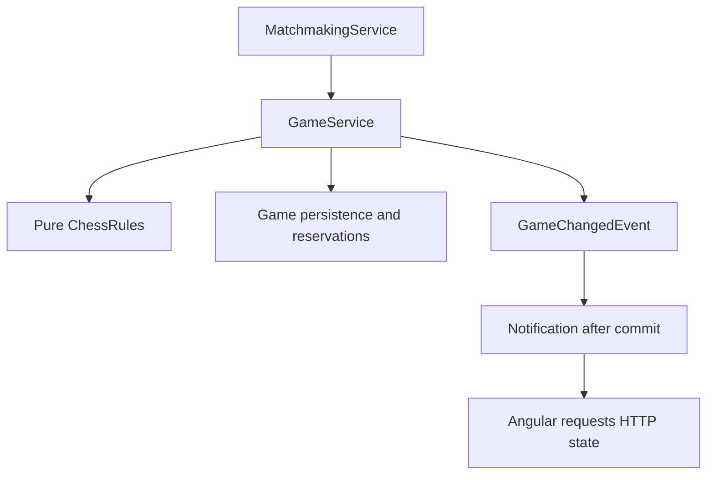
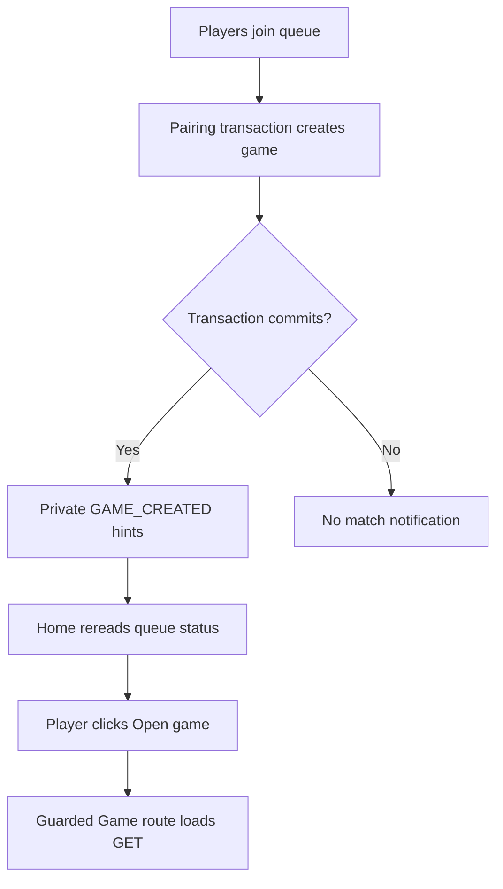
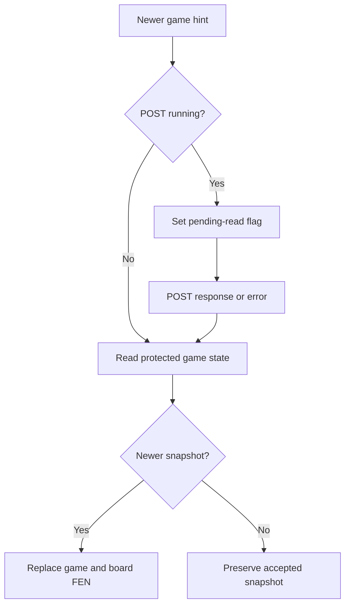

# Main documentation through Day 27

Historical text supplied inside the actual Day 28 archive; current replacements describe Day 28.


---

## README.md

# Chess Web App

A backend-focused chess portfolio project built as a modular monolith with conventional feature layers. It implements its own pure Java rules engine and a minimal Angular interface.

## Current checkpoint

Day 27 replaces JWT authentication with persistent Spring Security sessions backed by PostgreSQL. Source-reviewed on 4 November 2026 against actual user chess-web-app-day27-end(1).zip. See review, session/WebSocket authentication, detailed tab synchronization and handoff.

User reports the previously reported failures resolved and browser login/flow working. No assistant tests/builds/migrations/database/browser runs; detailed cross-tab/restart/deployment acceptance is not independently established. The shared test profile now disables timeout scanning and session cleanup. An intermittent game-action click observation remains deferred in the review.

**Session continuity is implemented.** Angular PGN download and post-MVP replay polish remain deferred.

## Capabilities

- New timed games start White with configured 10m/no increment; old games remain untimed.
- Versioned timeout completion freezes clocks, releases reservations and updates ratings atomically.
- Live countdowns remain live during replay; same-version GETs refresh clock estimates.

- Registration/login, BCrypt password handling, server-side session authentication and self-profile GET/username PATCH.
- Player Elo/statistics initialized at registration; all supported game completions update both Players atomically with duplicate protection.
- Session-derived self-statistics GET and a Home card with manual/live-hint/reconnect refresh.
- Persistent matchmaking with atomic pairing, oldest-first eligibility and one active-game reservation per Player.
- Immutable chess rules: all pieces, king safety, explicit promotion, en passant, standard castling and normal/check/checkmate/stalemate assessment.
- Participant-protected game GET and versioned HTTP move commands with optimistic concurrency protection.
- Atomic checkmate/stalemate, resignation and agreed-draw completion, persisted outcomes and release of both active reservations.
- One pending draw offer, opponent accept/decline and sender withdrawal; any accepted move clears the offer.
- Custom Player-oriented board, explicit promotion/cancellation and server-accepted FEN display.
- Ordered persisted moves with coordinates, promotion, resulting FEN, timestamps and SAN; explicit legacy-game baselines.
- Read-only replay: Start, Previous, Next, selectable history entries and explicit Latest return; live snapshots continue updating.
- Participant-protected `GET /api/v1/games/{gameId}/pgn` with UTF-8 PGN, result markers, custom-baseline support and legacy export rejection.
- Private live notifications, automatic queue/game reads, deferred reconciliation during commands, heartbeats and reconnect recovery.

**Pairing does not automatically navigate to the board.** Home updates to show the matched game; the Player clicks **Open game**. This is the intended Day 20 behavior.

## Stack

Java 21, Spring Boot 4.1.1, Gradle wrapper 9.8.1, PostgreSQL, JPA, Flyway, Spring Security and Spring Session JDBC, Lombok and YAML. Angular 21, Angular Material, signals, RxJS and `@stomp/stompjs` (declared `^7.5.0`).

## Run locally

Keep database, cookie and session configuration user-managed in `backend/src/main/resources/application.yaml`. Flyway migrations V1–V14 provide the schema; Hibernate validates it.

From `backend/`:

```bash
./gradlew bootRun
```

From `frontend/`, using compatible Node tooling and the declared npm 11.6.2:

```bash
npm ci
npm start
```

Open http://localhost:4200. The development proxy forwards `/api/**`, including WebSocket upgrades, to port 8080. Restart the dev server after proxy changes.

Backend WebSocket routing is configured under `app.websocket`; matching frontend addresses and timing are in `frontend/src/app/notification/config/realtime.config.ts`. See [configuration and protocol](../api-contracts.md#real-time-updates).

## Verification

Day 25 suggested focused commands, not assistant-executed results:

```bash
# No database:
./gradlew test --tests 'com.chessapp.player.rating.EloCalculatorTest' --tests 'com.chessapp.player.entity.PlayerStatisticsTest'

# Configured PostgreSQL test database:
./gradlew test --tests 'com.chessapp.player.PlayerStatisticsIntegrationTest' --tests 'com.chessapp.player.PlayerStatisticsHttpIntegrationTest' --tests 'com.chessapp.game.GameMigrationIntegrationTest'
```


Suggested commands, not assistant-executed results:

```bash
# From backend/, no database needed for these focused tests:
./gradlew test --tests 'com.chessapp.game.export.PgnFormatterTest' --tests 'com.chessapp.notification.config.WebSocketPropertiesTest' --tests 'com.chessapp.notification.security.*' --tests 'com.chessapp.game.service.GameMoveServiceTest' --tests 'com.chessapp.game.rules.notation.SanFormatterTest'

# Day 23 socket and migration checks require the configured PostgreSQL test database:
./gradlew test --tests 'com.chessapp.notification.WebSocketIntegrationTest' --tests 'com.chessapp.game.GameMigrationIntegrationTest'

# PGN HTTP checks, with the configured PostgreSQL test database:
./gradlew test --tests 'com.chessapp.game.GameReadIntegrationTest'

# With the configured PostgreSQL test database:
SPRING_PROFILES_ACTIVE=test ./gradlew test
```

From `frontend/`:

```bash
npm test -- --watch=false
npm run build
```

Backend reports are generated under `backend/build/reports/tests/test/`. Frontend tests cover six auth-flow cases and three mocked tab-sync coordinator cases; this document does not establish their execution. The Day 23 review distinguishes inspected coverage, user-reported execution and remaining limits. Migration tests create and drop unique schemas and require schema creation permission. The broad notification test pattern now includes a database-backed socket test.

## Current limits

Notifications are best-effort live hints. Accepted moves are separately persisted in the database; notification delivery is not guaranteed. HTTP reads recover current state; commands are never automatically replayed. Angular restores its in-memory profile using the persisted session cookie after reload; session and cookie expiry still apply.

Existing games record forward from their migration-time FEN; earlier moves cannot be reconstructed. Entries recorded before SAN support retain null SAN, displayed as “—” beside their coordinates. Replay supports available legacy positions, but PGN requires complete history, contiguous records and SAN on every move. There is no Angular PGN download button, SAN backfill, repetition/move-count/dead-position draws, acceptance stage or abandonment policy. Closing the page, disconnecting or logging out does not directly finish a game or release reservations. Timed games continue counting and can later finish by TIMEOUT. Spectators, chat, AI, external brokers and distributed deployment remain outside current scope. The custom board has no legal-move highlighting, drag-and-drop or persistent check indicator. Promotion selection may appear before a proposed promotion is rejected for king safety; this UI improvement is intentionally deferred. The local profile/revision cache is distinct from PostgreSQL-persisted authentication sessions and games/history.

## Documentation

- Day 27 review, session and WebSocket authentication, tab synchronization diagrams and handoff.

- Day 26 clock review, clock flow/pseudocode and handoff.

- Day 25 source review, Player statistics and Elo flow and next-session handoff.

- [Architecture](../architecture.md): current ownership and boundaries.
- [API and real-time contracts](../api-contracts.md).
- Frontend gameplay flow: Angular and board coordination.
- [Real-time flow](../realtime-updates-flow.md): diagrams for security, commit timing and recovery.
- Development progress, [roadmap](../roadmap.md) and frontend setup.
- Movement pipeline: pure rules companion.
- Move history and SAN flow.
- Replay and PGN flow, Day 24 source review and next-session handoff.
- Lifecycle flow, Day 23 source review and historical Day 23 handoff.
- Day 21 source review retains historical checkpoint evidence.
- Historical main-document checkpoints. Existing Day documents retain their historical scope.

## Lifecycle policy

Either participant may resign or offer a draw regardless of turn. Only the recipient can accept/decline; only the sender can withdraw. Play continues during an offer, and any accepted move clears it. Resignation awards the opponent a win. Offers, responses and resignation advance the concurrency version without adding move-history rows. Angular confirms resignation/draw acceptance and shares one POST lock with moves. See [contracts](../api-contracts.md#explicit-lifecycle-commands).

## Rating policy and limits

Initial Elo is 1200, K=32 and scale=400; each completion applies one rounded delta oppositely. V11 excludes already finished games and initializes existing Players at zero counts; active games count when they later finish. No historical backfill, rating floor, provisional/rated modes, leaderboard, audit ledger or rating-aware pairing is implemented. Counts include zero-move resignation/agreement. The game-ID processing record prevents duplicate counting; it is not an event queue.

Statistics failures roll back completion; messaging failures after commit cannot. Home statistics use ordinary GETs and no polling. Missed hints can leave values stale until manual refresh, reconnection or reopening Home. Day 27 supplies session restoration; no access/refresh-token lifecycle remains in the current implementation.

## Clock policy and limits

Production uses app.game.clock initial-time=10m, timeout-scan-enabled=true and timeout-scan-interval=1s. Old games stay untimed. Exactly zero expires; no increment, pause, acceptance/grace stage or network-lag compensation exists. Current timeout policy always awards the opponent a win; full impossible-mate draw adjudication is deferred.

Commands after expiry receive 409 GAME_CLOCK_EXPIRED; the scanner completes games separately through normal transactional statistics/release. Read-only calculatedAt clock projections do not advance game version. Browser countdowns estimate elapsed time from response receipt and may lag delivery; only the backend declares outcomes. A 100-candidate scan batch is not a strict one-second guarantee. Shared test YAML now disables scans for fixture isolation. See the review for failure-starvation and coverage limits.

## Day 26 focused verification

Suggested commands only; no assistant execution:

```bash
# From backend/, no database for these suites:
./gradlew test --tests 'com.chessapp.game.clock.GameClockCalculatorTest' --tests 'com.chessapp.game.entity.GameClockEntityTest' --tests 'com.chessapp.game.config.GameClockPropertiesTest' --tests 'com.chessapp.game.dto.GameClockResponseTest' --tests 'com.chessapp.game.service.GameTimeoutScannerTest'

# With configured PostgreSQL test database:
./gradlew test --tests 'com.chessapp.game.GameClockPersistenceIntegrationTest' --tests 'com.chessapp.game.GameTimeoutIntegrationTest' --tests 'com.chessapp.game.GameMoveHttpIntegrationTest' --tests 'com.chessapp.game.GameMigrationIntegrationTest'
```

## Session settings

CHESS_SESSION is HttpOnly, path /, SameSite Lax, with configured 7d max-age. Server session inactivity is separately 7d. Cookie lifetime is not automatically renewed per request and no separate absolute server cap is implemented. SessionCookieConfig explicitly binds the YAML values. SESSION_COOKIE_SECURE defaults false for local HTTP; use true for HTTPS deployment. Flyway owns framework session tables; production expired-session cleanup runs every minute. Logout invalidates the shared session, while other independent browser sessions remain.

GET /api/v1/auth/csrf initializes the readable XSRF-TOKEN cookie. Angular sends X-XSRF-TOKEN on state-changing relative API requests. POST login returns the Player profile; POST logout returns 204. CONNECT uses the session-authenticated handshake plus a native CSRF header. See the flow companions for expiry, revocation, multi-tab limits and the cost of database access checks.


---

## frontend/README.md

# Chess Frontend

Angular 21 standalone frontend with Material, signals, RxJS, persistent-session authentication, custom board and live clocks. Day 27 source-reviewed on 4 November 2026 against actual user chess-web-app-day27-end(1).zip. No assistant build/test/browser run is claimed. See review and clock flow.

## Run

From frontend/, use compatible Node tooling and the declared npm 11.6.2:

```bash
npm ci
npm start
```

Open http://localhost:4200. The start script enables proxy.conf.json, forwarding `/api/**` and WebSocket upgrades to port 8080. Restart the dev server after proxy changes. If a generated lazy chunk returns 404 after dependency/rebuild changes, restart, wait for successful compilation and hard-refresh. If needed, stop the server and use `npx ng cache clean`, then restart. This was the reported Day 20 development issue, subsequently reported resolved; it is not a game-rule failure.

## Authentication and navigation

Startup initialization restores csrf then players/me before guards. Login returns a Player profile after session creation; Angular reinitializes CSRF before storing it. The browser retains CHESS_SESSION; Angular stores profile/revision only. Protected 401 compares captured revision; 403 does not clear authentication. Failed forms preserve passwords. Server logout is subscribed to and only successful logout clears local state. See session flow and tab diagrams.

Home supports profile editing, self-statistics and persistent matchmaking. It reads queue state on entry, private updates and successful connections. A single pending read is drained after a current command/read. Unknown/WAITING/MATCHED status has 30-second recovery checks; NOT_QUEUED is idle. Home’s signal is named queueStatusResponse in this checkpoint.

**A match reveals Open game; it does not automatically navigate.** The Player clicks the link to open the guarded game route. Home now has separate home.ts, home.html and home.css files.

## Gameplay

Game owns GET snapshots, versioned POST commands, promotion and recovery. ChessBoard receives FEN/orientation/enabled and emits proposed coordinates. Game/board templates and CSS remain separate. The board does not validate chess legality or perform optimistic piece moves.

Select an own piece and destination; select another own piece to change source or click the selected square to cancel. Promotion requires an explicit choice; cancel sends no request and leaves no stale source. Castling proposes the king’s source/destination. En passant proposes the capturing pawn’s source/destination.

Relevant newer notifications request GET. A pending read waits during POST; safety reads can be cancelled before submission. Same-version reads preserve snapshot identity/promotion, and older reads cannot overwrite a newer snapshot. Game-state read failures block proposals; stale/uncertain command outcomes reconcile through GET without replay.

Games also reconcile after reconnect/focus and periodically while visible with a loaded active snapshot. The board stays visible during background reads. GET does not expose positionStatus, so there is no persistent check indicator. Terminal results disable all game commands; returning Home reads queue state and released Players can join again.

## Real-time connection

App instantiates RealtimeService once. It observes revision/authentication, checks csrf/profile before connecting, recreates subscriptions on reconnect and ignores stale callbacks. CONNECT sends X-XSRF-TOKEN and the handshake inherits cookie authentication. Heartbeats detect transport failures; clearing local state stops the client. No JWT expiry timer remains. STOMP rejection marks live delivery UNAVAILABLE while HTTP/manual recovery remains available.

@stomp/stompjs is declared as ^7.5.0. REALTIME_CONFIG supplies matching backend addresses plus reconnect/heartbeat/recovery timing. Backend YAML is not read by Angular.

## Verification and limits

Optional user-run commands:

```bash
npm test -- --watch=false
npm run build
```

The archive contains six auth-flow and three mocked tab-sync coordinator tests. No comprehensive real-browser notification/game coordinator suite is established. Suggested two-session scenarios are in the review.

The move list has separate coordinate and SAN columns. Pre-SAN entries show “—” for SAN. Recorded-position replay is implemented with explicit Latest return. Backend PGN export exists; its Angular download UI is deferred. Live clocks are implemented; drag-and-drop and legal-move highlighting remain absent. Promotion selection may open before backend king-safety rejection; this known UI improvement remains intentionally deferred. Disconnecting never decides game completion or releases reservations. No durable notification replay, auto board navigation or persisted login session is supplied.

See gameplay coordination, real-time diagrams, contracts, architecture and roadmap.

## Move history coordination

After accepting game GET, Game reads GET /games/{gameId}/moves. History with the displayed version is accepted; older history is ignored; newer history queues blocking board synchronization. The previous list remains visible with catching-up feedback when outdated. History errors are separate from board errors and do not alone block proposals.

The reading flag spans both GETs. cancelReads is downstream of switchMap, so a permitted POST cancels either stage. Route cancellation also tears down both. Successful POST explicitly queues nonblocking reconciliation. Visible loaded finished games continue safety checks while history is missing, outdated or failed; they stop when board/history are synchronized. Initial game GET failures without a snapshot still require manual/focus/connection/hint recovery.

The table shows Entry, Player, Move and SAN. Entry is a recorded individual-move sequence relative to the baseline. Legacy incomplete history has an explanatory notice. SAN is generated in the backend; Angular does not duplicate chess legality or notation rules. See history flow.

## Day 22 lifecycle controls

GameApiService maps typed actions to resignation and draw-offer POST routes. GameResponse adds nullable drawOfferedByPlayerId and termination reasons RESIGNATION/DRAW_AGREEMENT. Move responses now also include clock; their accepted mapping explicitly clears the pending offer and maps the returned clock.

canSubmitGameCommand checks active participant/session and synchronization/submission state. canSubmitMove additionally checks turn and absence of lifecycle confirmation. canSubmitLifecycleAction ignores turn but requires promotion to be resolved. An offer does not pause play.

Resignation and draw acceptance use inline confirmation; decline, withdrawal and offer send directly. A newer snapshot, route change or blocking synchronization clears confirmation. Unchanged nonblocking reads preserve it. Any accepted move clears the offer; the pending offer is discovered through ordinary game GET.

executeGameCommand shares the existing submitting flag across moves and lifecycle commands. It cancels either GET stage before POST, ignores callbacks for replaced snapshots, applies the accepted response and queues board/history reconciliation. Conflicts and uncertain responses request fresh state without replay. The retained moveMessage signal now carries general action feedback.

No new frontend tests are included. The lifecycle companion and Day 22 review record suggested two-session checks and the actual coverage limits.

## Player statistics and refresh stream

Home imports PlayerStatistics and renders app-player-statistics after app-profile-editor. PlayerApiService.currentStatistics calls GET /api/v1/players/me/statistics; statistics are not cached in AuthSessionStore. The component has separate TS/HTML/CSS and displays rating, played, wins, draws and losses.

merge combines a manual Subject, RealtimeService.connections$ and updates$; startWith triggers the first GET. Any private hint can refresh statistics, even when counts did not change. switchMap cancels an older GET when another trigger arrives. The captured token/Player ID and response identity guard updates in tap. catchError is inside the HTTP branch and returns EMPTY, preserving future refreshes; previous values remain visible with error feedback. finalize resets loading on success, failure or cancellation. takeUntilDestroyed is downstream of switchMap and tears down the active request. No nested subscribe, rating-history API or periodic statistics polling is implemented.

Opening Home loads current values after game completion. A missed hint may leave the card stale until manual refresh, reconnection or a new Home instance. No manual browser acceptance is established by source review. The existing frontend auth tests are unchanged. See statistics flow for RxJS and transaction diagrams.

## Day 26 clocks and timeout extension

Game accepts clock data on GET when its version is at least the displayed version, but replaces board identity only when needed. clockSnapshot is separate so equal-version clock refreshes preserve selection/promotion during nonblocking safety reads. Accepted move/lifecycle mappers replace clock data. Route initialization clears it; a 403/404 clears game and hides clocks, without an explicit clockSnapshot reset in that error branch.

GameClocks has separate TS/HTML/CSS and pseudocode.txt. It anchors server-calculated remaining times to performance.now at receipt, estimates the running Player's time every 100ms, clamps zero and rounds displayed seconds upward. calculatedAt is response metadata, not used for network-age correction. Delivery delay and sleep/background behavior can affect display. Existing focus/reconnect/periodic reads recover state. Local zero only shows waiting; backend owns completion and command rejection. Finished clocks freeze. GAME_CLOCK_EXPIRED triggers existing reconciliation without command replay.

Replay displays historical positions while clocks/status remain live. Latest remains explicit. Stronger banner/square-click behavior, sounds and new-live-move indicators are deferred until after MVP. No new frontend tests or assistant browser acceptance is claimed.

See clock flow and pseudocode for timing, configuration, transaction boundaries and remaining limits.

## Session coordination

AuthSessionEventsService publishes only SESSION_CHANGED over BroadcastChannel. SessionSyncService clears local identity/revision, awaits Login navigation, checks revision and restores the backend session before opening Home. Another tab does not receive credentials or a profile through the channel. Delivery and simultaneous authentication schedules have documented limits; see the tab companion. Relative API URLs preserve built-in Angular XSRF integration through the development proxy.


---

## docs/architecture.md

# Architecture

This document describes Day 27, source-reviewed on 4 November 2026 against actual user chess-web-app-day27-end(1).zip. See [review](day27-sessions-review.md), [session/WebSocket flow](session-authentication-flow.md) and [tab synchronization](tab-synchronization-flow.md). No assistant application execution. Prior document text is preserved in history.

## Application structure

One Spring Boot application, organized by feature with conventional controller/service/DTO/entity/repository layers. Keep `Player` terminology. This is a modular monolith, not DDD or a collection of microservices. Cross-feature operations use services or application events rather than another feature’s repositories.

| Feature | Responsibility |
| --- | --- |
| auth | Registration, local credentials and login orchestration |
| player | Player creation/lookup, self-profile, username updates, statistics and Elo completion reaction |
| security | HTTP session security, password encoding, CSRF and cookie settings |
| matchmaking | Persistent queue, eligibility and transactional pairing |
| game | Game creation/read/move commands, reservations, lifecycle, immutable rules and game events |
| notification | WebSocket configuration/security, private outbound notifications and session access tracking |
| common | Shared timestamps and validation/error infrastructure |

Controllers translate transport input. Services own authorization, use-case orchestration and transactions. Repositories stay within their feature. Concrete services and explicit record mappings remain sufficient; mapper frameworks and additional service interfaces are unnecessary without a concrete need.



## Authentication and profile

Transactional registration creates a Player through PlayerService and stores encoded credentials in auth. Scalar Player IDs avoid cross-feature entity coupling. PostgreSQL uniqueness constraints remain authoritative when availability checks race.

Login validates credentials, changes an existing session ID and resets CSRF, then explicitly saves a SecurityContext with a canonical Player-ID String principal. Spring Session JDBC stores it in PostgreSQL. Login returns PlayerResponse; JWT classes/starter/settings are removed. V14 creates framework session tables. Cookie settings are explicitly bound by SessionCookieConfig; TimeConfig now owns Clock.

The browser manages an HttpOnly session cookie; Angular stores only profile/revision and restores them at startup through csrf then players/me. Built-in XSRF handling supplies headers for relative API writes. Protected 401 clears a matching captured revision; 403 does not invalidate authentication. Login/register failure retains passwords. Profile edits keep stable Player identity. Broadcast hints trigger receiver clear/navigation/restore, as detailed in the tab companion. Exact, case-sensitive credential matching remains.

## Persistence and transactions

PostgreSQL is durable storage. Applied Flyway migrations are immutable; future schema changes use new migrations. Hibernate validates rather than generates the schema; Open EntityManager in View is disabled.

| Migration | Responsibility |
| --- | --- |
| V1 | Players |
| V2 | Local credentials |
| V3 | Matchmaking queue and ordering index |
| V4 | Games, participants, FEN and optimistic version |
| V5 | Active-player reservations and initial backfill |
| V6 | Completion fields and lifecycle consistency constraints |
| V7 | History baseline/completeness/count and ordered move records |
| V8 | Nullable SAN for pre-SAN records; new application records require SAN |
| V9 | Completion constraint permits resignation with a winner |
| V10 | Pending participant offer on active games; completion permits draw agreement |
| V11 | Player statistics and per-game processing/exclusion markers |
| V12 | Nullable game clocks; active/frozen/untimed shape constraint |
| V13 | TIMEOUT with a winning outcome |

BaseEntity timestamps use JPA callbacks. SQL defaults support non-JPA insertion; direct SQL updates do not automatically advance `updated_at`. Identity sequences need not rewind after rollback.

Queue operations acquire the same PostgreSQL transaction-level advisory lock. This serializes cooperating operations on the single queue, including status reads. Repeated join preserves enqueue time through an upsert. Pairing selects the oldest eligible entries, assigns colors, invokes GameService and removes both queue entries in one transaction.

GameService flushes game creation before inserting JDBC reservations that reference it. JPA and JdbcTemplate share the datasource and transaction. The reservation table’s Player primary key enforces one active game across either color. Incomplete reservation or release counts fail the transaction. Leaving the waiting queue does not cancel an established game.

## Pure chess rules

`game.rules` contains no Spring, JPA, HTTP or notification concerns. Immutable Piece/Square/Move records, Board and ChessPosition represent placement and metadata. Board currently uses map storage and identity equality; tests compare board contents or FEN rather than assuming value equality for Board.

| ChessRules operation | Responsibility |
| --- | --- |
| initialPosition() | Standard starting position |
| legalMoves(position) | Complete immutable set for the side to move |
| applyMove(position, move) | Exact legal-set membership, then shared application |
| evaluate(position) | NORMAL, CHECK, CHECKMATE or STALEMATE |

GameRulesConfig constructs the six pseudo-legal strategies, dispatcher, shared applier, attack detector, legal filter and evaluator. Sliding pieces share ray traversal. Attack detection includes pinned attackers; generated moves exclude king captures. Legal filtering checks the moving king on the resulting board. Castling additionally checks the original and transit positions.

FenParser validates structural representation, not historical reachability. FenSerializer is separate. Promotion choices are explicit; there is no automatic queen. En passant and castling use the shared immutable application pipeline. Rights are historical metadata and are never restored by returning a piece or promoting a rook.

The facade does not own authorization, persistence, version checks or transactions. FEN alone cannot establish repetition history. See the [movement pipeline companion](movement-pipeline-architecture.md).

## Game commands and lifecycle

Both participants may read a game, including after completion. Commands derive the acting Player from the authenticated session principal, never from request-supplied identity.

For a well-formed move command, GameService checks existence, membership, lifecycle, expected version, clock expiry, turn and legal membership. It applies and evaluates the move through ChessRules before mutating the managed game. SAN is formatted from the original position, accepted move, complete legal set and resulting assessment before managed state changes. The recorded sequence advances on the versioned Game row. Flush advances the optimistic version and detects competing writes before history insertion. A losing optimistic update becomes STALE_GAME_VERSION.

Checkmate sets the mover’s winning result; stalemate sets DRAW. Position, recorded count, move record including SAN, result/reason/time and deletion of both reservations commit or roll back together. The move and any completion share a Clock-derived timestamp truncated to microseconds. History is explicitly flushed before reservation release and event publication. Flush is not commit. Version is a concurrency token, not a separately defined move number.

## Internal events and real-time delivery

GameService publishes immutable GameChangedEvent values after creation/reservation success or after game/history flush and any reservation release succeed. They carry game/participant IDs, version and GAME_CREATED/GAME_UPDATED. The game feature imports no WebSocket transport.

GameNotificationListener runs AFTER_COMMIT and sends a small PlayerUpdate to both participant user destinations. During matchmaking it waits for the outer pairing transaction, including queue removal. A rollback produces no notification. Terminal moves use GAME_UPDATED; HTTP GET supplies the result.

Sending is best-effort. Each recipient attempt catches runtime send failures so the other recipient is still attempted and a committed command is not reported as a delivery failure. There is no outbox, durable replay, acknowledgement guarantee or external broker. No database writes occur in the listener.

## WebSocket security

HTTP upgrade requires session authentication and the configured Origin. SessionHandshakeInterceptor copies the existing session ID, Player name and raw CSRF cookie. CONNECT requires one matching X-XSRF-TOKEN native header and inherited authenticated identity; WebSocketSessionAccess rechecks the stored session before registering the socket binding. The expected CSRF attribute and native credential headers are removed after acceptance.

Only the exact private subscription is allowed; raw broker paths, other-Player paths, wildcards and SEND are rejected. Inbound operations and outgoing application MESSAGEs check the exact bound HTTP session, stored SecurityContext and Player identity. Outbound checks happen before enqueue and handler; protocol/heartbeat output bypasses that application-message filter. Disconnect removes bindings idempotently.

JDBC session reads do not extend activity. Each outgoing application message can incur two session reads. There is no proactive physical socket closure on session invalidation, no JDBC destruction-event dependency and no recall of transmitted messages. The local simple broker/map remain single-instance. See [authentication diagram](session-authentication-flow.md#websocket-authentication-in-detail).

## Angular orchestration

App instantiates RealtimeService and SessionSyncService independently of route navigation after startup restoration. It recreates private subscriptions after reconnecting, ignores stale-session callbacks, validates incoming update shape and exposes signals/observables. STOMP errors mark live delivery unavailable; HTTP still determines session validity.

Home reads queue state on entry, notifications and connection events. One pending read is drained after any current queue command/read. Periodic checks run for unknown, WAITING and MATCHED state; NOT_QUEUED is idle. Pairing reveals an Open game link rather than forcing navigation.

Game owns authoritative snapshots, promotion, commands and recovery. Route switchMap cancels old-route reads; exhaustMap permits one GET at a time. Notifications received during GET/POST coalesce into a pending read. A safety GET may be cancelled before a move POST starts. Unchanged versions preserve snapshot identity and promotion; older responses cannot replace newer state. Known-newer notifications block proposals until reconciliation. There is no automatic command retry.

ChessBoard owns rendering/orientation/selection and emits coordinates. Its selection-reset effect observes FEN, orientation and enabled inputs. It clears selection before emitting, so cancelling promotion leaves no stale source. Home, Game and ChessBoard use separate HTML/CSS files.

## Configuration and deployment boundary

`app.websocket` binds to WebSocketProperties with constructor validation. Endpoint registration, subscription authorization and sending consume this shared object; the HTTP endpoint is protected by the general authenticated-request rule. Destination paths are derived from prefixes plus updates-path. The configured heartbeat range is 1–300 seconds. A lazily injected broker scheduler enables heartbeats.

Angular’s REALTIME_CONFIG contains matching routing addresses and its own timing settings. Backend YAML is not automatically published to the browser. Development proxying includes WebSocket upgrades. Configuration/secrets remain user-managed.

The simple broker and session registry are in-process. Current delivery assumes a single application instance. Multi-instance notification routing requires a separate design, even though database concurrency guards continue to protect shared state.

## Deferred scope

The PGN download UI, pre-SAN backfill, clock extensions, extra rule-based draws, acceptance, abandonment/disconnect completion, rating extensions remain separate choices; session continuity is implemented in Day 27. Replay and backend PGN export are implemented. Promotion chooser legality gating is intentionally deferred. Custom board polish/library integration is optional. Closing a page does not finish a game. See [roadmap](../roadmap.md) and the two flow companions for details.

## Persisted history and SAN

Game owns immutable historyStartFen/historyComplete metadata and a mutable recordedMoveCount. V7 copies existing currentFen into the baseline and marks all existing games incomplete, conservatively including games whose earlier moves are unknown. New games set their supplied initial FEN as the baseline and historyComplete=true. This means history since creation, not game completion. Counts begin at zero and sequence numbers begin at one relative to that baseline; neither is defined as the JPA version or FEN fullmove number.

GameMove uses scalar game/Player IDs and stores source/destination, optional promotion, resulting FEN, playedAt and SAN. No application update operations are exposed. The database unique constraint on (game_id, sequence_number) protects ordering uniqueness and supplies its index. Membership, legal chess behavior and count/row consistency remain application responsibilities rather than cross-row database checks.

getHistory authorizes membership before reading records through the captured recordedMoveCount. Later committed entries are excluded by the query bound. Consistency relies on atomic append-only writes and stable history metadata; this is not a general-purpose repeatable-read transaction or a concurrent-reader integration test claim. No history write belongs in an after-commit listener.

SanFormatter is pure Java. It consumes the original position, accepted move, complete legal set and resulting assessment. It produces English SAN with captures, O-O/O-O-O, = promotion, legal-source disambiguation and +/# suffixes. It does not replace the legality facade. V8 preserves null SAN for pre-SAN entries; no backfill is supplied.

Angular reads the board, then history, within the same coordinated read operation. Matching versions accept history; older history is ignored; newer history queues board synchronization. An older accepted list may remain visible while catching up, but a newer list is not shown ahead of the board. History failures have separate feedback and do not independently disable moves. Accepted POSTs explicitly queue reconciliation so the sender's list catches up even when its notification is already obsolete. See [history flow](move-history-flow.md).

## Day 22 explicit lifecycle commands

GameService owns resign, offerDraw, acceptDraw, declineDraw and withdrawDraw. Public methods own transactions. loadActiveGameForCommand performs existence, participant, active lifecycle and expected-version checks in that order. requireDrawOfferActor checks offer presence and sender/recipient roles. These application commands do not evaluate pure chess rules.

persistLifecycleChange flushes the optimistic game update, releases exactly two reservations if finished, publishes GAME_UPDATED and maps GameResponse. It does not commit. An enclosing failure restores completion, pending offer and reservations and suppresses AFTER_COMMIT delivery. A concurrent move or lifecycle command may win; another write based on the same loaded version must fail. Private helpers do not create transaction boundaries.

Game.drawOfferedByPlayerId stores one nullable participant ID. Entity guards and ck_games_draw_offer prevent nonparticipant or finished-game offers. finish validates outcome before clearing negotiation; updatePosition clears an offer only after validating its input. Service-rejected moves never mutate the entity. V10 allows DRAW only for STALEMATE/DRAW_AGREEMENT and winning results only for CHECKMATE/RESIGNATION. Applied migrations remain immutable.

Lifecycle-only mutations leave FEN, baseline and recorded count unchanged and insert no GameMove. Version therefore advances independently of move count. GameResponse includes pending offer ownership; GameMoveResult is unchanged. History is a move log, not an audit of negotiations.

Angular executeGameCommand coordinates all POST types through one submission lock and shared recovery. General command permission is independent of turn; move permission adds turn checks. Promotion must be resolved before lifecycle actions. Inline confirmation is required for resignation/acceptance. Known-newer snapshots clear confirmations even when FEN did not change. Accepted lifecycle responses trigger board/history reconciliation because captured history versions advance too. See [lifecycle flow](game-lifecycle-flow.md).

## Day 23 verification boundaries

WebSocketPropertiesTest uses an isolated binding context. WebSocketIntegrationTest starts the real server on a random port and uses actual STOMP clients, real HTTP login/session cookies and CSRF, simple broker, listener and database transactions. A private probe establishes subscription readiness before application assertions. Resignation delivery waits for outer commit, reaches both participants and excludes an independently ready outsider. Rollback preserves active state and reservations and produces no update during the bounded observation windows.

GameMigrationIntegrationTest applies the real migrations to uniquely named PostgreSQL schemas. It tests V6-to-V10 legacy metadata and V7/V8/V9/V10 history/resignation continuity. It does not run JPA services against intermediate schemas or prove every deployment upgrade path. The current source filename is GameMigrationIntegrationTest.java; no naming cleanup remains.

These tests do not introduce delivery guarantees, heartbeat/reconnection socket coverage or a frontend coordinator suite. The user reports passing tests; no assistant execution is claimed. See [review](day23-reliability-review.md).


## Day 24 replay and export

GameExportService owns the participant-protected PGN read transaction. It loads the game, authorizes before exposing export availability, captures GameResponse and recordedMoveCount, then reads immutable move rows through that count. Player usernames come through PlayerService, never another feature's repository. Names are current at export time, not historical snapshots; they are not guaranteed to reflect one simultaneous cross-Player read.

PgnFormatter lives in game.export, outside the pure rules engine. It consumes captured DTOs and the existing FenParser. It requires matching game IDs/versions, complete history, an exact row count, contiguous sequences and nonblank SAN. It formats persisted SAN without replaying or revalidating chess moves. Baseline side/fullmove number determines numbering; lifecycle versions do not. Current result and captured move boundary remain consistent under existing atomic append-only writes, without asserting general repeatable-read isolation or an explicitly tested concurrent-export schedule.

The controller emits UTF-8 bytes, application/x-chess-pgn, an attachment filename based on game ID and Cache-Control: no-store. Authentication and access use session security and feature errors; unsupported history returns 409 PGN_EXPORT_UNAVAILABLE. No export button or Blob client method is included in Angular by user decision.

Game.replayIndex is a local display cursor: null follows game.currentFen; zero selects historyStartFen; a positive value selects a move's resultingFen. replayHistory checks game identity, version not ahead, row count and sequence continuity. An older accepted list remains usable during reconciliation. displayedFen drives both board and FEN details, while live status/offer/result remain sourced from game(). Numeric replay selection disables the shared command permission, including at the last recorded entry. Only Latest resumes live following; Next does not automatically do so.

Replay navigation clears pending promotion/confirmation, is blocked during POST, preserves its cursor across live updates and resets on route initialization or history-clearing 403/404 responses. ChessBoard's existing FEN/enabled effect clears selection. No new board component, rules engine, migration or frontend test suite was introduced. See [replay/export flow](replay-pgn-flow.md).

## Day 25 Player statistics and transaction ownership

PlayerStatistics is a separate player-owned entity keyed by scalar playerId, with a database foreign key, rating, wins/draws/losses and optimistic version. gamesPlayed is derived. PlayerService.createPlayer is transactional and flushes the Player before saving statistics; AuthService registration provides the enclosing credentials transaction. V11 initializes existing Players at 1200 with zero counts. It marks already FINISHED games excluded (statistics_applied=false); existing active games remain eligible.

GameService publishes GameFinishedEvent after a terminal move's history flush or a lifecycle game flush and after exact reservation release. The player.event.PlayerStatisticsGameFinishedEventListener is a regular synchronous @EventListener. It maps the game result and calls PlayerStatisticsService.recordFinishedGame with MANDATORY propagation. No @Async/custom asynchronous multicaster is introduced. Rating failure propagates and rolls back the game, history, reservations, marker and both statistics. A later outer failure rolls them back too. GameChangedEvent is published afterward; notification delivery remains AFTER_COMMIT and best-effort.

PlayerStatisticsRepository owns both the JPA entity operations and native insertFinishedGameClaim, wrapped by default boolean claimFinishedGame. ON CONFLICT DO NOTHING uses the game primary key to reject repeated/excluded processing. Successful claims are transactional, not durable work queues. The service then locks statistics by ascending Player ID with PESSIMISTIC_WRITE, maps back to colors, calculates from both old ratings, updates and flushes. The event is a trusted internal contract; the consumer does not reload/verify game membership/result through another feature's repository.

EloCalculator is pure Java in player.rating: initial 1200, K=32, scale 400, actual scores 1/0.5/0. One Math.round adjustment is applied oppositely to conserve the pair's total. There is no floor, provisional policy, time-control separation, backfill or rating audit ledger. Overflow checks fail rather than wrap. The /players/me/statistics read uses ordinary findById, checks account existence and maps a DTO. No rating-write lock is needed for display. The statistics profile contract is unchanged; Day 27 independently replaces transport authentication with sessions.

Home embeds PlayerStatistics with separate TS/HTML/CSS. Initial/manual/live-hint/reconnect triggers switch to a fresh GET, guarded by captured token/Player ID. Inner tap updates signals; inner catchError returns EMPTY so later triggers remain active. Inner finalize handles completion/error/cancellation; downstream takeUntilDestroyed tears down active GETs. No polling, focus retry or new frontend test suite is added for this card. See [statistics flow](player-statistics-flow.md).

## Day 26 clocks and timeout extension

Game clock state and TIMEOUT are implemented. New games start White at configured 10m/no increment before commit/opening; old games remain untimed. Expired commands return GAME_CLOCK_EXPIRED; a separate scanAndExpireGames worker calls transactional expireGame, rechecks current state and completes at the stored deadline. Version conflicts arbitrate competing writes. Timeout uses existing reservation release, GameFinishedEvent synchronous statistics and AFTER_COMMIT best-effort hints. Rating failure rolls back frozen clocks and completion together. Timeout adds no move row; draw offers never pause clocks.

Both response DTOs append projected clock with calculatedAt; read timestamps are not persisted completion events. Timeout currently always awards opponent win; the possible-mate draw exception is deferred. Disconnect/logout does not itself complete a game, but a timed game continues and can later expire. This scheduled worker does not make statistics asynchronous or introduce an outbox.

See [clock flow and pseudocode](game-clocks-flow.md) for timing, configuration, transaction boundaries and remaining limits.

## Session integration and tab coordination

Spring Boot supplies the session filter/repository through its JDBC session starter. The schema has no cross-feature Player entity relation; authentication uses a scalar identity in serialized SecurityContext. Session persistence uses its own framework transactions and is not part of a game completion transaction. Production cleanup runs every minute; fixture tests disable it. Cookie age and inactivity expiry are distinct. CSRF reset clears the browser cookie, not a server-side revocation list.

SessionSyncService consumes only hints and rechecks the backend. It resets revision/profile before navigation, guards against a newer local operation, then restores with another revision and opens Home on success. It does not replay commands or lock all tab mutations. See the detailed [tab flow](tab-synchronization-flow.md).


---

## docs/api-contracts.md

# API Contracts

Current Day 27 contracts, source-reviewed on 4 November 2026 against actual user chess-web-app-day27-end(1).zip. Session cookies and CSRF replace bearer JWTs; game/clock contracts remain. No assistant application execution. See [review](day27-sessions-review.md) and [authentication flow](session-authentication-flow.md).

## Shared conventions

- Protected endpoints require a valid CHESS_SESSION cookie. State-changing requests also require a matching XSRF-TOKEN cookie and X-XSRF-TOKEN header. This includes anonymous login/registration and logout.
- Protected self-service actions derive player identity from the authenticated session principal name; clients do not choose the acting player ID.
- MVC validation returns Problem Detail with `code: VALIDATION_FAILED` and an `errors` array containing `field` and `message`. Rejected password values are omitted.
- Duplicate-identity and feature-owned exceptions return Problem Detail with their application code.
- Missing/invalid session authentication use Spring Security handling; no application code or uniform MVC error body is guaranteed.
- Deleted-player failures from profile GET/PATCH and statistics GET use `ResponseStatusException` with 401; no application code is guaranteed. Matchmaking has its own `AUTHENTICATED_PLAYER_UNAVAILABLE` code.
- Malformed JSON, incompatible field types, path conversion failures and unexpected server errors may have different bodies. Clients need a generic fallback.
- The frontend handles protected 401 session cleanup centrally; action-specific UI handles known codes. A 403 does not invalidate the session.

## Endpoint index

| Method | Route | Authentication | Successful response |
| --- | --- | --- | --- |
| POST | `/api/v1/auth/register` | Anonymous access + CSRF | 201; `playerId`, `username`, `email` |
| POST | `/api/v1/auth/login` | Anonymous access + CSRF | 200; `id`, `username`, `email`; session cookie; no-store |
| GET | `/api/v1/auth/csrf` | Anonymous access | 204; initializes CSRF cookie; no-store |
| POST | `/api/v1/auth/logout` | Valid CSRF; authentication may be absent | 204; invalidates current session; clears cookies; no-store |
| GET | `/api/v1/players/me` | Session cookie | 200; `id`, `username`, `email` |
| GET | `/api/v1/players/me/statistics` | Session cookie | 200; `playerId`, `rating`, `wins`, `draws`, `losses`, `gamesPlayed`; no-store |
| PATCH | `/api/v1/players/me` | Session cookie | 200; updated `id`, `username`, `email` |
| POST | `/api/v1/matchmaking/queue` | Session cookie | 200; queue status |
| GET | `/api/v1/matchmaking/queue/me` | Session cookie | 200; queue status |
| DELETE | `/api/v1/matchmaking/queue/me` | Session cookie | 204; no body |
| GET | `/api/v1/games/{gameId}` | Participant session | 200; game state |
| GET | `/api/v1/games/{gameId}/pgn` | Participant session | 200; UTF-8 PGN attachment |
| POST | `/api/v1/games/{gameId}/moves` | Participant session | 200; GameMoveResult |
| GET | `/api/v1/games/{gameId}/moves` | Participant session | 200; GameHistoryResponse |
| POST | `/api/v1/games/{gameId}/resignation` | Participant session | 200; GameResponse |
| POST | `/api/v1/games/{gameId}/draw-offer` | Participant session | 200; GameResponse |
| POST | `/api/v1/games/{gameId}/draw-offer/accept` | Participant session | 200; GameResponse |
| POST | `/api/v1/games/{gameId}/draw-offer/decline` | Participant session | 200; GameResponse |
| POST | `/api/v1/games/{gameId}/draw-offer/withdraw` | Participant session | 200; GameResponse |

There is no public game-creation endpoint: pairing invokes creation internally. Participant-authenticated POST /api/v1/games/{gameId}/moves delegates to GameService. Pure rules exceptions are not themselves the HTTP contract; game-owned application exceptions map gameplay rejections.

## Register — POST `/api/v1/auth/register`

Request fields: `username`, `email`, `password`.

Username: nonblank, 3–30 Java UTF-16 string units. Email: nonblank, valid email format, at most 255 units. Password: nonblank, at least 8 units and at most 72 UTF-8 bytes. No trimming or normalization is applied. Success returns the registered identity without credentials or a token.

| Failure | Status | Application code |
| --- | --- | --- |
| Invalid fields | 400 | `VALIDATION_FAILED` |
| Username taken | 409 | `USERNAME_ALREADY_EXISTS` |
| Email registered | 409 | `EMAIL_ALREADY_EXISTS` |

## Login — POST `/api/v1/auth/login`

Request fields: `email`, `password`. Email matching is exact. Login validates nonblank fields, email format/maximum length and the BCrypt byte maximum; it does not impose registration's minimum password length.

Success returns PlayerResponse (`id`, `username`, `email`) with `Cache-Control: no-store` and establishes the session cookie. The frontend reinitializes CSRF before storing the local profile; startup restoration separately reads the self-profile. Unknown accounts and incorrect/missing local credentials receive the same invalid-credentials response.

| Failure | Status | Application code |
| --- | --- | --- |
| Invalid fields | 400 | `VALIDATION_FAILED` |
| Invalid credentials | 401 | `INVALID_CREDENTIALS` |

## Read self-profile — GET `/api/v1/players/me`

No request body. Success returns the current database-backed `PlayerResponse` (`id`, `username`, `email`).

| Failure | Status | Application code |
| --- | --- | --- |
| Missing, invalid or expired session | 401 | Not guaranteed |
| Authenticated player no longer exists | 401 | Not guaranteed |

## Read self-statistics — GET `/api/v1/players/me/statistics`

Player ID comes exclusively from the authenticated session principal name. Success is 200 with Cache-Control: no-store:

```json
{"playerId":7,"rating":1200,"wins":0,"draws":0,"losses":0,"gamesPlayed":0}
```

No email or persistence version is included. gamesPlayed equals wins+draws+losses. Ratings can be negative; no floor is imposed. Missing/invalid authentication is rejected by security. A session for a deleted Player yields 401, matching self-profile policy. An existing Player missing statistics is an internal invariant failure, not a default zero response or a new structured feature error.

V11 excludes games already finished at migration time; active games count when they later finish. All four supported completion reasons count, including zero-move resignation/agreement. Duplicate completion events do not apply a second update. Completion and statistics share one transaction; a failed rating update prevents the completion from committing. This GET performs ordinary reads and adds no mutation or retry behavior. No public leaderboard, rating-history or statistics-write endpoint exists.

## Update username — PATCH `/api/v1/players/me`

Request:

```json
{
  "username": "new_username"
}
```

Success: 200 with the existing `PlayerResponse` shape:

```json
{
  "id": 1,
  "username": "new_username",
  "email": "player@example.com"
}
```

### Rules

- Only the authenticated player's username changes. Email and ID are unchanged.
- Username must be nonblank and 3–30 Java UTF-16 string units long. Some supplementary Unicode characters occupy two units.
- Matching is exact and case-sensitive. Spaces and special characters are allowed; whitespace-only values are rejected. No trimming or normalization is performed.
- Submitting the current username succeeds without changing the entity or its update timestamp.
- Availability prechecks provide feedback; the existing PostgreSQL unique constraint protects against conflicting writes under concurrency.
- Existing sessions retain the stable Player ID after a rename.
- Concurrent edits to the same player's username use last-write-wins behavior.
- Missing/null username is invalid. This endpoint is a username-specific update, not a general JSON Patch or JSON Merge Patch implementation. Additional fields are outside its supported contract.

| Failure | Status | Application code |
| --- | --- | --- |
| Invalid username | 400 | `VALIDATION_FAILED` |
| Username taken | 409 | `USERNAME_ALREADY_EXISTS` |
| Missing, invalid or expired session | 401 | Not guaranteed |
| Authenticated player no longer exists | 401 | Not guaranteed |

A representative validation response is:

```json
{
  "type": "about:blank",
  "title": "Request validation failed",
  "status": 400,
  "detail": "One or more request fields are invalid",
  "instance": "/api/v1/players/me",
  "code": "VALIDATION_FAILED",
  "errors": [
    { "field": "username", "message": "must not be blank" }
  ]
}
```

Validation messages and the number of entries depend on the input and validator. Clients should use `field` and `code` rather than match literal messages.

## Queue join/status/leave

POST `/api/v1/matchmaking/queue` joins and attempts pairing. GET `/api/v1/matchmaking/queue/me` reads status. DELETE `/api/v1/matchmaking/queue/me` removes waiting membership and returns 204, including repeated leave requests.

Queue responses contain `status`, `enqueuedAt` and `gameId`. `WAITING` has an enqueue timestamp; `MATCHED` has a game ID. Inapplicable fields are null under the current DTO. Status is `NOT_QUEUED`, `WAITING` or `MATCHED`.

Repeated joins preserve the original waiting timestamp or return the existing active game. Leaving does not cancel an established game. Logout does not leave the queue. Pairing is triggered on join. Day 20 notifications request queue reads automatically; manual refresh remains available. Home offers Open game after discovering MATCHED and does not automatically navigate.

| Action | Failure | Status | Application code |
| --- | --- | --- | --- |
| Join, status, leave | Missing, invalid or expired session | 401 | Not guaranteed |
| Join, status, leave | Authenticated player no longer exists | 401 | `AUTHENTICATED_PLAYER_UNAVAILABLE` |
| Join during pairing | Reservation conflict with another game-creation caller | 409 | `PLAYER_ALREADY_IN_GAME` |

An ordinary repeated join by an already matched player returns 200 `MATCHED`; it is not a conflict. The reservation-conflict case describes a competing creation race and rolls back the pairing transaction.

## Read game — GET `/api/v1/games/{gameId}`

No request body. Success returns id, whitePlayerId, blackPlayerId, status, currentFen, createdAt, version, result, terminationReason, finishedAt and nullable drawOfferedByPlayerId through GameResponse.from(game). Either participant can read; opponent profile/email is not returned. New games start in IN_PROGRESS at the initial FEN. Accepted commands advance FEN/version and may produce FINISHED. Completion fields are null during active play. GET does not reevaluate the position and has no positionStatus.

| Failure | Status | Application code |
| --- | --- | --- |
| Missing, invalid or expired session | 401 | Not guaranteed |
| Game does not exist | 404 | `GAME_NOT_FOUND` |
| Authenticated requester is not a participant | 403 | `GAME_ACCESS_DENIED` |

## Submit move — POST `/api/v1/games/{gameId}/moves`

Authenticated Player identity comes from the authenticated session principal name.

```json
{
  "expectedVersion": 0,
  "from": "e2",
  "to": "e4",
  "promotion": null
}
```

expectedVersion is required and nonnegative. Coordinates are required lowercase algebraic squares from a1 through h8 and must differ. Promotion is omitted/null or exactly QUEEN, ROOK, BISHOP or KNIGHT; board-dependent validity remains in the rules pipeline. No automatic queen choice is supplied.

Success returns 200 with gameId, currentFen, version, positionStatus, status, result, terminationReason and finishedAt. positionStatus assesses the side to move and is NORMAL, CHECK, CHECKMATE or STALEMATE. Lifecycle is IN_PROGRESS/FINISHED; results are WHITE_WIN/BLACK_WIN/DRAW; supported termination reasons are CHECKMATE/STALEMATE/RESIGNATION/DRAW_AGREEMENT. Move-driven completion uses CHECKMATE/STALEMATE; explicit lifecycle commands produce the other two.

| Failure | Status | Application code |
| --- | --- | --- |
| Invalid request fields | 400 | VALIDATION_FAILED |
| Missing/invalid session authentication | 401 | Not guaranteed |
| Nonparticipant | 403 | GAME_ACCESS_DENIED |
| Missing game | 404 | GAME_NOT_FOUND |
| Finished game | 409 | GAME_ALREADY_FINISHED |
| Stale observed/concurrent version | 409 | STALE_GAME_VERSION |
| Wrong turn | 409 | NOT_PLAYERS_TURN |
| Well-formed illegal proposal | 422 | ILLEGAL_GAME_MOVE |

Request validation precedes service lookup. Well-formed command precedence is missing game, membership, lifecycle, version, turn and exact legal membership. Malformed JSON/incompatible types return 400 without promising VALIDATION_FAILED. Unexpected rules/stored-state failures are not broadly reclassified as client illegality.

Clients use the accepted response version for the next command. Reload stale state without automatically replaying a move. An uncertain network failure may follow a commit, so read before proposing another move.

The Angular page preserves GET-only participant metadata when applying a POST response. Both participants can read a finished game. Terminal release permits another queue join. Day 20 GAME_UPDATED notifications request a fresh GET for the opponent as well. The separate history GET exposes persisted moves including SAN.

## Read move history — GET `/api/v1/games/{gameId}/moves`

No body or pagination parameters. Either stored participant may read active or finished history. Identity comes from the authenticated session. Lookup precedes membership checking, using the existing GAME_NOT_FOUND (404) and GAME_ACCESS_DENIED (403) contracts. Missing/invalid credentials receive 401 without a guaranteed MVC code.

GameHistoryResponse fields:

| Field | Meaning |
| --- | --- |
| gameId | Requested game |
| version | Captured game concurrency version |
| historyStartFen | Position immediately before the first recorded move |
| historyComplete | Every move since creation is recorded; false for V7 legacy games |
| recordedMoveCount | Number of recorded individual moves after the baseline |
| moves | Ordered ascending by sequenceNumber, bounded by that captured count |

Each move contains sequenceNumber, playerId, from, to, promotion, resultingFen, playedAt and san. Sequence begins at 1 relative to the baseline, not the chess fullmove number. Promotion is null or QUEEN/ROOK/BISHOP/KNIGHT. New application writes require nonblank SAN of at most 32 characters; old pre-SAN rows may return null. Castling/en passant each occupy one entry. playedAt and terminal finishedAt use the same timestamp for a completing move. Internal move-row IDs are not exposed.

The baseline and resulting FENs supply Angular replay. The separate PGN endpoint below uses this stored history; its Angular download UI is deferred. There is no SAN backfill or reconstruction of missing pre-V7 moves. Reads currently return the full recorded list; pagination/retention limits are not implemented. History shape is unchanged; move POST adds clock in Day 26; GameResponse adds nullable drawOfferedByPlayerId in Day 22.

## Export PGN — GET `/api/v1/games/{gameId}/pgn`

No request body, expectedVersion, replay cursor or pagination parameters. Either participant can export an active or finished game when history is supported. Lookup precedes membership checks; authorization precedes history availability disclosure. This read does not mutate game/version/history/reservations or publish game events.

Successful response:

| Header | Value |
| --- | --- |
| Content-Type | application/x-chess-pgn;charset=UTF-8 |
| Content-Disposition | attachment; filename="game-{gameId}.pgn" |
| Cache-Control | no-store |

Body contains Event, Site, Date, Round, White, Black and Result headers. Event is Casual Game, Site is ?, Round is -, Date uses creation time formatted as uuuu.MM.dd in UTC, and Player names use current usernames with backslash/quote escaping and control-character replacement. Nonstandard baselines add FEN and SetUp=1 supplemental tags. Header spacing/case above describes semantics rather than an exact HTTP serialization string.

Movetext reuses persisted SAN; every White move is numbered and an initial Black move uses the baseline fullmove number plus three periods. Fullmove advances after Black. Lines wrap between tokens below 80 characters. The final marker matches Result: * for active games, 1-0 for WHITE_WIN, 0-1 for BLACK_WIN, 1/2-1/2 for DRAW. A completed game with no moves still exports its final marker. A pending draw offer has no SAN entry or special export marker.

The service captures result/version and a move-count boundary before reading rows at or below that boundary. Later moves are excluded, relying on the existing atomic append-only write model. The export can already be older than the live game when received; no browser replay selection limits its contents. No ETag/version response header or username history is supplied.

| Failure | HTTP | Application code |
| --- | --- | --- |
| Missing/invalid session authentication | 401 | Not guaranteed |
| Missing game | 404 | GAME_NOT_FOUND |
| Nonparticipant | 403 | GAME_ACCESS_DENIED |
| Incomplete history, row-count mismatch, sequence gap or missing/blank SAN | 409 | PGN_EXPORT_UNAVAILABLE |

V7 legacy history is rejected even when its recorded list is empty. Pre-SAN null entries are rejected without reconstruction. Unexpected malformed stored FEN or internal snapshot mismatches are not reclassified as legacy availability. Formatting trusts internally persisted SAN; it is not an arbitrary PGN/SAN validator or a legality replay. There is no Angular download integration in this checkpoint. See [flow](replay-pgn-flow.md).

## Explicit lifecycle commands

All five routes require participant authentication. The actor comes from the session; no request-supplied Player ID selects the actor. Each uses a JSON object with required, nonnegative Long expectedVersion:

```json
{"expectedVersion": 3}
```

Resignation uses ResignGameRequest; the four draw endpoints share DrawOfferRequest. Success returns 200 with the complete GameResponse, including nullable drawOfferedByPlayerId and the new concurrency version. Neither FEN nor recorded move count changes and no move row is inserted.

| POST suffix under /api/v1/games/{gameId} | Preconditions after common checks | Outcome |
| --- | --- | --- |
| /resignation | Either participant, any turn | FINISHED; opponent wins; RESIGNATION |
| /draw-offer | No pending offer; either participant, any turn | Remains active; sender stored |
| /draw-offer/accept | Pending opponent offer | FINISHED; DRAW; DRAW_AGREEMENT |
| /draw-offer/decline | Pending opponent offer | Remains active; offer cleared |
| /draw-offer/withdraw | Pending own offer | Remains active; offer cleared |

Play continues during an offer. Any accepted move by either side clears it. A rejected move preserves it. Every completion clears it. This is the application's negotiation policy, not a claim of tournament draw-offer procedure. No expiry, minimum move requirement, offer throttling or negotiation audit is implemented.

Well-formed command precedence is missing game, participant membership, active lifecycle, expected version, clock expiry, then offer presence/role. For offering, pending-offer detection follows the common checks. Field validation happens before service lookup.

| Failure | HTTP | Application code |
| --- | --- | --- |
| Invalid fields | 400 | VALIDATION_FAILED |
| Missing/invalid session authentication | 401 | Not guaranteed |
| Nonparticipant | 403 | GAME_ACCESS_DENIED |
| Missing game | 404 | GAME_NOT_FOUND |
| Finished game | 409 | GAME_ALREADY_FINISHED |
| Stale observed/concurrent version | 409 | STALE_GAME_VERSION |
| Existing offer when offering | 409 | DRAW_OFFER_ALREADY_PENDING |
| No offer when accepting/declining/withdrawing | 409 | DRAW_OFFER_NOT_FOUND |
| Sender accepts/declines, or recipient withdraws | 409 | DRAW_OFFER_ACTION_NOT_ALLOWED |

Resignation and agreement set finishedAt from Clock, truncated to microseconds, and require exactly two reservation deletions. Flush, completion, release and event publication share one transaction. A competing command is rejected rather than replayed. Repeated successful lifecycle requests do not have an idempotency key; reread current state after a conflict or uncertain response.

A lifecycle change advances history's captured version even when its move list stays identical. Clients must reconcile board and history versions as before. Notifications remain GAME_UPDATED hints with no offer/result payload.

## Real-time updates

WebSocket messages are server-to-client change hints. Existing REST routes and error precedence are unchanged by Day 20; move commands remain HTTP POST.

### Addresses and configuration

Addresses remain configured under app.websocket: endpoint /api/v1/ws, allowed-origin http://localhost:4200, application-prefix /app, user-prefix /user, broker-prefix /queue, updates-path /updates, first-message timeout 10s and heartbeat 10s. Derived user-send is /queue/updates and subscription is /user/queue/updates. Existing literal-path/origin/prefix/duration validation remains.

The HTTP upgrade requires the session cookie and accepts only the configured Origin. Handshake metadata contains the HTTP session ID, authenticated Player name and raw XSRF cookie. STOMP CONNECT then supplies exactly one native header:

```text
X-XSRF-TOKEN: <current CSRF cookie value>
```

Inherited authentication and persisted-session identity are rechecked before binding the socket. Native Authorization cannot authenticate. Missing HTTP authentication is rejected at upgrade (401); missing handshake CSRF or disallowed Origin is 403. CONNECT failures after upgrade use STOMP ERROR rather than a REST error body. See [detailed diagram](session-authentication-flow.md#websocket-authentication-in-detail).

### Client operations

| Operation | Policy |
| --- | --- |
| CONNECT / STOMP | Inherit authenticated HTTP session; validate handshake metadata and native CSRF |
| SUBSCRIBE | Bound session remains authenticated and unexpired; exact configured private destination only |
| UNSUBSCRIBE | Bound session remains authenticated and unexpired |
| Heartbeat | Bound session remains authenticated and unexpired |
| DISCONNECT | Allowed for cleanup, including framework-generated cleanup |
| SEND and other client commands | Rejected |

No game-topic, spectator or client-publication contract is supplied. Raw broker paths, another user’s destination and wildcard subscriptions are forbidden. STOMP failures are not REST Problem Detail responses; clients must not assume MVC error codes on the socket.

### Server update

```json
{
  "type": "GAME_UPDATED",
  "gameId": 10,
  "version": 3
}
```

Type is GAME_CREATED or GAME_UPDATED. GameService events provide both stored participant IDs; the notification listener sends the hint to each Player after commit. GAME_UPDATED includes terminal moves and all accepted lifecycle changes. Each Player’s subscribed sessions may receive the notification; the payload has no FEN, move, result or opponent profile.

Angular validates recognized type, positive safe-integer gameId and nonnegative safe-integer version. Unknown/malformed payloads are ignored. The version is an observed game concurrency version, not a separate move-history index.

### Delivery and recovery

- A rolled-back transaction sends no successful-change notification. During pairing, delivery waits for the outer transaction, including queue removal.
- The simple broker is in-process and does not provide persistent replay, subscription receipts or a delivery acknowledgement guarantee. A successful enqueue is not proof of browser receipt.
- CONNECTED means the connection succeeded and the client sent SUBSCRIBE, not that subscription registration has been acknowledged.
- Stale/duplicate hints at or below the displayed game version are ignored. Out-of-order higher hints cause a fresh HTTP read; a read cannot replace a newer snapshot with an older one.
- Home rereads on connection/update events, with 30-second checks for unknown/WAITING/MATCHED state. It does not force board navigation.
- Game rereads on relevant newer hints, connections and focus/visibility return. Visible loaded active games, or loaded games still requiring board/history refresh, receive 30-second safety reads. Initial failed reads without a snapshot rely on manual refresh, connection/focus events or a new hint; the periodic filter requires a snapshot.
- Reconciliation waits during POST. A safety GET can be cancelled before POST. Commands are never replayed. Failed reads block proposals pending a successful read.

Server outbound application messages require a registered binding and a live persisted authenticated session at enqueue and handler checks. Disconnect removes access. Backend filtering does not proactively close the physical socket at the exact expiry instant; already transmitted messages cannot be recalled.

There is no frontend JWT expiry timer. Protected HTTP 401 clears a matching local revision and navigates to Login. Session clearing stops its client. Before initial connect/reconnect, csrf/profile HTTP preflight checks current access; preflight failure stops that lifecycle. Transport close/error otherwise enables reconnect attempts. STOMP rejection stops automatic reconnect for that session and marks live updates unavailable; it does not by itself clear a still-current HTTP session.

### Frontend timing

REALTIME_CONFIG currently declares reconnect delay 5000ms, connection timeout 10000ms, heartbeat interval 10000ms and reconciliation interval 30000ms. Its endpoint/subscription must match backend configuration; YAML is not automatically exposed to Angular. Development `/api/**` proxying includes WebSocket upgrades.

## Keeping contracts synchronized

When changing an endpoint, update its owning DTO/service/controller, corresponding integration assertions, this action's contract and the checkpoint progress together. Keep feature error constants in their owning package. Tests verify documented behavior; this document does not establish that a test run passed.

## Day 23 contract verification

Historical Day 23 bearer checks are superseded by the current session socket suite. Inspected Day 27 coverage includes upgrade 401 and disallowed-Origin 403; missing/incorrect CONNECT CSRF; forbidden subscriptions and client SEND; after-commit/rollback hints; logout affecting two sockets sharing one session; and session expiry filtering. ERROR frames may have no body. Test clients disable heartbeats and bounded observations do not prove all transport schedules, reconnect or browser behavior. See [review](day27-sessions-review.md).

## Day 25 completion extension

Registration creates Player and initial statistics within the enclosing credentials transaction. A successful game finish also commits both statistics and its processing marker. This adds no fields to GameResponse, GameMoveResult or PlayerUpdate. A statistics processing failure is an unexpected server failure, not a claim that a completed game was committed. Existing clients reconcile uncertain commands through GET rather than replaying POST. Day 25 did not change authentication; Day 27 now supplies server-side sessions instead of extending access-token lifetime or adding refresh tokens.

## Day 26 clocks and timeout extension

GameResponse and GameMoveResult append nullable clock. Untimed games return null. Timed responses carry whiteRemainingMillis, blackRemainingMillis, runningColor and calculatedAt (server Instant serialized as an ISO timestamp). Balances are projected at calculatedAt; they are not necessarily the turn-boundary balances stored in games. Finished clocks have runningColor=null and frozen balances. Reads do not change version; equal versions can carry different remaining times/calculatedAt. Historical JSON examples above omit this additive field.

TIMEOUT is an additional termination reason, currently requiring WHITE_WIN/BLACK_WIN. Expired well-formed commands return 409 GAME_CLOCK_EXPIRED after access/lifecycle/version checks. They do not themselves complete the game; scanner completion is separate. Existing offer/turn/legal guards remain. IN_PROGRESS with a zero projected running balance is possible while scanning is pending. No client timestamp or timeout POST route is added.

Timeout completion uses the existing GAME_UPDATED hint and synchronous statistics transaction. There is no per-tick WebSocket payload. PGN format is unchanged, using the persisted winning result without clock tags or timeout-specific SAN. Full impossible-mate timeout draw adjudication is deferred.

See [clock flow and pseudocode](game-clocks-flow.md) for timing, configuration, transaction boundaries and remaining limits.

## CSRF and logout precedence

GET /api/v1/auth/csrf returns 204/no-store and resolves the deferred CSRF cookie. POST logout is handled by Spring Security, invalidates the current session and returns 204/no-store; it is not a game command or all-device logout. All protected application writes pass CSRF before MVC validation and service authorization. Missing/incorrect CSRF can therefore produce 403 even if authentication is also missing; the 401 rows above assume CSRF is satisfied where required. CSRF/security failures do not guarantee MVC application codes. Reinitialize CSRF after login/logout; cookie clearing is not a server-side CSRF-token blacklist.

See [tab synchronization](tab-synchronization-flow.md) for client publication/restore order and concurrency limits.


---

## docs/roadmap.md

# Roadmap — after Day 27

Day 27 delivers persistent browser sessions, CSRF-protected HTTP, session-authenticated WebSockets, startup recovery and cross-tab hints. See [review](day27-sessions-review.md), [authentication](session-authentication-flow.md), [tab diagrams](tab-synchronization-flow.md) and handoff. User reports the observed failures resolved and browser login/flow working; no assistant execution. The original roughly 30-working-day estimate is not a promise to implement every candidate below.

## Current scope

The modular monolith has authentication/profile, queue/pairing/reservations, pure Java chess rules, versioned commands, live hints/recovery, history/SAN, read-only replay, backend PGN export, resignation/agreed draws, transactional Elo/statistics and server-authoritative clocks/timeouts. The custom board remains the MVP choice. Sessions and clocks remain persisted across page closure; closing/disconnecting does not directly finish a game, although clocks continue toward TIMEOUT.

The shared test-profile timeout scanner follow-up from Day 26 is now applied: false. Session cleanup is disabled in tests and configured every minute in production. Session continuity is no longer pending, and refresh tokens are not an active implementation plan.

## Deferred observation: game-action clicks

Some Offer draw/Accept draw/other buttons reportedly need another attempt. No runtime cause or fix is established. Intentional confirmation, blocking synchronization/needsRefresh, newer-snapshot confirmation clearing and HTTP 403/409 are distinct hypotheses. Investigate no-POST versus rejected POST first. User explicitly deferred changes; no silent command retry is authorized.

## Choose the next milestone separately

Portfolio preparation is a useful candidate now that the main end-to-end path is implemented. Other options include additional chess draws or match acceptance/abandonment. These remain choices, not authorization. Start the next major milestone in a new chat using the handoff and actual user source.

| Capability | Remaining decision |
| --- | --- |
| Portfolio | Demo/run instructions, deployment scope, architecture presentation and interview narratives |
| Extra outcomes | Repetition, move-count and dead-position draws; full timeout mating-possibility exception |
| Match lifecycle | Acceptance, grace, abandonment, cancellation and queue expiry |
| PGN UI | Optional authenticated download; backend export already exists |
| Promotion chooser | Version-associated legal candidates before opening; intentionally deferred |
| Replay polish | Square-click return, stronger banner/Return-to-live UI, sounds, new-live-move indicators and Next-to-live are post-MVP |
| Clock extensions | Selectable controls, increment, lag compensation and scheduler scaling |
| Session extensions | OIDC/provider linking, all-device logout, session UI, absolute cap/renewal policy or stronger auth-race coordination only if selected |
| Reliability/scaling | Outbox, distributed routing, retry/quarantine and database-access optimization require concrete scope |
| Ratings | Leaderboard, rating-aware matching, rated modes, ledger/repair and asynchronous redesign remain separate |

No Redis/Kafka, spectators, tournaments, chat, engine/AI analysis, new draw policy, audit ledger or distributed deployment is silently introduced. Missing coverage does not automatically require another reliability milestone. Current known session/tab/socket limits are documented rather than asserted solved.

## Working constraints

User implements coherent inline increments. Preserve conventional feature layers, Player naming, cross-feature services/events, pure rules, useful comments, YAML/user-managed configuration and separate Angular templates/styles. Minimal frontend tests; explain selected important tests. No assistant tests/builds without explicit request. Existing historical checkpoint documents retain their original scope; current companions supersede pending-session claims.


---

## docs/development-progress.md

# Development Progress

## Current checkpoint — Day 27

Reviewed on 4 November 2026 against actual user chess-web-app-day27-end(1).zip. Persistent Spring Session JDBC replaces JWTs; V14 framework tables, explicit cookie serializer, SPA CSRF, logout, session-authenticated sockets, Angular restoration and revision-guarded cross-tab synchronization are implemented. Raw path comparison is 15 added/5 removed/56 changed, including BoardTestRenderer relocation. User reports the previously reported failures resolved and browser login/flow working; no assistant application execution or separately established comprehensive frontend/restart acceptance.

Four new Java suites contain 18 ordinary methods; current socket suite has 13 source cases. Frontend has six auth-flow plus three mocked coordinator cases. Fixes present include actual cookie-CSRF fixtures, missing write fixtures, explicit CHESS_SESSION naming, true-then-false outbound mocking and exact readiness-probe registry for same-Player sockets. Shared test timeout scanning is false; production remains enabled. See [review](day27-sessions-review.md), [authentication diagrams](session-authentication-flow.md), [tab diagrams](tab-synchronization-flow.md) and handoff.

The intermittent game-action click observation is deferred without an established cause or fix. No OIDC, refresh tokens, all-device logout, new game policy or replay polish is added.

## Previous checkpoint — Day 26

Source-reviewed on 3 November 2026 against actual user chess-web-app-day26-end.zip. Twenty-one added files, twenty-two changed, none removed. Implemented V12/V13 clock persistence/constraints, pure arithmetic, 10m/no-increment creation, expiry command guards, transactional timeout completion, bounded fixed-delay scanning, calculatedAt clock responses and separate Angular countdowns/pseudocode. Old games remain untimed; timeout always awards opponent win under the current simplified policy.

Seven new test classes contain 33 methods/39 cases; existing suites add nine methods/cases. Coverage includes both-color timeout, duplicate skip, rollback/retry, candidate recheck, controlled move-versus-timeout contention, HTTP clocks and SQL upgrades. User reports green after corrections; later increments follow standing agreement. No assistant application execution. No dedicated scheduled-trigger/restart/timeout-socket or new frontend tests. Shared test profile scanner is still enabled; recommended false remains unapplied. See [review](day26-clocks-review.md), [flow](game-clocks-flow.md) and handoff.

## Previous checkpoint — Day 25

Reviewed on 2 November 2026 against actual user chess-web-app-day25-end.zip, compared with Day 24 including documentation replacements. Eighteen added files, seventeen changed and none removed: thirty-four source/test paths plus roadmap.md. No blocking issue was found in inspected changes. Rules, dependencies and configuration are unchanged.

Delivered: V11 statistics and game processing/exclusion markers; registration initialization; pure fixed-K Elo; synchronous GameFinishedEvent processing in the game transaction; ordered pessimistic locks and duplicate claim in the consolidated repository; self-statistics GET/no-store; Home statistics component with separate HTML/CSS and cancellable/session-guarded refresh pipeline. Listener name is PlayerStatisticsGameFinishedEventListener in player.event.

Four new test classes contain twenty-three methods/thirty-five cases; the migration suite adds one V10-to-V11 fixture. Coverage includes terminal and lifecycle outcomes, duplicates, rating failure and outer rollback, nonterminal actions, HTTP authentication/identity and SQL exclusion policy. Existing fixture cleanup was updated for dependencies. User reports tests green after corrections; later work follows the standing agreement. No assistant application execution or manual UI acceptance is claimed.

Session continuity, async/ledger/leaderboard/rating-aware pairing and the existing PGN UI/promotion/replay deferrals remain outside scope. See [Day 25 review](day25-ratings-statistics-review.md), [statistics flow](player-statistics-flow.md) and handoff.

## Previous checkpoint — Day 24

Source-reviewed on 31 October 2026 against actual user chess-web-app-day24-end.zip, compared by file bytes with the Day 23 baseline including documentation replacements. Four files are added and nine changed: seven backend production sources (three new), two backend test sources (one new), three Angular page files and roadmap.md. No files are removed. Core rules, GameService, repositories, migrations, configuration and dependencies are unchanged.

Delivered: participant-protected backend PGN export, captured-count history, current Player names through PlayerService, UTC creation date, baseline-based numbering, matching result markers, custom-baseline tags, escaping/wrapping and structured legacy rejection. Angular adds saved-FEN replay, entry selection, explicit Latest return, shared command blocking, local-dialog clearing and cursor preservation across live updates.

The Angular PGN download UI is intentionally deferred; the proposed client method/button/Blob handling is absent. Next automatically returning to live at the final move is also unimplemented by decision. The premature promotion chooser remains unchanged and is documented for the user to improve later.

PgnFormatterTest has eight test methods and ten invocations including three result cases. GameReadIntegrationTest adds six methods/seven invocations for both participants, authentication, missing game, authorization before legacy availability, persisted move plus resignation result and old null SAN. These rollback-managed HTTP fixtures do not require commit assertions. There is no new export concurrency fixture or frontend coordinator/replay suite.

User reports the increments working; tests are treated as green under the standing agreement unless failures are reported. User did not verify route-switch replay reset. The assistant ran no tests/builds/migrations/browser checks. No blocking issue was found in inspected changes. See [Day 24 review](day24-replay-pgn-review.md), [flow](replay-pgn-flow.md) and handoff.

## Previous checkpoint — Day 23

Source-reviewed on 31 October 2026 against actual user chess-web-app-day23-end.zip, compared byte-for-byte by file with chess-web-app-day22-end(1).zip. The only source additions are WebSocketPropertiesTest, WebSocketIntegrationTest and G.java (declaring GameMigrationIntegrationTest). Production, migration, configuration, dependency and frontend files are unchanged. No blocking issue was found in inspected additions. The user reports passing tests after correcting the socket fixture; no assistant tests, builds, migrations or browser checks were run.

Delivered: property binding/startup rejection and boundaries; nine real socket cases covering missing/invalid credentials, forbidden destinations, client SEND, private resignation delivery after outer commit and rollback suppression; two real prior-schema upgrade fixtures. Both Day 22 draw HTTP tests previously described as post-upload additions are now present and inspected.

Socket fixes present: SimpleMessageConverter preserves raw bytes across content types; text(null) handles bodyless ERROR frames. The converter change alone did not resolve the reported failures; null handling resolved the seven rejection failures. No production security relaxation was needed.

See [Day 23 review](day23-reliability-review.md), [reliability testing guide](backend-reliability-testing.md) and next-session handoff. Older checkpoint sections below retain their historical evidence; their missing-coverage statements are superseded by this checkpoint where applicable.


## Previous checkpoint — Day 22 (historical review evidence)

Source-reviewed on 31 October 2026 against the actual user chess-web-app-day22-end.zip, compared with chess-web-app-day21-end(1).zip including documentation replacements. No blocking defect was found in inspected changes. The user reports all tests green, including the subsequently added HTTP tests. No assistant tests, builds, migrations or browser checks were run.

Delivered: V9 resignation, V10 pending offers/agreed draws, JWT-derived versioned lifecycle endpoints, shared lifecycle guards/flush/release/event helpers, pending offer in GameResponse, offer reset on accepted moves/completion, shared Angular POST coordination, inline terminal-action confirmation and all four outcome labels.

Inspected tests cover resignation for either color, history preservation, error precedence, rollback/release failures, after-commit resignation delivery, move-versus-resignation and move-versus-acceptance races, draw accept/decline/withdraw persistence, role errors, offer clearing/preservation and HTTP workflow/error mapping. The race helper preloads the same version in both transactions.

The uploaded snapshot lacks drawCommandsRequireAuthentication and drawCommandsValidateVersionAndPreserveFailurePrecedence. The user subsequently reports adding both tests and running all tests green. Those post-upload test implementations were not included in the inspected ZIP; retain this distinction at the next source review. No new frontend coordinator tests, real socket suite, WebSocketPropertiesTest or actual prior-database upgrade fixture is present. See [Day 22 review](day22-lifecycle-review.md) and [lifecycle flow](game-lifecycle-flow.md).


## Previous checkpoint — Day 21

Reviewed on 30 October 2026 against the actual user chess-web-app-day21-end.zip and compared with the attached Day 20 baseline including documentation replacements. No blocking defect was found in inspected changes. User reports all looks good; tests are treated as green under the standing agreement unless failures are reported. No assistant tests, builds, migrations or browser checks were run.

Delivered: V7 history metadata/table; V8 SAN compatibility; accepted-move recording in the existing transaction; bounded participant-protected GET history; pure Java SAN; extracted GameService persistence/lifecycle helpers; board-then-history refresh with version matching and history-specific errors; separate coordinate and SAN columns, including null-SAN “—”.

Inspected additions cover entity metadata/count guards, persisted ordinary/special/terminal moves, rejection/rollback preservation, one history row for concurrent winners, simulated legacy continuity, bounded queries, history HTTP access and ordering, SAN capture response mapping, null-SAN compatibility and formatter fixtures including pinned alternatives. The bounded-query test is sequential, not a forced concurrent read test. Legacy tests simulate post-migration state; an actual old-database upgrade test is absent. There is no new frontend coordinator suite.

See [Day 21 review](day21-history-review.md) and [history flow](move-history-flow.md).

## Previous checkpoint — Day 20

Source-reviewed on 30 October 2026 against the actual user archive `chess-web-app-day20-end.zip`, compared with the attached Day 19 continuation baseline. The reviewed source includes the two Day 19 guard/message fixes. No blocking defect was found in the inspected Day 20 changes.

The user reports that the implementation looks good. Tests follow the standing agreement that failures will be reported. No assistant tests, builds, migrations or browser checks were run. There is no independent frontend build or comprehensive manual acceptance claim.

## Delivered in Day 20

- WebSocket starter, endpoint upgrade permission and WebSocket-enabled Angular proxy.
- YAML-backed WebSocketProperties, derived destinations, path/origin/duration validation and heartbeat scheduler.
- CONNECT authentication through the existing JwtDecoder; exact private-subscription authorization; rejected client publishing.
- Session expiry registry, idempotent disconnect cleanup and outbound expiry checks before enqueueing/handling.
- GameChangedEvent publication from GameService and private PlayerUpdate delivery after the enclosing transaction commits.
- RealtimeService connection lifecycle, stale-session guards, token-expiry cleanup, reconnect subscription recreation and payload validation.
- Automatic Home reads with one pending status read, explicit Open game navigation and extracted HTML/CSS.
- Game version filtering, one-at-a-time reads, deferred reconciliation during POST, cancellation of safety GET before POST, focus/reconnect recovery and visible-page periodic checks.

## Working sessions

| Session | Delivered scope |
| --- | --- |
| Days 1–3 | Project setup, authentication/profile foundation, Angular authentication and persistent queue foundation |
| Day 4 | Initial game persistence, active-player reservations, transactional pairing, matched-game discovery and participant-protected retrieval |
| Day 5 | Authenticated username PATCH, backend tests and Angular profile editor |
| Day 6 | Immutable representation, separate FEN parser/serializer and initial-position rules boundary |
| Day 7 | Move/board relocation, knight movement, candidate application, all-piece attack detection, king-safety filtering and test rendering |
| Day 8 | Strategy dispatch, rook movement, shared pipeline and corner-rook castling-right updates |
| Day 9 | Shared sliding traversal, bishop/queen strategies, centralized movement fixtures and pipeline tests |
| Day 10 | Ordinary king candidates, resulting-square king safety, irreversible king castling-right removal and associated tests |
| Day 11 | Guided ordinary pawn generation, pawn metadata application, registration, dispatcher coverage and king-safety tests; final source reviewed; user reports green tests |
| Day 12 | Explicit promotion choices, quiet/capture generation, immutable replacement, shared king safety/metadata and renderer/test updates; source reviewed; user reports green tests |
| Day 13 | En passant generation, immutable off-destination capture, defensive metadata handling, expiry and king-safety tests; source reviewed; user reports green tests |
| Day 14 | Standard castling for both colors/sides, immutable two-piece application, staged king safety and boundary tests; final source reviewed; green tests reported through king-safety increment |
| Day 15 | Complete legal-move enumeration, shared filtering, current-side position assessment, cross-package test fixtures and both-color special-move/check-escape regressions; source reviewed; user reports all tests green |
| Day 16 | Legality-enforcing rules facade, production wiring, facade special-move/assessment regressions and closing tests; source reviewed; historical passing evidence described above |
| Day 17 | GameService move commands, exact legal application, version protection, checkmate/stalemate results, atomic reservation release, V6 and entity/unit/PostgreSQL test sources; source-reviewed, green status per standing user instruction |
| Day 18 | JWT-derived HTTP move submission, validated requests, version/result-bearing reads, game-owned error contracts and HTTP integration coverage |
| Day 19 | Custom Angular gameplay: guarded navigation, board display, explicit promotion, versioned moves, manual refresh, recovery, completion feedback, separate component HTML/CSS and lifecycle guide; source-reviewed; guard/message follow-ups included in the Day 20 baseline |
| Day 20 | Authenticated private WebSocket/STOMP updates, typed YAML routing, after-commit game events, expiry filtering, heartbeat/reconnect handling, automatic Home/Game reconciliation and separate Home HTML/CSS |
| Day 21 | Atomic persisted history, legacy baselines, bounded protected reads, SAN and synchronized coordinate/SAN move list |
| Day 22 | Versioned resignation/draw negotiation, atomic completion/release, shared Angular commands and inline confirmation |
| Day 23 | WebSocket property binding, real socket security/private after-commit delivery and real prior-schema migration fixtures |
| Day 24 | Backend PGN export with focused formatter/HTTP tests and Angular recorded-position replay; download UI deferred |
| Day 25 | Atomic Elo/statistics, V11, self-statistics API/Home card, duplicate/rollback/migration/HTTP coverage and dependency-aware fixture cleanup |

| Day 26 | Server clocks, transactional TIMEOUT, V12/V13, projected clock API, live Angular countdowns and focused coverage |

## Source-confirmed test coverage — historical Day 20

| Source | Inspected coverage |
| --- | --- |
| StompSecurityInterceptorTest | Valid CONNECT/principal/header removal, missing/invalid credentials, allowed private subscription, blocked alternative destinations, anonymous subscription, client SEND and expired subscription |
| StompOutboundSecurityInterceptorTest | Unexpired session, unknown/missing session, expiry while queued and repeated disconnect cleanup; disconnect fixture uses Message<byte[]> |
| GameMoveIntegrationTest | Existing game command/persistence/concurrency tests plus created-game notifications to both Players, delayed delivery until outer commit and suppressed delivery on rollback |
| GameMoveServiceTest | Existing rejection/order/rules-failure tests with the added event-publisher mock |
| Existing Angular auth-flow.spec.ts | Existing five focused authentication tests; unchanged |

At the historical Day 20 checkpoint, WebSocketPropertiesTest was **not present**. Day 23 subsequently adds it and real socket/migration fixtures; see the newer checkpoint above. There is no independent configuration-binding test, full STOMP socket delivery test or new frontend notification/coordinator test in this checkpoint. Code inspection and existing integration contexts do not replace those tests. These are coverage limits, not evidence that a failure occurred.

## Suggested verification

From backend/, focused checks without a database:

```bash
./gradlew test --tests 'com.chessapp.game.export.PgnFormatterTest' --tests 'com.chessapp.notification.config.WebSocketPropertiesTest' --tests 'com.chessapp.notification.security.*' --tests 'com.chessapp.game.service.GameMoveServiceTest'
```

With the configured PostgreSQL test database:

```bash
SPRING_PROFILES_ACTIVE=test ./gradlew test
```

From frontend/:

```bash
npm test -- --watch=false
npm run build
```

Suggested manual scenarios are in the [Day 20 review](day20-realtime-review.md). Commands are supplied for the user; they were not run by the assistant.

## Current limits and working agreement

One queue and one in-process message broker; notifications are not durable. Move history is separately persisted from Day 21. HTTP commands remain authoritative and are not replayed. Authentication sessions persist in PostgreSQL; each tab keeps its profile cache in memory. Disconnect/logout does not release reservations or determine a game outcome. Auto-navigation is not implemented by design. Additional game/rating policies remain in the [roadmap](../roadmap.md).

Continue with inline, explainable increments. The user implements production changes. Do not silently apply generated implementation archives. Documentation replacement packages are welcome. Keep feature service boundaries, pure Java rules, Player naming, useful comments, minimal frontend tests and separate component HTML/CSS. Preserve user-managed configuration. Treat tests as green unless failures are reported; do not execute tests/builds without an explicit request.

Historical checkpoint evidence is preserved in the archive and the existing Day documents.

## Scope retained from Day 22

Resignation, agreed draws, replay and backend PGN export are implemented. The PGN download UI, clocks, extra rule-based draws, ratings and abandonment remain separate decisions. Day 25 ratings/statistics are now implemented; no further feature is authorized by this checkpoint. The historical Day 20/21 sections above retain their checkpoint-specific evidence.


---

## docs/frontend-gameplay-flow.md

# Frontend gameplay flow

Day 27 update, source-reviewed on 4 November 2026 against actual user chess-web-app-day27-end(1).zip. Session/CSRF authentication supersedes earlier bearer/token statements. See [review](day27-sessions-review.md), [authentication and WebSocket diagrams](session-authentication-flow.md) and [tab synchronization](tab-synchronization-flow.md). No assistant application execution; older Day-labelled sections describe their historical checkpoint.


Current companion through Day 26, source-reviewed on 3 November 2026 against actual user chess-web-app-day26-end.zip. Clock/timeout additions below supersede earlier checkpoint-specific statements. No assistant application execution is claimed. See [Day 26 review](day26-clocks-review.md) and [clock flow/pseudocode](game-clocks-flow.md).

## Ownership

| Owner | Responsibility |
| --- | --- |
| GameService | Participant/turn/version/lifecycle checks, rules, persistence and completion |
| RealtimeService | Application-wide socket lifecycle, subscription and validated change hints |
| Home | Queue commands/status reads and explicit Open game navigation |
| Game | Authoritative snapshots, replay cursor/displayed FEN, requests, promotion and reconciliation |
| ChessBoard | FEN projection, orientation, selection and move proposals |
| GameApiService | Game/history GET and move/lifecycle POST transport |
| AuthSessionStore/interceptor | In-memory identity/token and protected HTTP handling |

Home, Game and ChessBoard each use separate HTML/CSS files. Templates are connected through templateUrl/styleUrl; separation changes file organization, not data flow.

## From pairing to an open board



Matchmaking creates the game before the route opens. Home updates automatically, but routing remains an explicit Player action. The game route never creates the game. The route guard checks local authentication; the backend separately enforces session authentication and participant access.

## Signals and coordination

| Angular API | Use here |
| --- | --- |
| signal | Writable state such as game, submitting and pendingPromotion |
| computed | Derived interaction permission and board projections |
| input | Parent-supplied FEN, orientation and enabled state |
| output | ChessBoard moveProposed event |
| effect | Selection reset; connection lifecycle side effect |
| untracked | Avoid accidental signal dependencies during transport setup |

Signals are local reactive state; they do not observe database changes. WebSocket notifications and HTTP responses supply new information. Computed values track the signals actually read and derive cached values. Angular updates templates consuming changed signals without a manual board redraw.

Game.canSubmitMove requires a loaded active game, authenticated participant, no initial loading/submission/refresh requirement and displayed side-to-move matching that Player. Frontend permission improves interaction; the backend independently checks actual state.

## Board inputs and selection

Game passes displayedFen, Player orientation and interaction permission to ChessBoard. displayedFen follows currentFen in live mode or projects a stored replay position. The FEN display parser projects placement/side to move; it does not duplicate legal-move evaluation. Display orientation changes ordering, not algebraic coordinates. a1 remains dark.

The selection-reset effect deliberately reads fen(), orientation() and enabled(), then clears selectedSquare. It does not read selectedSquare and therefore does not subscribe to selection changes. An effect is a lifecycle-managed reactive side effect, not polling or a synchronous callback inside every signal.set().

Selecting an own piece stores its square. Selecting another own piece replaces it; clicking the source again clears it. A destination proposal clears selectedSquare **before** emitting. Game inspects promotion shape, then either requests an explicit choice or submits. Cancelling promotion sends no POST and leaves no stale selected source. The backend owns legality for ordinary and special moves.

## Read stream and route lifecycle

Game.route.paramMap uses outer switchMap to cancel the old route’s read stream. New route setup clears old game/promotion/messages and resets activeGameId/latestNotifiedVersion/pending-read state. A validated route starts its first GET immediately.

Within a route, refreshRequests uses exhaustMap so only one coordinated board-then-history read runs at a time. Additional required work is recorded in readPending instead of being silently lost. The coordinator uses a microtask to coalesce triggers and checks destruction, authentication, current route, reading and submitting before starting another read.

readSnapshot retains an existing board. loading represents a read with no snapshot; reading separately coordinates background work. A newer version replaces game and clears promotion. The same version preserves object identity, FEN and promotion. An older snapshot cannot replace newer accepted state. Successful reads clear obsolete move feedback unless the observed version is still below a known notification.

catchError sits inside the read operation so future triggers remain active. Game-state read failures set needsRefresh and an error; history failures have separate feedback. A 403/404 additionally removes the snapshot. finalize clears read flags and schedules pending work. takeUntilDestroyed tears down page streams; takeUntil(cancelReads), placed after the history switchMap, permits cancellation of either GET stage before POST.

## Read triggers

| Trigger | Behavior |
| --- | --- |
| Initial valid route | Immediate GET |
| Relevant hint above displayed version | Track highest hinted version, clear promotion, block proposals and queue GET |
| Hint at/below displayed version | Ignore |
| Successful initial/reconnection | Queue blocking synchronization |
| Window focus/visible return | Queue blocking synchronization |
| Manual refresh | Queue blocking synchronization, guarded against submission/initial loading |
| 30-second timer | Nonblocking safety read only while page visible with a loaded active game or loaded board/history-refresh-required state |

An initial GET failure without a loaded snapshot is not retried by that timer. It can recover through manual refresh, connection/focus events or relevant hints. Blocking synchronization can clear selection/promotion even when the resulting version is unchanged; only an unchanged **nonblocking safety read** preserves those interactions.

CONNECTED is a transport state after the client sends SUBSCRIBE. The simple broker does not acknowledge subscription registration. Reconciliation covers missed messages; it is not a strict delivery or timing guarantee.

## POST and notification ordering



Before POST, an enabled board can coexist only with a nonblocking safety read. Game cancels that GET, remembers a pending read, then submits using the current version. Notifications during POST queue a read; they never replace the in-flight command. POST finalize clears submitting and drains pending work.

A successful POST preserves participant metadata from GET and replaces accepted FEN/version/status/completion fields. Its snapshot-identity check ignores callbacks for a replaced route snapshot. Same-version reads preserve that identity. A notification received before the POST response may cause one harmless reconciliation GET afterward. If received after the accepted version is displayed, it is ignored.

## Failure and completion

| Situation | Behavior |
| --- | --- |
| Illegal move / invalid request | Feedback, no optimistic board update |
| Stale version / wrong turn / already finished | Queue GET, never retry POST |
| Uncertain transport/server outcome | Block proposals and queue GET; command may already have committed |
| Protected HTTP 401 | Existing session-aware interceptor clears/redirects |
| Game-state read failure | Preserve blocked state; 403/404 removes snapshot |
| FINISHED snapshot/result | Show persisted outcome and disable moves |

Checkmate/stalemate release reservations in the backend transaction. Both Players learn completion through accepted POST or notification-triggered GET/recovery. Returning Home rereads status; another match is permitted after release. Closing the page or losing connectivity has no completion effect.

## File map and references

Game coordination is in frontend/src/app/game/pages/game/game.ts; board display in game/components/chess-board; transport in game/services/game-api.service.ts. Notification connection/config/models live under frontend/src/app/notification. Home’s current queue signal is queueStatusResponse and both pages expose realtimeService to their templates.

See [real-time delivery and security](../realtime-updates-flow.md), [contracts](../api-contracts.md), [review](day21-history-review.md), [Angular signals](https://angular.dev/guide/signals) and [StompJS lifecycle](https://stomp-js.github.io/guide/stompjs/using-stompjs-v5.html).

## Day 21 history extension

readSnapshot accepts the game snapshot in tap, then switchMap invokes readHistorySnapshot. reading/loading finalize after the complete read chain. History errors return null inside the history branch; they do not flow into the board-error handler. The history version must match the displayed board version. A newer response updates the known-newer version and queues blocking synchronization; an older one is ignored. A stale accepted list can remain visible while the page catches up.

Successful POST queues a nonblocking read after submission finalizes even when its own notification was ignored. historyNeedsRefresh extends visible-page safety recovery to finished games with missing/failed/outdated history. Matching history and an error-free finished board stop periodic work. No command is replayed. The coordinate and SAN columns remain side by side. See [history flow](move-history-flow.md).

## Day 22 shared command and confirmation flow

canSubmitGameCommand requires an authenticated active participant, no replay selection, no initial loading/submission and no blocking refresh. canSubmitMove adds the side-to-move check and absence of lifecycle confirmation. canSubmitLifecycleAction ignores turn but requires promotion to be resolved. History-only failures do not independently block either command type.

executeGameCommand receives a captured GameResponse, an Observable factory and a response mapper. It cancels an allowed safety read, clears local dialogs, sets submitting and invokes the command through defer. Both move and lifecycle paths use this lock and finalize handler. Snapshot identity protects against callbacks after route replacement. Lifecycle success accepts GameResponse directly; move success preserves participant metadata and explicitly sets drawOfferedByPlayerId to null.

Resign and accept-draw first open an inline confirmation. The confirmation disables board proposals and hides other lifecycle buttons. Confirm rechecks current permission. Route changes, blocking synchronization and accepted newer snapshots dismiss it; unchanged nonblocking reads preserve it. Promotion must be chosen/cancelled before lifecycle actions.

All accepted commands queue board/history reconciliation. Conflicts, missing/changed offers and uncertain failures block commands and request GET without retrying POST. Finished snapshots show resignation or agreement alongside existing outcome labels and remove lifecycle controls. Game.moveMessage remains the general action-feedback signal. See [lifecycle flow](game-lifecycle-flow.md).

## Day 23 verification note

The frontend is unchanged. Actual backend STOMP clients now exercise selected private delivery/security paths, but these tests do not exercise Angular signals, browser timers, reconnect recovery or command/read coordination. No new frontend tests or assistant browser checks were performed. See [review](day23-reliability-review.md).


## Day 24 recorded-position replay

replayIndex=null means live following. Zero means the recorded baseline; n means the FEN after recorded entry n. Numeric selections stay read-only even when n is the final available entry. Start, Previous, Next and entry buttons select numeric positions; Latest alone returns to live following. Previous from live uses available history length minus one, so an outdated available list is not a promise to step back exactly one move from the current live board. Empty history still supports the baseline.

replayHistory requires matching game ID, history version not ahead of the live game, count equal to list length and contiguous sequences starting at one. It permits a previously accepted older list while reconciliation continues. Legacy incomplete history and null SAN still allow replay because saved positions, not notation reconstruction, drive display. displayedFen is null for an unavailable selected position rather than silently switching to live.

canSubmitGameCommand includes !isReplaying, which blocks both move and lifecycle submission. canNavigateReplay blocks cursor navigation during POST. Entering replay cancels pending promotion/action confirmation and clears move feedback. Existing board input effects clear selectedSquare on FEN/enabled changes. Live game/offer/result continue updating independently and are labeled as live status.

Route initialization resets the cursor; board/history 403/404 branches that clear history also reset it. New accepted game/history versions do not reset it. A missing newer history response can retain the old selection with catching-up feedback. Latest returns to the currently accepted authoritative board; existing needsRefresh/turn/status/confirmation guards still apply before commands.

The user reports replay working except that the route-switch scenario was not manually verified. No new frontend tests, assistant browser checks or frontend builds were run. Next-to-live-at-the-end behavior was discussed only and remains unimplemented. See [flow and manual checks](replay-pgn-flow.md).

## Deferred improvement: promotion chooser before legality validation

The frontend opens promotion selection when a proposed pawn move reaches the last rank. This detects promotion shape, not legal-move membership. The chooser may therefore appear for a proposal that fails to resolve check or exposes the moving king. The user observed this premature chooser and intentionally deferred fixing it for later personal implementation.

After piece selection, the existing backend must reject a move outside the legal set, preserving position, version and history. A chooser appearing is a UI limitation; accepting a self-check move would be a separate rules defect. This review does not claim a new runtime reproduction or dedicated promotion-chooser test.

A future extension can expose version-associated legal moves from the existing rules engine and open the chooser only for a matching legal promotion candidate. The work is moderate API/frontend integration; keeping legal data aligned with the current version matters more than adding another promotion-rank check. Backend legality/version validation remains authoritative. No legal-move endpoint or client chess engine is added now.

Future checks: a promotion that fails king safety never opens the chooser; a legal promotion still offers explicit piece selection; stale legal data cannot authorize a command; rejected moves preserve position/version/history. Cancelling a chooser continues to send no POST.

## Day 25 Home statistics

Home adds app-player-statistics after the existing profile editor. The new component reads /players/me/statistics independently of queue/game state and the authentication profile. Initial/manual/reconnect/private-update triggers use switchMap, inner tap/catchError/finalize and downstream takeUntilDestroyed. Captured session checks reject stale responses. It does not subscribe manually inside an operator. A completed game updates statistics in the backend transaction before the ordinary after-commit hint. Returning Home requests the current totals. No game-board code, POST coordinator or frontend tests changed. No timer/focus-based recovery is added for the statistics card. See [Player statistics flow](player-statistics-flow.md).

## Day 26 clocks and timeout extension

Game accepts clock data on GET when its version is at least the displayed version, but replaces board identity only when needed. clockSnapshot is separate so equal-version clock refreshes preserve selection/promotion during nonblocking safety reads. Accepted move/lifecycle mappers replace clock data. Route initialization clears it; a 403/404 clears game and hides clocks, without an explicit clockSnapshot reset in that error branch.

GameClocks has separate TS/HTML/CSS and pseudocode.txt. It anchors server-calculated remaining times to performance.now at receipt, estimates the running Player's time every 100ms, clamps zero and rounds displayed seconds upward. calculatedAt is response metadata, not used for network-age correction. Delivery delay and sleep/background behavior can affect display. Existing focus/reconnect/periodic reads recover state. Local zero only shows waiting; backend owns completion and command rejection. Finished clocks freeze. GAME_CLOCK_EXPIRED triggers existing reconciliation without command replay.

Replay displays historical positions while clocks/status remain live. Latest remains explicit. Stronger banner/square-click behavior, sounds and new-live-move indicators are deferred until after MVP. No new frontend tests or assistant browser acceptance is claimed.

See [clock flow and pseudocode](game-clocks-flow.md) for timing, configuration, transaction boundaries and remaining limits.

## Session initialization and deferred action-click observation

App initialization restores csrf/profile before route guards. Local revision replaces JWT comparisons in profile/statistics/socket callbacks. SessionSyncService leaves the old page before restoring another identity; see the detailed tab diagrams. Game command/replay/read coordination itself is unchanged in Day 27.

User reports some lifecycle clicks need another attempt. Accept draw/resign deliberately require confirmation. needsRefresh, replay, pending promotion, loading/submission or changed snapshots can gate/clear interaction. An unchanged-version nonblocking safety read alone does not block commands. No runtime trace establishes whether the reported case is no POST, confirmation clearing, CSRF 403, stale 409 or another cause. Investigation and fixes remain deferred; do not add automatic command replay.
