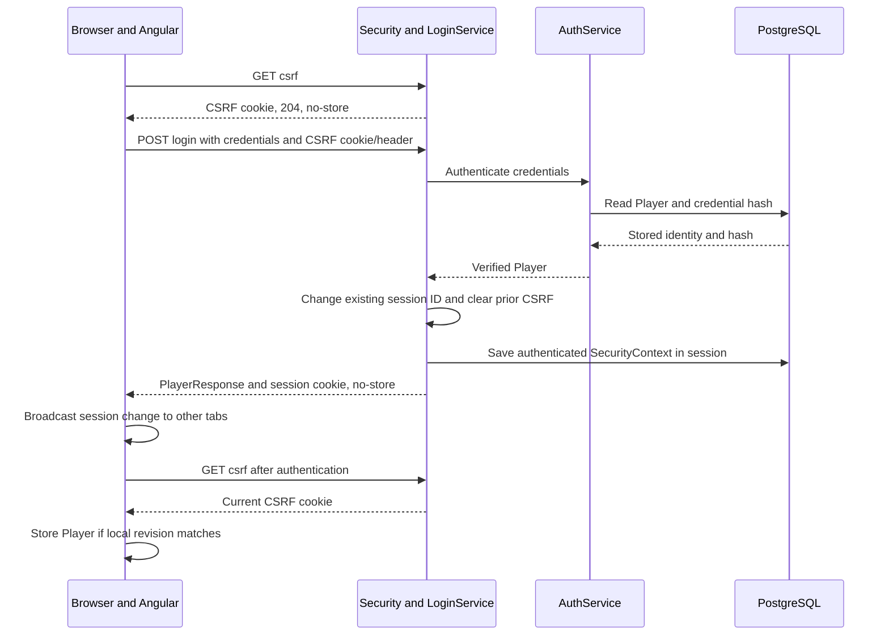
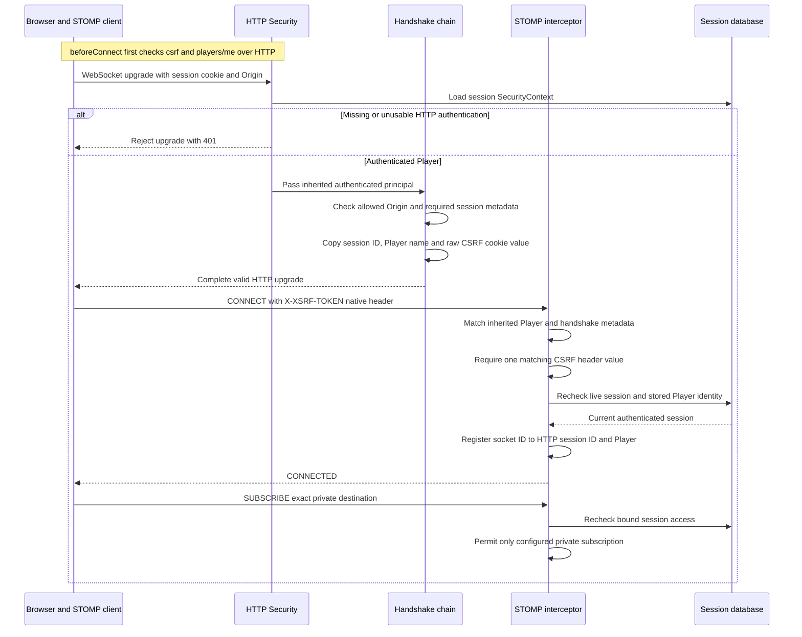
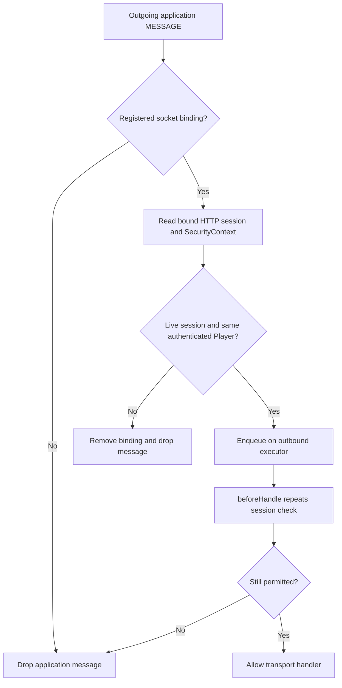

# Session and WebSocket authentication — Day 27

Source-reviewed on 4 November 2026 against actual user `chess-web-app-day27-end(1).zip`. User reports the previously failing tests resolved and browser login/flow working. No assistant test, build, migration, database or browser run. See [tab synchronization](tab-synchronization-flow.md) and [review](day27-sessions-review.md).

## Ownership and persisted state

AuthService still verifies BCrypt credentials and creates Player/credential/statistics records transactionally. LoginService verifies credentials before changing authentication, then uses ChangeSessionIdAuthenticationStrategy and CsrfAuthenticationStrategy. It creates a UsernamePasswordAuthenticationToken with canonical decimal Player ID as its String principal, null credentials and no authorities. A fresh SecurityContext is installed for the request and explicitly saved through HttpSessionSecurityContextRepository.

Spring Session JDBC backs HttpSession with PostgreSQL. The exact migration filename is `V14__create_auth_sessions.sql`, but its contents create **SPRING_SESSION** and **SPRING_SESSION_ATTRIBUTES**, not the abandoned custom refresh-token tables. Keep an already-applied filename/checksum unchanged. Authentication attributes use the framework's default serialization; no custom serializer is configured. There is no application JPA entity or Player foreign key for these framework tables.

| Item | Current configuration or behavior |
| --- | --- |
| Session cookie | CHESS_SESSION, path /, HttpOnly, SameSite Lax |
| Secure attribute | SESSION_COOKIE_SECURE, default false for local HTTP; use true for HTTPS deployment |
| Cookie max-age | 7d from issuance; not automatically renewed by every request |
| Server inactivity timeout | spring.session.timeout=7d; session activity may move this deadline |
| Absolute server lifetime | No separate absolute cap implemented |
| Schema ownership | Flyway; spring.session.jdbc.initialize-schema=never |
| Production cleanup | Framework cleanup-cron `0 * * * * *`, every minute |
| Shared test profile | Session cleanup disabled with `-`; game timeout scanner false |
| CSRF cookie/header | XSRF-TOKEN / X-XSRF-TOKEN; cookie JavaScript-readable, path /, SameSite Lax, matching Secure setting |

SessionCookieConfig explicitly reads cookie properties into DefaultCookieSerializer. This fixes the observed SESSION-versus-CHESS_SESSION mismatch and aligns issuance with logout's configured cookie clearing. Cookie and inactivity expiry are independent. A valid persisted session plus a retained cookie can survive reload/browser/backend restart, subject to expiry and serialization compatibility; no process-restart acceptance test establishes this end to end. Background HTTP reconciliation can count as activity. Socket repository access checks do not update activity.

## Login and restoration

Login returns PlayerResponse (`id`, `username`, `email`), not an access token. Failed credentials keep the INVALID_CREDENTIALS contract. The successful-login code changes an existing session ID when one exists; otherwise saving the context creates a session. Failed credentials are checked before that strategy, so they do not intentionally invalidate an already existing server session.

At Angular startup, provideAppInitializer waits for AuthService.restore: begin clears the local profile, GET csrf precedes GET players/me, and the full chain has a 10-second timeout before its profile result. Matching revisions accept the profile. A 401 yields false without a restoration-failure alert; other errors set restorationFailed for the current attempt. Initialization completes even on failure. The ordinary route guard can then inspect local authentication synchronously. Relative API URLs and the development proxy let the browser supply cookies and Angular's XSRF interceptor supply the header.

## WebSocket authentication in detail

The HTTP endpoint is `/api/v1/ws` and is authenticated by the filter chain. The allowed Origin is the configured `http://localhost:4200` in the inspected local setup. SessionHandshakeInterceptor requires a servlet request, an authenticated UsernamePasswordAuthenticationToken, an existing HttpSession and a CSRF cookie. Missing session identity produces 401; a missing CSRF cookie produces 403. Origin rejection is part of the endpoint handshake chain; the diagram does not prescribe internal interceptor ordering.

The expected CSRF string is loaded from CookieCsrfTokenRepository, not the XOR-masked request attribute. STOMP CONNECT/STOMP must inherit the same Player name and supply exactly one non-null matching X-XSRF-TOKEN value. The interceptor compares UTF-8 bytes with MessageDigest.isEqual, then registers access after checking persisted authentication. It removes the native CSRF/Authorization headers and removes the expected CSRF value from socket attributes. The inherited principal is retained; no JWT decoder or client-supplied Player ID establishes identity.

Missing/invalid CONNECT metadata or CSRF results in STOMP rejection/ERROR handling after upgrade, rather than a REST Problem Detail response. Native bearer headers cannot substitute for an authenticated HTTP session. No token or session identifier is placed in the URL.

The private subscription is `/user/queue/updates`. Sender code uses convertAndSendToUser with the stored Player ID and `/queue/updates`; Spring expands this to session-specific broker routes. All eligible subscribed sockets for the same Player may receive the hint. Raw broker paths, another Player's path, wildcards and client SEND remain forbidden.

## Access after connection

Bindings are an in-process ConcurrentHashMap keyed by WebSocket session ID; values contain the exact HTTP session ID and Player name. A new session with the same Player ID does not automatically transfer an old socket's binding. The database check requires a present, unexpired session with an authenticated UsernamePasswordAuthenticationToken of the expected Player. Invalid bindings are removed. Repository failures do not grant access.

SUBSCRIBE, UNSUBSCRIBE and inbound heartbeats recheck bound access. DISCONNECT remains allowed for cleanup even after invalidation. Outbound protocol/heartbeat/cleanup frames are not application MESSAGEs and bypass the payload filter. SessionDisconnectEvent removes a binding idempotently.

Each outbound application message can cause two database reads plus attribute deserialization. This favors current access decisions over caching; no optimization or load benchmark is claimed. JDBC session destruction does not automatically publish the events needed for proactive socket closure here. Checks stop later inspected operations/delivery, not an already authenticated request or an already transmitted message; check-to-send races are not eliminated.

RealtimeService observes local revision and isAuthenticated. Cleanup marks a client stopped and force-deactivates it. Each initial connect/reconnect first GETs csrf then players/me with a 10-second timeout. A different Player ID clears local state and redirects to Login with sessionChanged; a protected 401 is handled centrally. It reads the latest CSRF cookie through HttpXsrfTokenExtractor and sets CONNECT headers. Transport close/error normally permits reconnect; preflight failure or STOMP ERROR marks the lifecycle UNAVAILABLE and stops retry. There is no autonomous retry after a preflight network/server failure without a new lifecycle. STOMP ERROR also triggers a bounded profile read; it does not itself prove logout. The old JWT expiry decoder/timer is removed.

## Logout, CSRF reset and scope

POST `/api/v1/auth/logout` requires CSRF, invalidates the current HttpSession, clears security context and the named cookie, and returns 204/no-store. It can complete without an authenticated identity when its CSRF requirement is met. There is no logout-all-devices endpoint. Separate browser sessions are independent. The CSRF cookie is cleared on authentication/logout; Angular fetches a fresh one afterward. This cookie-based CSRF mechanism has no server-side blacklist and clearing does not revoke a copied CSRF value. The CSRF token alone cannot authenticate: session invalidation is the authentication revocation mechanism.

The local profile cache is not an authorization boundary. Protected 401 handling captures local revision and clears only the still-matching authenticated scope; 403 does not imply logout and commands are not automatically replayed. Deleted-Player handling remains feature-specific, not a global session-to-account revocation lookup.

## Deep reading and evidence limits

- `loginPersistsAuthenticationForFreshCookieOnlyRequests`: actual cookie-only follow-up HTTP reads.
- `anotherLoginChangesSessionIdAndRejectsOldCookie`: session-ID replacement.
- `logoutRequiresCsrfAndInvalidatesPersistedSession`: CSRF rejection and server-side invalidation.
- `logoutStopsDeliveryToBothTabsSharingTheSession`: two ready STOMP sockets, one cookie jar, live-recipient positive control.
- `sessionExpiryStopsDeliveryWithoutWaitingForCleanup`: stored expiry and bounded delivery observation.
- `rechecksSessionAccessAfterWaitingInTheExecutor`: permission changes between enqueue and handling.

No assistant execution. There is no dedicated actual-browser multi-tab/BroadcastChannel test, process-restart test, complete account-switch concurrency test, session-serialization upgrade test or deployed HTTPS/proxy acceptance. Tests establish their controlled fixtures, not every schedule. The simple broker and socket binding map remain single-instance components.
