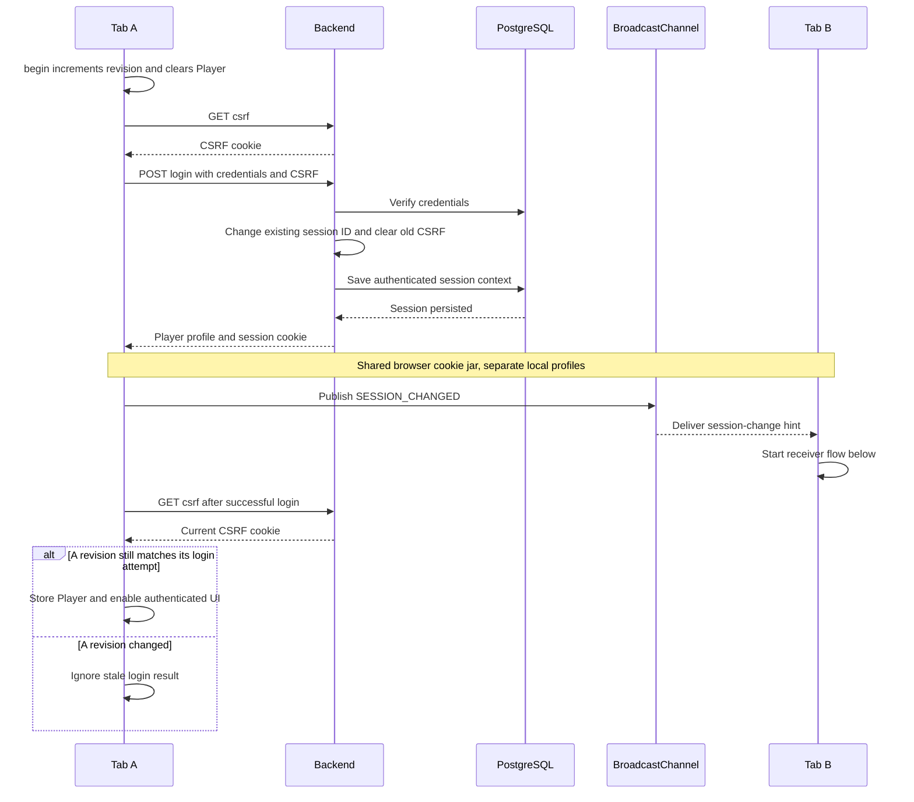
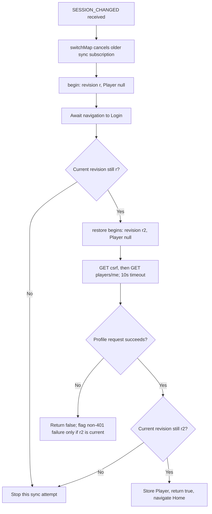
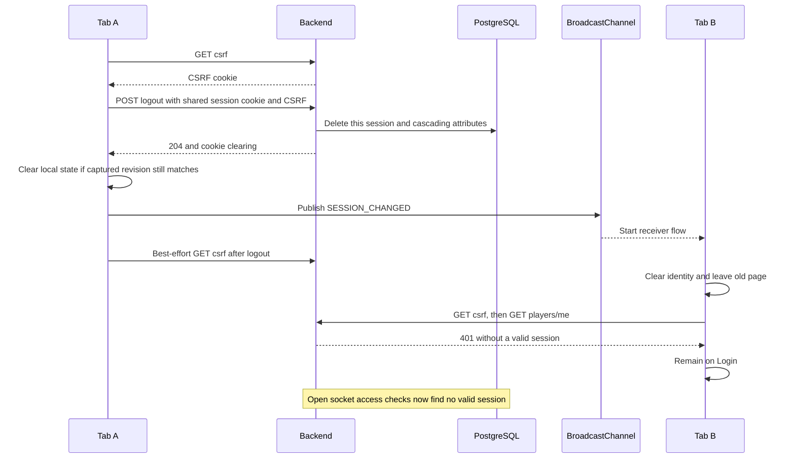

# Tab synchronization flow — Day 27

Source-reviewed on 4 November 2026 against actual user `chess-web-app-day27-end(1).zip`. These diagrams describe the inspected implementation. They are not browser execution evidence. See [session and WebSocket authentication](session-authentication-flow.md) and [review](day27-sessions-review.md).

## What is shared and what is local

| State | Scope | Meaning |
| --- | --- | --- |
| CHESS_SESSION cookie | Browser cookie jar for the site's applicable scope | Opaque session identifier; HttpOnly; JavaScript does not read it |
| XSRF-TOKEN cookie | Applicable browser cookie scope | JavaScript-readable CSRF value; Angular sends X-XSRF-TOKEN |
| PostgreSQL session and attributes | Backend | Authentication context, canonical Player-ID name and inactivity expiry |
| currentPlayer and revision | Each tab's AuthSessionStore | Local profile cache and monotonically increasing callback scope |
| STOMP client and component state | Each tab | A separate connection and separate Home/Game state |
| SESSION_CHANGED message | Same-origin BroadcastChannel listeners in the same storage partition | Hint to recheck the server; contains no Player ID, cookie, password or JWT |

The channel is `chess.auth.session`; its payload is `{ type: 'SESSION_CHANGED' }`. AuthSessionEventsService validates that shape and emits changes$. The sending channel object does not receive its own post. Unsupported/blocked channel creation returns null, and publication errors are caught. There is no localStorage fallback, retained message history or acknowledgment protocol.

## 1. Login publishes before the initiating tab finishes initialization

The broadcast is in AuthService.login immediately after the successful POST, before its second CSRF GET and setPlayer. Tab B can therefore restore concurrently with Tab A's final CSRF request. The diagram's receiver call is not a promise that Tab B finishes before Tab A. An unsuccessful login does not publish. If the POST succeeds but its following CSRF GET fails, the server session can exist while Tab A reports a login-flow failure; reload/restoration can discover it.

## 2. Receiving tab: clear, navigate, verify scope, restore

The first begin immediately disables authenticated interactions and invalidates old callback guards. Navigation happens before restoration so an old Home/Game component normally gets destroyed before another Player is stored. The receiver opens Home, rather than trying to preserve an old game route across an account change. A received hint also causes this reset if the same Player logs in again.

There are normally **two revision increments**: SessionSyncService.begin gives r; AuthService.restore.begin gives r2. The navigation guard compares r. The HTTP result guards compare r2. Profile updates through setPlayer do not independently increment revision.

AuthService.restore handles failure internally: 401 means anonymous and does not set restorationFailed; network/server errors or its 10-second timeout set restorationFailed when that attempt is still current. False does not trigger another navigation to Home. A stale result returns false without overwriting the newer local Player.

The navigation promise's boolean result is not used as the guard: the code checks revision after the promise resolves. It does not explicitly prove that navigation succeeded or destroyed the old component in every canceled-navigation schedule. Errors inside the synchronization operation are caught so later channel events remain usable.

| Example | Local revision | Result |
| --- | --- | --- |
| Old statistics request starts | 8 | Captures revision 8 and Player ID |
| Remote event invokes begin | 9 | Player cleared; old callbacks are stale |
| Login-route navigation resolves | 9 | Navigation guard permits restoration |
| restore invokes begin | 10 | Its profile GET captures revision 10 |
| Fresh profile succeeds | 10 | Player restored; receiver opens Home |
| Old request returns 401 | Still 10 | Interceptor ignores its stale revision 8 |

If a new local login invokes begin while navigation waits, the first guard rejects the old sync before it starts HTTP restoration. The focused test `does not restore over a newer local login` checks that boundary. A new channel event switches away from an older receiver subscription. Canceling a subscription does not undo a navigation promise already started, a server-side mutation, or a browser-applied Set-Cookie response.

## 3. Logout propagation and open sockets

Only the shared login session is invalidated; independent browsers have independent sessions. Failed logout before a successful POST does not clear local authentication or broadcast success. Failure of the final CSRF GET is swallowed because logout already succeeded. The initiating Home page waits for this flow before navigating and displays failure if server logout could not be completed.

Clearing local authentication causes RealtimeService effect cleanup to stop its client. The server independently rechecks persisted session access on inbound operations and twice on outbound application delivery. It may keep the physical transport open; it does not rely on JDBC session-destruction events, which are unavailable. A message already transmitted or a request already authenticated cannot be recalled by the broadcast.

## What this mechanism guarantees and what it does not

The hint carries no authentication authority. Receivers read the current server session, which may already differ from the operation that originally emitted a delayed hint. Restoration itself never broadcasts, avoiding loops. No refresh-token rotation, Web Locks, JWT storage or automatic game-command retry is involved.

Broadcast delivery is best-effort. Suspended tabs and unsupported channels may miss or delay it; there is no proactive focus-based session-identity synchronization service. Protected HTTP 401 responses clear a matching local revision; reconnect performs csrf/profile checks, and a different Player ID redirects to Login with a sessionChanged message. That reconnect check does not detect every same-Player session-ID change. HTTP success alone does not globally reconcile an old local account cache on every request.

The code does not globally serialize simultaneous login/logout operations across tabs. Revisions protect local callbacks; they cannot serialize browser cookie writes or all server request schedules. The three coordinator tests use mocked events/navigation/restoration, not actual browser BroadcastChannel windows. Two real STOMP clients sharing one HTTP cookie jar establish socket delivery isolation after logout; they are not an end-to-end Angular tab test.

## Source reading order

1. `frontend/src/app/auth/services/auth-session-events.service.ts`: channel lifecycle and hint validation.
2. `frontend/src/app/auth/services/session-sync.service.ts`: receiver order and navigation guard.
3. `frontend/src/app/auth/services/auth.service.ts`: login publication, restore r2 and logout publication.
4. `frontend/src/app/auth/services/auth-session.store.ts`: local identity and revision.
5. `frontend/src/app/auth/interceptors/auth.interceptor.ts`: stale-401 guard; 403 is not logout.
6. `frontend/src/app/notification/services/realtime.service.ts`: revision-scoped socket lifecycle.

Deep-read the coordinator's newer-login test, the auth-flow stale-401 test, and `logoutStopsDeliveryToBothTabsSharingTheSession` in the backend socket suite.
