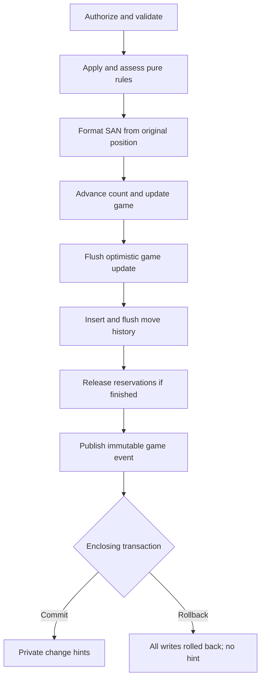
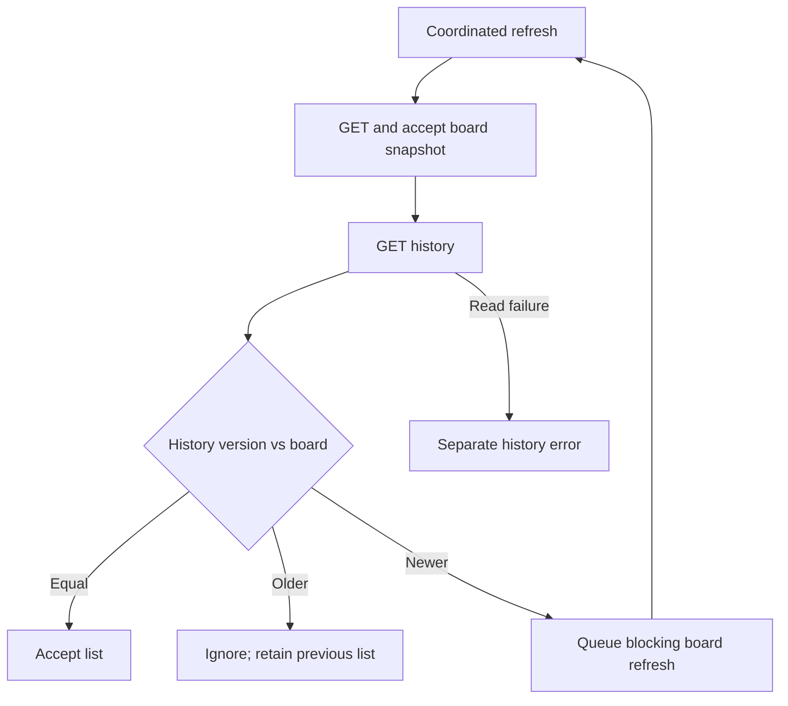

# Move history and SAN flow

Day 21 source companion, reviewed on 30 October 2026 against the actual user chess-web-app-day21-end.zip. No assistant application tests, builds, migrations or browser checks were run.

## Storage meanings

| Field | Meaning |
| --- | --- |
| Game.historyStartFen | Position before the first recorded move |
| Game.historyComplete | Every move since creation is recorded; unrelated to FINISHED |
| Game.recordedMoveCount | Recorded individual moves after the baseline |
| Game.version | Optimistic concurrency token; not a defined move number |
| GameMove.sequenceNumber | Ordering beginning at 1 relative to the baseline |
| GameMove.san | English SAN for new records; null for pre-SAN rows |

V7 preserves every existing game, copying its current FEN into the baseline and setting completeness false. It does not reconstruct earlier moves. New games retain their initial FEN and start complete with count zero. V8 adds nullable SAN without backfill. The UI shows coordinates and a separate SAN column; old null SAN displays “—”.

## Accepted command transaction

updateGameForAcceptedMove changes Game state, not notation. flushGameOrRejectConflict maps competing version failure before insertion. releaseReservationsIfFinished requires exactly two releases. publishGameChanged publishes an internal event; the notification listener runs AFTER_COMMIT. History insert errors propagate and roll back the transaction. Both the move and terminal completion use one microsecond-truncated Clock timestamp.

## SAN disambiguation

For Nb1-d2, another legal knight on f1 requires Nbd2; one on b3 requires N1d2; alternatives on both require Nb1d2. Without alternatives the result is Nd2. Only legal moves by identical same-color pieces count. Captures add x, promotions add =Q/=R/=B/=N, and resulting assessment adds + or #. Stalemate adds no check suffix. SAN formatting does not establish legal membership independently of the caller's supplied complete set.

## Protected history read

GameService loads the game, checks membership, captures recordedMoveCount and queries only sequenceNumber <= that count in ascending order. A move committed afterward cannot leak its later record into that captured response. The guarantee depends on atomic append-only writes and stable baseline metadata. The endpoint returns all recorded entries, without pagination or replay/export behavior.

## Browser reconciliation

A previous older list can remain visible with catching-up feedback. Newer history is never displayed ahead of the board. History failure alone does not invalidate an accepted board. readSnapshot spans both GETs; downstream takeUntil(cancelReads) cancels either stage before POST. Existing route cancellation tears down the chain.

Accepted POST explicitly queues nonblocking board/history reconciliation, coalesced with other pending triggers. Notifications remain hints and do not carry SAN. Visible loaded finished games continue safety reads while history is missing/outdated/failed, then stop when synchronized. An initial failed game GET with no snapshot is still outside periodic recovery. No command is automatically replayed.

## Limits

No reconstruction of pre-V7 moves, pre-SAN backfill, replay controls, PGN export, history pagination, clocks or disconnect outcome. No new frontend coordinator suite or old-database upgrade test is present. See [review](day21-history-review.md).
