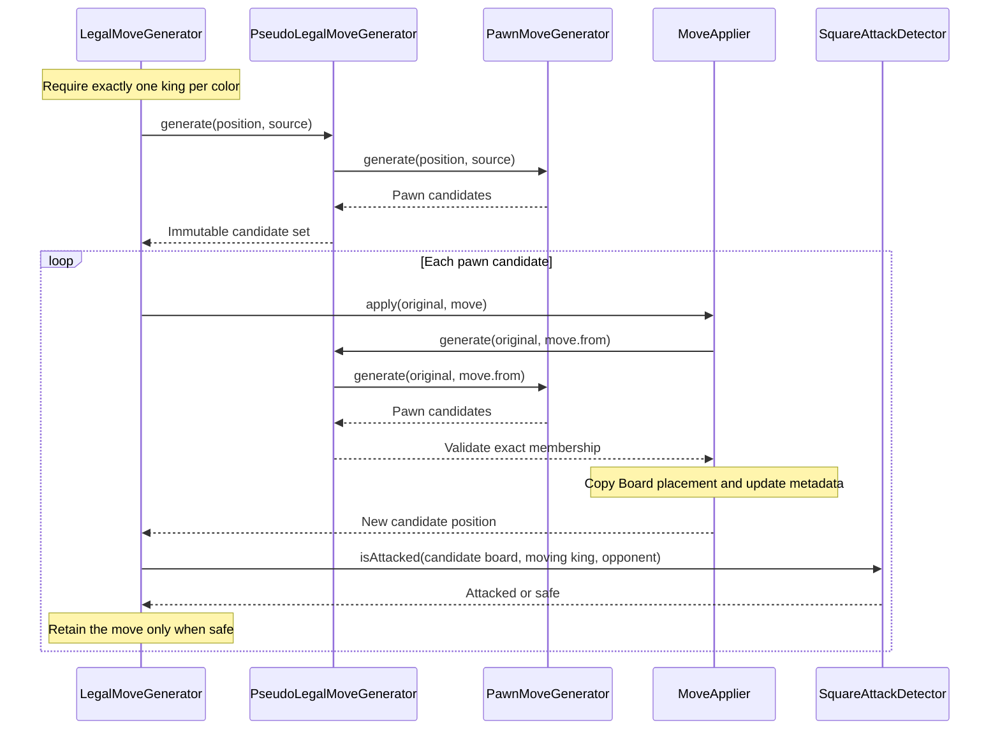

# Movement pipeline architecture — Day 15

This companion to `docs/architecture.md` describes the implementation inspected in `chess-web-app-day15-end.zip` on 27 October 2026. The user reports all tests green after final Day 15 regressions. No tests or builds were run independently for this review.

## The central idea

Generate movement candidates for one piece, construct each resulting position, and retain candidates that satisfy king safety. Standard castling also needs safety checks before the final position is constructed.

The pawn exercises the broadest range of movement cases: ordinary advances, starting-rank double advances, diagonal captures, promotion and en passant. Castling adds a different kind of complexity to the king.

These stages are in-process Java calls inside `game.rules`. They are not HTTP requests, separate services, database transactions or events. The wider application remains a modular monolith with conventional feature layers.

## Ownership

| Component | Responsibility | Result |
| --- | --- | --- |
| `FenParser` | Convert structural FEN into immutable board and metadata | `ChessPosition` |
| `LegalMoveGenerator` | Generate from one source or across every moving-side piece; validate kings and enforce shared king/castling safety | Immutable `Set<Move>` |
| `PositionEvaluator` | Combine complete legal replies with current moving-king attack state | `PositionStatus` |
| `PseudoLegalMoveGenerator` | Select the registered strategy for the source piece type | Strategy-generated `Set<Move>` |
| `PawnMoveGenerator` | Enumerate pawn movement using geometry, occupancy, side to move and special-move metadata | Pseudo-legal candidates |
| `MoveApplier` | Validate exact candidate membership and construct the resulting placement and metadata | New `ChessPosition` |
| `Board` | Copy placement while relocating, replacing or removing pieces | New `Board` |
| `SquareAttackDetector` | Determine whether a specified color attacks a specified square on a supplied board | `boolean` |
| `FenSerializer` | Convert a position to FEN for representation or assertions | FEN string |

Pseudo-legal means the piece's movement and placement conditions are satisfied; it does not establish own-king safety. Legal filtering adds that safety and castling's path restrictions.

## Actual call structure

`LegalMoveGenerator` is the coordinator. The following diagram shows its calls for a pawn source; it is not a chain of independently running components.



Application regenerates candidates even though the caller has just generated them. This is how the current `MoveApplier` protects direct callers: it does not assume every supplied `Move` came from the generator. Any future optimization should preserve that contract.

Every candidate is applied to the same original position. Trying candidate B does not start from the result of candidate A. Set iteration order is unspecified.

## Walkthrough: White captures en passant

Starting FEN:

```text
7k/8/8/3pP3/8/8/8/K7 w - d6 0 20
```

| State | Value |
| --- | --- |
| White king | a1 |
| Black king | h8 |
| White pawn under consideration | e5 |
| Black pawn available for capture | d5 |
| Side to move | White |
| En passant target | d6 |
| Halfmove clock / fullmove number | 0 / 20 |

The target is the passed-over square and possible landing square. It is not the captured pawn's square. The metadata describes a preceding d7–d5 advance, but the parser and local movement checks do not reconstruct history.

### 1. Request legal moves for e5

In the existing movement test package, construction and invocation can look like this:

```java
var position = new FenParser().parse(
        "7k/8/8/3pP3/8/8/8/K7 w - d6 0 20"
);
var dispatcher = MovementTestFixtures.pseudoLegalGenerator();
var legalGenerator = MovementTestFixtures.legalGenerator(dispatcher);

var moves = legalGenerator.generate(
        position, Square.fromAlgebraic("e5")
);
```

`MovementTestFixtures` is a public test-only helper with public factories so movement and evaluation tests can share construction; it is not a production service or Spring bean. The pure movement components currently run through direct construction in tests.

`LegalMoveGenerator` checks that both colors have exactly one king before generating candidates. This prevents incomplete or ambiguous king placement from being accepted for legal filtering; it does not prove full position legality or reachability.

### 2. Dispatch by piece type

`PseudoLegalMoveGenerator` reads e5. It contains a White pawn and White is to move, so the dispatcher selects the `PAWN` strategy from its immutable registry.

Empty sources and opposing sources return no candidates. An unregistered own-piece type throws explicitly. Duplicate strategy registrations fail during construction. With the standard fixture, all six types are registered.

This is the Strategy pattern: the dispatcher selects a piece-specific algorithm through `PiecePseudoLegalMoveGenerator`.

### 3. Generate pawn candidates

For White, the internal rank direction is +1.

| Possibility | Check | Decision |
| --- | --- | --- |
| e5 → e6 | e6 is empty | Include |
| e5 → e7 | e5 is not the starting rank | Omit |
| e5 → d6 | Correct source rank, forward diagonal, matching target, empty destination, opposing pawn on d5 | Include en passant |
| e5 → f6 | Empty diagonal without a matching opportunity | Omit |

The candidate set is `{e5→e6, e5→d6}`. Generation has not yet checked White's king.

En passant checks require both metadata and local placement. A stale target with no adjacent opposing pawn contributes no capture candidate. An occupied diagonal is handled using ordinary capture rules, even if inconsistent target metadata names it.

### 4. Apply e5 → d6

`MoveApplier` first regenerates candidates and checks `contains(move)`. `Move` is a record, so membership includes from, to and the promotion choice.

After membership succeeds, the applier observes a pawn moving diagonally into an empty destination. Among supported candidates, that identifies en passant.

Placement changes are:

1. `board.movePiece(e5, d6)` creates a new board with the White pawn relocated.
2. `removePiece(d5)` creates another new board without the captured pawn.

The captured square combines the destination file with the source rank: `(d, 5)`. `Board` owns placement and does not revalidate chess rules.

| Metadata | Result |
| --- | --- |
| Side to move | Black |
| Halfmove clock | 0, because a pawn moved |
| Fullmove number | 20, because White moved |
| En passant target | Cleared |
| Castling rights | Unchanged |

The constructed position serializes as:

```text
7k/8/3P4/8/8/8/8/K7 b - - 0 20
```

The original FEN remains unchanged. This is what the tests mean by preserving the original position.

### 5. Filter using the moving side's king

Although application has switched the turn to Black, `LegalMoveGenerator` checks White's king: White just moved. It finds a1 on the resulting board and asks whether Black attacks it.

No Black piece attacks a1 in this example, so e5→d6 is retained. The ordinary e5→e6 candidate also survives. The returned legal set contains both moves; it does not contain resulting positions or select a move to play.

## Why application does not establish legality

Consider the existing regression fixture:

```text
7k/8/8/r4pPK/8/8/8/8 w - f6 0 20
```

Black has a rook on a5 and a pawn on f5. White has a pawn on g5 and king on h5. The f5 and g5 pawns currently block the rook's rank.

The candidate g5→f6 satisfies en passant conditions. Application relocates the White pawn and removes f5, producing:

```text
7k/8/5P2/r6K/8/8/8/8 b - - 0 20
```

Now both blocking squares are empty. The rook on a5 attacks White's king on h5.

| Stage | g5 → f6 |
| --- | --- |
| Pawn candidate generation | Included |
| Pseudo-legal application | A result can be constructed |
| Attack detection on the resulting board | White king is attacked |
| Legal filtering | Rejected |

The ordinary g5→g6 move remains legal because the Black pawn on f5 still blocks the rook. This shows why en passant safety must examine the board after both pawn squares have been vacated.

## How promotion uses the same pipeline

Starting FEN:

```text
7k/4P3/8/8/8/8/8/K7 w - - 0 20
```

The White pawn on e7 can advance to e8, but it must promote. The strategy generates four distinct moves: e7→e8=QUEEN, =ROOK, =BISHOP and =KNIGHT.

`Move` validates the allowed replacement type. The strategy establishes when a replacement is required. Membership rejects a missing choice or an inappropriate choice on an ordinary move; there is no automatic queen default.

The applier retains the original pawn for metadata handling and supplies a new same-color replacement piece to `Board.movePiece(from, to, destinationPiece)`. The legal generator then checks the moving side's king on each resulting board, just as for other moves. A promoted rook never adds castling rights.

## What differs for castling

Ordinary king safety on the completed board cannot establish whether the king started in check or passed through check.

| Stage | Responsible component | Occupancy used |
| --- | --- | --- |
| Rights, home king, same-color corner rook and clear intervening path | `KingMoveGenerator` | Original board |
| Starting square safe | `LegalMoveGenerator` | Original board |
| Transit square safe | `LegalMoveGenerator` | King on transit square, source vacated, rook unmoved |
| Both pieces relocated and metadata updated | `MoveApplier` | Newly constructed board |
| Destination safe | Shared final-board check | Completed castling board |

`isCastlingMove()` identifies the candidate. Only those candidates call `isCastlingPathSafe()`. Non-castling moves proceed to shared application and final-board filtering.

Pinned attackers still count in attack detection. The queenside b-file must be empty, but it is not a king transit square. An attacked rook does not itself forbid castling.

## Position-wide enumeration and assessment

`generate(position)` validates one king per color, scans all 64 squares and combines `generateForSource(position, from)` results for moving-side pieces. The source-specific public overload uses the same private body. Every trial starts from the original position; the input is never advanced during enumeration. Both public results are immutable sets.

`PositionEvaluator.evaluate(position)` obtains the complete reply set before assessing the current board. It locates the validated moving king and asks SquareAttackDetector whether the opponent attacks that square. Available replies mean NORMAL or CHECK; no replies mean STALEMATE or CHECKMATE, depending on current check. Generation failures propagate rather than becoming an empty reply set.

Example: `7k/8/8/8/8/8/PP3N2/K6r w - - 0 20` has White in check from h1. The king on a1 cannot move, but Nf2-d1 blocks and Nf2-h1 captures. These are exactly the two legal replies, so the assessment is CHECK. A king-only or knight-only subset cannot generally establish a terminal position.

NORMAL means safe with at least one legal reply within the implemented assessment. It does not rule out repetition, move-count draws or dead positions. PositionStatus is separate from persisted GameStatus.

## Current boundaries

- Both single-source and position-wide generation are available. Only the complete reply set combined with current check establishes checkmate or stalemate; other draw rules remain outside assessment.
- `ChessRules` currently exposes only `initialPosition()`. `GameService` does not call movement, and games still store their initial FEN. There is no move-submission endpoint in this checkpoint.
- Future gameplay services must own authorization, transactions, persistence and concurrency. A caller must enforce legal-move membership before accepting a gameplay move; direct `MoveApplier.apply()` is insufficient.
- `FenParser` validates structure, not historical reachability. FEN alone cannot establish repetition.
- `Board` has identity equality. Compare square contents or canonical FEN for content assertions.
- This document describes inspected Day 15 behavior; updating the explanation changes no production or test sources.
