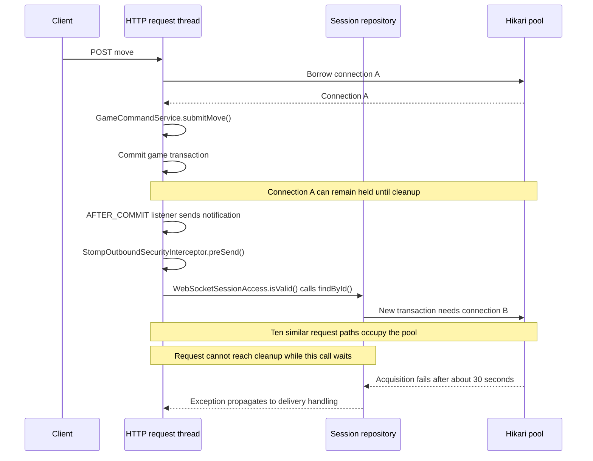

# 01 - Original problem and captured evidence

[Issue overview](README.md) | [Correction](02-resolution.md) | [Board recovery](03-board-synchronization.md)

## Terminology

This is a connection-pool starvation/hold-and-wait scenario, often called
pool-locking or an application-level deadlock. It is distinct from a PostgreSQL
row-lock deadlock and from a Java monitor deadlock. Hikari's acquisition timeout
can eventually break a blocked attempt, so the stall need not be permanent.
A database connection is a pooled resource, not a worker thread.

Each concurrent HTTP request runs on a servlet worker, such as
http-nio-8081-exec-1. There is no single main HTTP thread for all moves.

## Captured evidence

The one-game and five-game WebSocket runs were reported successful by the user:
2/10 connected STOMP sessions, 10/50 expected notifications and 1/5 complete games,
with no reported delivery/connection/unexpected-message failures. These two runs
were reviewed from pasted output, not independently inspected full reports.

The first supplied 20-game JSON recorded 40 connected STOMP sessions, 54 matching
notifications, no completed games and 40 failed/cancelled expectations out of 94
armed expectations. HTTP failures included client-side 10-second timeouts. The
Hikari log reported total=10, active=10, idle=0 and waiting=22 at its roughly
30-second acquisition timeout. The initial thread dump showed idle request
workers and did not capture the blocked path.

The diagnostic repeat supplies ws-games-20(1).json, 15 thread dumps and a pasted
outbound exception chain. The JSON contains only metrics/root_group, with no
setup_data. It records 40 connected sessions, zero matching notifications, zero
completed games, 40 failed/cancelled expectations and 22 HTTP failures out of 300
HTTP requests. The exception places a failed connection acquisition in sending
to clientOutboundChannel and reports the pool fully occupied with 12 waiters.

Every one of the 15 captures contains ten request threads blocked in Hikari
connection acquisition inside the after-commit game-notification call chain.
Captured timestamps span 2026-11-07 14:12:39 through 14:13:11 as printed by the
user's JVM; the dump does not itself identify its timezone. Counted pool-waiting
stacks rise from 21 in the first four dumps to 61, then 62, then 63. These are
instantaneous stacks, not unique requests or durations. Session-read waiting
stacks rise from 10 to 50/51, including additional inbound activity.

A representative path is visible in threads-5.txt on http-nio-8081-exec-1:

```text
GameCommandService.submitMove
  transaction commit / afterCompletion
    GameNotificationListener.onGameChanged / notifyPlayer
      SimpMessagingTemplate.convertAndSendToUser
        SimpleBrokerMessageHandler.sendMessageToSubscribers
          StompOutboundSecurityInterceptor.preSend / permitted
            WebSocketSessionAccess.canReceive / isValid
              JdbcIndexedSessionRepository.findById
                TransactionTemplate.execute
                  AbstractPlatformTransactionManager.handleExistingTransaction
                    JpaTransactionManager.doBegin
                      HikariPool.getConnection / ConcurrentBag.borrow
```

Spring executes these AFTER_COMMIT callbacks before transaction resources are
necessarily cleaned up. JDBC session operations use independent REQUIRES_NEW
transactions by default. Taken together with the inspected synchronous source,
the repeated call chains and pool log strongly support a pool-locking/starvation
cycle: request threads retain game-transaction resources while delivery attempts
to acquire additional connections for session checks. The remaining work, inbound
heartbeats and cleanup cannot make progress while the pool is exhausted.

This is not evidence of a PostgreSQL row deadlock or a permanent connection leak.
Connection-acquisition deadlines can eventually break the stall. Thread dumps
do not map connection objects to owning requests directly, but they clearly locate
the blocked notification path. This failure is not explained by the low latency
of successfully delivered messages or solved by changing Board storage.

## Original execution flow



The clientOutboundChannel name does not mean every operation on it is already
asynchronous. Its preSend interceptor executes synchronously on the sending
thread in the supplied stacks. The separate beforeHandle check protects delivery
again on the outbound worker. Both remain security requirements.

## Why a longer timeout is not the correction

| Deadline | Waiting party | Increasing it does what? |
| --- | --- | --- |
| 5-second notification deadline | k6 expectation for a game/version update | Allows more waiting for a hint; does not release server connections |
| 10-second HTTP request deadline | k6 HTTP client | Allows a later response; does not cancel or unblock the server |
| About 30-second acquisition deadline | Server borrowing from Hikari | Can prolong the hold-and-wait stall before throwing |

Longer client deadlines can accommodate ordinary slow work when progress is
possible. They do not create a free connection when each request holds a resource
and waits for another. The original listener catches a recipient's send failure
and then attempts the other recipient, which can incur another wait. A client
HTTP timeout therefore cannot be interpreted as a rolled-back or rejected move.
Larger pools may postpone a threshold but do not remove this dependency.

The low timings for successfully matched notifications exclude failed/missing
deliveries. They cannot be used to describe the failed run as healthy.

## Primary references


- Spring Session JDBC transaction configuration:
  https://docs.spring.io/spring-session/reference/configuration/jdbc.html
- Transactional event listener resource-lifecycle warning:
  https://docs.spring.io/spring-framework/docs/current/javadoc-api/org/springframework/transaction/event/TransactionalEventListener.html
- Spring executors, queue capacity and rejection policies:
  https://docs.spring.io/spring-framework/reference/integration/scheduling.html
