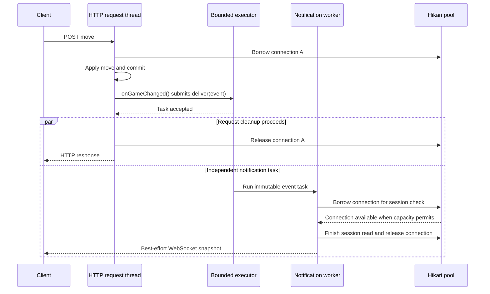

# 02 - Resolution: bounded notification handoff

[Issue overview](README.md) | [Original problem](01-problem-and-evidence.md) | [Board recovery](03-board-synchronization.md)

## Applied correction

The AFTER_COMMIT listener submits an immutable GameChangedEvent
to a dedicated bounded ThreadPoolTaskExecutor. Actual convertAndSendToUser calls
run on those workers, without the request thread's transaction-bound resources.
The request callback never waits for worker completion. Workers may begin before
the submitting transaction finishes cleanup, but requests can continue cleanup
and release connections independently; this breaks the nested hold-and-wait path.

The configuration starts with two workers and 256 queued game-event tasks. Each
task attempts notification for both participants. These are conservative initial
settings, not measured optimal capacities. A queued event is not a queued move
command or a durable broker message. No RabbitMQ/Kafka, database migration or
change to synchronous ratings/statistics transactions is involved.

AbortPolicy is deliberate. CallerRunsPolicy could put delivery back on the request
thread when saturated and recreate the original problem. Rejected submissions
are logged and remain best effort; the existing HTTP reconciliation path recovers
current game state. No mutation is retried. Recipient delivery failures remain
isolated, so the other participant is still attempted. The outbound worker checks session access before delivery. preSend stamps the
message to measure outbound queue wait.

Only the immutable event record crosses threads. There is no EntityManager,
managed Game entity or request SecurityContext propagated to the worker. Delivery
addresses Players explicitly, and the existing socket bindings/session reads
provide authorization. Parallel workers can reorder hints; clients must retain
version-based stale-update handling and authoritative HTTP reads. This does not
provide durable or exactly-once delivery, nor remove per-message database costs.

The executor is a named, qualified non-default bean so it does not accidentally
replace unrelated automatic task-executor selection. Spring manages initialization
and shutdown; the application code does not call initialize manually. A limited
graceful-shutdown wait does not make the in-memory queue durable.

## Corrected execution flow

The parallel branches express independence, not a required ordering. A worker can
start before request cleanup, and a notification can arrive before its command's
HTTP response. The worker has no inherited game connection to retain while
waiting for its session read. The HTTP thread neither joins the worker nor waits
for it to finish, and can release its game connection independently.

The executor correction breaks the observed circular dependency. It does not
promise unlimited throughput or eliminate ordinary pool contention, session-query
cost, outbound-worker queuing or later network failures.

## Files and configuration

The inspected base configuration sets `app.notification.delivery.workers` to
4 and `app.notification.delivery.queue-capacity` to 256. The earlier proposal
started at 2 workers. Each queued task attempts delivery to both participants.
The named executor is submitted to explicitly by the listener.

## Remaining tradeoffs

| Condition | Current behavior |
| --- | --- |
| Executor queue full/shutting down | Submission is rejected and logged; no caller-thread fallback |
| One participant's delivery raises an exception | Log it and still attempt the other participant |
| Application restarts with queued tasks | In-memory hints can be lost; recover through HTTP reconciliation |
| HTTP session is expired/invalidated before delivery | Outbound security suppresses access; delivery must not bypass authorization |
| Worker ordering differs from commit ordering | Client version checks reject stale hints/snapshots |
| Browser misses a hint without disconnecting | Periodic/focus/manual HTTP reads can recover; see the board-recovery companion |

A rejected task is not a rolled-back move. The database state was committed before
submission. No durable outbox or automatic command retry is part of this fix.
