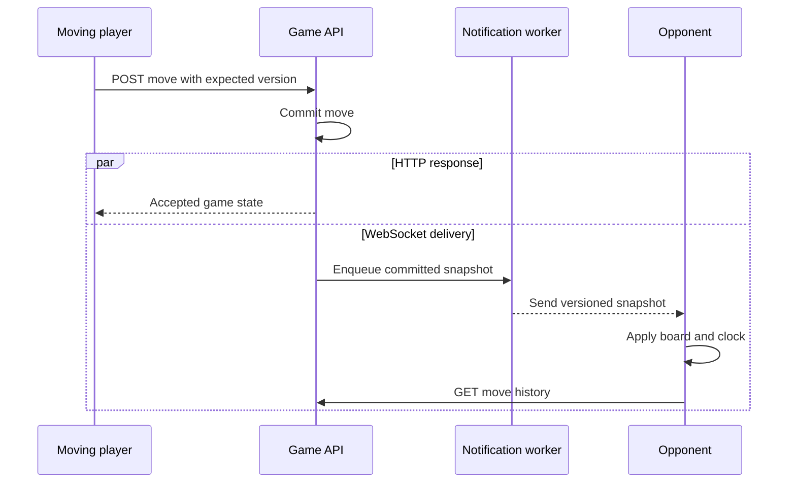
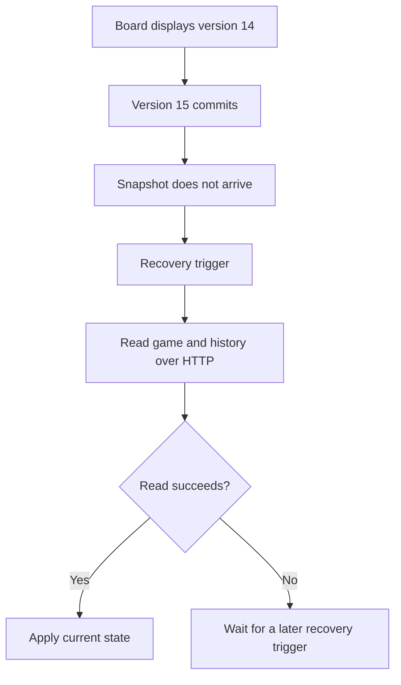
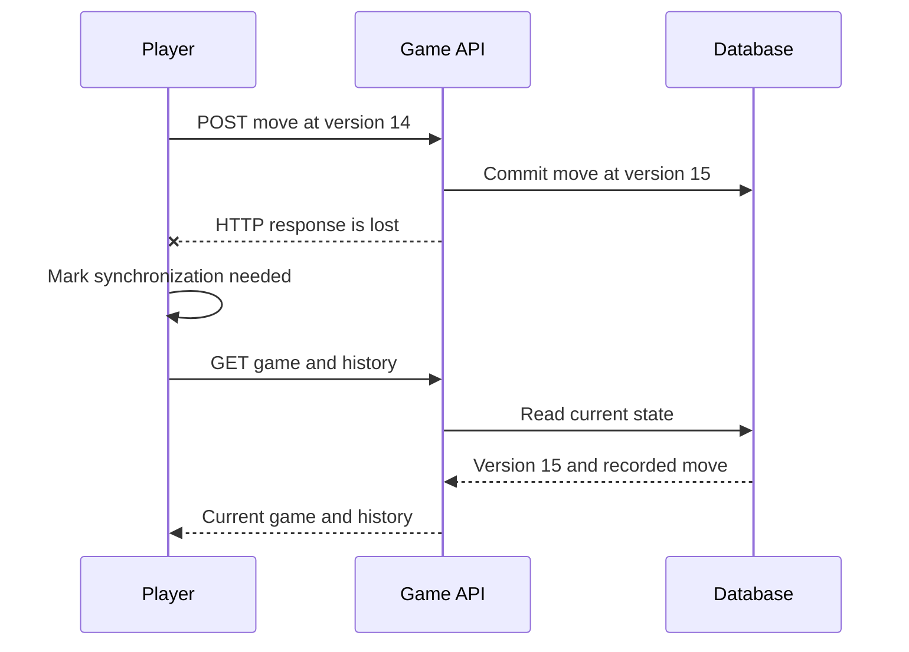

# 03 - Board synchronization when a notification is missed

[Issue overview](README.md) | [Problem](01-problem-and-evidence.md) | [Correction](02-resolution.md)

## Normal delivery

The backend commits the move and responds over HTTP. It also delivers the
versioned game snapshot to both participants over their private WebSocket
destinations. Either delivery can arrive first. The mover applies the command
response. The opponent applies the newer snapshot to the board and clock, then
refreshes move history separately.

The browser ignores updates for other games and versions at or below the live
board version. A newer full snapshot can skip intermediate versions. Move
history is fetched separately and must be compatible with the displayed version.
An update observed during a command is tracked so the response can be checked
against the newest known version.

## Missed or unusable snapshots

Reconnect, focus or visibility changes, and manual refresh can trigger HTTP
recovery. A visible game also has a 30-second safety interval when the game is
loaded and active or still needs board or history refresh. The interval describes
when a read can be requested. Connection availability and scheduling affect when
it succeeds. Reads still require an authenticated participant.

A known newer version without a usable snapshot can block further moves until
recovery. A background safety read leaves interaction available while it checks.
Older responses cannot overwrite a newer board. A same-version HTTP response can
refresh the clock estimate. A history failure has separate feedback and does not
invalidate a board that is already current.

## Uncertain command outcome

A transport failure can also occur before the move commits. The client reads
current state before the next deliberate action and never automatically resends
the command. See [verification](04-verification-and-follow-up.md) for what was
exercised by k6 and the two-browser check.
