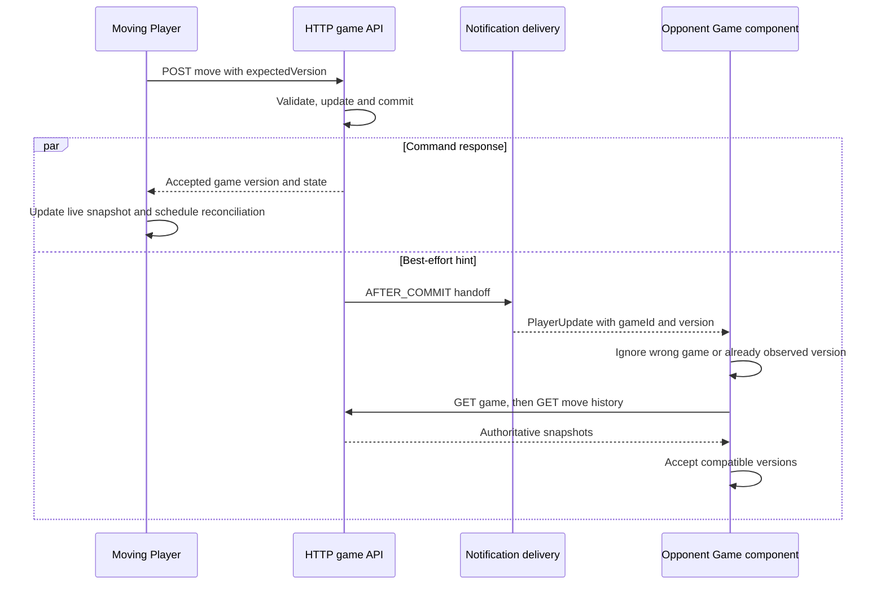
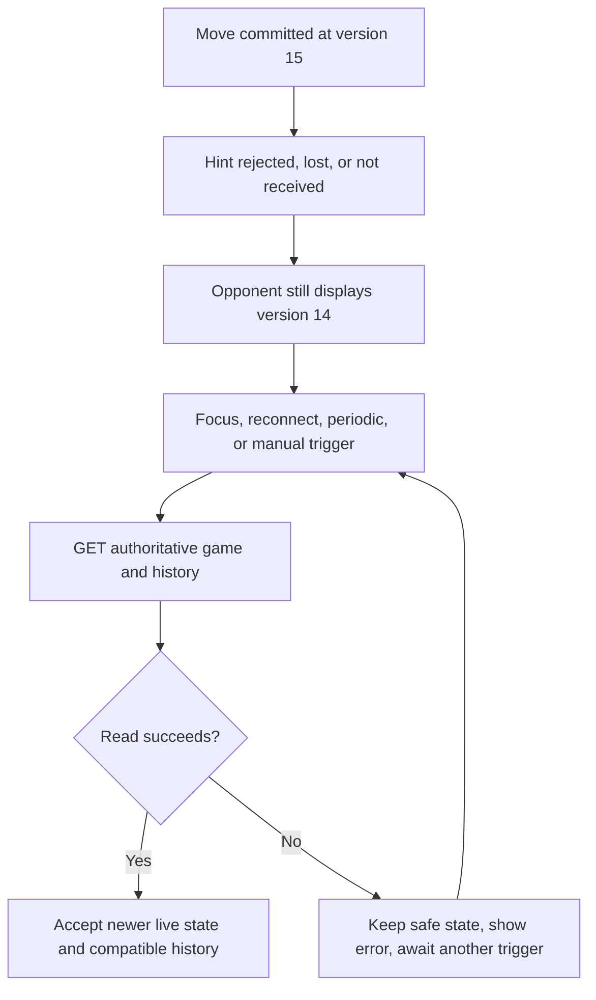

# 03 - Board synchronization when a notification is missed

[Issue overview](README.md) | [Problem](01-problem-and-evidence.md) | [Correction](02-resolution.md)

## Source boundary

This account is based on the inspected user Day 29 mid-session source, particularly:

- frontend/src/app/game/pages/game/game.ts
- frontend/src/app/notification/services/realtime.service.ts
- frontend/src/app/notification/config/realtime.config.ts
- backend/src/main/java/com/chessapp/notification/service/GameNotificationListener.java
- backend/src/main/java/com/chessapp/notification/security/StompOutboundSecurityInterceptor.java

The bounded-executor correction was supplied subsequently. Its application and
runtime verification remain pending user confirmation. Preserve any newer
user-applied changes when merging this documentation. This document does not
claim a comprehensive auth-race proof, browser acceptance or socket load success
for the proposed correction.

## Responsibility split

PostgreSQL-backed game state, read through the participant-protected HTTP API, is
authoritative. A WebSocket PlayerUpdate contains type, gameId and version. It is a
hint to read the latest state, not a move command, complete board, durable change
log or instruction to replay every missing event. Skipping from version 12 to
version 15 is fine: GET returns a current game snapshot and history is reconciled
separately. Game version is a state-concurrency token, not a move-history sequence.

The moving Player normally updates its local live snapshot from the successful
HTTP command response and requests follow-up synchronization. The opponent normally
learns of the change through the hint, then fetches the authoritative game. Missing
the hint can delay the opponent's display, but does not undo a committed move.

## Normal notification path



The notification and HTTP response are independent; either may arrive first.
Both participants are notification targets, although a moving Player may already
have observed the notified version in its command response and ignore that hint.

## Recovery triggers already present

| Trigger | Inspected methods | Behavior |
| --- | --- | --- |
| Open/navigate to a valid game route | initializeRouteReads() | Starts an initial game/history read and cancels the previous route's stream |
| Newer game notification | initializeGameUpdates() | Records the highest known version and calls requestSynchronization(true) |
| Initial STOMP connection or successful reconnect | RealtimeService.onConnect; initializeConnectionRecovery() | Subscribes and emits connections$, causing an authoritative HTTP read |
| Window focus or document becoming visible | initializeVisibilityRecovery() | Requests synchronization even if no notification was observed |
| Periodic safety check | initializePeriodicRecovery() | Uses the configured interval while the document is visible, a current game exists, and the game is in progress or game/history synchronization is needed |
| User refresh action | refresh() | Requests an authoritative read |
| Successful local command | executeGameCommand() success handler | Applies the command response, then requests nonblocking reconciliation |
| Stale-state/uncertain command result | handleCommandError() | Requests synchronization without automatically resubmitting the action |

REALTIME_CONFIG.reconciliationIntervalMs is 30,000 in the inspected source.
This is a periodic trigger, not a promise that a missed update is visible within
30 seconds. Background tabs can have throttled timers; the visibility guard skips
periodic reads while hidden. Network/server failures, pending work and browser
scheduling can delay success. Focus/visibility recovery helps on return to the tab.
An initially failed route read with no current game does not qualify for this
periodic guard; manual/focus/connection recovery remain relevant.

The browser transport reconnect delay is configured as 5,000 ms, with 10,000-ms
connection timeout and heartbeat settings. These are not recovery guarantees.
Before connection/reconnection, RealtimeService refreshes CSRF and checks the
current Player through HTTP. It guards callbacks with the local session revision
and stops/rejects stale identities. A failed pre-connect identity check or STOMP
protocol/security rejection can enter UNAVAILABLE and stop automatic reconnect;
HTTP synchronization and authentication handling remain separate paths.

## A committed move whose hint never arrives



The loop represents later recovery triggers, not an immediate retry loop. The
client does not receive an explicit acknowledgement that a hint was lost; it
reconciles periodically without needing to know that fact.

Examples include an executor queue rejection, process restart before a queued
task runs, a failed participant send, an outbound security rejection after logout,
and a network interruption. Security rejection must not be bypassed to synchronize
a board: authentication must still authorize any subsequent HTTP read.

If the backend itself is stalled, reconciliation HTTP reads may also fail or wait.
Recovery triggers cannot repair server resource exhaustion; the executor correction
addresses that server-side cause. Once authorized HTTP reads can succeed again,
the client can catch up without replaying a missing notification.

## Version, history and request coordination

initializeGameUpdates() filters other games and ignores updates whose version is
at or below the currently displayed live snapshot. It tracks the maximum notified
version, so older/out-of-order hints cannot lower the known target version.
This matters when parallel notification workers deliver out of order.

requestSynchronization(true) marks needsRefresh and clears pending promotion and
lifecycle confirmation. Existing permission checks prevent commands while a
blocking refresh is required. Periodic checks use requestSynchronization(false):
they are nonblocking safety reads and do not immediately cancel promotion. An
actually newer accepted snapshot clears stale pending actions.

schedulePendingRead() uses readPending/readScheduled and a microtask to coalesce
triggers. It will not start another read while reading or submitting. The route
stream uses exhaustMap for one read chain at a time. A command cancels an in-flight
safety read; command finalization schedules pending synchronization. Requests are
coordinated rather than one new overlapping GET per incoming hint.

readSnapshot() accepts a newer game version, preserves the object for an unchanged
version and refuses to replace a newer accepted game with an older read. Clock
snapshots can refresh at the same game version using the server's calculatedAt
basis; an unchanged game version does not mean time stopped. Clocks remain
server-authoritative and are not paused by notification failure.

Game data is accepted before move history is read. If history is newer than the
board, readHistorySnapshot() records that newer version and schedules board
synchronization. Older history does not replace the accepted history. Matching
history can be applied. A history read error shows its own feedback without
invalidating an accepted board. Subsequent recovery triggers can try reads again.
If the board remains behind a known notified version, needsRefresh remains set;
the client does not claim that synchronization is complete.

A live snapshot can update while the user is viewing replay. This recovery is
about the authoritative live state; it does not introduce automatic exit from
replay or change the existing replay-cursor policy.

## Uncertain move result is a different problem

Suppose POST /moves reaches the server, commits, and its HTTP response is lost or
times out. The moving Player cannot infer whether the move committed from the
transport failure alone. handleCommandError() explicitly reports that the action
could not be confirmed, requests the latest state and does not replay the command.

```mermaid
sequenceDiagram
    participant C as Player Game component
    participant H as HTTP game API
    participant D as Database
    C->>H: POST move with expectedVersion 14
    H->>D: Commit move at version 15
    H--xC: Response lost or client timeout
    C->>C: Mark synchronization needed; do not resend
    C->>H: GET game and history
    H->>D: Read authoritative state
    D-->>H: Version 15 and recorded move
    H-->>C: Current snapshots
    C->>C: Reconcile before another deliberate action
```

The diagram illustrates one possible outcome. A failed request could also have
failed before commit; only the subsequent authorized read establishes current
state. Expected-version/turn/finished-game validation remains server-side, so an
opponent acting on an unknowingly stale display cannot overwrite newer state.
That rejection triggers refresh; it does not authorize a silent retry.

## What has and has not been verified

Earlier real-socket integration tests cover security, participant-only delivery,
after-commit behavior and rollback suppression, with user-reported green results.
The 1/5-game load runs succeeded before the new executor correction, while the
20-game runs exposed the original failure. No successful post-correction load run
has yet been reported. The current k6 script deliberately fails missing deliveries
and does not exercise Angular's periodic/focus/reconnect recovery, browser rendering
or replay UI. Those recovery paths here are supported by source inspection, not
new runtime execution.
