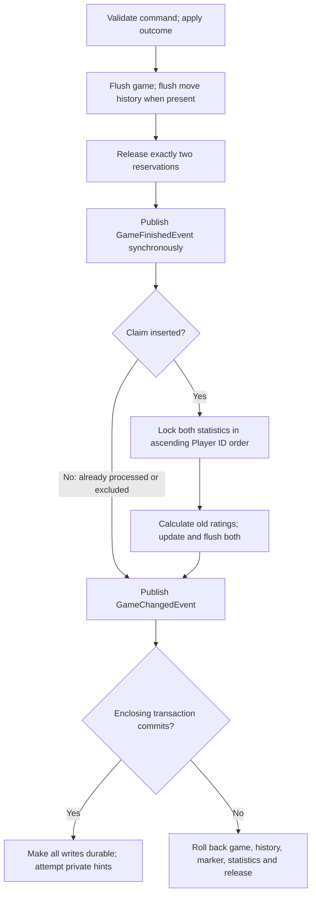
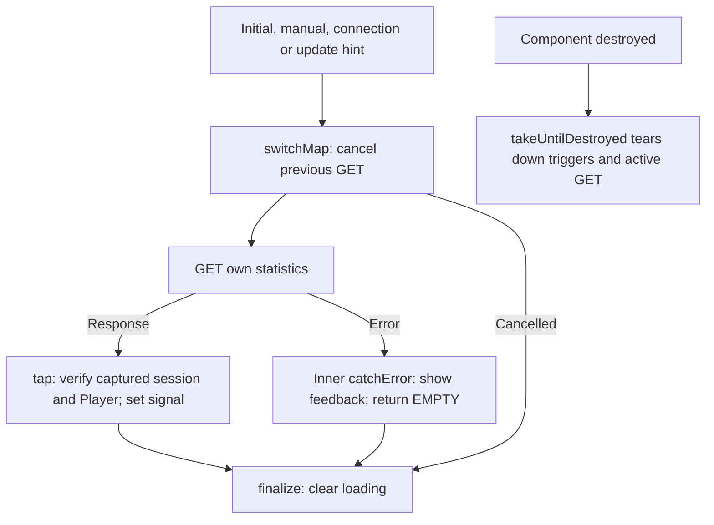

# Player statistics and Elo flow

Day 25 source companion, reviewed on 2 November 2026 against actual user chess-web-app-day25-end.zip. User reports tests green; no assistant application execution is claimed.

## Ownership

| Owner | Responsibility |
| --- | --- |
| game.event.GameFinishedEvent | Game-owned immutable completion fact |
| player.event.PlayerStatisticsGameFinishedEventListener | Maps result to player.rating.RatingOutcome |
| PlayerStatisticsService | Transaction requirement, claim, locks, calculation and update orchestration |
| PlayerStatisticsRepository | Entity persistence, locking query and native processing claim |
| PlayerStatistics | Rating/counters/version; derived gamesPlayed |
| EloCalculator | Pure arithmetic, separate from game rules |
| PlayerController | JWT-derived self-statistics GET and no-store |
| Angular PlayerStatistics | Display and GET lifecycle; no rating calculation |

An event belongs to the feature that owns the fact; its listener belongs to the feature that owns the reaction. These are conventional feature layers, not a new DDD model. No managed game/Player entity crosses the event boundary. Scalar IDs still have SQL foreign-key constraints. Scalar mappings do not inherently prevent N+1 if callers manually query each parent; they make such queries explicit.

## Completion transaction



The normal listener is synchronous; recordFinishedGame uses MANDATORY propagation and fails without an existing transaction. No @Async or AFTER_COMMIT is used for statistics. A successful listener return is not a commit; an outer caller can still roll everything back. Conversely, statistics failure prevents a game finish from committing. Private messaging remains a different event contract whose send failures cannot undo committed state.

The marker is inserted with ON CONFLICT DO NOTHING and a unique game ID. A duplicate may wait on another uncommitted claim, then return false if it commits. If processing rolls back, its marker also disappears. statistics_applied=false is a historical exclusion; true becomes durable only with successful statistics updates. Neither state is a pending work item or full rating audit record.

## Locks and versions

PESSIMISTIC_WRITE on findByPlayerIdForUpdate acquires a row lock until transaction end. Another transaction using that method for the same Player waits, even if it only wants to read. Ordinary PostgreSQL nonlocking reads can see committed versions. Lock lower ID before higher regardless of White/Black; this avoids opposite acquisition for these two statistics rows, not all possible deadlocks elsewhere. @Version remains an additional entity-write safeguard.

Under PostgreSQL READ COMMITTED, ordinary SELECT statements see committed state as of each statement start and the transaction's own writes. The statistics pipeline first loads through the locking query, before calculation. Reusing an entity loaded earlier in a persistence context is not equivalent to refreshing it from the database. Normal self-statistics display uses findById and does not reserve the row.

## Rating calculation

For White's pre-game rating Rw and Black's Rb:

```text
expectedWhite = 1 / (1 + 10^((Rb - Rw) / 400))
whiteDelta = Math.round(32 * (actualWhite - expectedWhite))
newWhite = Rw + whiteDelta
newBlack = Rb - whiteDelta
```

actualWhite is 1 for a win, 0.5 for a draw and 0 for a loss. Starting rating is 1200. Equal-rated decisive games transfer 16 points; a 1200-vs-1600 underdog win transfers 29. Round one delta and apply its opposite so total is conserved. No floor/provisional policy is supplied. Configuration is code policy here, not a newly added YAML setting. Integer/counter overflow fails rather than wraps. gamesPlayed is wins+draws+losses rather than another stored counter.

V11 initializes existing Players; all games already FINISHED at that migration are excluded. Games active at migration count when they later finish. Registration creates statistics inside the outer credentials transaction. Historical SAN completeness is unrelated to rating eligibility.

## Angular read lifecycle



The three merged sources are observables, not Angular signals. They can be silent while the subscription stays open. startWith initiates a read. The final subscribe activates the pipeline; switchMap subscribes to its returned HTTP observable. Returning an HTTP observable from tap does not subscribe. A manual nested subscribe would detach request cancellation/error handling from this lifecycle.

The inner tap is a side effect; it does not choose another request. For an illustrative dependent GET, return its observable from an inner switchMap so it remains cancellable; no rating-history endpoint is implemented here. catchError must return an observable; EMPTY emits no replacement DTO and completes only the current HTTP branch. Moving catchError outside the outer switchMap would end the refresh pipeline after an error. finalize runs on completion, error and cancellation. Downstream takeUntilDestroyed also cancels the current HTTP subscription; cancellation cannot undo server work that already ran.

Every GET captures token and Player ID. A response is applied only if the session still matches and response.playerId matches. On transient failure previous statistics stay visible with explicit feedback. No-auth triggers clear the statistics signal. Any private game update can trigger a read, including ordinary moves with unchanged totals. There is no polling/focus retry/durable delivery guarantee; manual refresh, a connection event or reopening Home can recover a missed hint.

## Deep reading and fixture cleanup

Read ratingFailureRollsBackTerminalMoveAndItsHistory first: terminal game/history writes were flushed before a counter overflow fails the listener, yet all revert. Then read outerRollbackUndoesSuccessfulCompletionAndStatistics: both rating updates flushed successfully, but outer failure still reverts them. Read concurrentCompletionEventsApplyStatisticsOnce for duplicate processing; its SQL fixture and start gate are not proof of a forced lock wait. Read upgradesV10WithInitialStatisticsAndHistoricalExclusions for actual SQL upgrade policy. HTTP tests use rollback fixtures because they assert read transport, not after-commit delivery.

Delete markers and moves before games, and statistics before Players, respecting other foreign keys too. A failed transactional @AfterEach rolls back its earlier cleanup work, leaving already committed fixture actions behind. Do not hide this by disabling constraints or adding deletion cascades as a test workaround.

## Deferred design discussions

Async ratings, banking commands, immutable ledgers and outboxes were educational discussions. They are not implemented. If ratings were decoupled, per-Player ordering and downstream Elo corrections would require a deliberate policy. An audit ledger alone would not make in-memory events durable. For this modular monolith, synchronous atomic completion is the chosen design.

Access-token expiry cleanup remains in RealtimeService.armExpiryTimer. It schedules a browser timeout until expiry, rearms for very long delays, ignores stale sessions and clears the timer during connection cleanup. It does not refresh tokens or replace backend expiry enforcement. Session continuity is tracked separately in roadmap.md.
