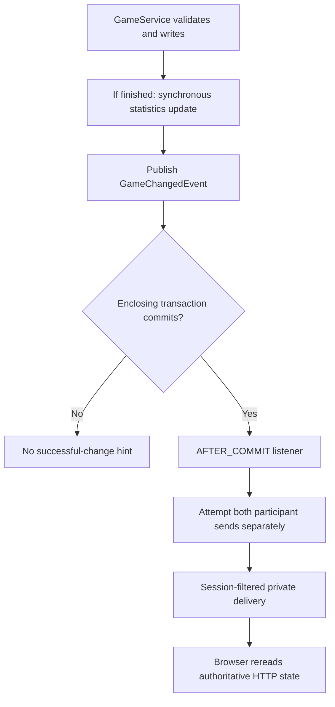

# Real-time updates flow — Day 27

Source-reviewed on 4 November 2026 against actual user chess-web-app-day27-end(1).zip. No assistant application execution. Authentication details and diagrams are in [session/WebSocket flow](session-authentication-flow.md); [tab flow](tab-synchronization-flow.md) documents browser coordination. Previous checkpoint descriptions are preserved in [history](history/main-documents-through-day26.md).

## Connection and authentication

App instantiates one RealtimeService and SessionSyncService after startup restoration. RealtimeService's effect observes local revision/isAuthenticated and uses untracked setup. Cleanup marks callbacks stopped and force-deactivates the old client. Its transport URL is relative to the page origin with ws/wss scheme; development proxy forwards /api upgrades.

Before each initial connect/reconnect, the client GETs csrf then players/me with a 10-second timeout. A protected 401 clears matching local state centrally. A different Player ID redirects to Login with sessionChanged. It extracts current XSRF-TOKEN and sets X-XSRF-TOKEN in CONNECT. Browser authentication comes from the HttpOnly session cookie; no JWT is decoded, stored or sent. Preflight failure or STOMP ERROR can stop retry for that lifecycle; transport errors otherwise reconnect. STOMP ERROR also causes a bounded profile read. No local authentication-expiry timer remains.

The HTTP upgrade requires session authentication and allowed Origin. Handshake metadata and CONNECT CSRF are checked before registering the exact HTTP-session/socket binding. The inherited Player name controls user routing. The exact private subscription is allowed, while direct broker/other-Player/wildcard paths and SEND are rejected. Multiple subscribed sockets belonging to one Player may receive the same hint.

## Committed changes

Pairing waits for the outer matchmaking transaction including queue deletions. Moves/history/completion/reservation release and synchronous ratings stay atomic. Notification send failures after commit do not roll back those writes; each participant send is attempted separately. PlayerUpdate remains type/gameId/version only. GAME_CREATED refreshes Home, GAME_UPDATED refreshes game/statistics consumers. No FEN, offer/result, clock tick or SAN is pushed.

Outbound application MESSAGEs recheck persisted session access before enqueue and before executor handling. Inbound operations and heartbeats also check it; DISCONNECT remains allowed for cleanup. Invalid sessions lose their local binding. This does not refresh inactivity, physically close every expired socket or recall transmitted data. JDBC session events are not used; database reads/deserialization add cost. Session persistence does not make the simple broker/map distributed.

## Recovery and replay

| Consumer | Immediate reads | Periodic recovery |
| --- | --- | --- |
| Home | Entry, private updates and connections | 30s for unknown/WAITING/MATCHED; idle NOT_QUEUED is not polled |
| Game | Entry, relevant newer hints, connections, focus/visible return and manual refresh | 30s while visible with a loaded active or board/history-refresh-required snapshot |
| Statistics card | Entry/manual/private updates/connections | No polling added |

One pending read coalesces triggers while commands/reads run. Game reads board then history, respecting captured versions. An older response cannot overwrite newer state; equal-version clock projections refresh without replacing board identity. Blocking synchronization may clear selection/promotion/confirmation; a nonblocking safety read preserves unchanged-version interaction. Commands are never automatically replayed. Initial game-load failure without a snapshot relies on manual/focus/connection/hint recovery rather than the periodic snapshot filter.

Replay keeps a historical board while status and clocks remain live. Latest explicitly returns to play. Home pairing still exposes Open game rather than forcing navigation. No sounds, square-click return, Next-to-live or new-live-move indicators are added.

## Timing and delivery limits

Backend app.websocket heartbeat defaults to configured 10s; literal origin/path/prefix/duration validation remains. Frontend REALTIME_CONFIG separately declares endpoint/subscription, 5s reconnect delay, 10s connection/heartbeat and 30s reconciliation. YAML does not publish browser config. Intervals are not strict latency guarantees under network failure/throttling.

The in-process broker has no durable replay/outbox, guaranteed browser acknowledgment, persistent subscription receipt or exactly-once semantics. CONNECTED plus sending SUBSCRIBE is not a registration acknowledgment. HTTP reads recover state, not missed negotiation history. A session-validity check does not provide atomic revocation-versus-network-send ordering.

## Tests and fixture lessons

WebSocketIntegrationTest uses real HTTP registration/login/CSRF cookies and a random-port STOMP endpoint. Upgrade rejection checks assert HTTP statuses; CONNECT rejection checks require ERROR frames and tolerate empty bodies. Four forbidden-subscription cases, SEND rejection and transaction timing remain. Two sockets sharing one cookie jar stop receiving after logout while an independent recipient still receives. Stored expiry similarly filters delivery before cleanup. These are bounded observations, not actual Angular tab/restart/deployment tests.

Readiness probes are generated per peer and sent through user routing. Same-Player sockets can receive each other's probes, so the fixture ignores the exact registry of all generated probes while releasing only a peer's own latch. SimpleMessageConverter preserves raw payloads; application messages alone are parsed as PlayerUpdate. Cleanup skips graceful disconnect for expected rejected peers but still stops clients. No complete transport-failure cleanup guarantee is claimed.

See [review](day27-sessions-review.md), [testing](backend-reliability-testing.md) and [clock flow](game-clocks-flow.md).
