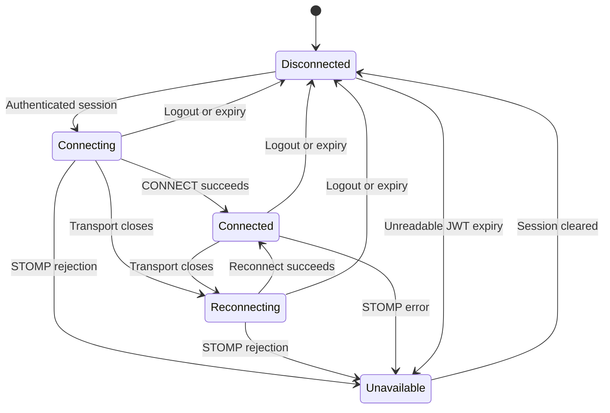
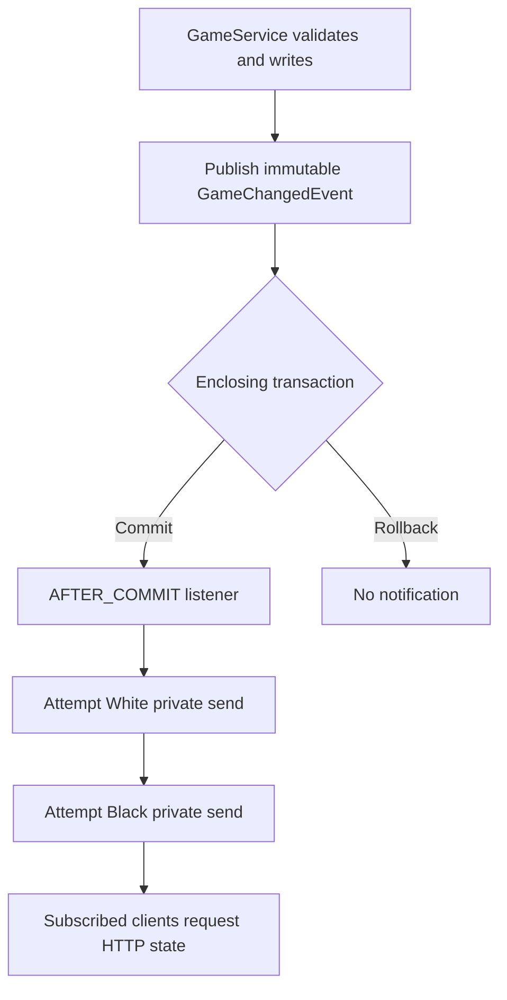

# Real-time updates flow

Day 20 source companion, reviewed on 30 October 2026 against `chess-web-app-day20-end.zip`. This explains implemented behavior, not a planned transport. No assistant application test/build/browser run is claimed.

## Connection and subscription

App injects one root RealtimeService. Its effect reads token and isAuthenticated. When login has loaded both token and Player, it creates a client. Effect cleanup marks that client stopped, clears the expiry timer and deactivates it. Navigation between Home/Game does not intentionally create a new connection.

New credentials cause cleanup and a new lifecycle. Invalid/unreadable expiry marks the socket unavailable but leaves HTTP session validity to HTTP. STOMP rejection stops retry for the current socket lifecycle; transport failure normally permits retries. callbacks check captured token/current session/stopped to ignore old clients. No bearer frames are deliberately logged by the client debug callback.

The endpoint uses the page’s origin and ws/wss scheme. During development, the Angular proxy forwards upgrades. The browser supplies its bearer header inside CONNECT, not an arbitrary HTTP upgrade header or token query parameter.

## Authentication and private routing

The HTTP upgrade is permitted. Origin restriction and first-message timeout apply. CONNECT then uses the existing JwtDecoder and strict token expiry. The interceptor sets a canonical Player-ID principal and registers session expiry.

| Routing stage | Example |
| --- | --- |
| Upgrade endpoint | /api/v1/ws |
| Client subscribes | /user/queue/updates |
| Sender selects Player | convertAndSendToUser("42", "/queue/updates", update) |
| Broker destination | Session-specific internal /queue/... destination |

The same subscription string does not mean all Players share updates. Spring resolves it using user/session identity. A user can have multiple subscribed sessions. The inbound interceptor still explicitly authenticates and restricts the destination: user routing alone is not authorization.

Only the exact derived private subscription is accepted. Direct broker paths, user-ID-addressed paths, wildcard subscriptions and client SEND are rejected. The /app prefix separates hypothetical application handlers from broker routing; no WebSocket command handler is implemented.

Native Authorization removal changes the existing message’s mutable accessor. The interceptor returns the same message object, so assertSame can pass while a separate header-removal assertion also passes. The principal retains the JWT; native-header removal is not token erasure.

## Committed changes and notifications

createGame publishes after both reservations are verified. submitMove publishes after its flush and any completion reservation release. These events carry IDs, version and type, not managed entities. Game depends on ApplicationEventPublisher, not messaging transport.

Pairing calls createGame inside MatchmakingService’s transaction. The listener therefore waits for the outer transaction, including both queue deletions. A failure after GameService returns can still roll back and suppress delivery. Flush alone does not permit notification.

PlayerUpdate contains only type, gameId and version. GAME_CREATED leads Home to reread status. GAME_UPDATED covers ordinary and terminal moves; Game reads the current participant-protected snapshot. Terminal result fields are not duplicated into the notification contract.

The listener attempts each participant separately and logs runtime enqueue failures. It performs no database writes or fresh entity loads. It does not turn a failed send into a failed committed HTTP command.

## Expiry and cleanup

WebSocketSessionAccess holds session ID to expiry in a ConcurrentHashMap. Inbound operations check the authenticated JWT expiry. Outbound application messages check registered/unexpired access before sending to the outbound channel and again immediately before executor handling, covering time spent queued.

Disconnect removes the registry entry idempotently. Unknown/missing session IDs cannot receive application messages. Protocol establishment, heartbeat and cleanup messages are not filtered as application MESSAGE payloads by the outbound interceptor.

These checks do not schedule server-side physical closure at the exact expiry instant and cannot recall a transmitted message. The browser separately schedules local expiry, clears the current session, deactivates and navigates to login. Browser timers can be delayed; backend expiry remains authoritative. The existing HTTP decoder’s timestamp tolerance is unchanged.

## Heartbeats and delivery guarantees

The configured backend heartbeat is 10 seconds, validated between 1 and 300 seconds. A lazily injected messageBrokerTaskScheduler avoids a configuration cycle. StompJS requests incoming/outgoing 10-second heartbeats and discards an unresponsive transport so reconnect can proceed. Intervals are negotiated and browser scheduling is not an exact clock.

The in-memory simple broker has no persistent replay, subscription receipts or guaranteed browser acknowledgement. CONNECTED means a successful connection followed by a sent subscription request. A commit during the small registration window can be missed. A process failure between commit and notification can also lose the hint. This checkpoint does not introduce an outbox or exactly-once semantics.

## Recovery reads

| Consumer | Immediate reads | Periodic recovery |
| --- | --- | --- |
| Home | Entry, private updates and successful connections | Every 30 seconds for unknown/WAITING/MATCHED, not idle NOT_QUEUED |
| Game | Entry, relevant newer hints, connection/reconnect, focus/visible return and manual refresh | Every 30 seconds while visible with loaded active or refresh-required state |

Home coalesces events received during a queue command/read into one pending read. It updates MATCHED feedback but intentionally leaves Open game as an explicit action.

Game coalesces required reads during GET/POST. Safety reads retain the board and same-version object. A Player may start a POST during a safety read; the GET is cancelled first and a read is queued afterward. Known-newer hints block proposals until reconciled. Delayed hints and older snapshots cannot roll back accepted state. There is never an automatic POST retry.

If an initial Game read fails without a snapshot, the timer does not retry it. Manual refresh, focus/connection events or a relevant hint can retry. The recovery intervals improve eventual state discovery; they do not guarantee a strict 30-second bound during network failure or browser throttling.

## Configuration lookup

Backend settings live in application.yaml under app.websocket and bind to WebSocketProperties. Prefixes and updates-path derive both sending and allowed-subscription destinations. Endpoint registration and HTTP security use the same endpoint property. Frontend REALTIME_CONFIG separately supplies matching addresses and client timing. Do not assume editing YAML changes a compiled browser address.

The origin property is a single allowed HTTP(S) origin. Routing prefixes cannot overlap; literal-path validation rejects wildcards and trailing slashes. These are configuration checks, not proof of deployment correctness. User-managed JWT/database configuration is outside this documentation package.

## Tests and scope

Inspected tests cover inbound authorization, outbound expiry/cleanup and real PostgreSQL transaction notification timing with a mocked messaging template. Actual end-to-end socket routing, heartbeat negotiation, subscription readiness and Angular coordination are not independently automated in this ZIP. See [review](day20-realtime-review.md).

No clocks, history, acceptance or disconnect outcome is added. This is a single-instance live notification path. Future durable/multi-instance requirements need their own design rather than assuming the simple broker scales transparently.

## References

- [Spring token authentication](https://docs.spring.io/spring-framework/reference/web/websocket/stomp/authentication-token-based.html)
- [Spring user destinations](https://docs.spring.io/spring-framework/reference/web/websocket/stomp/user-destination.html)
- [Transaction-bound events](https://docs.spring.io/spring-framework/reference/data-access/transaction/event.html)
- [Simple broker and heartbeat scheduler](https://docs.spring.io/spring-framework/reference/web/websocket/stomp/handle-simple-broker.html)
- [Simple broker limitations](https://docs.spring.io/spring-framework/reference/web/websocket/stomp/handle-broker-relay.html)
- [StompJS lifecycle](https://stomp-js.github.io/guide/stompjs/using-stompjs-v5.html)
