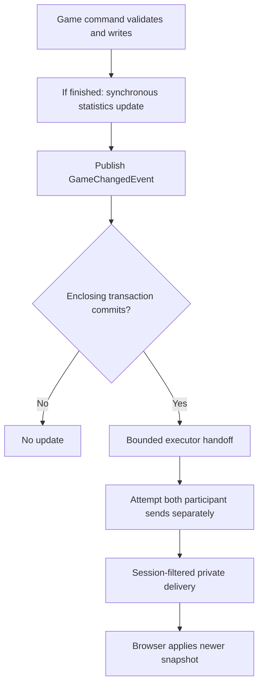

# Real-time updates

See the [API contracts](api-contracts.md#real-time-updates) for STOMP addresses and message shape.

## Connection and authentication

App instantiates one RealtimeService and SessionSyncService after startup restoration. RealtimeService's effect observes local revision/isAuthenticated and uses untracked setup. Cleanup marks callbacks stopped and force-deactivates the old client. Its transport URL is relative to the page origin with ws/wss scheme; development proxy forwards /api upgrades.

Before each initial connect/reconnect, the client GETs csrf then players/me with a 10-second timeout. A protected 401 clears matching local state centrally. A different Player ID redirects to Login with sessionChanged. It extracts current XSRF-TOKEN and sets X-XSRF-TOKEN in CONNECT. Browser authentication comes from the HttpOnly session cookie; no JWT is decoded, stored or sent. Preflight failure or STOMP ERROR can stop retry for that lifecycle; transport errors otherwise reconnect. STOMP ERROR also causes a bounded profile read. No local authentication-expiry timer remains.

The HTTP upgrade requires session authentication and allowed Origin. Handshake metadata and CONNECT CSRF are checked before registering the exact HTTP-session/socket binding. The inherited Player name controls user routing. The exact private subscription is allowed, while direct broker/other-Player/wildcard paths and SEND are rejected. Multiple subscribed sockets belonging to one Player may receive the same hint.

## Committed changes

Pairing waits for the outer matchmaking transaction including queue deletions. Moves/history/completion/reservation release and synchronous ratings stay atomic. Notification send failures after commit do not roll back those writes; each participant send is attempted separately. PlayerUpdate contains type, gameId, version and snapshot. GAME_CREATED refreshes Home and carries a null snapshot. GAME_UPDATED carries committed game state for the board and clock. History and SAN load separately, and the server does not push clock ticks.

The outbound interceptor timestamps application messages before enqueue and checks persisted session access on the outbound worker. Inbound operations and heartbeats also check it; DISCONNECT remains allowed for cleanup. Invalid sessions lose their local binding. This does not refresh inactivity, physically close every expired socket or recall transmitted data. JDBC session events are not used; database reads/deserialization add cost. Session persistence does not make the simple broker/map distributed.

## Recovery and replay

| Consumer | Immediate reads | Periodic recovery |
| --- | --- | --- |
| Home | Entry, private updates and connections | 30s for unknown/WAITING/MATCHED; idle NOT_QUEUED is not polled |
| Game | Entry, missing or unusable snapshots, connections, focus/visible return and manual refresh | 30s while visible with a loaded active or board/history-refresh-required snapshot |
| Statistics card | Entry/manual/private updates/connections | No polling added |

One pending read coalesces triggers while commands/reads run. Full HTTP recovery reads the board and history. A usable WebSocket snapshot updates the board and clock directly and schedules a separate history read. An older response cannot overwrite newer state; equal-version clock projections refresh without replacing board identity. Blocking synchronization may clear selection/promotion/confirmation; a nonblocking safety read preserves unchanged-version interaction. Commands are never automatically replayed. Initial game-load failure without a snapshot relies on manual/focus/connection/hint recovery rather than the periodic snapshot filter.

Replay keeps a historical board while status and clocks remain live. Latest explicitly returns to play. Home follows a matched search into the game.

## Timing and delivery limits

Backend app.websocket heartbeat defaults to configured 10s; literal origin/path/prefix/duration validation remains. Frontend REALTIME_CONFIG separately declares endpoint/subscription, 5s reconnect delay, 10s connection/heartbeat and 30s reconciliation. YAML does not publish browser config. Intervals are not strict latency guarantees under network failure/throttling.

The in-process broker has no durable replay/outbox, guaranteed browser acknowledgment, persistent subscription receipt or exactly-once semantics. CONNECTED plus sending SUBSCRIBE is not a registration acknowledgment. HTTP reads recover state, not missed negotiation history. A session-validity check does not provide atomic revocation-versus-network-send ordering.

See [load testing](load-testing.md) and [board synchronization](performance-investigations/001-websocket-notification-pool-starvation/03-board-synchronization.md) for measured delivery and recovery evidence.
