# Replay and PGN flow

Day 24 companion, source-reviewed on 31 October 2026 against actual user chess-web-app-day24-end.zip. No assistant application execution is claimed. The Angular download UI is deferred; backend PGN export and saved-position replay are implemented.

## Distinct state meanings

| Value | Meaning |
| --- | --- |
| game() | Authoritative accepted live snapshot, including lifecycle and version |
| history() | Accepted recorded history; may temporarily lag the game |
| replayIndex=null | Follow the live game FEN |
| replayIndex=0 | Display the history baseline |
| replayIndex=n | Display resultingFen after recorded entry n |
| displayedFen | Projection supplied to board and FEN details |
| Game.version | Command concurrency token, independent of recorded move index |
| Baseline fullmove/side | Starting chess move number/color for PGN |

## Replay interaction

```mermaid
stateDiagram-v2
    [*] --> Live
    Live --> Replay: Start, Previous or entry
    Replay --> Replay: Previous, Next or entry
    Replay --> Live: Latest
    Live --> Live: Accept live update
    Replay --> Replay: Accept live update; keep cursor
```

Every numeric cursor is read-only, including the last recorded entry. Navigation clears pending promotion/confirmation and move feedback; POST blocks navigation. Shared command permission rejects replay mode, so both moves and lifecycle actions are disabled. Existing board input effects clear source selection.

replayHistory requires the same game, version no greater than live, count equal to list length and sequences 1..n. It can reuse an older accepted list while reads catch up. Baseline/resulting FEN drives display, so null SAN or historyComplete=false does not prevent replay of available positions. Start means earliest saved position for a legacy game. An invalid selected projection shows unavailable feedback and keeps the explicit Latest escape.

Live status, result, pending offers and version remain sourced from game(). Notification comparison and refresh scheduling use live version, not replay position. Live updates append history without moving the cursor. Route initialization and history-clearing 403/404 branches reset it. Next does not automatically exit replay; the proposed alternative is documented only.

Previous in live mode selects available list length minus one. If the list is behind the live board this is a step within the available history, not a guaranteed one-ply step back from the live position. The catching-up message explains that replay uses available history.

## Backend export read

GameController derives Player ID from JWT and invokes GameExportService.exportPgn. The service transaction loads the game, checks membership, captures GameResponse/count, queries GameMoveRepository.findHistoryThrough and maps immutable DTOs. Current usernames come from PlayerService. It formats the captured game, not whichever replay position the browser is showing.

Captured count excludes later commits under the existing atomic append-only model. Result/version come from the same loaded game. This is not a general repeatable-read claim or proof from a forced concurrent-export test. Username reads are current rather than historically pinned.

PgnFormatter rejects mismatched game/history identity or version as internal argument errors. Unsupported history raises PgnExportUnavailableException for incomplete metadata, row-count mismatch, sequence gaps and absent/blank SAN. The handler maps that application exception to 409 PGN_EXPORT_UNAVAILABLE after participant authorization. It does not backfill SAN or pretend a partial legacy record is a full game.

The formatter reuses stored SAN and parses only the baseline for side/fullmove numbering. Supplemental FEN/SetUp tags represent a complete game with a custom initial position. A Black baseline can start 20...; fullmove increments after Black. Result header and trailing marker agree. Resignation and draw agreement produce no move entry; zero-move completion still has a result marker. Date is creation date in UTC; names are current usernames. Tag values escape quotes/backslashes and replace control characters. Movetext wraps between tokens below 80 columns, ending with an empty line.

The controller responds with UTF-8 PGN bytes, application/x-chess-pgn, attachment filename game-{id}.pgn and no-store. No new migration, configuration or dependency is required. No Angular PGN API method, download button or Blob handling was added.

## How to read the tests

PgnFormatterTest is a no-database formatting fixture. Its supplied SAN/FEN combinations are not a legal-game replay; the formatter is not a chess validator. Read the custom Black baseline test for numbering independent of version, then the result cases and sequence/null-SAN rejection tests.

Deep-read GameReadIntegrationTest.pgnUsesPersistedMovesAndLifecycleResult: e4 creates one history row, Black resigns without a new move, clearing the persistence context forces reload, and PGN ends with 1. e4 1-0. Then read pgnChecksMembershipBeforeLegacyAvailability: outsider receives 403 while the participant receives the legacy 409. Existing @Transactional rollback fixtures are appropriate because these HTTP formatting checks do not need after-commit delivery.

## Verification record and suggested checks

The user reports increments working and tests follow the standing green-unless-reported agreement. The user did not manually verify navigation to another game. No assistant tests/builds/migrations/browser checks were run. No new frontend replay/coordinator suite or forced concurrent-export schedule is present.

| Suggested scenario | Expected behavior |
| --- | --- |
| Start/Previous/Next/entry | Saved position and displayed FEN agree |
| Numeric replay cursor | All mutation commands disabled |
| Opponent move/completion during replay | Live status/history refresh; cursor remains fixed |
| Latest | Live board returns; normal guards still govern commands |
| Pending promotion/confirmation then replay | Local proposal is cancelled |
| Legacy or null-SAN history | Available positions replay; PGN rejects unsupported history |
| Route switch | Replay resets; user manual check remains outstanding |
| Empty complete history | Baseline replays; PGN contains headers and marker |

The promotion chooser may appear before legality validation, intentionally deferred for later user implementation. See [tracking note](frontend-gameplay-flow.md#deferred-improvement-promotion-chooser-before-legality-validation).
